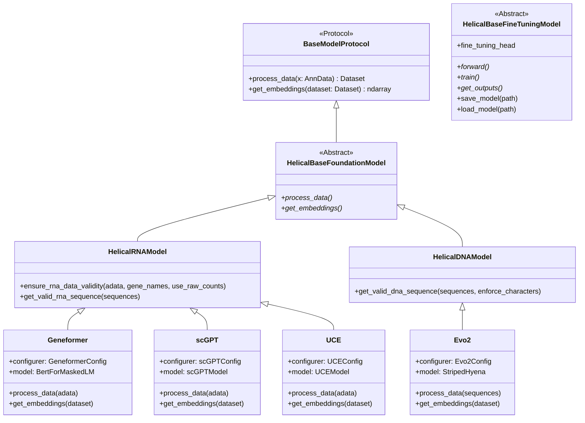
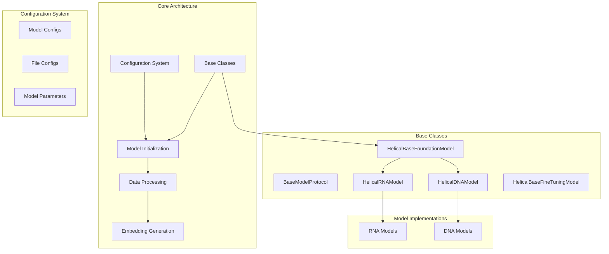
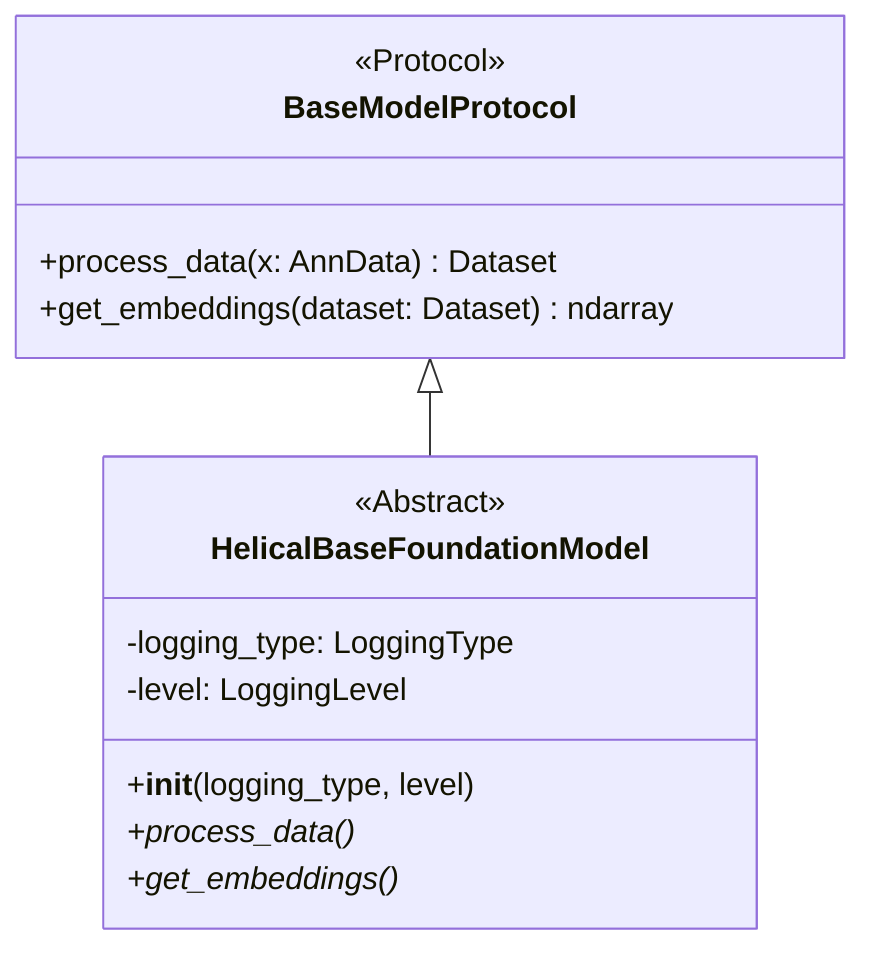
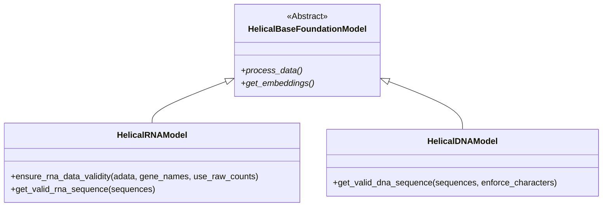
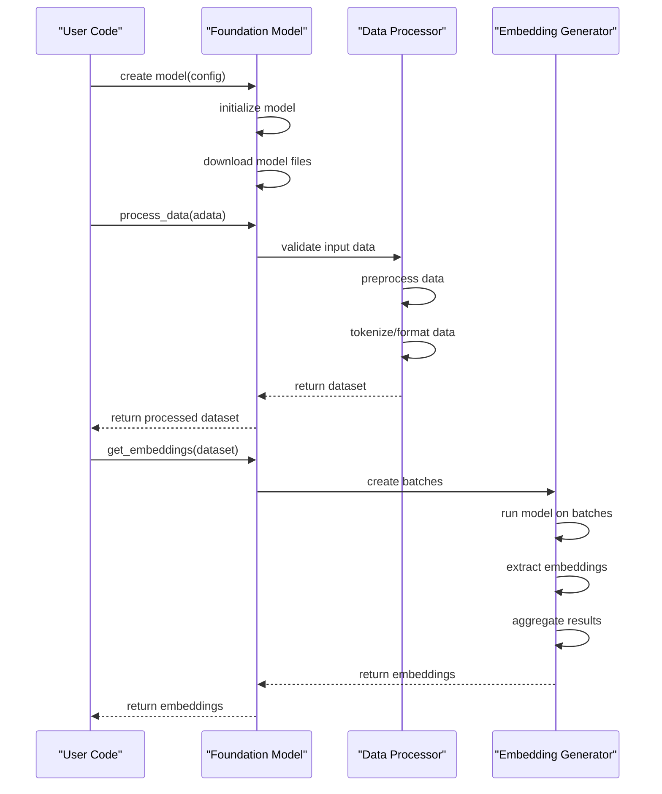
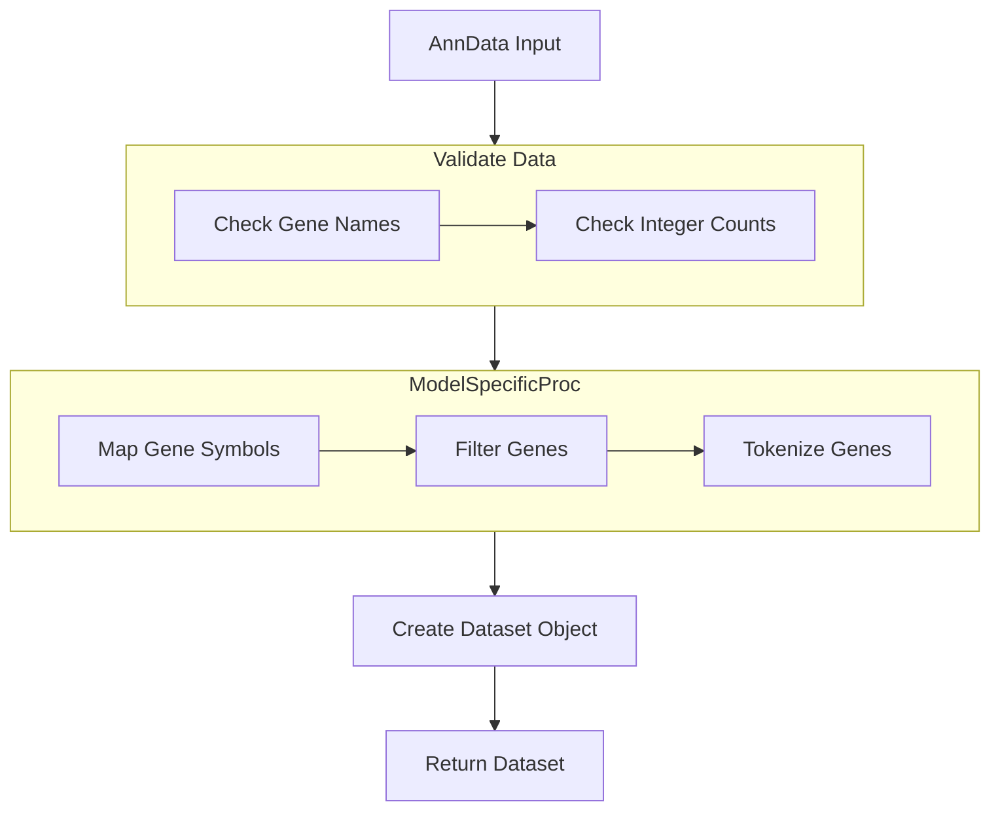
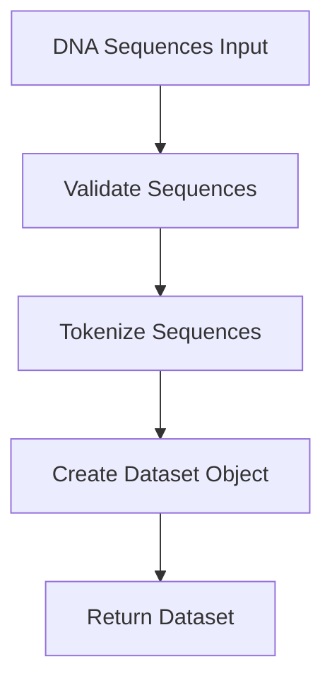
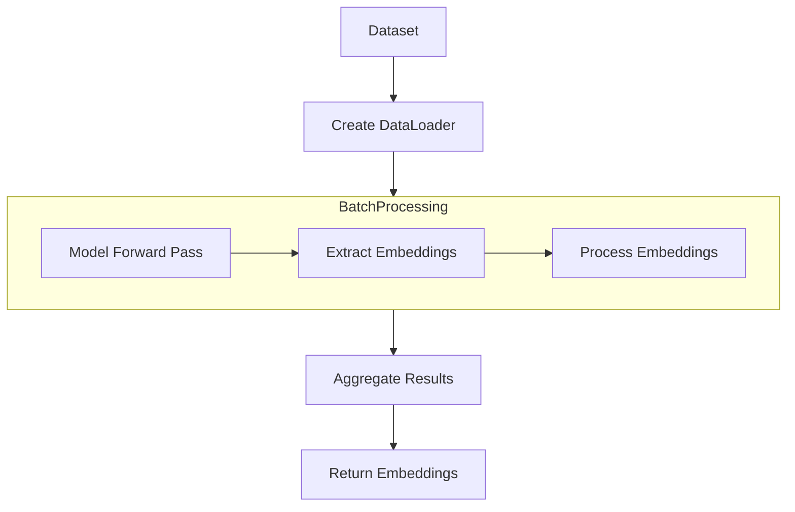
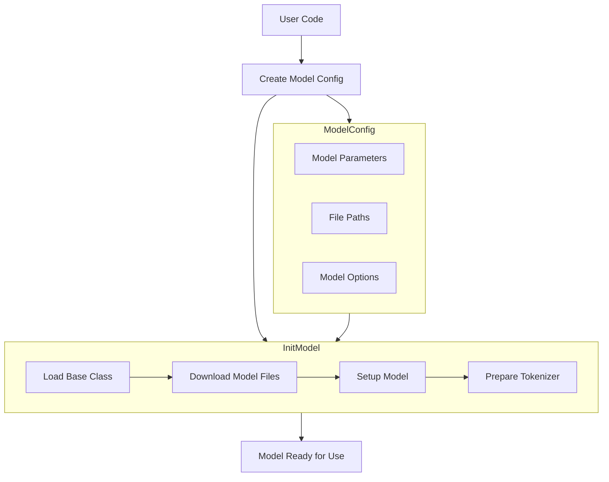
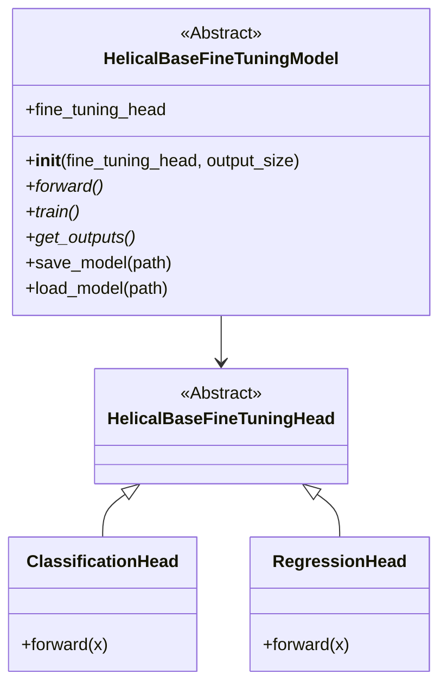

# Core Architecture

<details>
<summary>Relevant source files</summary>

The following files were used as context for generating this wiki page:

- [ci/tests/test_evo2/test_evo2_model.py](ci/tests/test_evo2/test_evo2_model.py)
- [examples/run_models/configs/evo_2_config.yaml](examples/run_models/configs/evo_2_config.yaml)
- [examples/run_models/run_evo2.py](examples/run_models/run_evo2.py)
- [helical/__init__.py](helical/__init__.py)
- [helical/models/base_models.py](helical/models/base_models.py)
- [helical/models/evo_2/LICENSE](helical/models/evo_2/LICENSE)
- [helical/models/evo_2/README.md](helical/models/evo_2/README.md)
- [helical/models/evo_2/evo_2_config.py](helical/models/evo_2/evo_2_config.py)
- [helical/models/evo_2/model.py](helical/models/evo_2/model.py)
- [helical/models/geneformer/model.py](helical/models/geneformer/model.py)
- [helical/models/scgpt/model.py](helical/models/scgpt/model.py)
- [helical/models/uce/model.py](helical/models/uce/model.py)

</details>


This document describes the core architecture of the Helical framework, focusing on the foundational classes and inheritance hierarchy that enables uniform interaction with various bio foundation models. It explains the common interfaces, data processing patterns, and model initialization flow that make up the backbone of the framework. For detailed information about the specific model implementations, see [RNA Models](#4) and [DNA Models](#5). For details on fine-tuning capabilities, see [Fine-tuning System](#6).

## Base Model Hierarchy

The Helical framework is built around a clear inheritance hierarchy that standardizes the interface for all biological foundation models. This design allows users to interact with different model types through a consistent API, making it easier to swap between models or compare their performance.



Sources: [helical/models/base_models.py:22-282](helical/models/base_models.py:22-282), [helical/models/geneformer/model.py:18-72](helical/models/geneformer/model.py:18-72), [helical/models/scgpt/model.py:23-59](helical/models/scgpt/model.py:23-59), [helical/models/uce/model.py:26-60](helical/models/uce/model.py:26-60), [helical/models/evo_2/model.py:36-74](helical/models/evo_2/model.py:36-74)

## Core Components

The Helical framework consists of several key components that work together to provide a unified interface for biological foundation models:



Sources: [helical/models/base_models.py:28-144](helical/models/base_models.py:28-144)

### Base Model Protocol and Foundation Model

At the foundation of the architecture is the `BaseModelProtocol` and `HelicalBaseFoundationModel`, which define the core interface all models must implement:



The `BaseModelProtocol` defines the expected interface using Python's runtime Protocol feature, ensuring that even models not directly inheriting from `HelicalBaseFoundationModel` can be compatible with the framework if they implement the required methods.

Sources: [helical/models/base_models.py:22-55](helical/models/base_models.py:22-55)

### RNA and DNA Model Specializations

The framework provides specialized base classes for RNA and DNA models, with built-in validation methods:



- `HelicalRNAModel`: Provides RNA-specific data validation methods and sequence validation
- `HelicalDNAModel`: Provides DNA-specific sequence validation methods

Sources: [helical/models/base_models.py:58-187](helical/models/base_models.py:58-187)

## Standard Model Interface

All foundation models in Helical implement two core methods:

1. `process_data`: Converts biological data into a format suitable for the model
2. `get_embeddings`: Extracts embeddings from processed data

Here's how this standardized interface works across the framework:



Sources: [helical/models/geneformer/model.py:135-235](helical/models/geneformer/model.py:135-235), [helical/models/scgpt/model.py:89-168](helical/models/scgpt/model.py:89-168), [helical/models/uce/model.py:94-272](helical/models/uce/model.py:94-272), [helical/models/evo_2/model.py:97-174](helical/models/evo_2/model.py:97-174)

## Data Processing Flow

The data processing flow varies by model type but follows a consistent pattern:

### RNA Model Data Processing



Sources: [helical/models/base_models.py:59-101](helical/models/base_models.py:59-101), [helical/models/geneformer/model.py:135-204](helical/models/geneformer/model.py:135-204)

### DNA Model Data Processing



Sources: [helical/models/base_models.py:146-187](helical/models/base_models.py:146-187), [helical/models/evo_2/model.py:97-123](helical/models/evo_2/model.py:97-123)

## Embedding Generation Flow

The embedding generation flow also follows a consistent pattern across models:



Sources: [helical/models/geneformer/model.py:206-235](helical/models/geneformer/model.py:206-235), [helical/models/scgpt/model.py:89-184](helical/models/scgpt/model.py:89-184), [helical/models/uce/model.py:210-272](helical/models/uce/model.py:210-272), [helical/models/evo_2/model.py:125-174](helical/models/evo_2/model.py:125-174)

## Model Initialization and Configuration

The model initialization process in Helical relies on model-specific configuration classes that encapsulate all the parameters needed to initialize a model:



Each model follows this pattern, with model-specific configurations:

| Model | Configuration Class | Base Class | Primary Model Type |
|-------|---------------------|------------|-------------------|
| Geneformer | `GeneformerConfig` | `HelicalRNAModel` | Gene expression |
| scGPT | `scGPTConfig` | `HelicalRNAModel` | Single-cell RNA-seq |
| UCE | `UCEConfig` | `HelicalRNAModel` | Universal Cell Embedding |
| Evo2 | `Evo2Config` | `HelicalDNAModel` | DNA sequence |

Sources: [helical/models/geneformer/model.py:75-133](helical/models/geneformer/model.py:75-133), [helical/models/scgpt/model.py:63-87](helical/models/scgpt/model.py:63-87), [helical/models/uce/model.py:64-92](helical/models/uce/model.py:64-92), [helical/models/evo_2/model.py:78-95](helical/models/evo_2/model.py:78-95), [helical/models/evo_2/evo_2_config.py:15-330](helical/models/evo_2/evo_2_config.py:15-330)

## Fine-Tuning Architecture

The Helical framework also provides a base class for fine-tuning models:



The fine-tuning architecture allows foundation models to be easily adapted for downstream tasks. For detailed information on fine-tuning, see [Fine-tuning System](#6).

Sources: [helical/models/base_models.py:220-307](helical/models/base_models.py:220-307)

## Technical Implementation Details

The base models include several key implementation details:

### Validation Methods

RNA and DNA models include specific validation methods to ensure data integrity:

- RNA models validate:
  - Gene names existence in AnnData
  - Integer counts in expression data
  - Valid RNA sequences (only A, C, U, G, N, E characters)

- DNA models validate:
  - Valid DNA sequences (only A, C, T, G, N characters)

These methods ensure that data is properly formatted before processing, preventing errors during model execution.

Sources: [helical/models/base_models.py:59-144](helical/models/base_models.py:59-144)

### Logging System

The base foundation model inherits from a `Logger` class, providing consistent logging across all models:

```python
def __init__(self, logging_type=LoggingType.CONSOLE, level=LoggingLevel.INFO):
    super().__init__(logging_type, level)
```

The framework uses Python's standard logging module with customized formatters and handlers:

```python
logger = logging.getLogger()
logger.setLevel(logging.INFO)

handler = logging.StreamHandler()
handler.setLevel(logging.INFO)

formatter = logging.Formatter("%(levelname)s:%(name)s:%(message)s")
handler.setFormatter(formatter)

logger.addHandler(handler)
```

Sources: [helical/models/base_models.py:28-48](helical/models/base_models.py:28-48), [helical/__init__.py:1-20](helical/__init__.py:1-20)

## Design Principles

The Helical framework's core architecture is guided by several key design principles:

1. **Consistent Interface**: All models implement the same core interface with `process_data()` and `get_embeddings()` methods.

2. **Type Specialization**: Models are divided between RNA and DNA models, with appropriate validation methods.

3. **Configuration-Driven**: Models are initialized with configuration objects that encapsulate all necessary parameters.

4. **Validation First**: Data validation occurs before processing to prevent errors during model execution.

5. **Separation of Concerns**: Data processing and embedding generation are separate steps, allowing for flexibility.

6. **Extensibility**: The architecture makes it easy to add new model types while maintaining a consistent interface.

7. **Type Safety**: The use of Protocols ensures type safety even with duck typing.

These principles enable a framework that is both flexible and consistent, making it easier for users to work with a variety of bio foundation models through a unified API.

---