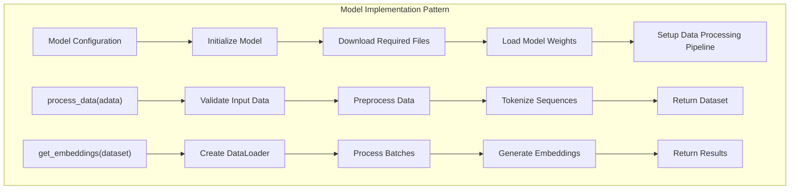
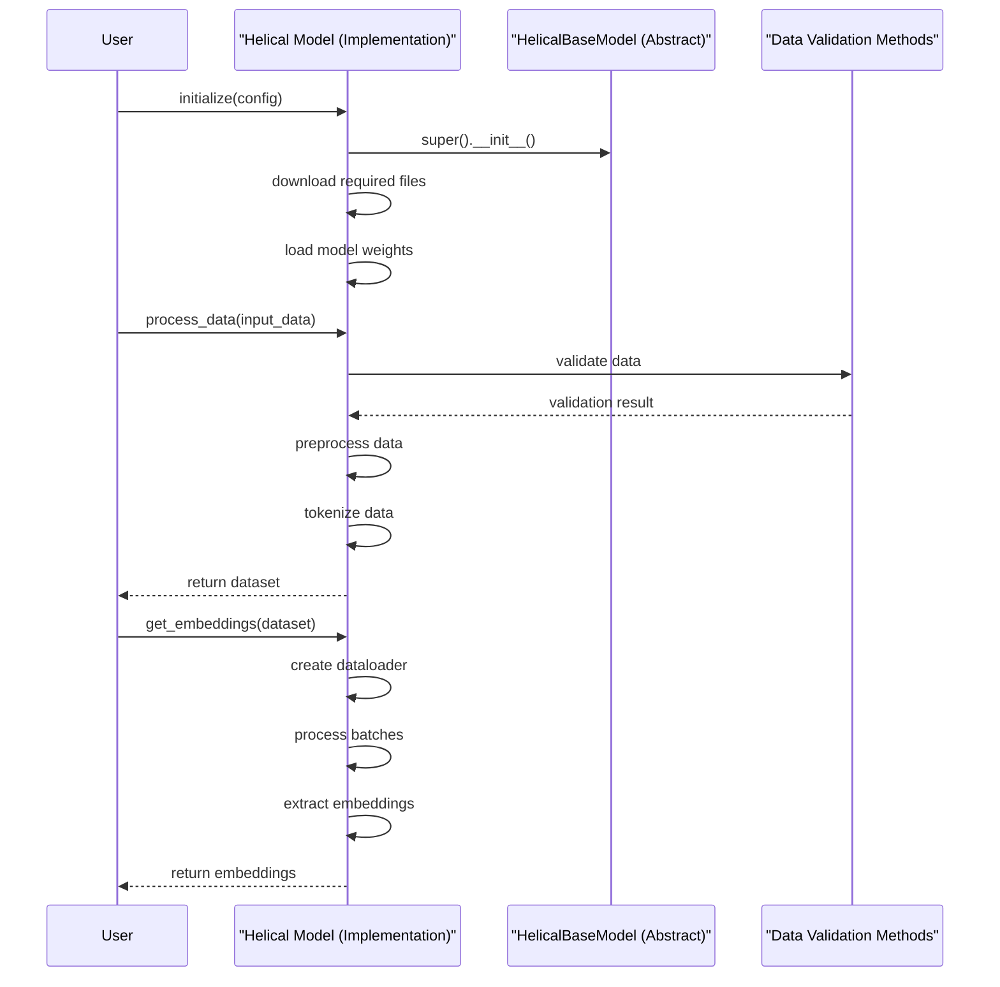

# Base Models

<details>
<summary>Relevant source files</summary>

The following files were used as context for generating this wiki page:

- [helical/models/base_models.py](helical/models/base_models.py)
- [helical/models/caduceus/model.py](helical/models/caduceus/model.py)
- [helical/models/geneformer/model.py](helical/models/geneformer/model.py)
- [helical/models/helix_mrna/model.py](helical/models/helix_mrna/model.py)
- [helical/models/hyena_dna/hyena_dna_config.py](helical/models/hyena_dna/hyena_dna_config.py)
- [helical/models/hyena_dna/model.py](helical/models/hyena_dna/model.py)
- [helical/models/hyena_dna/pretrained_model.py](helical/models/hyena_dna/pretrained_model.py)
- [helical/models/mamba2_mrna/model.py](helical/models/mamba2_mrna/model.py)
- [helical/models/scgpt/model.py](helical/models/scgpt/model.py)
- [helical/models/uce/model.py](helical/models/uce/model.py)

</details>


## Purpose and Scope

This page documents the base model architecture of the Helical framework, which provides a unified foundation for working with various biological sequence models. The base model classes define common interfaces and functionality that all specific model implementations adhere to, ensuring consistency across the framework.

For details about specific RNA models like Geneformer or scGPT, see [RNA Models](#4). For DNA models like HyenaDNA and Caduceus, see [DNA Models](#5). For information about the fine-tuning system, see [Fine-tuning System](#6).

## Base Model Hierarchy

The Helical framework implements a clear inheritance hierarchy for models, ensuring consistent interfaces and behaviors across different model types.

```mermaid
classDiagram
    class "BaseModelProtocol" {
        <<Protocol>>
        +process_data(x: AnnData) -> Dataset
        +get_embeddings(dataset: Dataset) -> ndarray
    }
    
    class "HelicalBaseFoundationModel" {
        <<Abstract>>
        +process_data()
        +get_embeddings()
    }
    
    class "HelicalRNAModel" {
        +ensure_rna_data_validity(adata, gene_names, use_raw_counts)
        +get_valid_rna_sequence(sequences)
    }
    
    class "HelicalDNAModel" {
        +get_valid_dna_sequence(sequences, enforce_characters)
    }
    
    class "BaseTaskModel" {
        <<Abstract>>
        +compile()
        +train()
        +predict()
        +save()
        +load()
    }
    
    class "HelicalBaseFineTuningModel" {
        <<Abstract>>
        +forward()
        +train()
        +get_outputs()
        +save_model(path)
        +load_model(path)
    }
    
    "BaseModelProtocol" <|.. "HelicalBaseFoundationModel" : implements
    "HelicalBaseFoundationModel" <|-- "HelicalRNAModel" : extends
    "HelicalBaseFoundationModel" <|-- "HelicalDNAModel" : extends
    "HelicalBaseFineTuningModel" <|-- "GeneformerFineTuningModel" : extends
    "HelicalBaseFineTuningModel" <|-- "scGPTFineTuningModel" : extends
    "HelicalBaseFineTuningModel" <|-- "UCEFineTuningModel" : extends
```

Sources: [helical/models/base_models.py:22-282]()

## Foundation Model Base Classes

### HelicalBaseFoundationModel

The `HelicalBaseFoundationModel` is the primary abstract base class for all foundation models in the Helical framework. It defines the common interface that all models must implement and provides logging functionality.

Key features:
- Abstract methods for data processing and embedding generation
- Built-in logging capabilities
- Functions as a protocol that enforces consistent API across implementations

```python
class HelicalBaseFoundationModel(ABC, Logger):
    def __init__(self, logging_type=LoggingType.CONSOLE, level=LoggingLevel.INFO):
        super().__init__(logging_type, level)

    @abstractmethod
    def process_data():
        pass

    @abstractmethod
    def get_embeddings():
        pass
```

Sources: [helical/models/base_models.py:28-55]()

### HelicalRNAModel

The `HelicalRNAModel` extends the base foundation model class with RNA-specific functionality. It provides methods for validating RNA data and sequences.

Key features:
- Validation for AnnData objects containing RNA data
- Validation for RNA sequences (A, C, U, G, N, E)
- Common utilities used by all RNA model implementations

```python
def ensure_rna_data_validity(self, adata: AnnData, gene_names: str, use_raw_counts: bool = True) -> None:
    # Verify gene names and data validity
    if gene_names == "index":
        if not all(isinstance(item, str) for item in adata.var.index):
            message = "The data in the index must only contain strings."
            LOGGER.error(message)
            raise ValueError(message)
        adata.var["index"] = adata.var.index
    
    # Verify gene column exists
    if not gene_names in adata.var:
        message = f"Data must have the provided key '{gene_names}' in its 'var' section to be processed by the Helical RNA model."
        LOGGER.error(message)
        raise KeyError(message)
    
    # Verify that X contains integers if using raw counts
    adata.obs["total_counts"] = adata.X.sum(axis=1)
    if use_raw_counts and not (adata.obs["total_counts"] % 1 == 0).all():
        message = "The data in X must be integers."
        LOGGER.error(message)
        raise ValueError(message)
```

Sources: [helical/models/base_models.py:58-143]()

### HelicalDNAModel

The `HelicalDNAModel` extends the base foundation model class with DNA-specific functionality. It provides methods for validating DNA sequences.

Key features:
- Validation for DNA sequences (A, C, T, G, N)
- Common utilities used by all DNA model implementations

```python
def get_valid_dna_sequence(self, sequences: Union[list[str], DataFrame], enforce_characters: bool = True) -> list[str]:
    # Extract sequences from DataFrame if needed
    if isinstance(sequences, DataFrame):
        if "Sequence" not in sequences.columns:
            message = "The DataFrame must have a column named 'Sequence'."
            LOGGER.error(message)
            raise KeyError(message)
        sequences = sequences["Sequence"].tolist()
    
    # Validate sequence characters
    if enforce_characters:
        valid_chars = set("ACTGN")
        for sequence in sequences:
            if not set(sequence.upper()).issubset(valid_chars):
                invalid_chars = set(sequence.upper()) - valid_chars
                message = f"Invalid DNA sequence: found invalid characters {invalid_chars}"
                LOGGER.error(message)
                raise ValueError(message)
    
    return sequences
```

Sources: [helical/models/base_models.py:146-187]()

## Model Implementation Pattern

All specific model implementations in Helical follow a common pattern, ensuring consistent behavior and interface across the framework.



Sources: 
- [helical/models/geneformer/model.py:18-235]()
- [helical/models/scgpt/model.py:23-371]()
- [helical/models/hyena_dna/model.py:18-162]()
- [helical/models/uce/model.py:26-272]()

## Common Interface

All models in the Helical framework implement a consistent interface defined by the base classes, with two primary methods:

### process_data

This method processes raw biological data (AnnData for gene expression or sequences for DNA/RNA) and converts it into a format suitable for the model.

**Common parameters:**
- `adata` or `sequences`: The input data (AnnData for RNA expression models, sequences for DNA/RNA sequence models)
- `gene_names`: For RNA expression models, specifies which column contains gene identifiers
- Additional model-specific parameters

**Returns:**
- A `Dataset` object that can be passed to `get_embeddings`

### get_embeddings

This method processes the dataset created by `process_data` and generates embeddings (vector representations) for the input data.

**Common parameters:**
- `dataset`: The Dataset object created by `process_data`

**Returns:**
- Numpy array of embeddings



Sources:
- [helical/models/base_models.py:22-55]()
- [helical/models/geneformer/model.py:134-235]()
- [helical/models/hyena_dna/model.py:81-162]()

## Data Validation

### RNA Data Validation

The RNA models in Helical validate input data to ensure it meets the requirements for processing:

1. Gene names must be strings
2. The specified gene_names column must exist in adata.var
3. For raw counts, data in adata.X must contain integers

Additionally, RNA sequence validation ensures that sequences only contain valid RNA nucleotides: A, C, U, G, N, and E.

Sources: [helical/models/base_models.py:59-143]()

### DNA Data Validation

DNA models validate input sequences to ensure they contain only valid DNA nucleotides: A, C, T, G, and N.

Sources: [helical/models/base_models.py:147-187]()

## Fine-Tuning Base Models

The `HelicalBaseFineTuningModel` provides a foundation for fine-tuning models on specific tasks, such as classification or regression.

Key features:
- Supports classification and regression heads
- Abstract methods for forward pass, training, and output generation
- Methods for saving and loading fine-tuned models

```python
class HelicalBaseFineTuningModel(torch.nn.Module):
    def __init__(self, fine_tuning_head: (Literal["classification", "regression"] | HelicalBaseFineTuningHead), output_size: int):
        super().__init__()
        # Initialize fine-tuning head based on type
        if isinstance(fine_tuning_head, str):
            if fine_tuning_head == "classification":
                fine_tuning_head = ClassificationHead(output_size)
            elif fine_tuning_head == "regression":
                fine_tuning_head = RegressionHead(output_size)
            else:
                raise NotImplementedError("Not implemented fine-tuning head.")
        elif not isinstance(fine_tuning_head, HelicalBaseFineTuningHead):
            raise ValueError("The fine_tuning_head must be a valid 'HelicalBaseFineTuningHead'.")
        
        self.fine_tuning_head = fine_tuning_head
```

For more details on fine-tuning, see [Fine-tuning System](#6).

Sources: [helical/models/base_models.py:220-307]()

## Foundation Model Configuration Pattern

Each model in Helical follows a similar configuration pattern, using a dedicated configuration class to manage model parameters and downloadable resources.

```mermaid
classDiagram
    class "ModelConfig" {
        +config: dict
        +files_config: dict
        +list_of_files_to_download: list
        +model_map: dict
    }
    
    class "Model" {
        +configurer: ModelConfig
        +config: dict
        +files_config: dict
        +process_data()
        +get_embeddings()
    }
    
    "ModelConfig" -- "Model" : configures
```

Example of a model configuration class:

```python
class HyenaDNAConfig:
    def __init__(self, model_name="hyenadna-tiny-1k-seqlen", batch_size=5, ...):
        # Define model-specific parameters
        self.model_map = {
            "hyenadna-tiny-1k-seqlen": {
                "d_model": 128,
                "d_inner": 512,
                "max_length": 1024,
            },
            # Other model variants...
        }
        
        # Create configuration dictionary
        self.config = {
            "model_name": model_name,
            "model_path": Path(CACHE_DIR_HELICAL, f"hyena_dna/{model_name}.ckpt"),
            "list_of_files_to_download": [f"hyena_dna/{model_name}.ckpt"],
            "batch_size": batch_size,
            # Other parameters...
        }
```

Sources: [helical/models/hyena_dna/hyena_dna_config.py:6-131]()

## Model Initialization Pattern

Models in the Helical framework follow a common initialization pattern:

1. Initialize the base class
2. Load the configuration
3. Download required model files
4. Initialize the model architecture
5. Load model weights
6. Set up tokenizers or preprocessing tools

```python
def __init__(self, configurer: Config = default_configurer) -> None:
    super().__init__()
    self.config = configurer.config
    
    # Download required files
    downloader = Downloader()
    for file in self.config["list_of_files_to_download"]:
        downloader.download_via_name(file)
    
    # Initialize model
    self.model = ModelClass.from_pretrained(self.config["model_path"])
    
    # Initialize tokenizer or processor
    self.tokenizer = TokenizerClass()
    
    # Set device and model mode
    self.model.to(self.config["device"])
    self.model.eval()
    
    LOGGER.info(f"Model finished initializing.")
```

Sources:
- [helical/models/geneformer/model.py:75-133]()
- [helical/models/scgpt/model.py:63-87]()
- [helical/models/hyena_dna/model.py:51-79]()
- [helical/models/uce/model.py:64-92]()

## Summary

The base model architecture of the Helical framework provides a solid foundation for working with various biological sequence models. By defining consistent interfaces and common patterns, the framework ensures that models can be easily interchanged and extended while maintaining compatibility with the rest of the system.

Key features of the base model architecture include:
- Clear inheritance hierarchy for different model types (RNA, DNA)
- Consistent interfaces for data processing and embedding generation
- Common validation methods for biological data
- Support for fine-tuning on specific tasks
- Standardized configuration and initialization patterns

For details on specific model implementations, see the dedicated pages for [RNA Models](#4) and [DNA Models](#5).

---