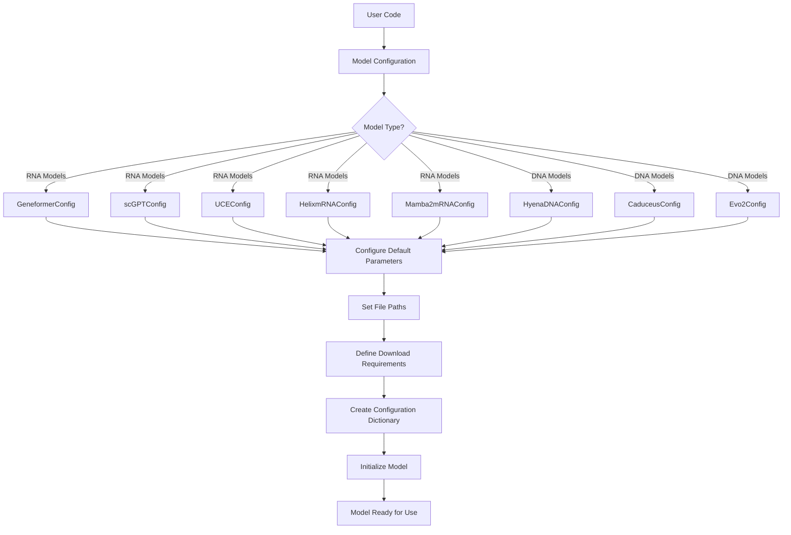
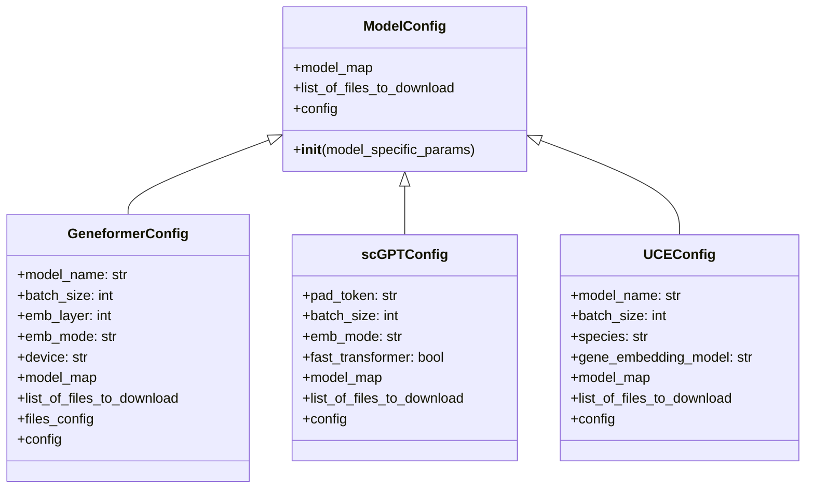
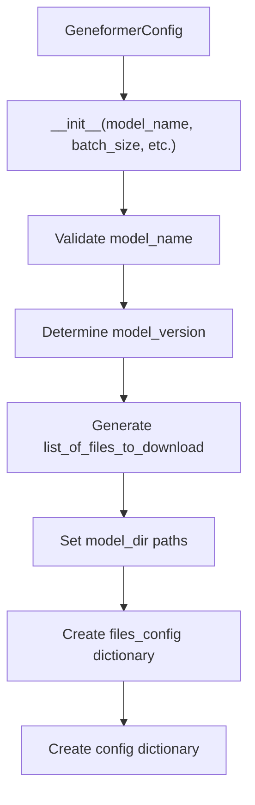
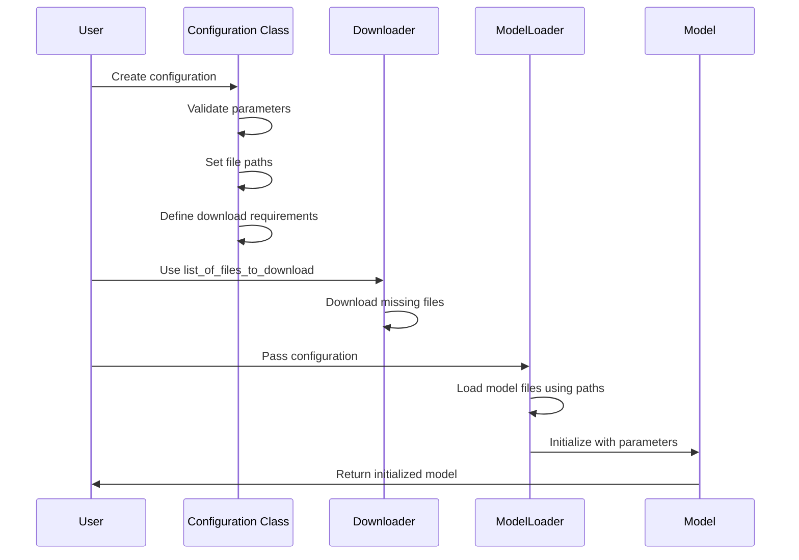
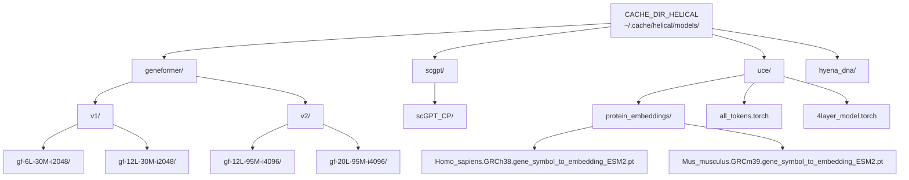

# Configuration System

<details>
<summary>Relevant source files</summary>

The following files were used as context for generating this wiki page:

- [ci/tests/test_uce/test_gene_embeddings.py](ci/tests/test_uce/test_gene_embeddings.py)
- [examples/run_models/configs/geneformer_config.yaml](examples/run_models/configs/geneformer_config.yaml)
- [examples/run_models/configs/hyena_dna_config.yaml](examples/run_models/configs/hyena_dna_config.yaml)
- [examples/run_models/configs/scgpt_config.yaml](examples/run_models/configs/scgpt_config.yaml)
- [examples/run_models/configs/uce_config.yaml](examples/run_models/configs/uce_config.yaml)
- [helical/models/geneformer/geneformer_config.py](helical/models/geneformer/geneformer_config.py)
- [helical/models/hyena_dna/standalone_hyenadna.py](helical/models/hyena_dna/standalone_hyenadna.py)
- [helical/models/scgpt/scgpt_config.py](helical/models/scgpt/scgpt_config.py)
- [helical/models/scgpt/scgpt_utils.py](helical/models/scgpt/scgpt_utils.py)
- [helical/models/uce/gene_embeddings.py](helical/models/uce/gene_embeddings.py)
- [helical/models/uce/uce_config.py](helical/models/uce/uce_config.py)

</details>


The Configuration System in Helical manages model-specific parameters, file paths, and resource requirements for all supported foundation models. It provides a consistent interface for initializing and customizing models while abstracting away the complexities of model-specific configurations and file management.

## Overview

The Configuration System serves several key purposes:

1. Defines model-specific parameters with sensible defaults
2. Manages file paths for model weights and associated resources
3. Specifies which files need to be downloaded for each model
4. Validates model parameters and ensures compatibility
5. Provides a consistent interface across different model types

This page focuses on the configuration architecture and usage patterns. For information on model-specific parameters, see the corresponding model pages in sections [4. RNA Models](#4) and [5. DNA Models](#5).



Sources: [helical/models/geneformer/geneformer_config.py:7-146](), [helical/models/uce/uce_config.py:20-148](), [helical/models/scgpt/scgpt_config.py:6-103]()

## Configuration Architecture

All model configuration classes in Helical follow a consistent pattern. Each configuration class:

1. Defines parameters with default values via constructor arguments
2. Maps model names/versions to specific parameter sets
3. Creates a list of required files to download
4. Generates appropriate file paths based on the cache directory
5. Constructs a configuration dictionary that can be passed to model constructors



Sources: [helical/models/geneformer/geneformer_config.py:7-146](), [helical/models/uce/uce_config.py:20-148](), [helical/models/scgpt/scgpt_config.py:6-103]()

## Configuration Classes

### Common Structure

While there isn't a formal base configuration class, all model configurations follow a similar structure. Each configuration class has:

1. A constructor with model-specific parameters
2. A `model_map` dictionary that maps model names to parameter sets
3. A `list_of_files_to_download` listing required files
4. A `config` dictionary with all necessary parameters for model initialization

Example from GeneformerConfig:



Sources: [helical/models/geneformer/geneformer_config.py:40-146]()

### Model-Specific Configurations

#### GeneformerConfig

The GeneformerConfig class configures Geneformer models with parameters like:
- `model_name`: Which pre-trained model to use
- `batch_size`: Batch size for processing
- `emb_layer`: Which embedding layer to use
- `emb_mode`: Embedding extraction mode (cls, cell, gene)
- Device and accelerator settings

This configuration also handles model version differences (v1 vs v2) and validates that the embedding mode is compatible with the chosen model.

Sources: [helical/models/geneformer/geneformer_config.py:7-146]()

#### scGPTConfig

The scGPTConfig class manages configurations for the scGPT model, including:
- Tokenization parameters (`pad_token`, `mask_value`, `pad_value`)
- Model architecture parameters (`nlayers`, `nheads`, `embsize`)
- Training parameters (`dropout`, `batch_size`)
- Hardware settings (`device`, `accelerator`)

Sources: [helical/models/scgpt/scgpt_config.py:6-103]()

#### UCEConfig

The UCEConfig class configures the Universal Cell Embedding model with:
- `model_name`: Which pre-trained model to use
- `species`: The species for the data (human, mouse, etc.)
- `gene_embedding_model`: The protein embedding model to use
- Token and padding parameters
- Model dimension parameters
- Hardware settings

This configuration also handles species-specific gene embeddings.

Sources: [helical/models/uce/uce_config.py:20-148](), [helical/models/uce/gene_embeddings.py:15-112]()

## Configuration Usage

### Creating Model Configurations

Model configurations can be created either programmatically or loaded from YAML files. 

#### Programmatic Configuration

To create a configuration programmatically:

```python
from helical.models.geneformer import GeneformerConfig

# Create with default parameters
config = GeneformerConfig()

# Create with custom parameters
config = GeneformerConfig(
    model_name="gf-12L-95M-i4096",
    batch_size=16,
    emb_mode="cell",
    device="cuda"
)
```

#### YAML Configuration

YAML files can also define configurations:

```yaml
# Geneformer config example
model_name: "gf-12L-30M-i2048"
batch_size: 24
emb_layer: -1
emb_mode: "cell"
device: "cpu"
accelerator: False
```

These YAML configurations can be loaded and used to instantiate model configurations.

Sources: [examples/run_models/configs/geneformer_config.yaml:1-6](), [examples/run_models/configs/scgpt_config.yaml:1-17](), [examples/run_models/configs/uce_config.yaml:1-18]()

### Configuration to Model Flow

The configuration system plays a central role in model initialization. Here's the typical flow:



Sources: [helical/models/geneformer/geneformer_config.py:98-117](), [helical/models/uce/uce_config.py:114-120](), [helical/models/scgpt/scgpt_utils.py:72-111]()

## File Management

The configuration system is responsible for managing file paths and download requirements. Each model configuration:

1. Uses a central cache directory defined in `helical.constants.paths.CACHE_DIR_HELICAL`
2. Creates model-specific subdirectories
3. Generates a list of files that need to be downloaded
4. Provides paths to these files for the model initialization process

### Cache Structure



Sources: [helical/models/geneformer/geneformer_config.py:119-131](), [helical/models/uce/uce_config.py:114-122](), [helical/models/uce/gene_embeddings.py:15-28]()

## Common Configuration Parameters

While each model has specific parameters, there are common parameters that appear across most configurations:

| Parameter | Description | Example Values |
|-----------|-------------|----------------|
| `model_name` | Name or identifier of the pre-trained model | "gf-12L-30M-i2048", "4layer_model" |
| `batch_size` | Batch size for processing | 16, 24, 32 |
| `device` | Device to run the model on | "cpu", "cuda" |
| `accelerator` | Whether to use an accelerator | True, False |
| `emb_mode` | How embeddings are extracted | "cls", "cell", "gene" |

Sources: [helical/models/geneformer/geneformer_config.py:134-146](), [helical/models/uce/uce_config.py:124-148](), [helical/models/scgpt/scgpt_config.py:82-103]()

## Parameter Validation and Defaults

Configuration classes validate parameters and set appropriate defaults:

1. Model name validation: Checking against available models
   ```python
   if model_name not in self.model_map:
       raise ValueError(f"Model name {model_name} not found in available models: {self.model_map.keys()}")
   ```

2. Parameter compatibility validation:
   ```python
   model_version = "v2" if "95M" in model_name else "v1"
   if model_version == "v1" and emb_mode == "cls":
       raise ValueError(f"Verson 1 Geneformer models do not support the CLS embedding mode")
   ```

3. Default values through constructor parameters:
   ```python
   def __init__(
       self,
       model_name: Literal["gf-6L-30M-i2048", "gf-12L-30M-i2048", ...] = "gf-12L-30M-i2048",
       batch_size: int = 24,
       emb_layer: int = -1,
       # ... more parameters with defaults
   ):
   ```

Sources: [helical/models/geneformer/geneformer_config.py:86-96](), [helical/models/uce/uce_config.py:109-112]()

## Summary

The Configuration System in Helical provides a consistent approach to model configuration across different model types. It handles parameter management, file paths, and download requirements, creating a streamlined experience for initializing and using models while abstracting away the complexities of model-specific configurations.

When using Helical, you typically:
1. Create a configuration object with your desired parameters
2. Pass this configuration to the appropriate model loader
3. The configuration handles file paths and validates parameters
4. The model is initialized with the configuration

This architecture allows for flexibility in how models are configured while maintaining a consistent interface across the framework.

---