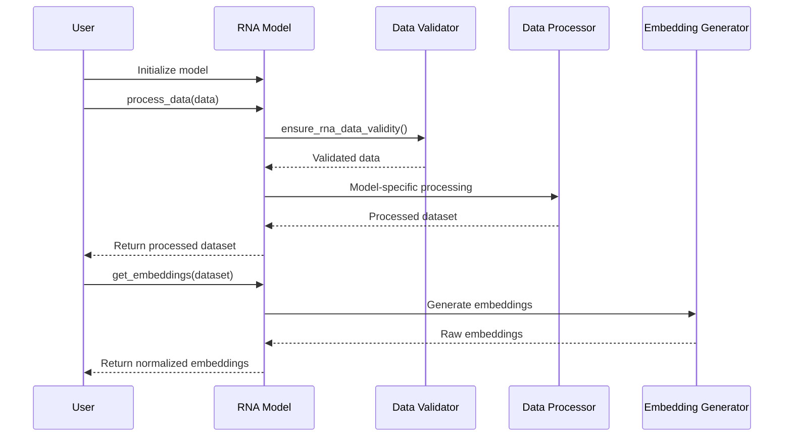
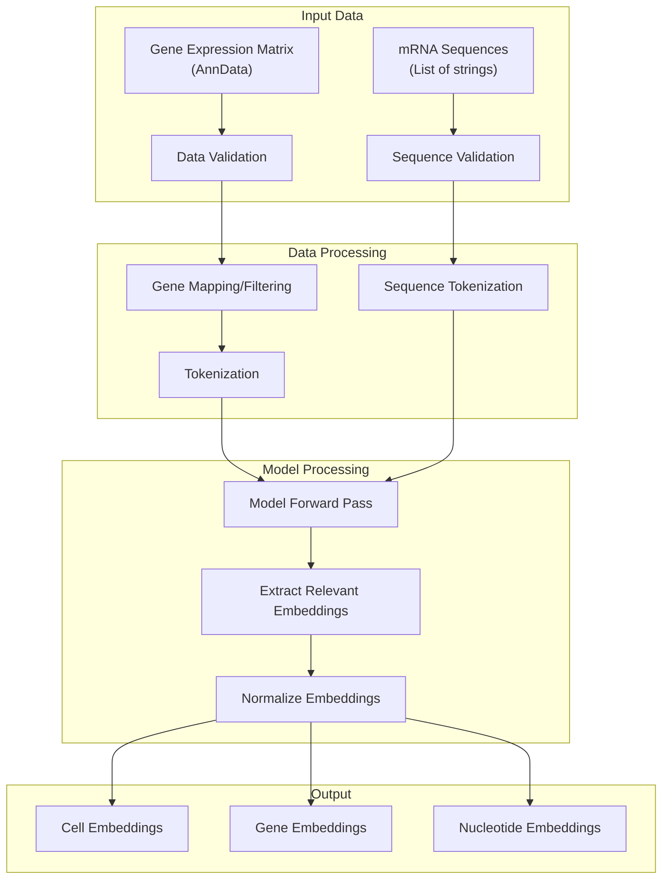

# RNA Models

<details>
<summary>Relevant source files</summary>

The following files were used as context for generating this wiki page:

- [docs/model_cards/caduceus.md](docs/model_cards/caduceus.md)
- [docs/model_cards/geneformer.md](docs/model_cards/geneformer.md)
- [docs/model_cards/helix_mrna.md](docs/model_cards/helix_mrna.md)
- [docs/model_cards/hyena_dna.md](docs/model_cards/hyena_dna.md)
- [docs/model_cards/mamba2_mrna.md](docs/model_cards/mamba2_mrna.md)
- [docs/model_cards/scgpt.md](docs/model_cards/scgpt.md)
- [docs/model_cards/uce.md](docs/model_cards/uce.md)
- [helical/models/base_models.py](helical/models/base_models.py)
- [helical/models/geneformer/model.py](helical/models/geneformer/model.py)
- [helical/models/scgpt/model.py](helical/models/scgpt/model.py)
- [helical/models/uce/model.py](helical/models/uce/model.py)

</details>


This page provides an overview of the RNA models available in the Helical framework. These models process RNA sequence or gene expression data to generate embeddings that can be used for downstream tasks. For information about DNA sequence models, see [DNA Models](#5).

## Overview

The Helical framework offers several pre-trained foundation models for RNA analysis, which can be categorized into:
1. **Gene Expression Models**: Analyze gene expression matrices from single-cell RNA-seq data
2. **mRNA Sequence Models**: Process individual nucleotide sequences

All RNA models in Helical inherit from the `HelicalRNAModel` base class, ensuring a consistent interface for data processing and embedding generation.

```mermaid
classDiagram
    class "HelicalBaseFoundationModel" {
        <<abstract>>
        +process_data()
        +get_embeddings()
    }
    class "HelicalRNAModel" {
        +ensure_rna_data_validity()
        +get_valid_rna_sequence()
    }
    class "Geneformer" {
        +process_data(adata)
        +get_embeddings(dataset)
    }
    class "scGPT" {
        +process_data(adata)
        +get_embeddings(dataset)
    }
    class "UCE" {
        +process_data(adata)
        +get_embeddings(dataset)
    }
    class "HelixmRNA" {
        +process_data(sequences)
        +get_embeddings(dataset)
    }
    class "Mamba2mRNA" {
        +process_data(sequences)
        +get_embeddings(dataset)
    }
    
    "HelicalBaseFoundationModel" <|-- "HelicalRNAModel"
    "HelicalRNAModel" <|-- "Geneformer"
    "HelicalRNAModel" <|-- "scGPT"
    "HelicalRNAModel" <|-- "UCE"
    "HelicalRNAModel" <|-- "HelixmRNA"
    "HelicalRNAModel" <|-- "Mamba2mRNA"
```

Sources: [helical/models/base_models.py:58-143](), [helical/models/geneformer/model.py:18-235](), [helical/models/scgpt/model.py:23-371](), [helical/models/uce/model.py:26-272]()

## Common Interface

All RNA models in Helical implement a consistent interface through the `HelicalRNAModel` base class:



Sources: [helical/models/base_models.py:58-143](), [helical/models/geneformer/model.py:135-204](), [helical/models/scgpt/model.py:236-371](), [helical/models/uce/model.py:94-208]()

### Data Validation

All RNA models perform validation of input data through the `ensure_rna_data_validity()` method, which checks:
- Presence of gene names in the AnnData object
- Integer counts in the expression matrix
- Valid RNA sequences (for sequence-based models)

Sources: [helical/models/base_models.py:59-101]()

## Gene Expression Models

Gene expression models work with gene expression matrices, typically in the form of AnnData objects containing single-cell RNA-seq data.

### Geneformer

Geneformer is a transformer-based model trained on large-scale corpora of single-cell transcriptomes. It excels at generating context-specific gene embeddings.

#### Versions and Variants

| Version | Model Name | Layers | Pretraining Dataset | Input Size |
|---------|------------|--------|---------------------|------------|
| 1.0 | gf-6L-30M-i2048 | 6 | 30M cells | 2048 genes |
| 1.0 | gf-12L-30M-i2048 | 12 | 30M cells | 2048 genes |
| 2.0 | gf-12L-95M-i4096 | 12 | 95M cells | 4096 genes |
| 2.0 | gf-20L-95M-i4096 | 20 | 95M cells | 4096 genes |
| 2.0 | gf-12L-95M-i4096-CLcancer | 12 | 95M cells + 14M cancer cells | 4096 genes |

Sources: [helical/models/geneformer/model.py:18-71](), [docs/model_cards/geneformer.md:16-66]()

#### Input Requirements
- AnnData object containing gene expression data
- Gene names mapped to Ensembl IDs (or a column with gene symbols that can be mapped)
- Integer counts in the expression matrix

Sources: [helical/models/geneformer/model.py:135-204]()

#### Example Usage

```python
from helical.models.geneformer import Geneformer, GeneformerConfig
import anndata as ad

# Example configuration
model_config = GeneformerConfig(model_name="gf-12L-95M-i4096", batch_size=10)
geneformer_v2 = Geneformer(model_config)

# Example usage for base pretrained model
ann_data = ad.read_h5ad("anndata_file.h5ad")
dataset = geneformer_v2.process_data(ann_data)
embeddings = geneformer_v2.get_embeddings(dataset)
print("Base model embeddings shape:", embeddings.shape)
```

Sources: [helical/models/geneformer/model.py:34-58]()

### scGPT

scGPT is a transformer-based model pre-trained on approximately 33 million human cells under non-disease conditions. It performs various tasks including cell type annotation, batch integration, and in silico perturbation response prediction.

#### Key Features
- Pretrained on 33M+ human cells from 51 organs/tissues and 441 studies
- Uses a value binning technique to convert expression counts into relative values
- Supports both cell-level and gene-level embeddings

Sources: [helical/models/scgpt/model.py:23-63](), [docs/model_cards/scgpt.md:9-61]()

#### Input Requirements
- AnnData object containing gene expression data
- Optional batch labels for batch correction

Sources: [helical/models/scgpt/model.py:236-338]()

#### Example Usage

```python
from helical.models.scgpt import scGPT, scGPTConfig
import anndata as ad

scgpt_config = scGPTConfig(batch_size=10)
scgpt = scGPT(configurer=scgpt_config)

ann_data = ad.read_h5ad("anndata_file.h5ad")
dataset = scgpt.process_data(ann_data)
embeddings = scgpt.get_embeddings(dataset)
print("scGPT embeddings shape:", embeddings.shape)
```

Sources: [helical/models/scgpt/model.py:34-49]()

### UCE (Universal Cell Embedding)

UCE is a transformer-based model pre-trained on over 36 million cells across multiple species. It uniquely represents genes by their protein products using a large protein language model (ESM2), enabling cross-species application.

#### Key Features
- Trained on 36M+ cells representing 1,000+ cell types
- Supports human and macaque species by default
- Uses protein embeddings from ESM2 for gene representation
- Zero-shot cell type annotation and cross-species analysis

Sources: [helical/models/uce/model.py:26-60](), [docs/model_cards/uce.md:9-44]()

#### Input Requirements
- AnnData object containing gene expression data
- Species information (human or macaque by default)

Sources: [helical/models/uce/model.py:94-208]()

#### Example Usage

```python
from helical.models.uce import UCE, UCEConfig
import anndata as ad

configurer = UCEConfig(batch_size=10)
uce = UCE(configurer=configurer)

ann_data = ad.read_h5ad("dataset.h5ad")
dataset = uce.process_data(ann_data)
embeddings = uce.get_embeddings(dataset)
print("UCE embeddings shape:", embeddings.shape)
```

Sources: [docs/model_cards/uce.md:110-124]()

## mRNA Sequence Models

mRNA sequence models work directly with nucleotide sequences rather than gene expression matrices.

### Helix-mRNA

Helix-mRNA is a hybrid model combining the Mamba2 architecture with transformer components for nucleotide-level analysis of mRNA sequences.

#### Key Features
- Single nucleotide resolution
- Combines Mamba2 with transformer components (attention and MLP blocks)
- Recognizes codon-level patterns using a special 'E' character to denote codon beginnings
- Pretrained on 57.5 million mRNA sequences across multiple taxonomic groups

Sources: [docs/model_cards/helix_mrna.md:9-14](), [docs/model_cards/helix_mrna.md:65-73]()

#### Input Requirements
- mRNA sequences containing the characters A, C, U, G, N, and E (where E denotes codon starts)

Sources: [docs/model_cards/helix_mrna.md:90-92]()

#### Example Usage

```python
from helical.models.helix_mrna import HelixmRNA, HelixmRNAConfig
import torch

device = "cuda" if torch.cuda.is_available() else "cpu"

helix_mrna_config = HelixmRNAConfig(batch_size=5, max_length=100, device=device)
helix_mrna = HelixmRNA(configurer=helix_mrna_config)

rna_sequences = ["EACUEGGG", "EACUEGGG", "EACUEGGG", "EACUEGGG", "EACUEGGG"]
dataset = helix_mrna.process_data(rna_sequences)

rna_embeddings = helix_mrna.get_embeddings(dataset)
print("Helix-mRNA embeddings shape:", rna_embeddings.shape)
```

Sources: [docs/model_cards/helix_mrna.md:98-113]()

### Mamba2-mRNA

Mamba2-mRNA is a model using the Mamba2 architecture for nucleotide-level analysis of mRNA sequences.

#### Key Features
- Single nucleotide resolution
- Uses 16 Mamba layers (16L) for sequence processing
- Efficient sequence processing through Mamba2's state space architecture

Sources: [docs/model_cards/mamba2_mrna.md:9-14]()

#### Input Requirements
- mRNA sequences containing the characters A, C, U, G, and N

Sources: [docs/model_cards/mamba2_mrna.md:69-71]()

#### Example Usage

```python
from helical.models.mamba2_mrna import Mamba2mRNA, Mamba2mRNAConfig
import torch

device = "cuda" if torch.cuda.is_available() else "cpu"

input_sequences = ["ACUG"*20, "AUGC"*20, "AUGC"*20, "ACUG"*20, "AUUG"*20]

mamba2_mrna_config = Mamba2mRNAConfig(batch_size=5, device=device)
mamba2_mrna = Mamba2mRNA(configurer=mamba2_mrna_config)

processed_input_data = mamba2_mrna.process_data(input_sequences)
embeddings = mamba2_mrna.get_embeddings(processed_input_data)

print("Mamba2-mRNA embeddings shape:", embeddings.shape)
```

Sources: [docs/model_cards/mamba2_mrna.md:78-94]()

## Model Comparison

The following table compares the key features of the RNA models available in Helical:

| Model | Input Type | Architecture | Species Support | Embedding Types | Key Applications |
|-------|------------|--------------|-----------------|-----------------|------------------|
| Geneformer | Gene expression (AnnData) | Transformer | Human | Cell, Gene | Gene network mapping, Disease modeling, Therapeutic target identification |
| scGPT | Gene expression (AnnData) | Transformer | Human | Cell, Gene, CLS | Cell type annotation, Batch integration, Perturbation prediction |
| UCE | Gene expression (AnnData) | Transformer | Multiple (Human, Macaque, etc.) | Cell | Cross-species analysis, Cell type annotation, Dataset integration |
| Helix-mRNA | mRNA sequences | Mamba2-Transformer hybrid | Multiple | Nucleotide | mRNA optimization, Stability prediction, Translation efficiency |
| Mamba2-mRNA | mRNA sequences | Mamba2 | Multiple | Nucleotide | mRNA sequence analysis |

Sources: [docs/model_cards/geneformer.md:91-108](), [docs/model_cards/scgpt.md:40-45](), [docs/model_cards/uce.md:38-45](), [docs/model_cards/helix_mrna.md:44-62](), [docs/model_cards/mamba2_mrna.md:35-41]()

## Embedding Generation Process

The following diagram shows the general process of generating embeddings with RNA models in Helical:



Sources: [helical/models/geneformer/model.py:135-235](), [helical/models/scgpt/model.py:89-235](), [helical/models/uce/model.py:210-272]()

## Working with RNA Models

### Common Data Processing Pattern

All RNA models follow a similar pattern for data processing:

1. **Initialize the model with a configuration**
   - Set batch size, device, embedding mode, etc.

2. **Process the input data**
   - For gene expression models: Pass an AnnData object
   - For sequence models: Pass a list of RNA sequences

3. **Generate embeddings from the processed data**
   - Get embeddings for cells, genes, or nucleotides

4. **Use embeddings for downstream tasks**
   - Visualization, clustering, classification, etc.

### Fine-tuning RNA Models

All RNA models can be fine-tuned for specific downstream tasks using the corresponding fine-tuning model classes:

```mermaid
classDiagram
    class "HelicalBaseFineTuningModel" {
        <<abstract>>
        +train()
        +get_outputs()
    }
    class "GeneformerFineTuningModel" {
        +process_data(adata)
        +train(dataset, labels)
        +get_outputs(dataset)
    }
    class "scGPTFineTuningModel" {
        +process_data(adata)
        +train(dataset, labels)
        +get_outputs(dataset)
    }
    class "UCEFineTuningModel" {
        +process_data(adata)
        +train(dataset, labels)
        +get_outputs(dataset)
    }
    class "HelixmRNAFineTuningModel" {
        +process_data(sequences)
        +train(dataset, labels)
        +get_outputs(dataset)
    }
    class "Mamba2mRNAFineTuningModel" {
        +process_data(sequences)
        +train(dataset, labels)
        +get_outputs(dataset)
    }
    
    "HelicalBaseFineTuningModel" <|-- "GeneformerFineTuningModel"
    "HelicalBaseFineTuningModel" <|-- "scGPTFineTuningModel"
    "HelicalBaseFineTuningModel" <|-- "UCEFineTuningModel"
    "HelicalBaseFineTuningModel" <|-- "HelixmRNAFineTuningModel"
    "HelicalBaseFineTuningModel" <|-- "Mamba2mRNAFineTuningModel"
```

Sources: [helical/models/base_models.py:220-307](), [docs/model_cards/geneformer.md:213-258](), [docs/model_cards/scgpt.md:112-140](), [docs/model_cards/uce.md:128-158](), [docs/model_cards/helix_mrna.md:115-136](), [docs/model_cards/mamba2_mrna.md:96-117]()

#### Example Fine-tuning Pattern

```python
# 1. Initialize fine-tuning model with configuration
model_config = ModelConfig(batch_size=10)
fine_tuning_model = ModelFineTuningModel(
    model_config=model_config,
    fine_tuning_head="classification",
    output_size=num_classes
)

# 2. Process the data
dataset = fine_tuning_model.process_data(input_data)

# 3. Train the model
fine_tuning_model.train(dataset, labels)

# 4. Get predictions
outputs = fine_tuning_model.get_outputs(dataset)
```

---