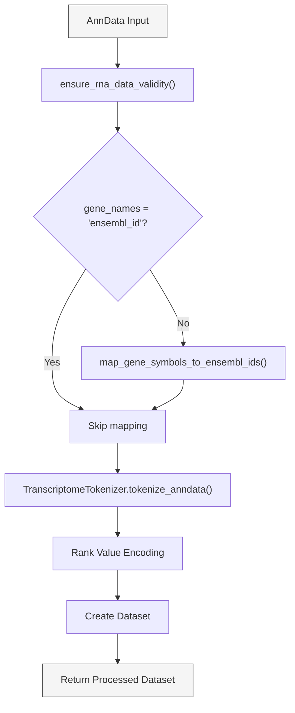
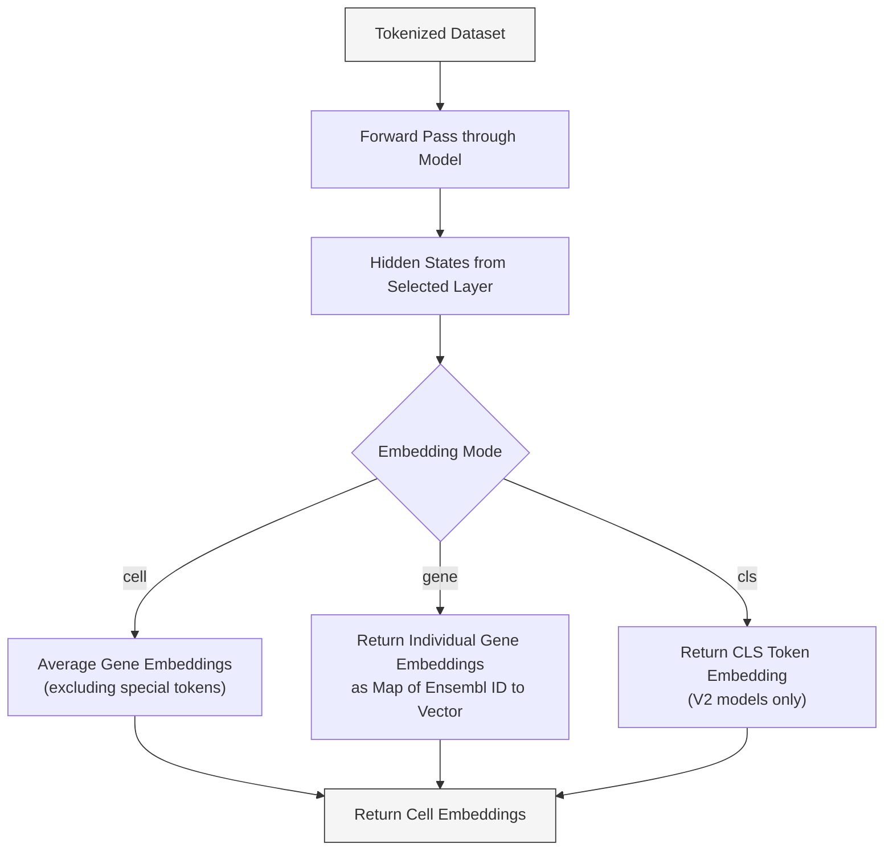
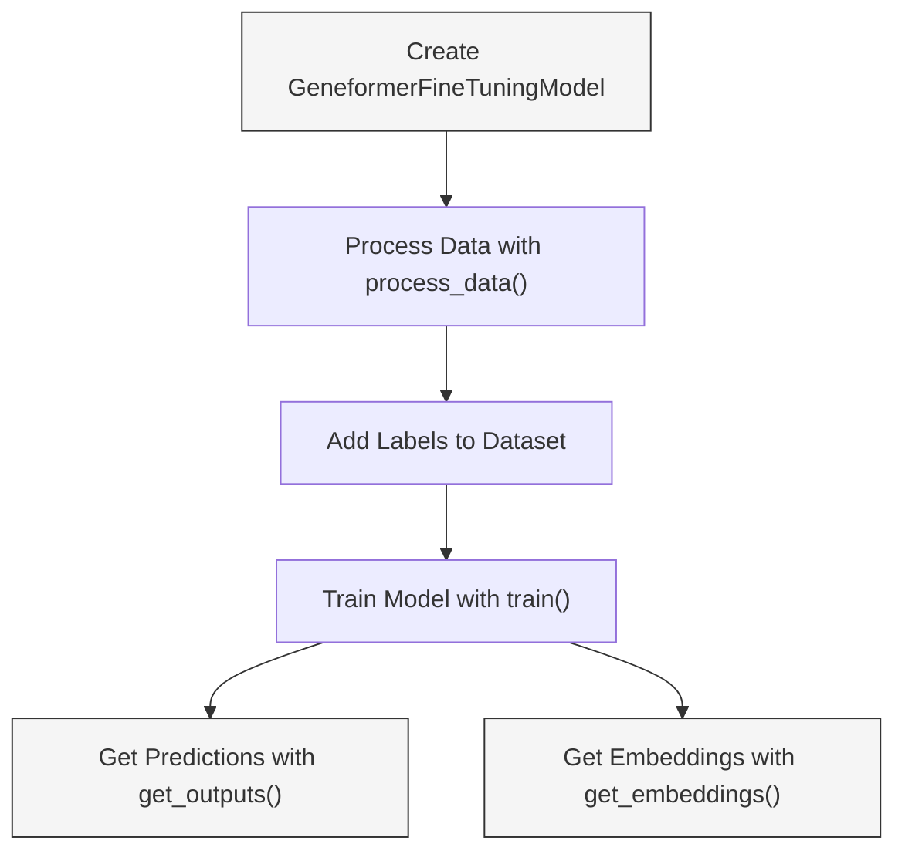

# Geneformer

<details>
<summary>Relevant source files</summary>

The following files were used as context for generating this wiki page:

- [ci/tests/test_geneformer/test_geneformer_model.py](ci/tests/test_geneformer/test_geneformer_model.py)
- [ci/tests/test_geneformer/test_geneformer_tokenizer.py](ci/tests/test_geneformer/test_geneformer_tokenizer.py)
- [ci/tests/test_scgpt/test_scgpt_model.py](ci/tests/test_scgpt/test_scgpt_model.py)
- [docs/model_cards/caduceus.md](docs/model_cards/caduceus.md)
- [docs/model_cards/geneformer.md](docs/model_cards/geneformer.md)
- [docs/model_cards/helix_mrna.md](docs/model_cards/helix_mrna.md)
- [docs/model_cards/hyena_dna.md](docs/model_cards/hyena_dna.md)
- [docs/model_cards/mamba2_mrna.md](docs/model_cards/mamba2_mrna.md)
- [docs/model_cards/scgpt.md](docs/model_cards/scgpt.md)
- [docs/model_cards/uce.md](docs/model_cards/uce.md)
- [helical/models/base_models.py](helical/models/base_models.py)
- [helical/models/geneformer/geneformer_tokenizer.py](helical/models/geneformer/geneformer_tokenizer.py)
- [helical/models/geneformer/geneformer_utils.py](helical/models/geneformer/geneformer_utils.py)
- [helical/models/geneformer/model.py](helical/models/geneformer/model.py)
- [helical/models/scgpt/model.py](helical/models/scgpt/model.py)
- [helical/models/uce/model.py](helical/models/uce/model.py)

</details>


## Overview

Geneformer is a transformer-based foundation model designed for single-cell RNA sequencing (scRNA-seq) data analysis. It enables the extraction of gene embeddings from scRNA-seq data across multiple versions and model variants. As part of the Helical framework, Geneformer serves as one of the core RNA models for genomic and transcriptomic analysis.

This document covers the architecture, components, and usage of the Geneformer model within the Helical framework. For information about other RNA models like scGPT or UCE, see their respective documentation pages ([scGPT](#4.2), [UCE](#4.3)).

## Model Versions and Variants

Geneformer is available in two major versions with several variants:

### Version 1.0
- Pretrained on approximately 30 million single-cell transcriptomes
- Input size of 2048 genes per cell
- Available models:
  - **gf-6L-30M-i2048**: 6 layers, trained on ~30 million cells
  - **gf-12L-30M-i2048**: 12 layers, trained on ~30 million cells

### Version 2.0
- Pretrained on Genecorpus-103M, comprising ~103 million human single-cell transcriptomes
- Expanded input/context size of 4096 genes per cell
- Available models:
  - **gf-12L-95M-i4096**: 12 layers, trained on ~95 million cells
  - **gf-20L-95M-i4096**: 20 layers, trained on ~95 million cells
  - **gf-12L-95M-i4096-CLcancer**: 12 layers, cancer-tuned model (trained on ~95 million cells, then fine-tuned on ~14 million cancer cells)

Sources: [helical/models/geneformer/model.py:22-33](https://github.com/helicalAI/helical/blob/main/helical/models/geneformer/model.py#L22-L33), [docs/model_cards/geneformer.md:17-66](https://github.com/helicalAI/helical/blob/main/docs/model_cards/geneformer.md#L17-L66)

## Architecture Overview

Geneformer is built upon the BERT architecture for masked language modeling. It inherits from the `HelicalRNAModel` base class and implements specialized functionality for processing gene expression data.

```mermaid
classDiagram
    class "HelicalBaseFoundationModel" {
        <<abstract>>
        +process_data()
        +get_embeddings()
    }
    class "HelicalRNAModel" {
        +ensure_rna_data_validity()
        +get_valid_rna_sequence()
    }
    class "Geneformer" {
        -configurer: GeneformerConfig
        -model: BertForMaskedLM
        -tk: TranscriptomeTokenizer
        -layer_to_quant: int
        -emb_mode: str
        +process_data(adata)
        +get_embeddings(dataset)
    }
    class "TranscriptomeTokenizer" {
        -gene_median_dict
        -gene_token_dict
        -gene_mapping_dict
        +tokenize_anndata()
        +create_dataset()
    }
    class "GeneformerConfig" {
        +model_name: str
        +emb_mode: str
        +emb_layer: int
        +batch_size: int
        +files_config: dict
    }

    HelicalBaseFoundationModel <|-- HelicalRNAModel
    HelicalRNAModel <|-- Geneformer
    Geneformer -- GeneformerConfig : "configures ▶"
    Geneformer -- TranscriptomeTokenizer : "uses ▶"
```

Sources: [helical/models/geneformer/model.py:18-134](https://github.com/helicalAI/helical/blob/main/helical/models/geneformer/model.py#L18-L134), [helical/models/base_models.py:58-143](https://github.com/helicalAI/helical/blob/main/helical/models/base_models.py#L58-L143)

## Key Components

### Geneformer Class
The main model class that implements the RNA model interface. It handles initialization, data processing, and embedding generation.

### TranscriptomeTokenizer
A specialized tokenizer that converts gene expression data from AnnData objects into tokens that the model can process. The tokenizer performs several key functions:
- Maps gene names to Ensembl IDs
- Rank-value encodes the gene expression data
- Creates a dataset with tokenized cells

### GeneformerConfig
Configuration class that handles model-specific parameters like model name, embedding mode, layer selection, etc.

Sources: [helical/models/geneformer/model.py:18-134](https://github.com/helicalAI/helical/blob/main/helical/models/geneformer/model.py#L18-L134), [helical/models/geneformer/geneformer_tokenizer.py:196-547](https://github.com/helicalAI/helical/blob/main/helical/models/geneformer/geneformer_tokenizer.py#L196-L547)

## Data Processing Workflow



When processing data, the workflow includes:

1. **Data Validation**: Checks if the AnnData object contains the required columns and data types
2. **Gene Mapping**: Maps gene symbols to Ensembl IDs if needed (required for Geneformer)
3. **Tokenization**: Processes the gene expression data using the TranscriptomeTokenizer
4. **Dataset Creation**: Returns a tokenized dataset ready for the model

Sources: [helical/models/geneformer/model.py:135-204](https://github.com/helicalAI/helical/blob/main/helical/models/geneformer/model.py#L135-L204), [helical/models/geneformer/geneformer_tokenizer.py:308-390](https://github.com/helicalAI/helical/blob/main/helical/models/geneformer/geneformer_tokenizer.py#L308-L390)

## Embedding Generation

Geneformer supports three embedding modes, each providing a different perspective on the gene expression data:

1. **Cell Mode** (`emb_mode="cell"`): Generates embeddings that represent entire cells, averaging across all gene embeddings in the cell
2. **Gene Mode** (`emb_mode="gene"`): Provides individual gene embeddings for each cell (returns a list of pandas Series mapping gene IDs to embeddings)
3. **CLS Mode** (`emb_mode="cls"`): Uses the CLS token embedding as a representation of the cell (only available in v2 models)



Sources: [helical/models/geneformer/model.py:206-235](https://github.com/helicalAI/helical/blob/main/helical/models/geneformer/model.py#L206-L235), [helical/models/geneformer/geneformer_utils.py:41-99](https://github.com/helicalAI/helical/blob/main/helical/models/geneformer/geneformer_utils.py#L41-L99)

## Using Geneformer

### Initialization

To use Geneformer, you first need to create a configuration and initialize the model:

```python
from helical.models.geneformer import Geneformer, GeneformerConfig

# Example configuration
model_config = GeneformerConfig(model_name="gf-12L-95M-i4096", batch_size=10)
geneformer = Geneformer(model_config)
```

The configuration options include:

| Parameter | Description | Default |
|-----------|-------------|---------|
| model_name | Name of the model variant to use | "gf-12L-95M-i4096" |
| emb_mode | Embedding mode ("cell", "gene", or "cls") | "cell" |
| emb_layer | Which model layer to extract embeddings from | -1 (last layer) |
| batch_size | Batch size for processing | 10 |
| device | Device to run the model on | Automatically determined |

Sources: [helical/models/geneformer/model.py:75-133](https://github.com/helicalAI/helical/blob/main/helical/models/geneformer/model.py#L75-L133), [ci/tests/test_geneformer/test_geneformer_model.py:54-58](https://github.com/helicalAI/helical/blob/main/ci/tests/test_geneformer/test_geneformer_model.py#L54-L58)

### Processing Data

To process data with Geneformer:

```python
import anndata as ad

# Load AnnData file
ann_data = ad.read_h5ad("your_data.h5ad")

# Process the data
dataset = geneformer.process_data(
    adata=ann_data,
    gene_names="gene_symbols",  # Column in adata.var containing gene names
    output_path=None,  # Optional: path to save processed dataset
    use_raw_counts=True  # Whether to use raw counts
)
```

The `process_data()` method handles:
1. Data validation
2. Mapping gene symbols to Ensembl IDs
3. Tokenization of gene expression data
4. Creation of a dataset for the model

Sources: [helical/models/geneformer/model.py:135-204](https://github.com/helicalAI/helical/blob/main/helical/models/geneformer/model.py#L135-L204), [ci/tests/test_geneformer/test_geneformer_model.py:60-82](https://github.com/helicalAI/helical/blob/main/ci/tests/test_geneformer/test_geneformer_model.py#L60-L82)

### Getting Embeddings

After processing the data, you can extract embeddings:

```python
# Get embeddings from the processed dataset
embeddings = geneformer.get_embeddings(dataset)

# The shape and format of the embeddings depends on the emb_mode:
# - "cell" mode: numpy array with shape (n_cells, embedding_dim)
# - "gene" mode: list of pandas Series mapping gene IDs to embedding vectors
# - "cls" mode: numpy array with shape (n_cells, embedding_dim)
```

Sources: [helical/models/geneformer/model.py:206-235](https://github.com/helicalAI/helical/blob/main/helical/models/geneformer/model.py#L206-L235), [ci/tests/test_geneformer/test_geneformer_model.py:137-195](https://github.com/helicalAI/helical/blob/main/ci/tests/test_geneformer/test_geneformer_model.py#L137-L195)

## Fine-tuning Geneformer

Geneformer can be fine-tuned for specific tasks using the `GeneformerFineTuningModel` class:



Example usage for classification:

```python
from helical.models.geneformer import GeneformerFineTuningModel, GeneformerConfig

# Create config
geneformer_config = GeneformerConfig(model_name="gf-12L-95M-i4096", batch_size=10)

# Initialize fine-tuning model with classification head
geneformer_fine_tune = GeneformerFineTuningModel(
    geneformer_config=geneformer_config,
    fine_tuning_head="classification",
    output_size=len(class_set)  # Number of unique classes
)

# Process data
dataset = geneformer_fine_tune.process_data(ann_data)

# Add labels to dataset
dataset = dataset.add_column('labels', labels)

# Fine-tune the model
geneformer_fine_tune.train(train_dataset=dataset, label="labels")

# Get predictions
predictions = geneformer_fine_tune.get_outputs(dataset)

# Get embeddings from fine-tuned model
embeddings = geneformer_fine_tune.get_embeddings(dataset)
```

Sources: [ci/tests/test_geneformer/test_geneformer_model.py:197-229](https://github.com/helicalAI/helical/blob/main/ci/tests/test_geneformer/test_geneformer_model.py#L197-L229), [docs/model_cards/geneformer.md:214-258](https://github.com/helicalAI/helical/blob/main/docs/model_cards/geneformer.md#L214-L258)

## Use Cases

Geneformer is designed for a wide range of genomic analysis tasks:

1. **Gene Network Analysis**: Mapping and understanding gene interactions
2. **Disease Modeling**: Analyzing disease states in cellular contexts
3. **Therapeutic Target Identification**: Finding potential targets for treatment
4. **Cell Type Classification**: Automatically identifying cell types from expression data
5. **Batch Integration**: Combining data from different batches or experiments
6. **In Silico Perturbation**: Predicting the effects of gene perturbations

The choice of model depends on the specific application:
- Base pretrained models (gf-12L-95M-i4096) are best for general transcriptomic analysis
- Cancer-tuned model (gf-12L-95M-i4096-CLcancer) is specialized for cancer research

Sources: [docs/model_cards/geneformer.md:90-107](https://github.com/helicalAI/helical/blob/main/docs/model_cards/geneformer.md#L90-L107), [docs/model_cards/geneformer.md:134-155](https://github.com/helicalAI/helical/blob/main/docs/model_cards/geneformer.md#L134-L155)

## Technical Details

### Tokenization Process

Geneformer uses a rank-value encoding approach for tokenization:

1. Genes are ranked by their scaled expression within each cell
2. Each gene is represented by a token from the model's vocabulary
3. Special tokens (`<cls>`, `<eos>`, `<pad>`) are added according to the model version
4. Input is truncated or padded to the model's input size (2048 for v1, 4096 for v2)

The tokenizer supports customization via:
- Special tokens (required for v2 models)
- Custom cell metadata transfer
- Configurable input sizes

Sources: [helical/models/geneformer/geneformer_tokenizer.py:39-194](https://github.com/helicalAI/helical/blob/main/helical/models/geneformer/geneformer_tokenizer.py#L39-L194), [helical/models/geneformer/geneformer_tokenizer.py:482-547](https://github.com/helicalAI/helical/blob/main/helical/models/geneformer/geneformer_tokenizer.py#L482-L547)

### Embedding Layer Selection

Geneformer allows selecting which model layer to extract embeddings from:

```python
# Use the 3rd layer for embeddings (0-indexed)
config = GeneformerConfig(model_name="gf-12L-95M-i4096", emb_layer=3)

# Use the last layer for embeddings (default)
config = GeneformerConfig(model_name="gf-12L-95M-i4096", emb_layer=-1)
```

Layer selection can impact the quality of embeddings for specific tasks. Generally:
- Lower layers capture more basic gene expression patterns
- Higher layers represent more complex biological relationships
- The last layer (-1) is a good default for most tasks

Sources: [helical/models/geneformer/model.py:94-110](https://github.com/helicalAI/helical/blob/main/helical/models/geneformer/model.py#L94-L110), [ci/tests/test_geneformer/test_geneformer_model.py:230-269](https://github.com/helicalAI/helical/blob/main/ci/tests/test_geneformer/test_geneformer_model.py#L230-L269)

## Limitations and Considerations

When using Geneformer, be aware of these important considerations:

1. **Gene Mapping Requirement**: 
   - Input data must have gene symbols that can be mapped to Ensembl IDs
   - Currently only human genes are supported

2. **Model Version Differences**:
   - V1 models (30M) don't support CLS token embeddings
   - V2 models (95M) have larger context windows and support special tokens

3. **Data Compatibility**:
   - Requires single-cell RNA-seq data in AnnData format
   - Genes not found in the model's vocabulary will be filtered out

4. **Performance Considerations**:
   - Processing large datasets may require substantial memory
   - Using smaller batch sizes can help with memory constraints
   - GPU acceleration is recommended for large datasets

Sources: [helical/models/geneformer/model.py:142-190](https://github.com/helicalAI/helical/blob/main/helical/models/geneformer/model.py#L142-L190), [ci/tests/test_geneformer/test_geneformer_model.py:83-136](https://github.com/helicalAI/helical/blob/main/ci/tests/test_geneformer/test_geneformer_model.py#L83-L136)

## Summary

Geneformer provides a powerful framework for analyzing single-cell RNA-seq data, offering:

1. **Multiple Model Variants**: Different model sizes and specializations (including cancer-tuned)
2. **Flexible Embedding Options**: Cell-level, gene-level, or CLS token embeddings
3. **Fine-tuning Capabilities**: Adaptation to specialized biological tasks
4. **Integration with Helical**: Part of a broader ecosystem of biological foundation models

The model is particularly well-suited for researchers working with single-cell genomic data who need to extract meaningful representations for downstream analysis or fine-tuning for specific biological tasks.

Sources: [helical/models/geneformer/model.py:18-33](https://github.com/helicalAI/helical/blob/main/helical/models/geneformer/model.py#L18-L33), [docs/model_cards/geneformer.md:4-13](https://github.com/helicalAI/helical/blob/main/docs/model_cards/geneformer.md#L4-L13)

---