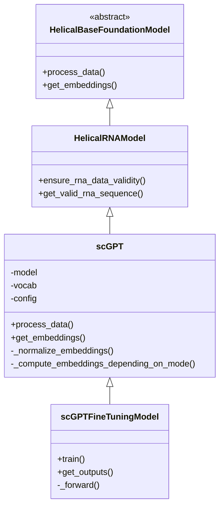
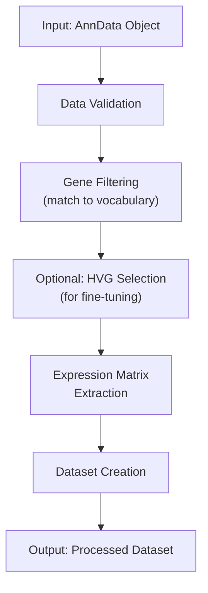
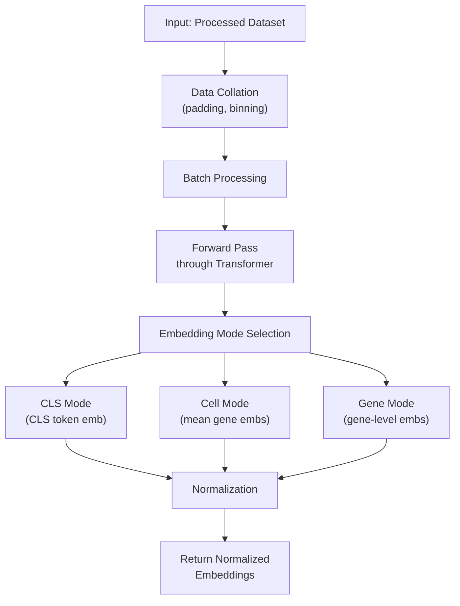
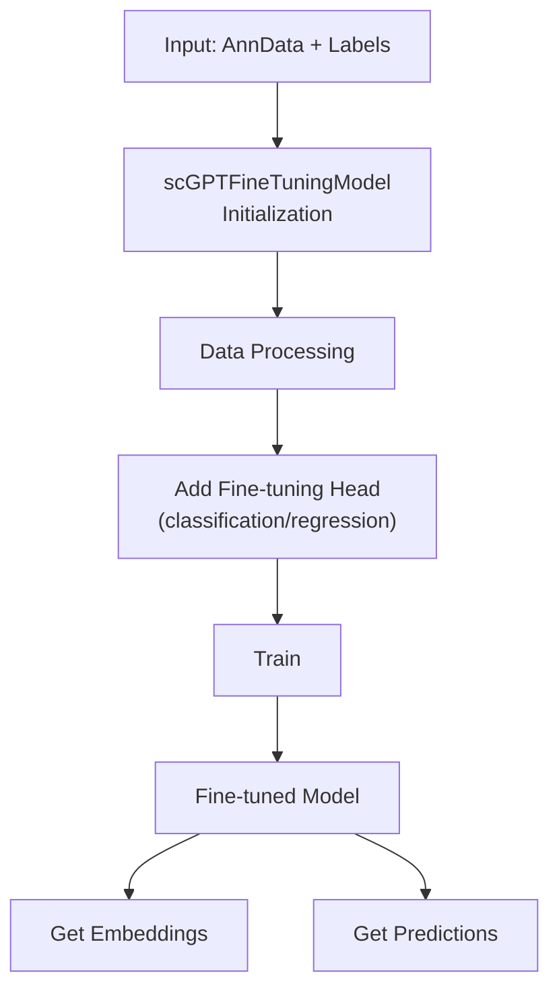
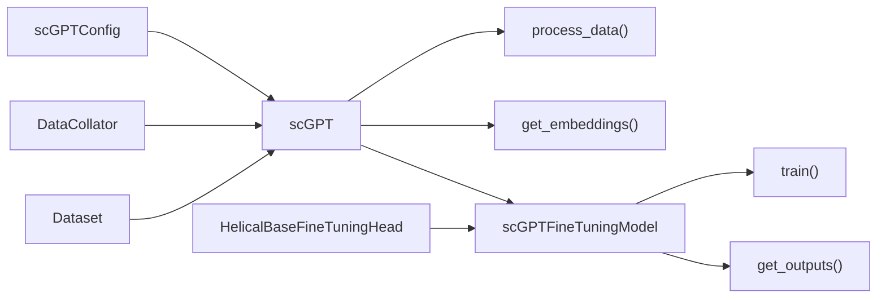

# scGPT

<details>
<summary>Relevant source files</summary>

The following files were used as context for generating this wiki page:

- [docs/model_cards/caduceus.md](docs/model_cards/caduceus.md)
- [docs/model_cards/geneformer.md](docs/model_cards/geneformer.md)
- [docs/model_cards/helix_mrna.md](docs/model_cards/helix_mrna.md)
- [docs/model_cards/hyena_dna.md](docs/model_cards/hyena_dna.md)
- [docs/model_cards/mamba2_mrna.md](docs/model_cards/mamba2_mrna.md)
- [docs/model_cards/scgpt.md](docs/model_cards/scgpt.md)
- [docs/model_cards/uce.md](docs/model_cards/uce.md)
- [helical/models/base_models.py](helical/models/base_models.py)
- [helical/models/fine_tune/fine_tuning_heads.py](helical/models/fine_tune/fine_tuning_heads.py)
- [helical/models/geneformer/fine_tuning_model.py](helical/models/geneformer/fine_tuning_model.py)
- [helical/models/geneformer/model.py](helical/models/geneformer/model.py)
- [helical/models/scgpt/fine_tuning_model.py](helical/models/scgpt/fine_tuning_model.py)
- [helical/models/scgpt/model.py](helical/models/scgpt/model.py)
- [helical/models/uce/fine_tuning_model.py](helical/models/uce/fine_tuning_model.py)
- [helical/models/uce/model.py](helical/models/uce/model.py)

</details>


## Purpose and Overview

scGPT is a transformer-based foundation model for single-cell RNA sequencing (scRNA-seq) data analysis in the Helical framework. Pre-trained on over 33 million human cells from 51 organs/tissues and 441 studies, it represents gene expression patterns and cell states in a unified embedding space.

This page documents how to use scGPT to extract embeddings from scRNA-seq data and fine-tune it for downstream tasks like cell type classification, batch integration, and gene regulatory network inference.

For information about other RNA foundation models like Geneformer, see [Geneformer](#4.1), and for UCE, see [UCE](#4.3).

Sources:
- [helical/models/scgpt/model.py:24-59]()
- [docs/model_cards/scgpt.md:9-37]()

## Model Architecture and Integration

scGPT inherits from the `HelicalRNAModel` base class and processes gene expression data through a transformer architecture. It has specialized knowledge of gene relationships and cell state representations learned during pre-training.



The model processes single-cell data through:
1. A vocabulary mapping gene symbols to token IDs
2. Expression value binning to handle continuous values
3. A transformer encoder that creates contextual representations
4. Different embedding extraction modes for downstream applications

Sources:
- [helical/models/scgpt/model.py:1-22]()
- [helical/models/base_models.py:58-143]()

## Data Processing Flow

scGPT processes AnnData objects (the standard format for scRNA-seq data) through a multi-step pipeline:



The processing steps include:

1. **Validation**: Ensures the input AnnData meets requirements (checking gene names column exists)
2. **Gene Filtering**: Maps genes to scGPT's vocabulary and filters non-matching genes
3. **Optional HVG Selection**: For fine-tuning, can select highly variable genes
4. **Expression Matrix Extraction**: Converts to NumPy array for efficient processing
5. **Dataset Creation**: Builds a dataset object with expression values and gene IDs

Key parameters for `process_data`:
- `gene_names`: Specifies which column in `adata.var` contains gene symbols
- `fine_tuning`: If True, enables HVG selection for dimension reduction
- `n_top_genes`: Number of highly variable genes to keep (when fine_tuning=True)
- `use_batch_labels`: Whether to use batch identifiers for integration

Sources:
- [helical/models/scgpt/model.py:236-338]()
- [helical/models/scgpt/model.py:340-371]()

## Embedding Generation

scGPT extracts contextual gene and cell embeddings through the `get_embeddings` method:



The model supports three embedding modes:
- **CLS Mode** (`emb_mode="cls"`): Uses the [CLS] token embedding (position 0) as cell representation
- **Cell Mode** (`emb_mode="cell"`): Uses the mean of all gene embeddings in the cell
- **Gene Mode** (`emb_mode="gene"`): Returns individual gene embeddings as a mapping of gene names to vectors

Note that the embeddings are normalized by default (divided by their L2 norm) to ensure consistency.

Sources:
- [helical/models/scgpt/model.py:89-168]()
- [helical/models/scgpt/model.py:170-184]()
- [helical/models/scgpt/model.py:185-235]()

## Fine-Tuning Capabilities

scGPT can be fine-tuned for downstream tasks through the `scGPTFineTuningModel` class, which adds task-specific heads to the pre-trained model:



The fine-tuning process:
1. Initializes a model with a task-specific head (classification or regression)
2. Processes the input data (similar to the base model)
3. Trains the model using the provided labels
4. Produces a fine-tuned model that can make predictions on new data

The `train` method supports various parameters:
- `train_input_data`: Processed dataset for training
- `train_labels`: Labels for supervised learning
- `validation_input_data` and `validation_labels`: Optional validation data
- `optimizer` and `optimizer_params`: Configuration for optimization
- `loss_function`: Loss function for training
- `epochs`: Number of training epochs
- `lr_scheduler_params`: Learning rate scheduling options

Sources:
- [helical/models/scgpt/fine_tuning_model.py:19-347]()
- [helical/models/fine_tune/fine_tuning_heads.py:6-120]()

## Usage Examples

### Basic Usage: Getting Embeddings

```python
from helical.models.scgpt import scGPT, scGPTConfig
from datasets import load_dataset
from helical.utils import get_anndata_from_hf_dataset

# Initialize the model with configuration
scgpt_config = scGPTConfig(batch_size=10)
scgpt = scGPT(configurer=scgpt_config)

# Load a dataset
hf_dataset = load_dataset("helical-ai/yolksac_human", split="train[:25%]", 
                          trust_remote_code=True)
ann_data = get_anndata_from_hf_dataset(hf_dataset)

# Process data and get embeddings
dataset = scgpt.process_data(ann_data[:100])
embeddings = scgpt.get_embeddings(dataset)
print("scGPT embeddings shape:", embeddings.shape)
```

### Fine-tuning for Cell Type Classification

```python
from helical.models.scgpt import scGPTFineTuningModel, scGPTConfig
import anndata as ad
import numpy as np

# Load data and extract cell types
adata = ad.read_h5ad("dataset.h5ad")
cell_types = list(adata.obs.cell_type)
label_set = set(cell_types)

# Initialize fine-tuning model
scgpt_config = scGPTConfig(batch_size=10)
scgpt_fine_tune = scGPTFineTuningModel(
    scGPT_config=scgpt_config,
    fine_tuning_head="classification",
    output_size=len(label_set)
)

# Process data
dataset = scgpt_fine_tune.process_data(adata)

# Convert labels to numeric IDs
class_id_dict = dict(zip(label_set, range(len(label_set))))
cell_type_ids = np.array([class_id_dict[ct] for ct in cell_types])

# Train model
scgpt_fine_tune.train(
    train_input_data=dataset,
    train_labels=cell_type_ids,
    epochs=5,
    optimizer_params={"lr": 0.0001}
)

# Get predictions
outputs = scgpt_fine_tune.get_outputs(dataset)
```

Sources:
- [helical/models/scgpt/model.py:31-49]()
- [helical/models/scgpt/fine_tuning_model.py:24-58]()

## Technical Details

### Model Implementation

scGPT is implemented as a Python class in Helical that:
- Loads pre-trained transformer weights during initialization
- Processes AnnData objects by extracting and filtering gene expression matrices
- Generates embeddings through contextual encoding of genes and their expressions
- Supports fine-tuning through specialized task-specific heads



### Key Configuration Parameters

The model behavior can be customized through the `scGPTConfig` class:

| Parameter | Description | Default |
|-----------|-------------|---------|
| `batch_size` | Number of cells to process in each batch | 10 |
| `emb_mode` | Embedding mode ("cls", "cell", or "gene") | "cls" |
| `accelerator` | Whether to use HF Accelerator for distributed training | None |
| `device` | Device to run the model on | "cuda" if available |
| `pad_token` | Token used for padding | "\<pad\>" |
| `pad_value` | Value used for padding expression values | 0 |
| `MAX_LENGTH` | Maximum sequence length | 1200 |
| `binning_seed` | Random seed for binning operation | 42 |

Sources:
- [helical/models/scgpt/model.py:62-87]()
- [helical/models/scgpt/fine_tuning_model.py:71-128]()

---