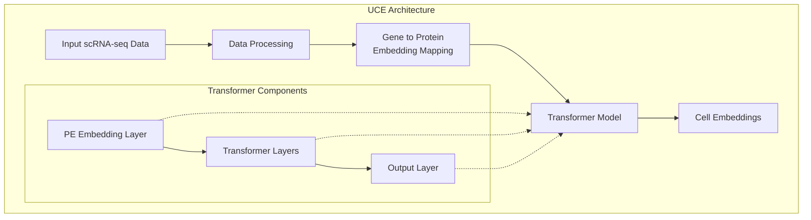
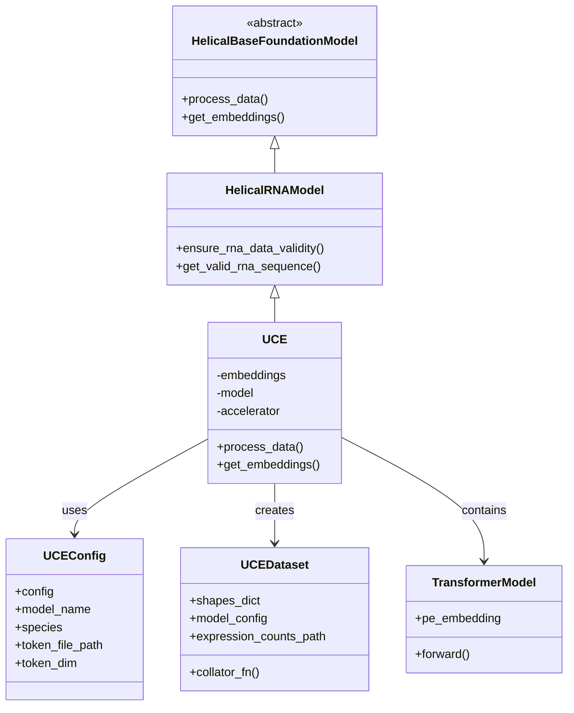
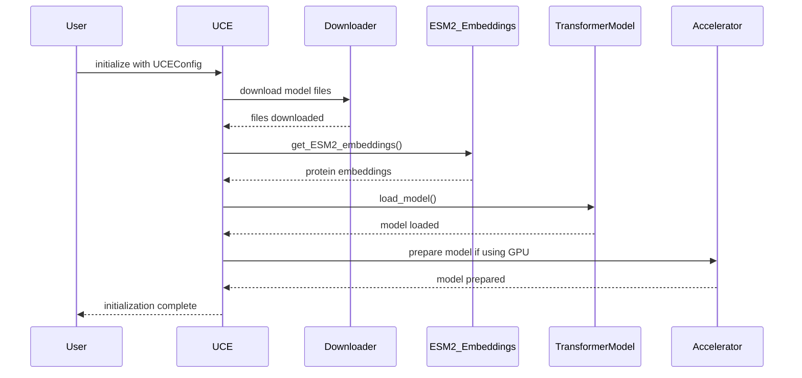

# UCE

<details>
<summary>Relevant source files</summary>

The following files were used as context for generating this wiki page:

- [docs/model_cards/caduceus.md](docs/model_cards/caduceus.md)
- [docs/model_cards/geneformer.md](docs/model_cards/geneformer.md)
- [docs/model_cards/helix_mrna.md](docs/model_cards/helix_mrna.md)
- [docs/model_cards/hyena_dna.md](docs/model_cards/hyena_dna.md)
- [docs/model_cards/mamba2_mrna.md](docs/model_cards/mamba2_mrna.md)
- [docs/model_cards/scgpt.md](docs/model_cards/scgpt.md)
- [docs/model_cards/uce.md](docs/model_cards/uce.md)
- [helical/models/base_models.py](helical/models/base_models.py)
- [helical/models/geneformer/model.py](helical/models/geneformer/model.py)
- [helical/models/scgpt/model.py](helical/models/scgpt/model.py)
- [helical/models/uce/model.py](helical/models/uce/model.py)
- [helical/models/uce/uce_utils.py](helical/models/uce/uce_utils.py)

</details>


This document covers the Universal Cell Embedding (UCE) model in the Helical framework, including its architecture, implementation details, and usage. UCE is a transformer-based model that creates cell embeddings from single-cell RNA-seq data by representing genes through their protein products using a protein language model (ESM2).

## Overview

UCE is a large-scale self-supervised model pretrained on more than 36 million cells across 8 species, creating an Integrated Mega-scale Atlas with over 1,000 unique cell types. The model is designed to represent any gene from any species by leveraging protein language models, allowing cross-species analysis even when a particular species wasn't in the training data.

### Key Features

- **Cross-species support**: Currently human and macaque species are fully supported
- **Zero-shot capabilities**: Can be used without fine-tuning for cell type annotation
- **Integration with protein embeddings**: Uses ESM2 protein embeddings to represent genes
- **Scale**: Trained on 36+ million cells across 300+ datasets
- **Flexible usage**: Can be used for various downstream tasks like cell type annotation and integration

Sources: [helical/models/uce/model.py:26-60](). [docs/model_cards/uce.md:9-11]()

## Architecture

The UCE model architecture is based on a transformer model that processes gene expression data. The model uses protein embeddings from ESM2 to represent genes, which allows it to generalize across species.

### UCE Model Architecture



Sources: [helical/models/uce/model.py:77-78](). [helical/models/uce/uce_utils.py:143-152]()

### Integration with Helical Framework



Sources: [helical/models/uce/model.py:26-27](). [helical/models/base_models.py:58-102]()

## Data Processing Pipeline

The UCE model processes single-cell RNA-seq data to generate cell embeddings. The processing pipeline involves filtering genes, mapping them to protein embeddings, and using a transformer model to generate embeddings.

### Data Processing Flow


Sources: [helical/models/uce/model.py:94-208](). [helical/models/uce/model.py:210-272]()

## Implementation Details

The UCE model in Helical is implemented in the `UCE` class, which inherits from `HelicalRNAModel`. The class has two main methods: `process_data()` and `get_embeddings()`.

### Key Components

| Component | Description |
|-----------|-------------|
| `UCE` | Main class implementing the UCE model |
| `UCEConfig` | Configuration class for UCE model |
| `UCEDataset` | Dataset class for UCE model |
| `TransformerModel` | Transformer model implementation |
| `get_ESM2_embeddings` | Function to load protein embeddings |
| `get_positions` | Function to get chromosome positions for genes |
| `get_protein_embeddings_idxs` | Function to get protein embedding indices |
| `load_model` | Function to load the UCE model |

Sources: [helical/models/uce/model.py:26-93](). [helical/models/uce/uce_utils.py:14-167]()

### Initialization Process



Sources: [helical/models/uce/model.py:64-92]()

## Usage

The UCE model can be used to generate embeddings from single-cell RNA-seq data. Here's a typical workflow:

### Basic Usage

1. Create an instance of the UCE model with a configuration
2. Process an AnnData object to create a UCEDataset
3. Generate embeddings from the dataset

Example:
```python
from helical.models.uce import UCE, UCEConfig
import anndata as ad

# Create a configuration
configurer = UCEConfig(batch_size=10)
# Initialize the model
uce = UCE(configurer=configurer)

# Load data
ann_data = ad.read_h5ad("dataset.h5ad")
# Process data
dataset = uce.process_data(ann_data[:100])
# Get embeddings
embeddings = uce.get_embeddings(dataset)

print("UCE embeddings shape:", embeddings.shape)
```

Sources: [helical/models/uce/model.py:32-50](). [docs/model_cards/uce.md:109-124]()

### Data Processing Details

The `process_data` method takes an AnnData object and processes it to create a UCEDataset. The processing includes:

1. Validating the input data
2. Filtering genes based on protein embeddings availability
3. Mapping genes to their protein embeddings
4. Creating a UCEDataset with the processed data

Sources: [helical/models/uce/model.py:94-208]()

### Embedding Generation

The `get_embeddings` method takes a UCEDataset and generates embeddings using the UCE model. The process includes:

1. Creating a DataLoader for the dataset
2. Processing batches through the model
3. Collecting and normalizing embeddings
4. Returning the embeddings as a numpy array

Sources: [helical/models/uce/model.py:210-272]()

## Configuration Options

The UCE model is configured using the `UCEConfig` class. Here are the main configuration options:

| Option | Description |
|--------|-------------|
| `model_name` | Name of the model to use |
| `species` | Species to use for analysis (e.g., "human", "macaque") |
| `batch_size` | Batch size for processing data |
| `device` | Device to use for computation ("cuda" or "cpu") |
| `gene_embedding_model` | Model to use for gene embeddings |
| `accelerator` | Whether to use an accelerator for computation |

Sources: [helical/models/uce/model.py:62]()

## Limitations and Considerations

- Currently, UCE fully supports human and macaque species, but you can add your own species by providing protein embeddings
- Analyses are generally limited by their emphasis on broad, coarse-grained cell type labels
- The model doesn't utilize detailed information from raw RNA transcripts
- Performance may vary depending on the quality and preprocessing of input data

Sources: [docs/model_cards/uce.md:89-97]()

## Related Models

For information about other RNA models in the Helical framework, see:
- [Geneformer](#4.1) - A transformer-based model for gene expression analysis
- [scGPT](#4.2) - A GPT-based model for single-cell analysis
- [Helix-mRNA and Mamba2-mRNA](#4.4) - Models for mRNA sequence analysis

Sources: [docs/model_cards/uce.md]()

---