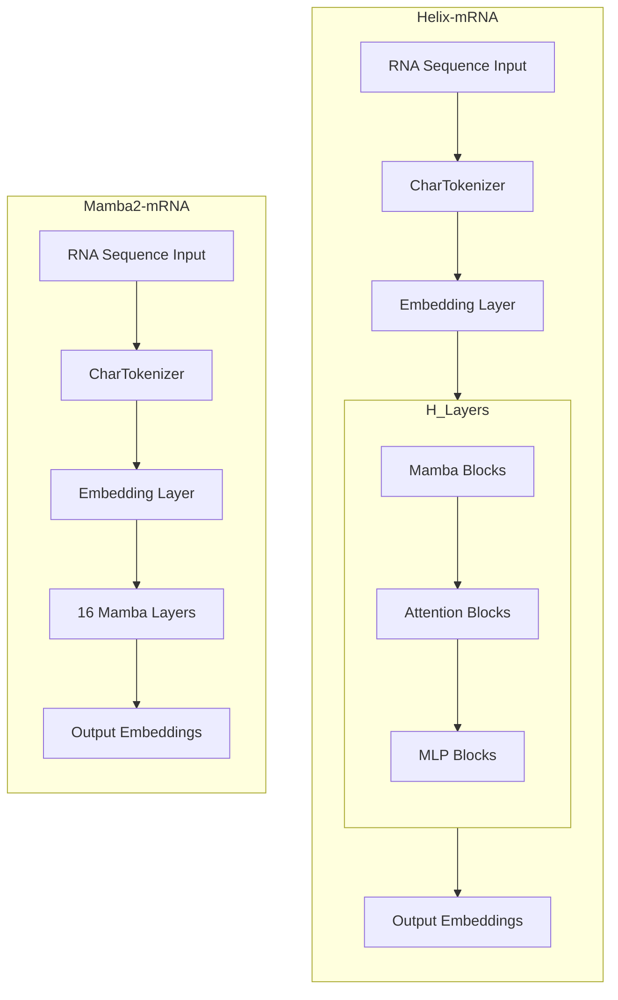
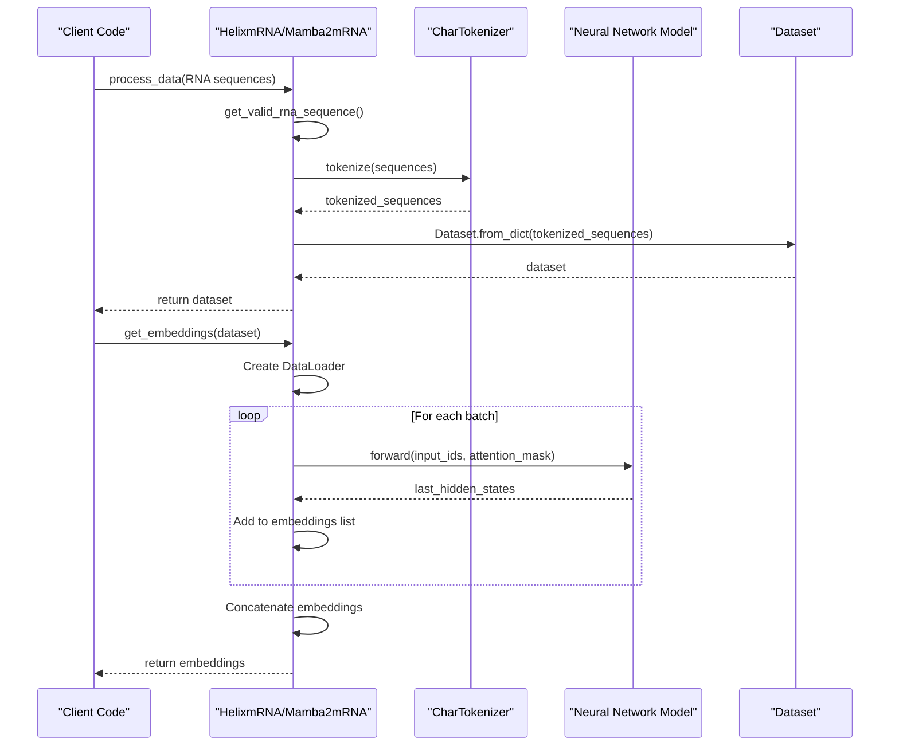
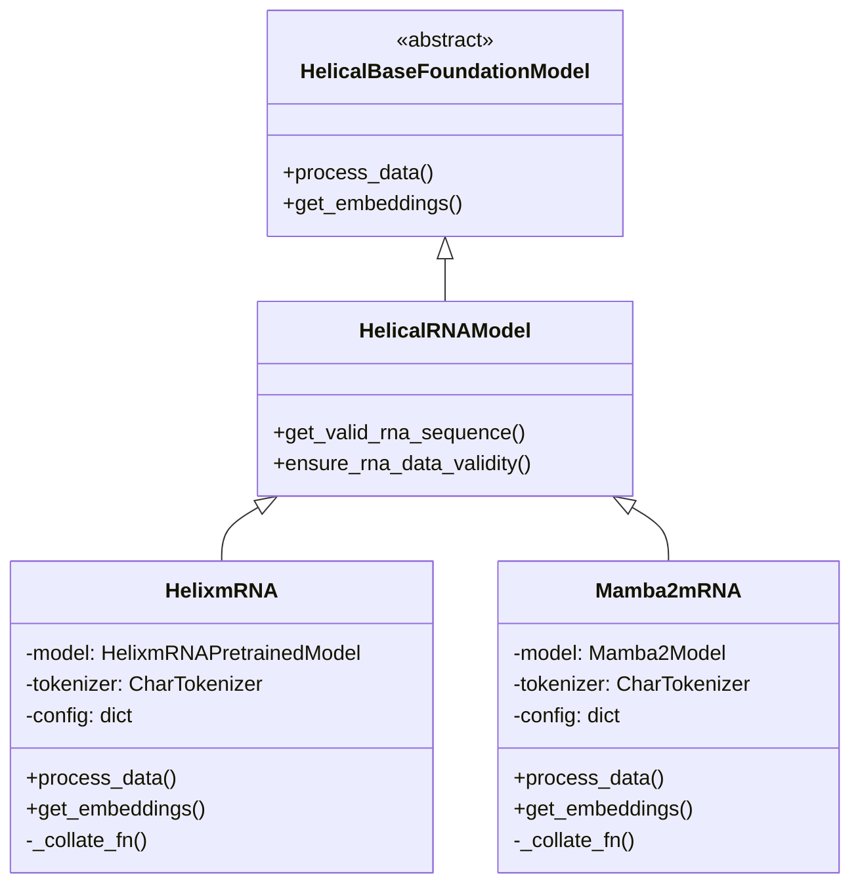
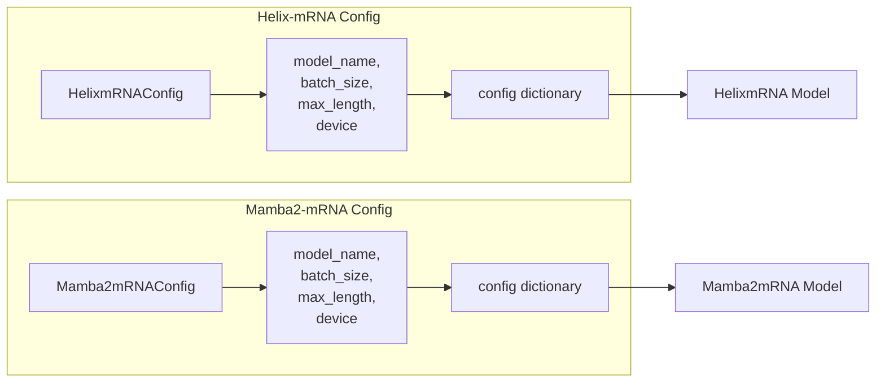

# Helix-mRNA and Mamba2-mRNA

<details>
<summary>Relevant source files</summary>

The following files were used as context for generating this wiki page:

- [docs/model_cards/caduceus.md](docs/model_cards/caduceus.md)
- [docs/model_cards/geneformer.md](docs/model_cards/geneformer.md)
- [docs/model_cards/helix_mrna.md](docs/model_cards/helix_mrna.md)
- [docs/model_cards/hyena_dna.md](docs/model_cards/hyena_dna.md)
- [docs/model_cards/mamba2_mrna.md](docs/model_cards/mamba2_mrna.md)
- [docs/model_cards/scgpt.md](docs/model_cards/scgpt.md)
- [docs/model_cards/uce.md](docs/model_cards/uce.md)
- [helical/models/caduceus/model.py](helical/models/caduceus/model.py)
- [helical/models/helix_mrna/model.py](helical/models/helix_mrna/model.py)
- [helical/models/hyena_dna/hyena_dna_config.py](helical/models/hyena_dna/hyena_dna_config.py)
- [helical/models/hyena_dna/model.py](helical/models/hyena_dna/model.py)
- [helical/models/hyena_dna/pretrained_model.py](helical/models/hyena_dna/pretrained_model.py)
- [helical/models/mamba2_mrna/model.py](helical/models/mamba2_mrna/model.py)

</details>


This page documents the Helix-mRNA and Mamba2-mRNA models within the Helical framework. Both models are designed for single nucleotide resolution analysis of mRNA sequences, but with different architectural approaches. They provide capabilities for generating embeddings from RNA sequences that can be used for downstream tasks like mRNA optimization, therapeutic design, and biomanufacturing.

For information on DNA sequence models, see [DNA Models](#5).

## Overview

Helix-mRNA and Mamba2-mRNA are foundation models for processing and analyzing mRNA sequences at the nucleotide level. While they share similar interfaces and applications, they differ in their underlying architectures:

- **Helix-mRNA**: A hybrid model combining Mamba2's state space architecture with transformer components (attention and MLP blocks)
- **Mamba2-mRNA**: A pure Mamba2-based model using 16 Mamba layers (16L)

Both models support the standard RNA nucleotides (A, C, U, G) and unknown nucleotides (N). Helix-mRNA additionally supports the 'E' character to denote the beginning of each codon, enhancing its ability to recognize codon-level patterns.

Sources: [docs/model_cards/helix_mrna.md:1-10](), [docs/model_cards/mamba2_mrna.md:1-9](), [helical/models/helix_mrna/model.py:20-54](), [helical/models/mamba2_mrna/model.py:18-48]()

### Model Comparison

| Feature | Helix-mRNA | Mamba2-mRNA |
|---------|------------|-------------|
| **Architecture** | Mamba2-Transformer hybrid | Pure Mamba2-based |
| **Components** | Mamba blocks + Attention + MLP | 16 Mamba layers |
| **Special tokens** | Supports 'E' character to mark codon beginnings | Standard RNA tokens only |
| **Pre-training data** | 57.5M mRNA sequences across five taxonomic groups | Publicly available mRNA databases |
| **License** | CC-BY-NC-SA 4.0 | CC-BY-NC-SA 4.0 |

Sources: [docs/model_cards/helix_mrna.md:24-34](), [docs/model_cards/mamba2_mrna.md:24-32](), [docs/model_cards/helix_mrna.md:63-72](), [docs/model_cards/mamba2_mrna.md:42-51]()

## Architecture

### Model Architecture Comparison



Sources: [docs/model_cards/helix_mrna.md:24-26](), [docs/model_cards/mamba2_mrna.md:24-26](), [helical/models/helix_mrna/model.py:63-69](), [helical/models/mamba2_mrna/model.py:57-71]()

### Data Processing and Embedding Generation Flow



Sources: [helical/models/helix_mrna/model.py:78-166](), [helical/models/mamba2_mrna/model.py:73-198]()

## Implementation Details

### Helix-mRNA Implementation

The Helix-mRNA model is implemented in the `HelixmRNA` class, which inherits from the `HelicalRNAModel` base class. The model uses a specialized tokenizer (`CharTokenizer`) that supports RNA sequence characters including the special 'E' character for denoting codon beginnings.

Key components:
1. `HelixmRNAPretrainedModel` - The underlying model architecture
2. `CharTokenizer` - Tokenizer for RNA sequences
3. `process_data` - Method to tokenize and prepare RNA sequences
4. `get_embeddings` - Method to generate embeddings from processed data

The model processes input sequences by tokenizing them, padding to the configured max length, and running them through the model to obtain embeddings. It handles special tokens and attention masking appropriately.

Sources: [helical/models/helix_mrna/model.py:20-166]()

### Mamba2-mRNA Implementation

The Mamba2-mRNA model is implemented in the `Mamba2mRNA` class, also inheriting from `HelicalRNAModel`. It uses the base Mamba2 implementation from the transformers library.

Key components:
1. `Mamba2Model` - The underlying Mamba2 architecture
2. `CharTokenizer` - Tokenizer for RNA sequences
3. `process_data` - Method to tokenize and prepare RNA sequences 
4. `get_embeddings` - Method to generate embeddings from processed data

The embedding generation process includes handling sequence lengths and padding tokens, ensuring proper pooling of the hidden states.

Sources: [helical/models/mamba2_mrna/model.py:18-198]()

## Integration with Helical Framework

### Model Hierarchy



Sources: [helical/models/helix_mrna/model.py:20-22](), [helical/models/mamba2_mrna/model.py:18-19]()

### Configuration System

Both models use a configuration class to manage model parameters. The configurations specify model hyperparameters, runtime settings, and integration details.



Sources: [helical/models/helix_mrna/model.py:56-60](), [helical/models/mamba2_mrna/model.py:50-55]()

## Usage Examples

### Basic Usage

Both models follow a consistent usage pattern:

1. Create a configuration object
2. Initialize the model
3. Process the RNA sequences
4. Get embeddings

#### Helix-mRNA Example

```python
from helical.models.helix_mrna import HelixmRNA, HelixmRNAConfig
import torch

device = "cuda" if torch.cuda.is_available() else "cpu"

helix_mrna_config = HelixmRNAConfig(batch_size=5, max_length=100, device=device)
helix_mrna = HelixmRNA(configurer=helix_mrna_config)

rna_sequences = ["EACUEGGG", "EACUEGGG", "EACUEGGG", "EACUEGGG", "EACUEGGG"]
dataset = helix_mrna.process_data(rna_sequences)

rna_embeddings = helix_mrna.get_embeddings(dataset)
print("Helix-mRNA embeddings shape: ", rna_embeddings.shape)
```

Sources: [docs/model_cards/helix_mrna.md:98-112](), [helical/models/helix_mrna/model.py:28-42]()

#### Mamba2-mRNA Example

```python
from helical.models.mamba2_mrna import Mamba2mRNA, Mamba2mRNAConfig
import torch

device = "cuda" if torch.cuda.is_available() else "cpu"

input_sequences = ["ACUG"*20, "AUGC"*20, "AUGC"*20, "ACUG"*20, "AUUG"*20]

mamba2_mrna_config = Mamba2mRNAConfig(batch_size=5, device=device)
mamba2_mrna = Mamba2mRNA(configurer=mamba2_mrna_config)

processed_input_data = mamba2_mrna.process_data(input_sequences)

embeddings = mamba2_mrna.get_embeddings(processed_input_data)
print("Mamba2-mRNA embeddings shape: ", embeddings.shape)
```

Sources: [docs/model_cards/mamba2_mrna.md:78-93](), [helical/models/mamba2_mrna/model.py:26-41]()

### Fine-tuning

Both models support fine-tuning for downstream tasks through their respective fine-tuning model classes:

#### Helix-mRNA Fine-tuning Example

```python
from helical.models.helix_mrna import HelixmRNAFineTuningModel, HelixmRNAConfig
import torch

device = "cuda" if torch.cuda.is_available() else "cpu"

input_sequences = ["EACU"*20, "EAUG"*20, "EUGC"*20, "ECUG"*20, "EUUG"*20]
labels = [0, 2, 2, 0, 1]

helix_mrna_config = HelixmRNAConfig(batch_size=5, device=device, max_length=100)
helix_mrna_fine_tune = HelixmRNAFineTuningModel(helix_mrna_config=helix_mrna_config, output_size=3)

train_dataset = helix_mrna_fine_tune.process_data(input_sequences)

helix_mrna_fine_tune.train(train_dataset=train_dataset, train_labels=labels)

outputs = helix_mrna_fine_tune.get_outputs(train_dataset)
```

Sources: [docs/model_cards/helix_mrna.md:115-136]()

#### Mamba2-mRNA Fine-tuning Example

```python
from helical.models.mamba2_mrna import Mamba2mRNAFineTuningModel, Mamba2mRNAConfig
import torch

device = "cuda" if torch.cuda.is_available() else "cpu"

input_sequences = ["ACUG"*20, "AUGC"*20, "AUGC"*20, "ACUG"*20, "AUUG"*20]
labels = [0, 2, 2, 0, 1]

mamba2_mrna_config = Mamba2mRNAConfig(batch_size=5, device=device, max_length=100)
mamba2_mrna_fine_tune = Mamba2mRNAFineTuningModel(mamba2_mrna_config=mamba2_mrna_config, output_size=3)

train_dataset = mamba2_mrna_fine_tune.process_data(input_sequences)

mamba2_mrna_fine_tune.train(train_dataset=train_dataset, train_labels=labels)

outputs = mamba2_mrna_fine_tune.get_outputs(train_dataset)
```

Sources: [docs/model_cards/mamba2_mrna.md:98-116]()

## Applications

Both models are designed for similar applications in the RNA sequence analysis domain:

1. **mRNA Optimization**
   - Translation efficiency improvement
   - Stability enhancement
   - Half-life modification
   - Sequence evaluation and prioritization

2. **Therapeutic Applications**
   - mRNA vaccine design (e.g., SARS-CoV-2 vaccines)
   - Personalized cancer vaccines
   - Neoantigen encoding

3. **Biomanufacturing**
   - Industrial-scale mRNA synthesis optimization
   - Yield improvement
   - Production consistency enhancement
   - Biologics manufacturing

Sources: [docs/model_cards/helix_mrna.md:44-62]()

## Key Differences

While the models share many similarities, there are important differences to consider when choosing between them:

1. **Architecture**: 
   - Helix-mRNA combines Mamba2 with transformer components
   - Mamba2-mRNA uses a pure Mamba2 architecture

2. **Codon Awareness**: 
   - Helix-mRNA was trained with a special 'E' character between codons
   - Mamba2-mRNA works with standard RNA sequences without special tokens

3. **Usage Recommendation**:
   - Use Helix-mRNA when codon-level analysis is important
   - Use Mamba2-mRNA for standard nucleotide-level analysis

Sources: [docs/model_cards/helix_mrna.md:9-10](), [docs/model_cards/mamba2_mrna.md:9-10](), [helical/models/helix_mrna/model.py:49-54]()

## Limitations

Both models share similar limitations:

1. Performance may vary based on sequence length
2. Performance degrades for sequences longer than those used during pretraining
3. Specific to mRNA sequence analysis tasks

Sources: [docs/model_cards/helix_mrna.md:80-86](), [docs/model_cards/mamba2_mrna.md:59-64]()

---