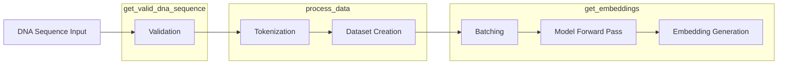
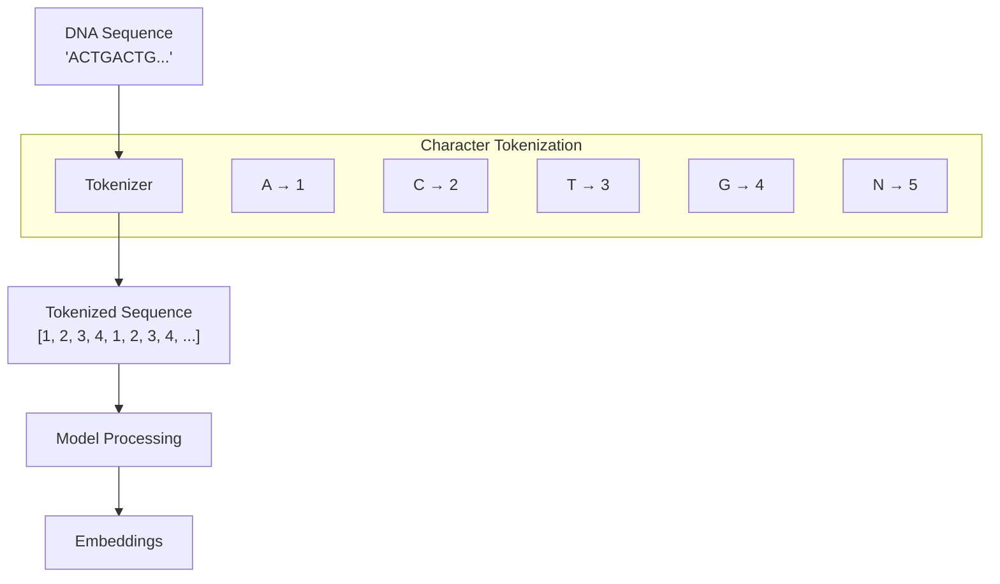
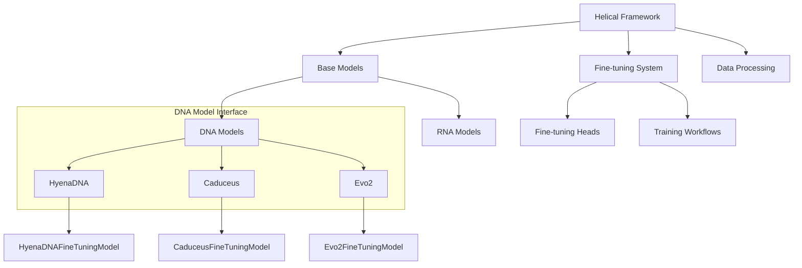

# DNA Models

<details>
<summary>Relevant source files</summary>

The following files were used as context for generating this wiki page:

- [docs/model_cards/caduceus.md](docs/model_cards/caduceus.md)
- [docs/model_cards/geneformer.md](docs/model_cards/geneformer.md)
- [docs/model_cards/helix_mrna.md](docs/model_cards/helix_mrna.md)
- [docs/model_cards/hyena_dna.md](docs/model_cards/hyena_dna.md)
- [docs/model_cards/mamba2_mrna.md](docs/model_cards/mamba2_mrna.md)
- [docs/model_cards/scgpt.md](docs/model_cards/scgpt.md)
- [docs/model_cards/uce.md](docs/model_cards/uce.md)
- [helical/models/caduceus/model.py](helical/models/caduceus/model.py)
- [helical/models/helix_mrna/model.py](helical/models/helix_mrna/model.py)
- [helical/models/hyena_dna/hyena_dna_config.py](helical/models/hyena_dna/hyena_dna_config.py)
- [helical/models/hyena_dna/model.py](helical/models/hyena_dna/model.py)
- [helical/models/hyena_dna/pretrained_model.py](helical/models/hyena_dna/pretrained_model.py)
- [helical/models/mamba2_mrna/model.py](helical/models/mamba2_mrna/model.py)

</details>


## Purpose and Scope

This page provides a comprehensive overview of the DNA foundation models available in the Helical framework. These models are specialized for analyzing and generating embeddings from DNA sequences at single nucleotide resolution. The DNA models include HyenaDNA, Caduceus, and Evo2, each with distinct architectures and capabilities for genomic sequence analysis.

For RNA sequence and gene expression models, see [RNA Models](#4).

## Architecture Overview

DNA models in Helical inherit from the `HelicalDNAModel` abstract base class, which defines the standard interface for all DNA-focused foundation models. This ensures a consistent API across different implementations while allowing each model to leverage its unique architecture.

```mermaid
classDiagram
    class "HelicalDNAModel" {
        <<abstract>>
        +process_data()
        +get_embeddings()
        +get_valid_dna_sequence()
    }
    class "HyenaDNA" {
        +tokenizer: CharacterTokenizer
        +model: HyenaDNAPreTrainedModel
        +process_data()
        +get_embeddings()
    }
    class "Caduceus" {
        +tokenizer: CaduceusTokenizer
        +model: CaduceusModel
        +process_data()
        +get_embeddings()
        +_pool_hidden_states()
    }
    class "Evo2" {
        +tokenizer
        +model
        +process_data()
        +get_embeddings()
    }
    "HelicalDNAModel" <|-- "HyenaDNA"
    "HelicalDNAModel" <|-- "Caduceus"
    "HelicalDNAModel" <|-- "Evo2"
```

Sources: [helical/models/hyena_dna/model.py:18-162](), [helical/models/caduceus/model.py:21-199]()

## Data Processing Workflow

DNA models in Helical follow a standardized workflow for processing sequences and generating embeddings:



Sources: [helical/models/hyena_dna/model.py:81-161](), [helical/models/caduceus/model.py:115-198]()

## Available DNA Models

### HyenaDNA

HyenaDNA is a long-range genomic foundation model pretrained on context lengths of up to 1 million tokens at single nucleotide resolution. It's designed to analyze and understand patterns in DNA sequences across large genomic regions.

#### Architecture

HyenaDNA is based on the Hyena architecture, which is specifically designed for efficient long-range sequence modeling. The model leverages a combination of convolutions and special operators to efficiently process sequences.

#### Configuration

The model provides two primary configurations:

| Model Name | Dimensions | Context Length |
|------------|------------|----------------|
| hyenadna-tiny-1k-seqlen | d_model=128, d_inner=512 | 1024 tokens |
| hyenadna-tiny-1k-seqlen-d256 | d_model=256, d_inner=1024 | 1024 tokens |

Additional configuration parameters include:
- Batch size
- Number of layers
- Device (CPU/CUDA)
- Various architectural parameters (dropout rates, fusion options)

#### Usage Example

```python
from helical.models.hyena_dna import HyenaDNA, HyenaDNAConfig

hyena_config = HyenaDNAConfig(model_name="hyenadna-tiny-1k-seqlen-d256")
model = HyenaDNA(configurer=hyena_config)

sequence = 'ACTG' * int(1024/4)

tokenized_sequence = model.process_data(sequence)
embeddings = model.get_embeddings(tokenized_sequence)

print(embeddings.shape)
```

Sources: [helical/models/hyena_dna/model.py:18-162](), [helical/models/hyena_dna/hyena_dna_config.py:6-131](), [docs/model_cards/hyena_dna.md:1-169]()

### Caduceus

Caduceus is a DNA model that extends the Mamba architecture with bi-directionality and reverse complementarity (RC) support, making it especially suited for genomic analysis tasks. The model leverages these DNA-specific properties to outperform larger models that don't utilize bi-directionality or equivariance.

#### Architecture

Caduceus is built upon the long-range Mamba block, extending it to a BiMamba component that supports bi-directionality and a Mamba block that additionally supports reverse complementarity of DNA.

#### Key Features

- Bi-directional sequence processing
- Reverse complement equivariance
- Multiple pooling strategies (mean, max, first, last)
- CUDA-accelerated implementation (requires CUDA device)

#### Usage Example

```python
from helical.models.caduceus import Caduceus, CaduceusConfig

caduceus_config = CaduceusConfig(
    model_name="caduceus-ph-4L-seqlen-1k-d118", 
    batch_size=5,
    pooling_strategy="mean"
)
caduceus = Caduceus(configurer=caduceus_config)

sequence = ['ACTG' * int(1024/4)]
processed_data = caduceus.process_data(sequence)

embeddings = caduceus.get_embeddings(processed_data)
print(embeddings.shape)
```

Sources: [helical/models/caduceus/model.py:21-199](), [docs/model_cards/caduceus.md:1-102]()

### Evo2

Evo2 is another DNA model available in the Helical framework that extends the base `HelicalDNAModel` class. While detailed implementation information is not provided in the shared files, it follows the same interface as the other DNA models for consistency within the framework.

## Model Comparison

The following table compares the key characteristics of the available DNA models:

| Feature | HyenaDNA | Caduceus | Evo2 |
|---------|----------|----------|------|
| Architecture | Hyena-based | Mamba-based with BiMamba | Not specified |
| Maximum Sequence Length | 1024 | 1024 | Not specified |
| Bi-directionality | No | Yes | Not specified |
| Reverse Complement Support | No | Yes | Not specified |
| Hardware Requirements | CPU/CUDA | CUDA only | Not specified |
| Pooling Strategies | N/A | Mean, Max, First, Last | Not specified |

## Implementation Details

### Base Model Methods

All DNA models in Helical implement these key methods from the `HelicalDNAModel` base class:

1. **`process_data(sequences, ...)`**: Processes and tokenizes DNA sequences
   - Takes raw DNA sequences (list of strings or DataFrame)
   - Validates sequences with `get_valid_dna_sequence()`
   - Tokenizes and creates a dataset object

2. **`get_embeddings(dataset)`**: Generates embeddings from processed sequences
   - Takes the dataset object from `process_data()`
   - Runs the model's forward pass in batches
   - Returns an array of embeddings

### Tokenization

Different models use different tokenizers:

- **HyenaDNA**: Uses `CharacterTokenizer` with tokens for "A", "C", "G", "T", and "N"
- **Caduceus**: Uses `CaduceusTokenizer` specialized for DNA sequences



Sources: [helical/models/hyena_dna/model.py:62-68](), [helical/models/caduceus/model.py:79]()

## Fine-Tuning DNA Models

All DNA models in Helical support fine-tuning for downstream tasks through specialized fine-tuning classes (`HyenaDNAFineTuningModel`, `CaduceusFineTuningModel`, etc.) that extend the base models with training capabilities.

### Fine-Tuning Example

```python
from helical.models.hyena_dna import HyenaDNAConfig, HyenaDNAFineTuningModel
import torch

device = "cuda" if torch.cuda.is_available() else "cpu"

# Create configuration
config = HyenaDNAConfig(device=device, batch_size=10)

# Initialize fine-tuning model for classification with 3 output classes
hyena_fine_tune = HyenaDNAFineTuningModel(
    hyenadna_config=config, 
    fine_tuning_head="classification", 
    output_size=3
)

# Process input sequences
input_sequences = ["ACTG"*100, "GTCA"*100, "CAGT"*100]
labels = [0, 1, 2]
dataset = hyena_fine_tune.process_data(input_sequences)

# Train model
hyena_fine_tune.train(train_dataset=dataset, train_labels=labels)

# Get predictions
outputs = hyena_fine_tune.get_outputs(dataset)
```

Sources: [docs/model_cards/hyena_dna.md:132-155](), [docs/model_cards/caduceus.md:71-87]()

## Integration with Helical Framework

DNA models are a core component of the Helical framework, designed to work seamlessly with other framework components like fine-tuning systems and utilities.



Sources: [helical/models/hyena_dna/model.py:18-162](), [helical/models/caduceus/model.py:21-199]()

## Hardware Requirements

- **HyenaDNA**: Compatible with both CPU and CUDA devices
- **Caduceus**: Requires CUDA device due to architecture-specific dependencies
- **Evo2**: Not specified in the provided documentation

## Conclusion

The DNA models in Helical provide powerful capabilities for analyzing genomic sequences at single nucleotide resolution. Each model offers unique strengths, from HyenaDNA's long-range sequence modeling to Caduceus's bi-directional and reverse complement awareness. The consistent interface across models allows researchers to easily switch between them while maintaining the same workflow.

---