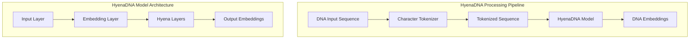
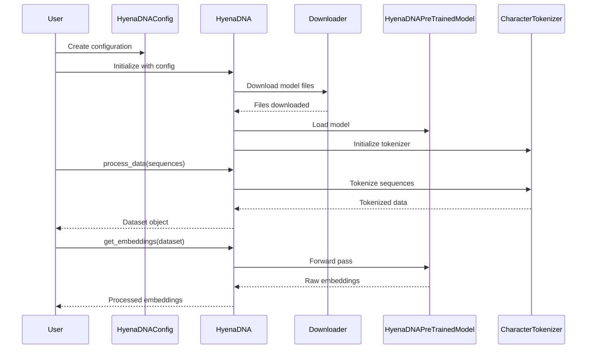
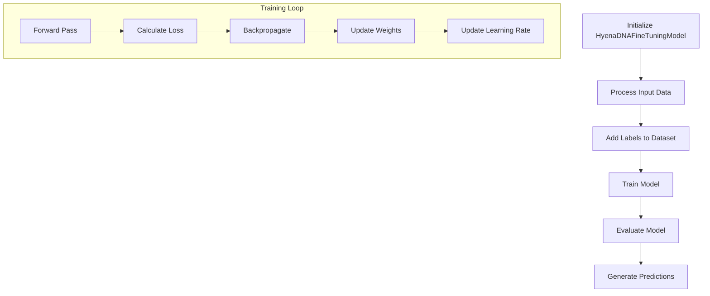

# HyenaDNA

<details>
<summary>Relevant source files</summary>

The following files were used as context for generating this wiki page:

- [ci/tests/test_helix_mrna/test_helix_mrna_model.py](ci/tests/test_helix_mrna/test_helix_mrna_model.py)
- [ci/tests/test_hyena_dna/test_hyena_dna_fine_tuning.py](ci/tests/test_hyena_dna/test_hyena_dna_fine_tuning.py)
- [ci/tests/test_hyena_dna/test_hyena_dna_model.py](ci/tests/test_hyena_dna/test_hyena_dna_model.py)
- [docs/model_cards/caduceus.md](docs/model_cards/caduceus.md)
- [docs/model_cards/geneformer.md](docs/model_cards/geneformer.md)
- [docs/model_cards/helix_mrna.md](docs/model_cards/helix_mrna.md)
- [docs/model_cards/hyena_dna.md](docs/model_cards/hyena_dna.md)
- [docs/model_cards/mamba2_mrna.md](docs/model_cards/mamba2_mrna.md)
- [docs/model_cards/scgpt.md](docs/model_cards/scgpt.md)
- [docs/model_cards/uce.md](docs/model_cards/uce.md)
- [examples/notebooks/HyenaDNA-Fine-Tuning.ipynb](examples/notebooks/HyenaDNA-Fine-Tuning.ipynb)
- [examples/run_models/run_caduceus.py](examples/run_models/run_caduceus.py)
- [examples/run_models/run_helix_mrna.py](examples/run_models/run_helix_mrna.py)
- [examples/run_models/run_hyena_dna.py](examples/run_models/run_hyena_dna.py)
- [helical/models/caduceus/model.py](helical/models/caduceus/model.py)
- [helical/models/helix_mrna/model.py](helical/models/helix_mrna/model.py)
- [helical/models/hyena_dna/fine_tuning_model.py](helical/models/hyena_dna/fine_tuning_model.py)
- [helical/models/hyena_dna/hyena_dna_config.py](helical/models/hyena_dna/hyena_dna_config.py)
- [helical/models/hyena_dna/model.py](helical/models/hyena_dna/model.py)
- [helical/models/hyena_dna/pretrained_model.py](helical/models/hyena_dna/pretrained_model.py)
- [helical/models/mamba2_mrna/model.py](helical/models/mamba2_mrna/model.py)

</details>


This document provides detailed information about the HyenaDNA model implementation in the Helical framework. HyenaDNA is a long-range genomic foundation model that processes DNA sequences at single nucleotide resolution. This page covers the model architecture, configuration options, basic usage patterns, and fine-tuning capabilities.

For information about other DNA models available in Helical, see [DNA Models](#5) or specific models like [Caduceus](#5.2) and [Evo2](#5.3).

## Overview

HyenaDNA is a genomic sequence model based on the Hyena architecture that specializes in long-range DNA sequence modeling. It can handle context lengths of up to 1 million tokens at single nucleotide resolution, making it suitable for analyzing complex genomic sequences.

The model is implemented as a subclass of `HelicalDNAModel` and provides a standardized interface consistent with other DNA models in the Helical framework.

```mermaid
classDiagram
    class "HelicalBaseFoundationModel" {
        <<abstract>>
        +process_data()
        +get_embeddings()
    }
    class "HelicalDNAModel" {
        +get_valid_dna_sequence()
    }
    class "HyenaDNA" {
        -tokenizer: CharacterTokenizer
        -model: HyenaDNAPreTrainedModel
        -config: dict
        +process_data()
        +get_embeddings()
        -_collate_fn()
    }
    class "HyenaDNAConfig" {
        +model_map: dict
        +config: dict
    }
    
    HelicalBaseFoundationModel <|-- HelicalDNAModel
    HelicalDNAModel <|-- HyenaDNA
    HyenaDNA -- HyenaDNAConfig : uses
```

Sources: [helical/models/hyena_dna/model.py:1-163](), [helical/models/hyena_dna/hyena_dna_config.py:1-132]()

## Architecture

HyenaDNA leverages a specialized architecture designed for processing long-range genomic sequences. It uses a character-level tokenizer that operates at single nucleotide resolution, allowing it to process DNA sequences token by token.

The core architecture consists of:

1. **DNA Character Tokenizer**: Handles DNA-specific tokens (A, C, G, T, N)
2. **Hyena Layers**: Specialized layers for efficient long-range sequence modeling
3. **Embedding Layer**: Produces contextual embeddings of DNA sequences



Sources: [helical/models/hyena_dna/model.py:18-79](), [helical/models/hyena_dna/pretrained_model.py:1-105]()

## Available Models

HyenaDNA comes with two pre-trained model versions, each configured for different sequence lengths and embedding dimensions:

| Model Name | Embedding Dimension | Inner Dimension | Max Sequence Length |
|------------|---------------------|-----------------|---------------------|
| hyenadna-tiny-1k-seqlen | 128 | 512 | 1024 |
| hyenadna-tiny-1k-seqlen-d256 | 256 | 1024 | 1024 |

Sources: [helical/models/hyena_dna/hyena_dna_config.py:90-101]()

## Configuration

HyenaDNA configuration is handled through the `HyenaDNAConfig` class, which provides a flexible way to specify model parameters and settings.

### Key Configuration Parameters

| Parameter | Description | Default |
|-----------|-------------|---------|
| model_name | Name of the pre-trained model | "hyenadna-tiny-1k-seqlen" |
| batch_size | Batch size for processing | 5 |
| n_layer | Number of layers | 2 |
| vocab_size | Size of the vocabulary | 12 |
| device | Device to run the model on | "cpu" |
| max_length | Maximum sequence length | Based on model |

### Example Configuration

```python
from helical.models.hyena_dna import HyenaDNAConfig

# Create a configuration with custom parameters
config = HyenaDNAConfig(
    model_name="hyenadna-tiny-1k-seqlen-d256",
    batch_size=10,
    device="cuda"
)
```

Sources: [helical/models/hyena_dna/hyena_dna_config.py:6-131]()

## Basic Usage

HyenaDNA provides a straightforward interface for processing DNA sequences and generating embeddings.



### Example Usage

```python
from helical.models.hyena_dna import HyenaDNA, HyenaDNAConfig

# Initialize the model with a configuration
hyena_config = HyenaDNAConfig(model_name="hyenadna-tiny-1k-seqlen-d256")
model = HyenaDNA(configurer=hyena_config)

# Process DNA sequences
sequence = 'ACTG' * int(1024/4)
tokenized_sequence = model.process_data(sequence)

# Get embeddings
embeddings = model.get_embeddings(tokenized_sequence)
print(embeddings.shape)
```

The model supports both list inputs and pandas DataFrames with a 'Sequence' column.

Sources: [helical/models/hyena_dna/model.py:19-163](), [examples/run_models/run_hyena_dna.py:1-20]()

## Data Processing

The `process_data` method handles the conversion of DNA sequences into a format suitable for the model. It performs the following steps:

1. Validates input DNA sequences
2. Tokenizes sequences using a character-level tokenizer
3. Returns a Dataset object containing the processed sequences

```python
# Processing a list of sequences
sequences = ["ACGT", "TGCA", "NNNN"]
dataset = model.process_data(sequences)

# Processing a DataFrame
import pandas as pd
df = pd.DataFrame({"Sequence": ["ACGT", "TGCA", "NNNN"]})
dataset = model.process_data(df)
```

The tokenizer can handle variable-length sequences within the same batch, automatically padding them to the maximum length.

Sources: [helical/models/hyena_dna/model.py:81-123](), [ci/tests/test_hyena_dna/test_hyena_dna_model.py:45-84]()

## Getting Embeddings

The `get_embeddings` method generates embeddings from a processed dataset:

1. Creates a DataLoader to handle batching
2. Passes each batch through the model in inference mode
3. Returns stacked embeddings as a numpy array

```python
# Get embeddings from processed dataset
embeddings = model.get_embeddings(dataset)

# Embeddings shape: [number_of_sequences, embedding_dimension]
```

Sources: [helical/models/hyena_dna/model.py:125-151]()

## Fine-tuning

HyenaDNA supports fine-tuning for downstream tasks through the `HyenaDNAFineTuningModel` class, which extends both `HyenaDNA` and `HelicalBaseFineTuningModel`.

```mermaid
classDiagram
    class "HelicalBaseFineTuningModel" {
        <<abstract>>
        +train()
        +get_outputs()
    }
    
    class "HyenaDNA" {
        +process_data()
        +get_embeddings()
    }
    
    class "HyenaDNAFineTuningModel" {
        -fine_tuning_head
        +train()
        +get_outputs()
        +get_embeddings()
        -_forward()
        -_add_data_column()
    }
    
    class "ClassificationHead" {
        +output_size: int
        +set_dim_size()
        +forward()
    }
    
    HelicalBaseFineTuningModel <|-- HyenaDNAFineTuningModel
    HyenaDNA <|-- HyenaDNAFineTuningModel
    HyenaDNAFineTuningModel -- ClassificationHead : uses
```

Sources: [helical/models/hyena_dna/fine_tuning_model.py:1-244]()

### Fine-tuning Process

The fine-tuning process involves:

1. Creating a `HyenaDNAFineTuningModel` with the appropriate configuration and fine-tuning head
2. Processing the input data
3. Training the model on labeled data
4. Using the fine-tuned model to generate predictions



Sources: [helical/models/hyena_dna/fine_tuning_model.py:82-191]()

### Fine-tuning Example

```python
from helical.models.hyena_dna import HyenaDNAFineTuningModel, HyenaDNAConfig
import torch

# Set device
device = "cuda" if torch.cuda.is_available() else "cpu"

# Create input data
input_sequences = ["ACTG"*20, "ATGC"*20, "ATGC"*20, "ACTG"*20, "ATTG"*20]
labels = [0, 2, 2, 0, 1]

# Initialize fine-tuning model
config = HyenaDNAConfig(batch_size=5, device=device)
hyena_fine_tune = HyenaDNAFineTuningModel(
    hyena_config=config, 
    fine_tuning_head="classification", 
    output_size=3
)

# Process data
train_dataset = hyena_fine_tune.process_data(input_sequences)

# Train model
hyena_fine_tune.train(
    train_dataset=train_dataset,
    train_labels=labels,
    optimizer_params={"lr": 0.0001},
    epochs=5
)

# Get outputs from fine-tuned model
outputs = hyena_fine_tune.get_outputs(train_dataset)
```

For a more comprehensive example, see the Helical notebook for fine-tuning HyenaDNA on downstream classification tasks.

Sources: [helical/models/hyena_dna/fine_tuning_model.py:20-222](), [examples/notebooks/HyenaDNA-Fine-Tuning.ipynb]()

## Performance and Benchmarks

HyenaDNA has been evaluated on various genomic tasks. The model can be fine-tuned to achieve strong performance on tasks such as:

- Chromatin accessibility prediction
- Promoter identification
- Enhancer classification
- Histone modification prediction
- Splice site detection

The models are particularly effective for tasks requiring understanding of long-range dependencies in genomic sequences.

| Task Type | Evaluation Metric | Performance Range |
|-----------|-------------------|-------------------|
| Histone Marks | Matthews Correlation Coefficient (MCC) | 24-72% |
| Splice Sites | F1 Score | 57-93% |
| Promoters | F1 Score | 92-94% |
| Enhancers | Matthews Correlation Coefficient (MCC) | 35-48% |

Note that these numbers represent probing performance. Fine-tuning the model can significantly improve results.

Sources: [docs/model_cards/hyena_dna.md:60-82]()

## Limitations and Considerations

- HyenaDNA models are specifically trained on genomic sequences and may not generalize well to other types of biological sequences.
- Performance is optimal within the maximum sequence length of the model (1024 tokens for the available models).
- The model operates at single nucleotide resolution, which may lead to memory limitations for very long sequences.
- Currently available models have been primarily evaluated on human genomic data.

## Additional Resources

- Original paper: [HyenaDNA: Long-Range Genomic Sequence Modeling at Single Nucleotide Resolution](https://arxiv.org/abs/2306.15794)
- HyenaDNA GitHub repository: [HazyResearch/hyena-dna](https://github.com/HazyResearch/hyena-dna)

Sources: [docs/model_cards/hyena_dna.md:1-169]()

---