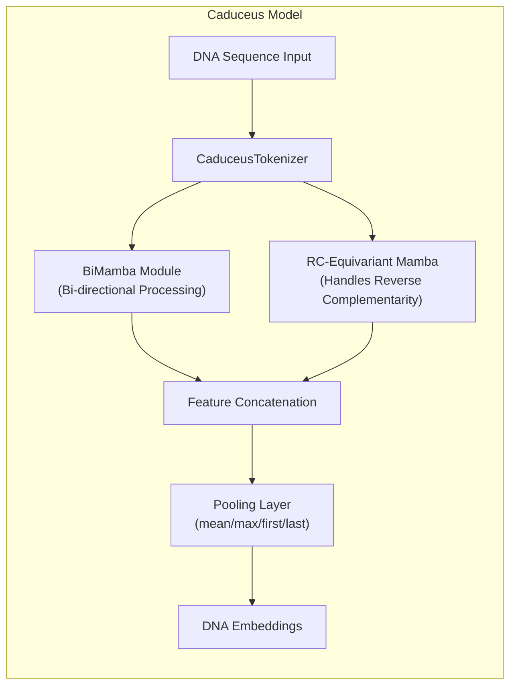
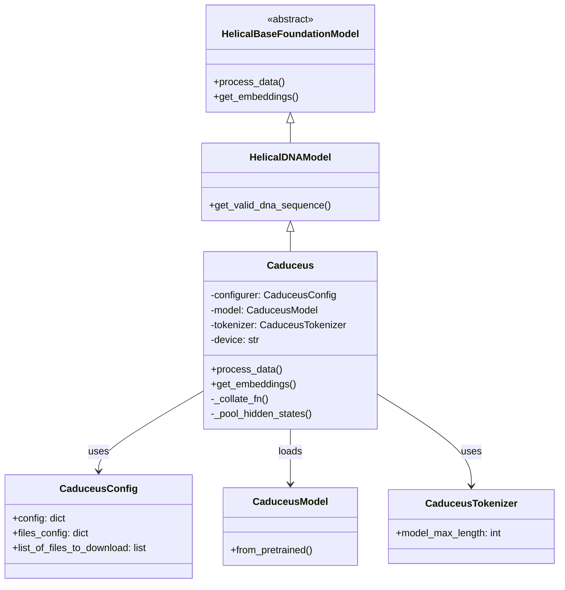
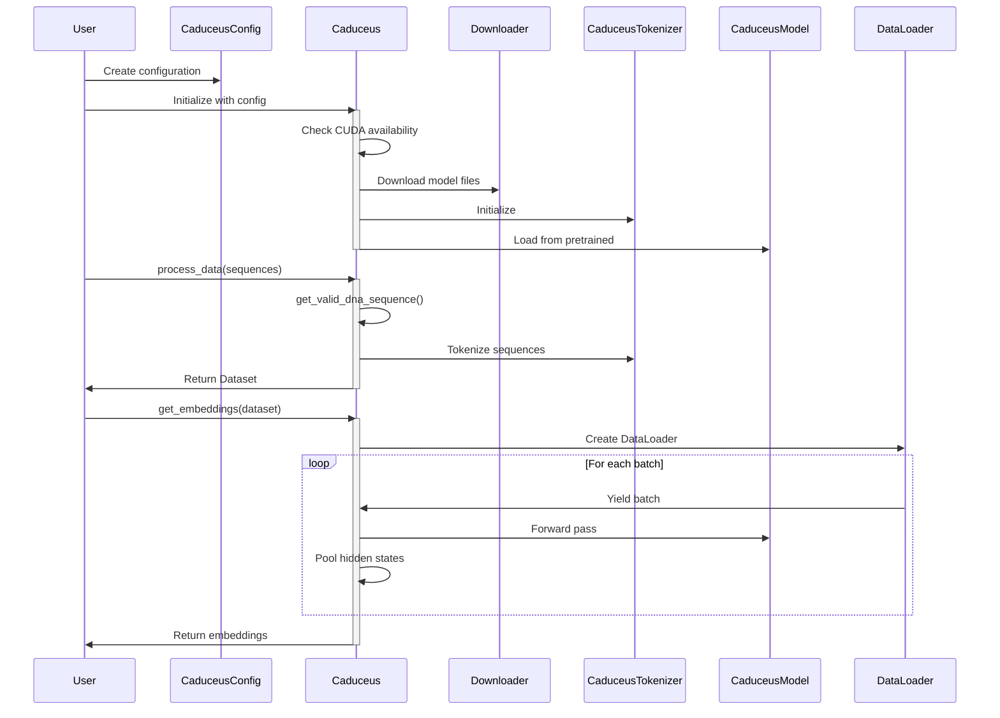

# Caduceus

<details>
<summary>Relevant source files</summary>

The following files were used as context for generating this wiki page:

- [docs/model_cards/caduceus.md](docs/model_cards/caduceus.md)
- [docs/model_cards/geneformer.md](docs/model_cards/geneformer.md)
- [docs/model_cards/helix_mrna.md](docs/model_cards/helix_mrna.md)
- [docs/model_cards/hyena_dna.md](docs/model_cards/hyena_dna.md)
- [docs/model_cards/mamba2_mrna.md](docs/model_cards/mamba2_mrna.md)
- [docs/model_cards/scgpt.md](docs/model_cards/scgpt.md)
- [docs/model_cards/uce.md](docs/model_cards/uce.md)
- [helical/models/caduceus/model.py](helical/models/caduceus/model.py)
- [helical/models/helix_mrna/model.py](helical/models/helix_mrna/model.py)
- [helical/models/hyena_dna/hyena_dna_config.py](helical/models/hyena_dna/hyena_dna_config.py)
- [helical/models/hyena_dna/model.py](helical/models/hyena_dna/model.py)
- [helical/models/hyena_dna/pretrained_model.py](helical/models/hyena_dna/pretrained_model.py)
- [helical/models/mamba2_mrna/model.py](helical/models/mamba2_mrna/model.py)

</details>


Caduceus is a DNA foundation model in the Helical framework that leverages a bi-directional and reverse complement-aware architecture for genomic sequence analysis. Built on the Mamba architecture, it extends the state-space model approach to better handle DNA sequences by incorporating the biological properties of DNA strands, specifically bi-directionality and reverse complementarity.

This page documents the Caduceus model implementation, configuration, and usage within the Helical framework. For information about other DNA models available in Helical, see [HyenaDNA](#5.1) or [Evo2](#5.3).

## Architecture Overview

Caduceus extends the Mamba architecture to create a specialized DNA model that respects the biological properties of DNA. The model includes two key innovations:

1. **BiMamba** - A bi-directional component that processes DNA sequences from both directions
2. **RC-Equivariant Mamba** - A component that respects the reverse complementarity property of DNA strands



Sources: [helical/models/caduceus/model.py:21-199](), [docs/model_cards/caduceus.md:1-102]()

The model's architecture is designed to outperform larger models that don't utilize bi-directionality or equivariance, making it more efficient for genomic analysis tasks.

## Class Hierarchy and Integration

Caduceus integrates into the Helical framework as a DNA model implementation, inheriting from the `HelicalDNAModel` base class.



Sources: [helical/models/caduceus/model.py:21-51]()

## Configuration

The Caduceus model is configured using the `CaduceusConfig` class, which provides parameters for model selection, batch size, device settings, and embedding pooling strategy.

Key configuration parameters include:

| Parameter | Description | Default |
|-----------|-------------|---------|
| model_name | Pre-trained model identifier | "caduceus-ph-4L-seqlen-1k-d118" |
| batch_size | Batch size for processing | 2 |
| pooling_strategy | How to pool embeddings (mean/max/first/last) | "mean" |
| device | Computing device (CUDA only) | "cuda" |
| input_size | Maximum sequence length | 1024 |
| nproc | Number of worker processes | 0 |

Sources: [helical/models/caduceus/model.py:53-75]()

## Model Initialization and Processing Flow

The Caduceus model follows a standard flow for initialization, data processing, and embedding generation:



Sources: [helical/models/caduceus/model.py:53-198]()

## Usage Examples

### Basic Usage

The following example demonstrates how to initialize the Caduceus model and generate embeddings from DNA sequences:

```python
from helical.models.caduceus import Caduceus, CaduceusConfig

# Create configuration
caduceus_config = CaduceusConfig(
    model_name="caduceus-ph-4L-seqlen-1k-d118", 
    batch_size=2, 
    pooling_strategy="mean"
)

# Initialize model
caduceus = Caduceus(configurer=caduceus_config)

# Process DNA sequences
sequence = ['ACTG' * int(1024/4), 'TGCA' * int(1024/4)]
processed_data = caduceus.process_data(sequence)

# Generate embeddings
embeddings = caduceus.get_embeddings(processed_data)
print(embeddings.shape)
```

Sources: [docs/model_cards/caduceus.md:58-69]()

### Fine-Tuning Example

Caduceus can be fine-tuned for specific downstream tasks using the `CaduceusFineTuningModel`:

```python
from helical.models.caduceus import CaduceusConfig, CaduceusFineTuningModel

# Prepare data
input_sequences = ["ACT"*20, "ATG"*20, "ATG"*20, "CTG"*20, "TTG"*20]
labels = [0, 2, 2, 0, 1]

# Configure model
caduceus_config = CaduceusConfig(
    model_name="caduceus-ph-4L-seqlen-1k-d118", 
    batch_size=2, 
    pooling_strategy="mean"
)

# Create fine-tuning model
caduceus_fine_tune = CaduceusFineTuningModel(
    caduceus_config=caduceus_config, 
    fine_tuning_head="classification", 
    output_size=3
)

# Process data and train
train_dataset = caduceus_fine_tune.process_data(input_sequences)
caduceus_fine_tune.train(train_dataset=train_dataset, train_labels=labels)

# Get predictions
outputs = caduceus_fine_tune.get_outputs(train_dataset)
```

Sources: [docs/model_cards/caduceus.md:71-87]()

## Implementation Details

### Tokenization

The `CaduceusTokenizer` handles the conversion of DNA sequences into tokens that can be processed by the model. It supports standard DNA nucleotide characters.

### Pooling Strategies

The Caduceus model supports four different strategies for pooling the hidden states into fixed-size embeddings:

1. **mean** - Average pooling across the sequence length
2. **max** - Maximum pooling across the sequence length
3. **first** - Use the embedding of the first token in the sequence
4. **last** - Use the embedding of the last token in the sequence

The pooling strategy is specified in the model configuration:

```python
def _pool_hidden_states(self, hidden_states, sequence_length_dim=1):
    """Pools hidden states along sequence length dimension."""
    if self.config["pooling_strategy"] == "mean":
        return hidden_states.mean(dim=sequence_length_dim)
    if self.config["pooling_strategy"] == "max":
        return hidden_states.max(dim=sequence_length_dim).values
    if self.config["pooling_strategy"] == "last":
        return hidden_states.moveaxis(hidden_states, sequence_length_dim, 0)[-1, ...]
    if self.config["pooling_strategy"] == "first":
        return hidden_states.moveaxis(hidden_states, sequence_length_dim, 0)[0, ...]
```

Sources: [helical/models/caduceus/model.py:94-113]()

### CUDA Requirement

Unlike some other models in the Helical framework, Caduceus requires a CUDA device to run due to its architecture and dependencies. This requirement is checked during model initialization:

```python
if torch.cuda.is_available() == False:
    message = "Caduceus requires a CUDA device to run and CUDA is not available"
    LOGGER.error(message)
    raise RuntimeError(message)
```

Sources: [helical/models/caduceus/model.py:56-59]()

## Model Training and Data

Caduceus was trained on the human reference genome splits from the Enformer study (Avsec et al., 2021), with the training data comprising approximately 35 billion tokens (base pairs).

The model uses reverse complement (RC) data augmentation during training, with a 50% probability of applying the RC operation to the input sequences. This augmentation helps the model learn the biological property of reverse complementarity in DNA strands.

Sources: [docs/model_cards/caduceus.md:38-50]()

## Application Areas

Caduceus is particularly well-suited for the following genomic analysis tasks:

1. **Variant effect prediction (VEP)** - Determining if genetic mutations affect gene expression
2. **Recognition of evolutionary pressure effects** - Analyzing conservation and co-evolution patterns
3. **Prediction of long-range effects on gene expression** - Understanding how distant genomic regions influence each other

Sources: [docs/model_cards/caduceus.md:30-36]()

## Limitations

The primary limitations of the Caduceus model include:

1. **CUDA Requirement** - The model can only run on CUDA-enabled devices
2. **Human-Genome Focus** - The model was specifically pretrained on human genome data and may not generalize well to other genomes
3. **Sequence Length** - Performance may degrade for sequences longer than those used during training

Sources: [docs/model_cards/caduceus.md:53-55](), [helical/models/caduceus/model.py:48-50]()

## Technical References

Caduceus is based on the research described in:

```
@article{schiff2024caduceus,
  title={Caduceus: Bi-directional equivariant long-range dna sequence modeling},
  author={Schiff, Yair and Kao, Chia-Hsiang and Gokaslan, Aaron and Dao, Tri and Gu, Albert and Kuleshov, Volodymyr},
  journal={arXiv preprint arXiv:2403.03234},
  year={2024}
}
```

For more information, the original publication can be found at: https://arxiv.org/abs/2403.03234

Sources: [docs/model_cards/caduceus.md:93-101]()

---