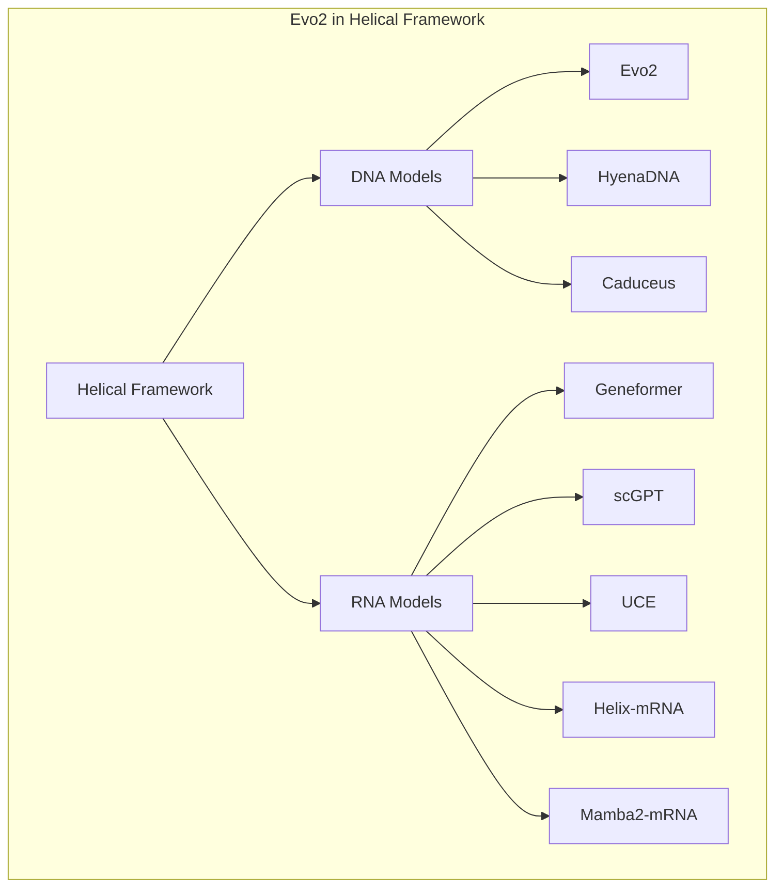
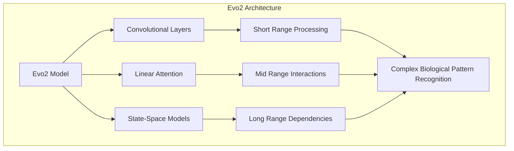
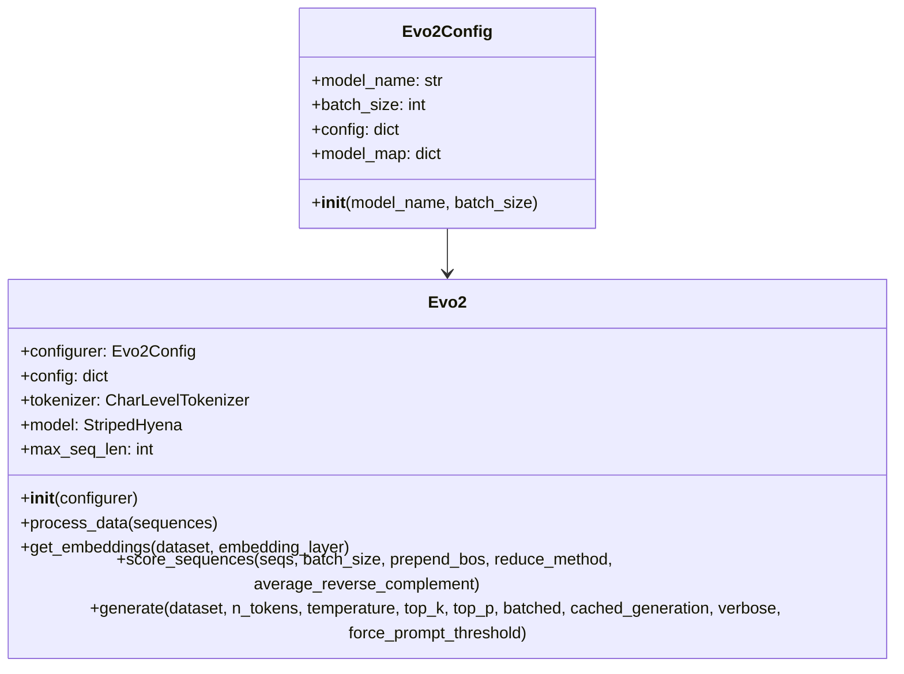
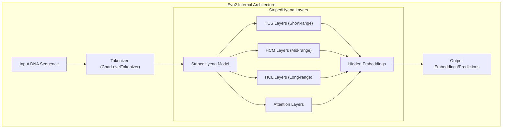

# Evo2

<details>
<summary>Relevant source files</summary>

The following files were used as context for generating this wiki page:

- [ci/tests/test_caduceus/test_caduceus_model.py](ci/tests/test_caduceus/test_caduceus_model.py)
- [ci/tests/test_evo2/test_evo2_model.py](ci/tests/test_evo2/test_evo2_model.py)
- [docs/configs/evo_2_config.md](docs/configs/evo_2_config.md)
- [docs/model_cards/caduceus.md](docs/model_cards/caduceus.md)
- [docs/model_cards/geneformer.md](docs/model_cards/geneformer.md)
- [docs/model_cards/helix_mrna.md](docs/model_cards/helix_mrna.md)
- [docs/model_cards/hyena_dna.md](docs/model_cards/hyena_dna.md)
- [docs/model_cards/mamba2_mrna.md](docs/model_cards/mamba2_mrna.md)
- [docs/model_cards/scgpt.md](docs/model_cards/scgpt.md)
- [docs/model_cards/uce.md](docs/model_cards/uce.md)
- [docs/models/evo_2.md](docs/models/evo_2.md)
- [examples/notebooks/Evo-2.ipynb](examples/notebooks/Evo-2.ipynb)
- [examples/run_models/configs/evo_2_config.yaml](examples/run_models/configs/evo_2_config.yaml)
- [examples/run_models/run_evo2.py](examples/run_models/run_evo2.py)
- [helical/__init__.py](helical/__init__.py)
- [helical/models/caduceus/__init__.py](helical/models/caduceus/__init__.py)
- [helical/models/evo_2/LICENSE](helical/models/evo_2/LICENSE)
- [helical/models/evo_2/README.md](helical/models/evo_2/README.md)
- [helical/models/evo_2/evo_2_config.py](helical/models/evo_2/evo_2_config.py)
- [helical/models/evo_2/model.py](helical/models/evo_2/model.py)

</details>


## Overview

Evo2 is a next-generation genomic foundation model within the Helical framework that integrates DNA, RNA, and protein data across all domains of life. It leverages the StripedHyena 2 architecture, combining convolutional, linear attention, and state-space models to efficiently process long sequences and capture complex biological patterns.

As one of the DNA models in the Helical framework, Evo2 can be used for various genomic analysis tasks, including generating embeddings, scoring sequences, and generating new sequences.



Sources: 
- [helical/models/evo_2/README.md:8-9]()
- [helical/models/evo_2/model.py:36-74]()

## Model Architecture

Evo2 is built on the StripedHyena 2 architecture, which is a multi-hybrid architecture combining different model types to efficiently process genomic sequences.



The model is trained on trillions of nucleotides from eukaryotic and prokaryotic genomes, allowing it to effectively process sequences across different domains of life.

### Available Model Variants

Evo2 comes in several variants with different parameter sizes:

| Model Name | Parameters | Max Sequence Length | Description |
|------------|------------|---------------------|-------------|
| evo2-1b-base | 1 billion | 8,192 tokens | Base 1B model trained on 1T tokens |
| evo2-7b-base | 7 billion | 32,768 tokens | Base 7B model trained on 2.1T tokens |
| evo2-7b | 7 billion | 1,048,576 tokens | Full 7B model trained on 4T tokens |
| evo2-40b-base | 40 billion | 8,192 tokens | Base 40B model trained on ~7.7T tokens |
| evo2-40b | 40 billion | 1,048,576 tokens | Full 40B model trained on 9.3T tokens |

Sources:
- [helical/models/evo_2/README.md:28-31]()
- [helical/models/evo_2/README.md:51-56]()
- [helical/models/evo_2/evo_2_config.py:14-320]()

## Model Configuration

The Evo2 model is configured through the `Evo2Config` class, which allows setting parameters such as the model name and batch size. Each model variant has its own set of parameters defined in the configuration.



Key configuration parameters include:
- `model_name`: Selects the model variant (e.g., "evo2-7b", "evo2-1b-base")
- `batch_size`: Controls the batch size for processing data
- Various model-specific parameters like `hidden_size`, `num_layers`, `num_attention_heads`, etc.

Sources:
- [helical/models/evo_2/evo_2_config.py:4-331]()
- [helical/models/evo_2/model.py:76-90]()

## Usage

The Evo2 model provides several key methods for working with genomic sequences:

### Processing Data

The `process_data` method converts raw DNA sequences into a format that can be processed by the model:

```python
from helical.models.evo_2 import Evo2, Evo2Config

evo2_config = Evo2Config(model_name="evo2-7b", batch_size=1)
evo2 = Evo2(configurer=evo2_config)

sequences = ["ACGT" * 1000]
dataset = evo2.process_data(sequences)
```

### Generating Embeddings

The `get_embeddings` method extracts embeddings from processed sequences:

```python
embeddings = evo2.get_embeddings(dataset)
# Access the last embedding of each sequence
print(embeddings["embeddings"][0][embeddings["original_lengths"][0]-1])
print(embeddings["original_lengths"])
```

### Generating Sequences

The `generate` method can generate new sequences based on input prompts:

```python
generated_sequences = evo2.generate(dataset, n_tokens=500, temperature=1.0, top_k=4)
print(generated_sequences)
```

### Scoring Sequences

The `score_sequences` method evaluates sequences according to the model's understanding:

```python
scores = evo2.score_sequences(sequences, batch_size=1, reduce_method="mean")
```

Sources:
- [helical/models/evo_2/model.py:97-367]()
- [examples/run_models/run_evo2.py:1-26]()
- [examples/notebooks/Evo-2.ipynb:64-77]()

## Installation and Requirements

Evo2 has specific hardware and software requirements:

- **Hardware Requirements**:
  - NVIDIA GPUs with compute capability ≥8.9
  - x86_64 system architecture
  - Tested on Ubuntu 22.04.5 LTS

- **Installation Methods**:
  1. **Docker**:
     ```bash
     git clone https://github.com/helicalAI/helical.git
     cd helical/helical/models/evo_2
     docker build -t helical_with_evo_2 .
     docker run -it --gpus all helical_with_evo_2
     ```
  
  2. **Conda Environment**:
     ```bash
     conda create -n helical-env-with-evo-2 python=3.11
     conda activate helical-env-with-evo-2
     conda install cuda-toolkit=12.4 -c nvidia
     export CUDNN_PATH=$CONDA_PREFIX/lib/python3.11/site-packages/nvidia/cudnn
     export CPLUS_INCLUDE_PATH=$CONDA_PREFIX/lib/python3.11/site-packages/nvidia/nvtx/include
     pip install torch==2.6.0
     pip install "helical[evo-2]@git+https://github.com/helicalAI/helical.git"
     git clone git@github.com:Zymrael/vortex.git
     cd vortex
     git checkout f243e8e
     sed -i 's/torch==2.5.1/torch==2.6.0/g' pyproject.toml
     make setup-full
     cd ..
     pip install torch==2.6.0 torchvision
     ```

Sources:
- [helical/models/evo_2/README.md:21-25]()
- [helical/models/evo_2/README.md:76-112]()

## Example: Zero-Shot mRNA Expression Prediction

The Evo2 model can be used for zero-shot tasks like mRNA expression prediction. Below is an example comparing Evo2 with Helix-mRNA on this task:

```python
from helical.models.evo_2 import Evo2, Evo2Config
from helical.models.helix_mrna import HelixmRNA, HelixmRNAConfig
import pandas as pd
from sklearn.linear_model import LinearRegression

# Load dataset
dataset = pd.read_csv("mRFP_Expression.csv")
train_data = dataset[dataset["Split"] == "train"]
test_data = dataset[dataset["Split"] == "test"]

# Initialize Evo2
evo2_config = Evo2Config(batch_size=1)
evo2 = Evo2(configurer=evo2_config)

# Process data and get embeddings
evo2_train_dataset = evo2.process_data(train_data["Sequence"])
evo2_test_dataset = evo2.process_data(test_data["Sequence"])
evo2_train_embeddings = evo2.get_embeddings(evo2_train_dataset)
evo2_test_embeddings = evo2.get_embeddings(evo2_test_dataset)

# Train a regression model
regressor = LinearRegression()
regressor.fit(evo2_train_embeddings, train_data["Expression"])
predictions = regressor.predict(evo2_test_embeddings)
```

Sources:
- [examples/notebooks/Evo-2.ipynb:1-115]()

## Internal Architecture

The Evo2 model internally uses the StripedHyena 2 architecture, which combines different layer types:



The model uses different layer types for different range interactions:
- **HCS Layers (Hyena Convolutional Short)**: Process short-range patterns in the sequence
- **HCM Layers (Hyena Convolutional Medium)**: Handle medium-range interactions
- **HCL Layers (Hyena Convolutional Long)**: Capture long-range dependencies
- **Attention Layers**: Standard transformer attention to capture complex relationships

The indices of these different layer types are specified in the model configuration:
```
"hcs_layer_idxs": [0, 4, 7, 11, 14, 18, 21, 25, 28]
"hcm_layer_idxs": [1, 5, 8, 12, 15, 19, 22, 26, 29]
"hcl_layer_idxs": [2, 6, 9, 13, 16, 20, 23, 27, 30]
"attn_layer_idxs": [3, 10, 17, 24, 31]
```

Sources:
- [helical/models/evo_2/evo_2_config.py:30-33]()
- [helical/models/evo_2/model.py:368-427]()

## License and Citation

Evo2 is licensed under the Apache 2.0 License.

To cite Evo2, use the following BibTeX entry:

```bibtex
@article {Brixi2025.02.18.638918,
  author = {Brixi, Garyk and Durrant, Matthew G and Ku, Jerome and Poli, Michael and Brockman, Greg and Chang, Daniel and Gonzalez, Gabriel A and King, Samuel H and Li, David B and Merchant, Aditi T and Naghipourfar, Mohsen and Nguyen, Eric and Ricci-Tam, Chiara and Romero, David W and Sun, Gwanggyu and Taghibakshi, Ali and Vorontsov, Anton and Yang, Brandon and Deng, Myra and Gorton, Liv and Nguyen, Nam and Wang, Nicholas K and Adams, Etowah and Baccus, Stephen A and Dillmann, Steven and Ermon, Stefano and Guo, Daniel and Ilango, Rajesh and Janik, Ken and Lu, Amy X and Mehta, Reshma and Mofrad, Mohammad R.K. and Ng, Madelena Y and Pannu, Jaspreet and Re, Christopher and Schmok, Jonathan C and St. John, John and Sullivan, Jeremy and Zhu, Kevin and Zynda, Greg and Balsam, Daniel and Collison, Patrick and Costa, Anthony B. and Hernandez-Boussard, Tina and Ho, Eric and Liu, Ming-Yu and McGrath, Tom and Powell, Kimberly and Burke, Dave P. and Goodarzi, Hani and Hsu, Patrick D and Hie, Brian},
  title = {Genome modeling and design across all domains of life with Evo 2},
  elocation-id = {2025.02.18.638918},
  year = {2025},
  doi = {10.1101/2025.02.18.638918},
  publisher = {Cold Spring Harbor Laboratory},
  URL = {https://www.biorxiv.org/content/early/2025/02/21/2025.02.18.638918},
  eprint = {https://www.biorxiv.org/content/early/2025/02/21/2025.02.18.638918.full.pdf},
  journal = {bioRxiv}
}
```

Sources:
- [helical/models/evo_2/README.md:162-173]()
- [helical/models/evo_2/LICENSE:1-202]()

---