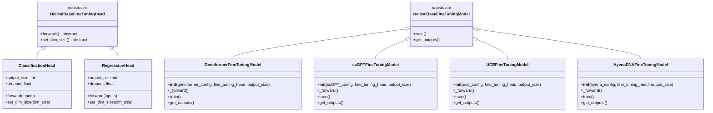
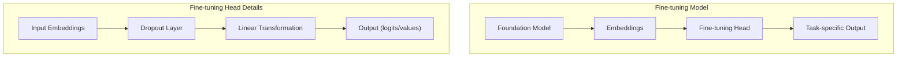
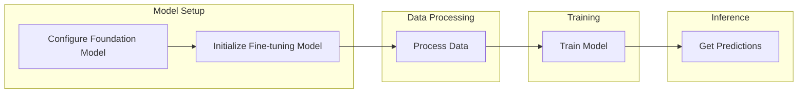
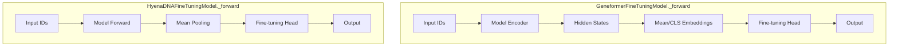

# Fine-tuning System

<details>
<summary>Relevant source files</summary>

The following files were used as context for generating this wiki page:

- [ci/tests/test_helix_mrna/test_helix_mrna_model.py](ci/tests/test_helix_mrna/test_helix_mrna_model.py)
- [ci/tests/test_hyena_dna/test_hyena_dna_fine_tuning.py](ci/tests/test_hyena_dna/test_hyena_dna_fine_tuning.py)
- [ci/tests/test_hyena_dna/test_hyena_dna_model.py](ci/tests/test_hyena_dna/test_hyena_dna_model.py)
- [examples/notebooks/HyenaDNA-Fine-Tuning.ipynb](examples/notebooks/HyenaDNA-Fine-Tuning.ipynb)
- [examples/run_models/run_caduceus.py](examples/run_models/run_caduceus.py)
- [examples/run_models/run_helix_mrna.py](examples/run_models/run_helix_mrna.py)
- [examples/run_models/run_hyena_dna.py](examples/run_models/run_hyena_dna.py)
- [helical/models/fine_tune/fine_tuning_heads.py](helical/models/fine_tune/fine_tuning_heads.py)
- [helical/models/geneformer/fine_tuning_model.py](helical/models/geneformer/fine_tuning_model.py)
- [helical/models/hyena_dna/fine_tuning_model.py](helical/models/hyena_dna/fine_tuning_model.py)
- [helical/models/scgpt/fine_tuning_model.py](helical/models/scgpt/fine_tuning_model.py)
- [helical/models/uce/fine_tuning_model.py](helical/models/uce/fine_tuning_model.py)

</details>


The Helical fine-tuning system provides a standardized framework for adapting pre-trained bio foundation models to specific downstream tasks. This page documents the architecture, components, and workflow of the fine-tuning system, enabling users to easily train models for classification and regression tasks using consistent patterns across different model types.

For information about specific foundation models that can be fine-tuned, see the respective documentation pages for [RNA Models](#4) and [DNA Models](#5).

## Architecture Overview

The fine-tuning system follows a modular design pattern that separates the foundation model functionality from the task-specific adaptation. This is achieved through:

1. **Base Classes**: Abstract classes that define the interfaces for fine-tuning models and heads
2. **Model-Specific Implementations**: Concrete implementations for each foundation model type
3. **Fine-tuning Heads**: Components that transform embeddings into task-specific outputs

The diagram below illustrates the inheritance hierarchy of the fine-tuning system:



Sources:
- [helical/models/fine_tune/fine_tuning_heads.py:6-120]()
- [helical/models/base_models.py]() (referenced but not in provided files)
- [helical/models/geneformer/fine_tuning_model.py:26-105]()
- [helical/models/scgpt/fine_tuning_model.py:19-79]()
- [helical/models/uce/fine_tuning_model.py:18-75]()
- [helical/models/hyena_dna/fine_tuning_model.py:20-71]()

## Fine-tuning Components

### Base Fine-tuning Model

The `HelicalBaseFineTuningModel` provides a foundation for all model-specific fine-tuning implementations. It defines the common interface and functionality shared across different models:

1. Initializing with a specific fine-tuning head
2. Training on labeled data
3. Generating outputs from fine-tuned models

Each model-specific implementation inherits from both `HelicalBaseFineTuningModel` and the corresponding foundation model class (e.g., `GeneformerFineTuningModel` inherits from both `HelicalBaseFineTuningModel` and `Geneformer`).

### Fine-tuning Heads

Fine-tuning heads are components that transform the model embeddings into outputs for specific downstream tasks. The system includes:

1. **ClassificationHead**: For classification tasks, producing categorical outputs
2. **RegressionHead**: For regression tasks, producing continuous numerical outputs

The heads follow a common pattern:
- Accept embeddings as input
- Apply dropout for regularization
- Transform the embeddings to the desired output size using a linear layer



Sources:
- [helical/models/fine_tune/fine_tuning_heads.py:23-70]() (ClassificationHead)
- [helical/models/fine_tune/fine_tuning_heads.py:73-120]() (RegressionHead)

## Fine-tuning Workflow

The typical workflow for fine-tuning a model follows these steps:



### 1. Configure and Initialize

Create a configuration for the base model and initialize the fine-tuning model with the desired task head:

```python
# Example with HyenaDNA
hyena_config = HyenaDNAConfig(batch_size=10, device="cuda")
hyena_fine_tune = HyenaDNAFineTuningModel(
    hyena_config, 
    fine_tuning_head="classification", 
    output_size=3  # Number of classes
)
```

### 2. Process Data

Process your input data using the model's `process_data` method:

```python
# Example with DNA sequences
train_dataset = hyena_fine_tune.process_data(input_sequences)
```

### 3. Train the Model

Train the fine-tuning model on your labeled data:

```python
# Example training
hyena_fine_tune.train(
    train_dataset=train_dataset,
    train_labels=labels,
    validation_dataset=val_dataset,
    validation_labels=val_labels,
    epochs=10,
    optimizer_params={"lr": 2e-5},
    lr_scheduler_params={"name": "linear", "num_warmup_steps": 0}
)
```

### 4. Get Predictions

Generate predictions with the fine-tuned model:

```python
# Example inference
outputs = hyena_fine_tune.get_outputs(test_dataset)
```

Sources:
- [helical/models/hyena_dna/fine_tuning_model.py:82-192]() (train method)
- [helical/models/hyena_dna/fine_tuning_model.py:193-221]() (get_outputs method)
- [examples/notebooks/HyenaDNA-Fine-Tuning.ipynb]()

## Model-Specific Implementations

Each model type has its own fine-tuning implementation to handle the specific requirements and architecture of that model. The table below summarizes the key characteristics of each implementation:

| Model | Fine-tuning Class | Training Features | Data Type |
|-------|-------------------|-------------------|-----------|
| Geneformer | GeneformerFineTuningModel | Layer freezing, validation metrics | Gene expression data |
| scGPT | scGPTFineTuningModel | Batch labels support, validation metrics | Single-cell data |
| UCE | UCEFineTuningModel | Token normalization, validation metrics | RNA sequences |
| HyenaDNA | HyenaDNAFineTuningModel | Learning rate scheduling, validation metrics | DNA sequences |

While the implementations differ in details, they follow a consistent pattern:

1. **Forward Method**: Each implementation defines a custom `_forward` method that handles the model-specific embedding generation and passes the embeddings to the fine-tuning head.

2. **Training Method**: The `train` method implements the training loop, including batching, computing loss, backpropagation, and optional validation.

3. **Output Generation**: The `get_outputs` method generates predictions from processed data using the fine-tuned model.

### Implementation Example: Forward Methods

The forward methods extract embeddings and pass them to the fine-tuning head:



Sources:
- [helical/models/geneformer/fine_tuning_model.py:109-153]() (Geneformer forward)
- [helical/models/scgpt/fine_tuning_model.py:82-126]() (scGPT forward)
- [helical/models/uce/fine_tuning_model.py:84-111]() (UCE forward)
- [helical/models/hyena_dna/fine_tuning_model.py:76-80]() (HyenaDNA forward)

## Advanced Usage

### Custom Fine-tuning Heads

You can create custom fine-tuning heads by subclassing `HelicalBaseFineTuningHead`:

```python
class CustomHead(HelicalBaseFineTuningHead):
    def __init__(self, output_size, hidden_size=128):
        super().__init__()
        self.output_size = output_size
        self.hidden_size = hidden_size
        self.dropout = torch.nn.Dropout(0.1)
        
    def forward(self, inputs):
        x = self.dropout(inputs)
        x = self.hidden(x)
        x = torch.nn.functional.relu(x)
        x = self.output(x)
        return x
        
    def set_dim_size(self, dim_size):
        self.hidden = torch.nn.Linear(dim_size, self.hidden_size)
        self.output = torch.nn.Linear(self.hidden_size, self.output_size)
```

Then use your custom head with any fine-tuning model:

```python
custom_head = CustomHead(output_size=3)
model = GeneformerFineTuningModel(
    geneformer_config=config,
    fine_tuning_head=custom_head
)
```

### Optimization Customization

All fine-tuning implementations allow customization of the training process:

1. **Optimizer Selection**: Choose any PyTorch optimizer (default is AdamW)
2. **Learning Rate Scheduling**: Configure learning rate warmup and decay
3. **Loss Function**: Specify a custom loss function for your task
4. **Layer Freezing**: Some models support freezing early layers (like Geneformer)

Example with custom optimization:

```python
from torch import optim
from torch.nn import functional as F

model.train(
    train_dataset=train_data,
    train_labels=labels,
    optimizer=optim.SGD,
    optimizer_params={"lr": 0.01, "momentum": 0.9},
    loss_function=F.cross_entropy,
    epochs=20,
    lr_scheduler_params={
        "name": "cosine", 
        "num_warmup_steps": 100
    },
    freeze_layers=2  # Only for models that support this
)
```

Sources:
- [helical/models/geneformer/fine_tuning_model.py:155-220]() (Geneformer training options)
- [helical/models/scgpt/fine_tuning_model.py:128-186]() (scGPT training options)
- [helical/models/uce/fine_tuning_model.py:113-150]() (UCE training options)
- [helical/models/hyena_dna/fine_tuning_model.py:82-121]() (HyenaDNA training options)

## Saving and Loading Fine-tuned Models

Most fine-tuning models support saving and loading of the trained model:

```python
# Save the fine-tuned model
model.save_model("./my_fine_tuned_model.pt")

# Load the model later
model.load_model("./my_fine_tuned_model.pt")
```

This functionality preserves both the foundation model weights and the fine-tuning head, allowing you to deploy your fine-tuned models in production settings.

Sources:
- [ci/tests/test_hyena_dna/test_hyena_dna_fine_tuning.py:38-51]()

---