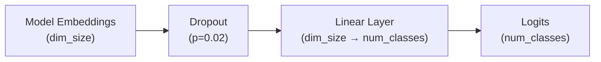
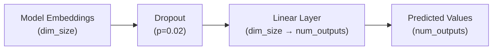
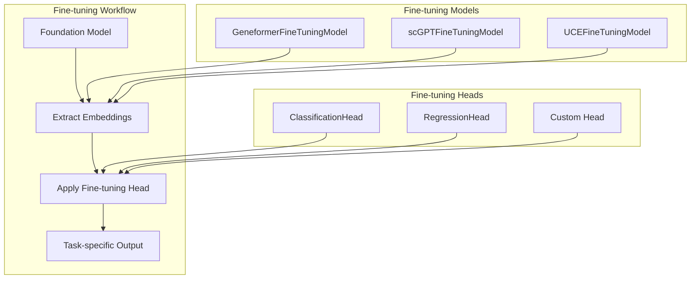
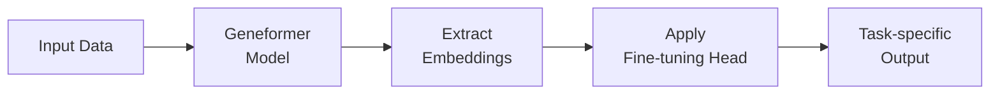
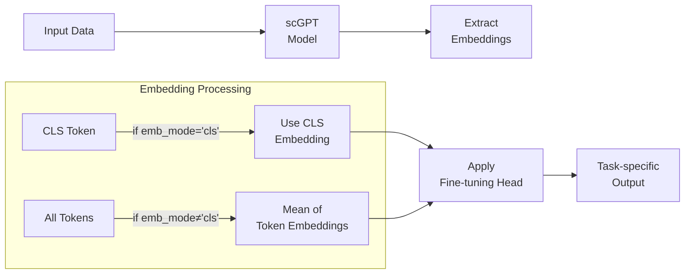
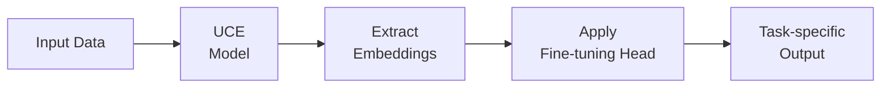

# Fine-tuning Heads

<details>
<summary>Relevant source files</summary>

The following files were used as context for generating this wiki page:

- [helical/models/fine_tune/fine_tuning_heads.py](helical/models/fine_tune/fine_tuning_heads.py)
- [helical/models/geneformer/fine_tuning_model.py](helical/models/geneformer/fine_tuning_model.py)
- [helical/models/scgpt/fine_tuning_model.py](helical/models/scgpt/fine_tuning_model.py)
- [helical/models/uce/fine_tuning_model.py](helical/models/uce/fine_tuning_model.py)

</details>


## Overview

Fine-tuning heads are specialized components in the Helical framework that enable pre-trained bio foundation models to be adapted for specific downstream tasks. These heads are attached to the embeddings produced by foundation models (like Geneformer, scGPT, or UCE) to transform the learned representations into task-specific outputs, such as classification predictions or regression values.

For information about the overall fine-tuning process and training workflow, see [Fine-tuning System](#6) and [Training and Evaluation](#6.2).

## Architecture

Fine-tuning heads in Helical follow a consistent pattern of inheritance and functionality.

```mermaid
classDiagram
    class "HelicalBaseFineTuningHead" {
        <<abstract>>
        +forward()
        +set_dim_size()
    }
    
    class "ClassificationHead" {
        +dropout
        +linear
        +output_size
        +forward(inputs)
        +set_dim_size(dim_size)
    }
    
    class "RegressionHead" {
        +dropout
        +linear
        +output_size
        +forward(inputs)
        +set_dim_size(dim_size)
    }
    
    class "CustomFineTuningHead" {
        +custom_layers
        +forward(inputs)
        +set_dim_size(dim_size)
    }
    
    "HelicalBaseFineTuningHead" <|-- "ClassificationHead"
    "HelicalBaseFineTuningHead" <|-- "RegressionHead"
    "HelicalBaseFineTuningHead" <|-- "CustomFineTuningHead"
```

Sources: [helical/models/fine_tune/fine_tuning_heads.py:6-20]()

## Standard Fine-tuning Heads

Helical provides two standard fine-tuning heads out of the box:

### ClassificationHead

The `ClassificationHead` is designed for multi-class classification tasks. It applies dropout for regularization and uses a linear layer to transform the embedding dimensions to the number of output classes.



Sources: [helical/models/fine_tune/fine_tuning_heads.py:23-70]()

### RegressionHead

The `RegressionHead` is used for predicting continuous values. It has a similar structure to the `ClassificationHead` but is trained with different loss functions appropriate for regression tasks.



Sources: [helical/models/fine_tune/fine_tuning_heads.py:73-120]()

## Integration with Foundation Models

Fine-tuning heads are integrated with the foundation models through model-specific fine-tuning classes that inherit from both the base foundation model and `HelicalBaseFineTuningModel`.



Sources: 
- [helical/models/geneformer/fine_tuning_model.py:19-153]()
- [helical/models/scgpt/fine_tuning_model.py:19-126]()
- [helical/models/uce/fine_tuning_model.py:18-111]()

## Example Usage

Here's how to use a fine-tuning head with a foundation model:

### Option 1: Using Pre-defined Task Types

You can specify a task type ("classification" or "regression") and the output size when initializing a fine-tuning model:

```python
# For a classification task with 10 classes
geneformer_config = GeneformerConfig(model_name="gf-12L-95M-i4096", batch_size=10)
model = GeneformerFineTuningModel(
    geneformer_config=geneformer_config, 
    fine_tuning_head="classification", 
    output_size=10
)
```

### Option 2: Using a Custom Fine-tuning Head

You can create and use a custom fine-tuning head by inheriting from `HelicalBaseFineTuningHead`:

```python
# Creating a custom head
class MyCustomHead(HelicalBaseFineTuningHead):
    def __init__(self, output_size):
        super().__init__()
        self.output_size = output_size
        # Additional layers can be defined here
        
    def forward(self, inputs):
        # Custom forward logic
        pass
        
    def set_dim_size(self, dim_size):
        # Initialize dimension-dependent layers
        self.linear = torch.nn.Linear(dim_size, self.output_size)

# Using the custom head
custom_head = MyCustomHead(output_size=10)
model = GeneformerFineTuningModel(
    geneformer_config=geneformer_config,
    fine_tuning_head=custom_head
)
```

## Implementation Details

### Base Fine-tuning Head

The `HelicalBaseFineTuningHead` is an abstract base class that defines the interface for all fine-tuning heads:

```mermaid
classDiagram
    class "HelicalBaseFineTuningHead" {
        <<abstract>>
        +__init__()
        +forward() *
        +set_dim_size() *
    }
```

Key methods:
- `forward()`: Processes the model embeddings to produce task-specific outputs
- `set_dim_size()`: Configures the head based on the foundation model's embedding dimension

Sources: [helical/models/fine_tune/fine_tuning_heads.py:6-20]()

### Model-Specific Integration

Each foundation model has a corresponding fine-tuning model class that integrates with the fine-tuning heads:

#### GeneformerFineTuningModel



Key integration points:
- The model's `_forward()` method extracts embeddings and passes them to the fine-tuning head
- The model initializes the fine-tuning head with the proper embedding dimension via `set_dim_size()`

Sources: [helical/models/geneformer/fine_tuning_model.py:109-153]()

#### scGPTFineTuningModel

Similar to Geneformer, but with scGPT-specific embedding extraction:



Sources: [helical/models/scgpt/fine_tuning_model.py:82-126]()

#### UCEFineTuningModel

Integration with UCE model:



Sources: [helical/models/uce/fine_tuning_model.py:84-111]()

## Creating Custom Fine-tuning Heads

To create a custom fine-tuning head, you need to:

1. Inherit from `HelicalBaseFineTuningHead`
2. Implement the abstract methods:
   - `forward()`: Define how inputs are processed
   - `set_dim_size()`: Set up dimension-dependent components

Example structure for a custom head:

```python
class CustomHead(HelicalBaseFineTuningHead):
    def __init__(self, output_size, hidden_size=128):
        super().__init__()
        self.output_size = output_size
        self.hidden_size = hidden_size
        # The dimension-dependent layers will be initialized in set_dim_size()
        
    def set_dim_size(self, dim_size):
        # Initialize layers that depend on input dimension
        self.layer1 = torch.nn.Linear(dim_size, self.hidden_size)
        self.activation = torch.nn.ReLU()
        self.layer2 = torch.nn.Linear(self.hidden_size, self.output_size)
        
    def forward(self, inputs):
        # Define the forward pass
        x = self.layer1(inputs)
        x = self.activation(x)
        return self.layer2(x)
```

## Best Practices

When working with fine-tuning heads in Helical:

1. **Choose the right head for your task**:
   - Use `ClassificationHead` for categorical prediction tasks
   - Use `RegressionHead` for continuous value prediction tasks
   - Create custom heads for more complex tasks

2. **Consider the embedding dimension**:
   - The fine-tuning head's input dimension must match the foundation model's embedding size
   - Different models have different embedding dimensions (specified in their configs)

3. **Task-specific loss functions**:
   - Use `CrossEntropyLoss` for classification tasks
   - Use `MSELoss` for regression tasks
   - Specify the appropriate loss function in the `train()` method

4. **Regularization**:
   - Both built-in heads use dropout with a default rate of 0.02
   - Adjust dropout rates based on your dataset size and complexity

## Conclusion

Fine-tuning heads are a crucial component of the Helical framework that enable foundation models to be adapted for specific downstream tasks. The modular design allows for easy experimentation with different heads and tasks, while maintaining a consistent interface across different foundation models.

---