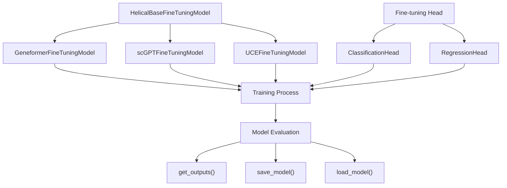
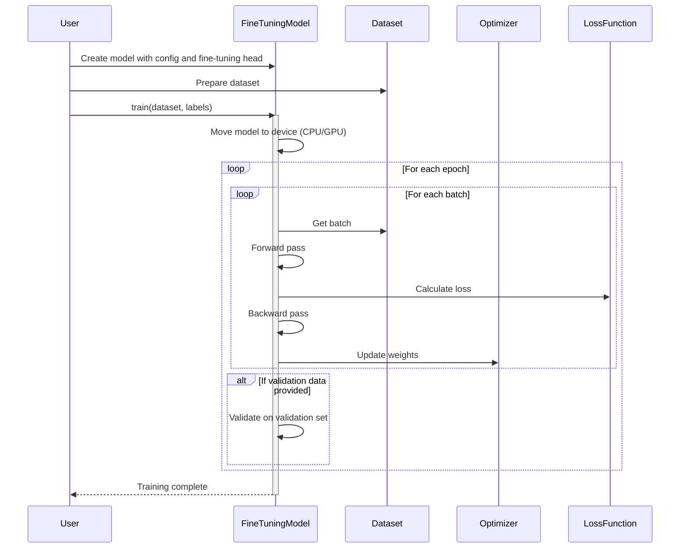
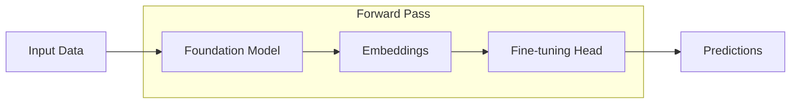
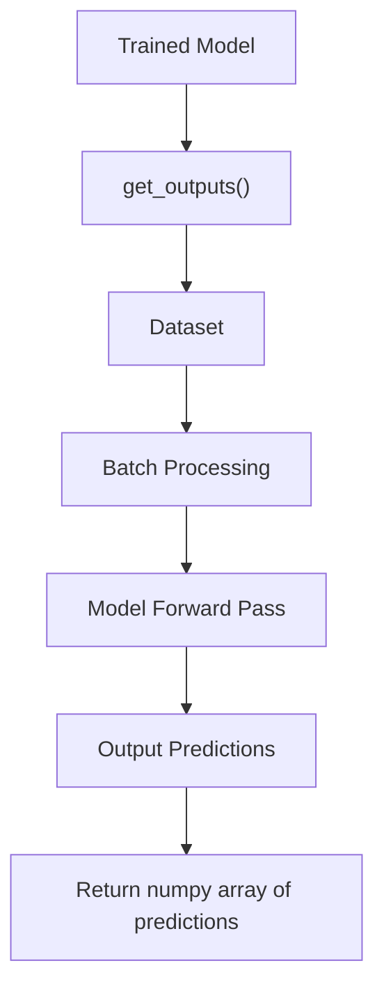
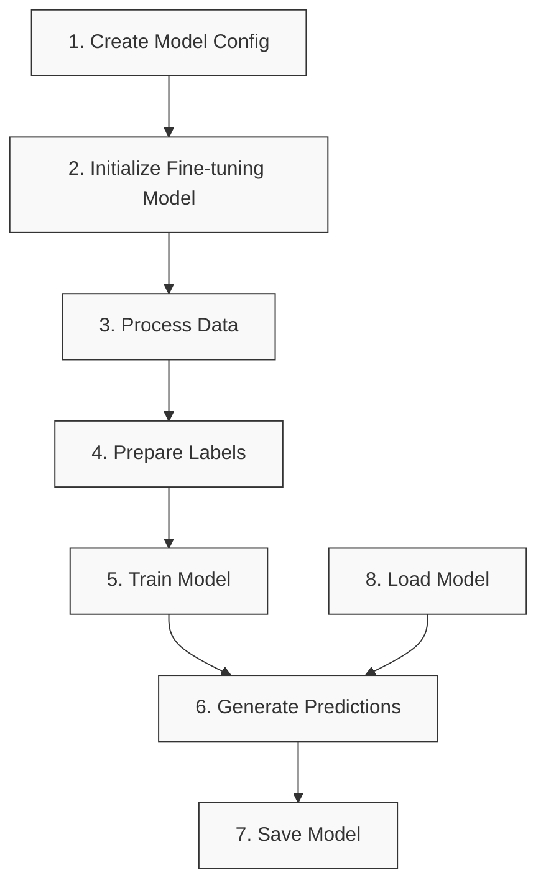

# Training and Evaluation

<details>
<summary>Relevant source files</summary>

The following files were used as context for generating this wiki page:

- [examples/fine_tune_models/fine_tune_UCE.py](examples/fine_tune_models/fine_tune_UCE.py)
- [examples/fine_tune_models/fine_tune_geneformer.py](examples/fine_tune_models/fine_tune_geneformer.py)
- [examples/fine_tune_models/fine_tune_scgpt.py](examples/fine_tune_models/fine_tune_scgpt.py)
- [examples/run_models/run_geneformer.py](examples/run_models/run_geneformer.py)
- [examples/run_models/run_scgpt.py](examples/run_models/run_scgpt.py)
- [examples/run_models/run_uce.py](examples/run_models/run_uce.py)
- [helical/models/fine_tune/fine_tuning_heads.py](helical/models/fine_tune/fine_tuning_heads.py)
- [helical/models/geneformer/fine_tuning_model.py](helical/models/geneformer/fine_tuning_model.py)
- [helical/models/scgpt/fine_tuning_model.py](helical/models/scgpt/fine_tuning_model.py)
- [helical/models/uce/fine_tuning_model.py](helical/models/uce/fine_tuning_model.py)
- [helical/utils/__init__.py](helical/utils/__init__.py)

</details>


This page explains how to fine-tune and evaluate bio foundation models in the Helical framework. It covers the core training process, evaluation methods, and usage patterns common across the supported models. For detailed information about the fine-tuning heads available, see [Fine-tuning Heads](#6.1).

## Overview

The Helical framework provides a standardized approach to fine-tune foundation models like Geneformer, scGPT, and UCE for downstream tasks such as cell type classification or gene expression prediction. Each model in Helical follows a consistent training and evaluation pattern, making it easy to experiment with different models on the same task.



Sources: [helical/models/geneformer/fine_tuning_model.py:26-391](), [helical/models/scgpt/fine_tuning_model.py:19-347](), [helical/models/uce/fine_tuning_model.py:18-321](), [helical/models/fine_tune/fine_tuning_heads.py:6-120]()

## Training Process Overview

The training process in Helical follows these general steps:



Sources: [helical/models/geneformer/fine_tuning_model.py:155-328](), [helical/models/scgpt/fine_tuning_model.py:128-279](), [helical/models/uce/fine_tuning_model.py:113-269]()

## Common Training Parameters

All fine-tuning models in Helical share a common set of parameters for training:

| Parameter | Description | Default |
|-----------|-------------|---------|
| `optimizer` | PyTorch optimizer to use | `torch.optim.AdamW` |
| `optimizer_params` | Dictionary of parameters for the optimizer | `{"lr": 0.0001}` |
| `loss_function` | Loss function to use for training | `torch.nn.CrossEntropyLoss()` |
| `epochs` | Number of training epochs | `1` |
| `lr_scheduler_params` | Parameters for learning rate scheduler | `None` |

Additionally, each model accepts parameters specific to its architecture and data format:

| Model | Additional Parameters | Description |
|-------|----------------------|-------------|
| GeneformerFineTuningModel | `freeze_layers` | Number of encoder layers to freeze during training |
| GeneformerFineTuningModel | `label` | Column name in the dataset containing labels |
| scGPTFineTuningModel | N/A | Handles labels directly as array |
| UCEFineTuningModel | N/A | Handles labels directly as array |

Sources: [helical/models/geneformer/fine_tuning_model.py:155-166](), [helical/models/scgpt/fine_tuning_model.py:128-139](), [helical/models/uce/fine_tuning_model.py:113-124]()

## Model-Specific Training Approaches

While sharing a common interface, each model has specific implementation details for training:

### Geneformer

Geneformer uses the Hugging Face `Dataset` format and processes data in batches. It has special handling for CLS tokens and supports freezing transformer layers during fine-tuning.

```python
# Training with Geneformer
from helical.models.geneformer import GeneformerConfig, GeneformerFineTuningModel

# Create configuration and model
geneformer_config = GeneformerConfig(model_name="gf-12L-95M-i4096", batch_size=10)
geneformer_model = GeneformerFineTuningModel(
    geneformer_config=geneformer_config, 
    fine_tuning_head="classification", 
    output_size=len(label_set)
)

# Process data
dataset = geneformer_model.process_data(ann_data)
dataset = dataset.add_column('cell_types', cell_types)

# Map labels to integers
class_id_dict = dict(zip(label_set, range(len(label_set))))
dataset = dataset.map(lambda x: {"cell_types": class_id_dict[x["cell_types"]]})

# Train model
geneformer_model.train(
    train_dataset=dataset, 
    label="cell_types",
    epochs=3,
    freeze_layers=2
)
```

Sources: [examples/fine_tune_models/fine_tune_geneformer.py:1-56](), [helical/models/geneformer/fine_tuning_model.py:155-328]()

### scGPT

scGPT uses a custom `DataCollator` for batching and requires labels as a NumPy array. It has special handling for batch effects and gene expression data.

```python
# Training with scGPT
from helical.models.scgpt import scGPTConfig, scGPTFineTuningModel
import numpy as np

# Create configuration and model
scgpt_config = scGPTConfig(batch_size=10)
scgpt_model = scGPTFineTuningModel(
    scGPT_config=scgpt_config, 
    fine_tuning_head="classification", 
    output_size=len(label_set)
)

# Process data
dataset = scgpt_model.process_data(ann_data)

# Convert labels to integers
class_id_dict = {label: i for i, label in enumerate(label_set)}
numeric_labels = np.array([class_id_dict[cell] for cell in cell_types])

# Train model
scgpt_model.train(
    train_input_data=dataset, 
    train_labels=numeric_labels,
    epochs=3
)
```

Sources: [examples/fine_tune_models/fine_tune_scgpt.py:1-48](), [helical/models/scgpt/fine_tuning_model.py:128-279]()

### UCE

UCE uses a custom `UCEDataset` class and handles processing batches with special attention to token normalization.

```python
# Training with UCE
from helical.models.uce import UCEConfig, UCEFineTuningModel
import numpy as np

# Create configuration and model
uce_config = UCEConfig(batch_size=10)
uce_model = UCEFineTuningModel(
    uce_config=uce_config, 
    fine_tuning_head="classification", 
    output_size=len(label_set)
)

# Process data
dataset = uce_model.process_data(ann_data, name="train")

# Convert labels to integers
class_id_dict = {label: i for i, label in enumerate(label_set)}
numeric_labels = np.array([class_id_dict[cell] for cell in cell_types])

# Train model
uce_model.train(
    train_input_data=dataset, 
    train_labels=numeric_labels,
    epochs=3
)
```

Sources: [examples/fine_tune_models/fine_tune_UCE.py:1-48](), [helical/models/uce/fine_tuning_model.py:113-269]()

## Forward Pass Implementation

Each fine-tuning model implements a `_forward` method that:
1. Processes input data through the foundation model
2. Extracts embeddings
3. Passes embeddings through the fine-tuning head



Sources: [helical/models/geneformer/fine_tuning_model.py:109-153](), [helical/models/scgpt/fine_tuning_model.py:82-126](), [helical/models/uce/fine_tuning_model.py:84-111]()

## Evaluation

After training, models can be evaluated using the `get_outputs` method, which generates predictions for a given dataset:



The `get_outputs` method:
1. Sets model to evaluation mode
2. Processes the dataset in batches
3. Performs forward passes without gradient calculation
4. Collects predictions and returns them as NumPy array

Sources: [helical/models/geneformer/fine_tuning_model.py:330-390](), [helical/models/scgpt/fine_tuning_model.py:281-347](), [helical/models/uce/fine_tuning_model.py:271-321]()

## Model Saving and Loading

Fine-tuned models can be saved and loaded using the `save_model` and `load_model` methods, which preserve both the foundation model weights and the fine-tuning head.

```python
# Save a fine-tuned model
model.save_model("./fine_tuned_model.pt")

# Load a previously fine-tuned model
model.load_model("./fine_tuned_model.pt")
```

Sources: [examples/fine_tune_models/fine_tune_geneformer.py:49-50](), [examples/fine_tune_models/fine_tune_scgpt.py:41-42](), [examples/fine_tune_models/fine_tune_UCE.py:41-42]()

## Complete Fine-tuning Workflow

Here's the complete workflow for fine-tuning a model in Helical:



Sources: [examples/fine_tune_models/fine_tune_geneformer.py:1-56](), [examples/fine_tune_models/fine_tune_scgpt.py:1-48](), [examples/fine_tune_models/fine_tune_UCE.py:1-48]()

## Performance Considerations

When fine-tuning large foundation models, consider the following:

1. **Batch Size**: Adjust the batch size according to your GPU memory constraints. Larger batch sizes generally lead to more stable training but require more memory.

2. **Learning Rate**: Typically, a smaller learning rate (1e-4 to 1e-5) works well for fine-tuning foundation models.

3. **Epochs**: Foundation models often need fewer epochs for fine-tuning compared to training from scratch. Start with a small number (1-3) and increase if needed.

4. **Layer Freezing**: For the Geneformer model, freezing some of the lower layers (`freeze_layers` parameter) can speed up training and prevent overfitting.

5. **Validation**: Always use a validation set to monitor performance and prevent overfitting.

Sources: [helical/models/geneformer/fine_tuning_model.py:155-328](), [helical/models/scgpt/fine_tuning_model.py:128-279](), [helical/models/uce/fine_tuning_model.py:113-269]()

## Common Errors and Troubleshooting

When training and evaluating fine-tuned models, you might encounter these common issues:

1. **Out of Memory (OOM) errors**: Reduce batch size or use gradient accumulation.

2. **NaN loss values**: Check for extreme values in your data or reduce learning rate.

3. **Poor convergence**: Try adjusting learning rate or using a different optimizer/scheduler.

4. **Label mismatch**: Ensure that your labels are properly converted to integers starting from 0.

5. **Dimension mismatch**: Ensure the `output_size` parameter matches the number of classes for classification tasks.

---