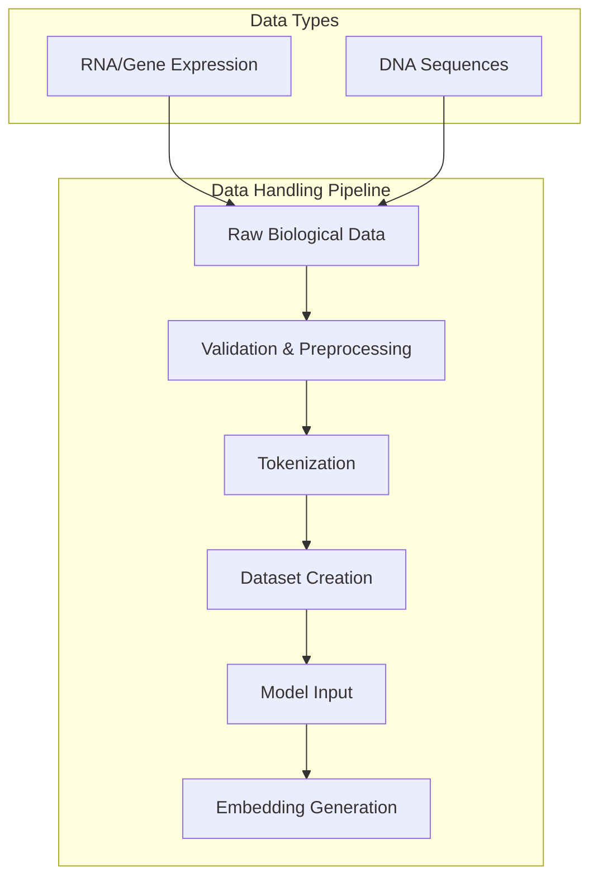
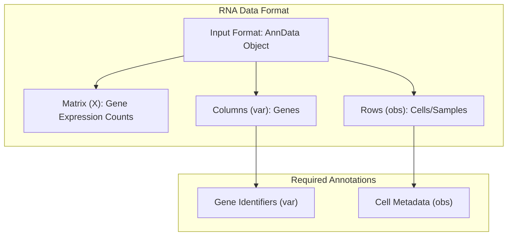
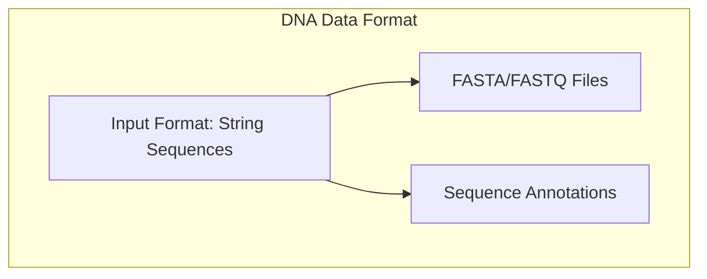
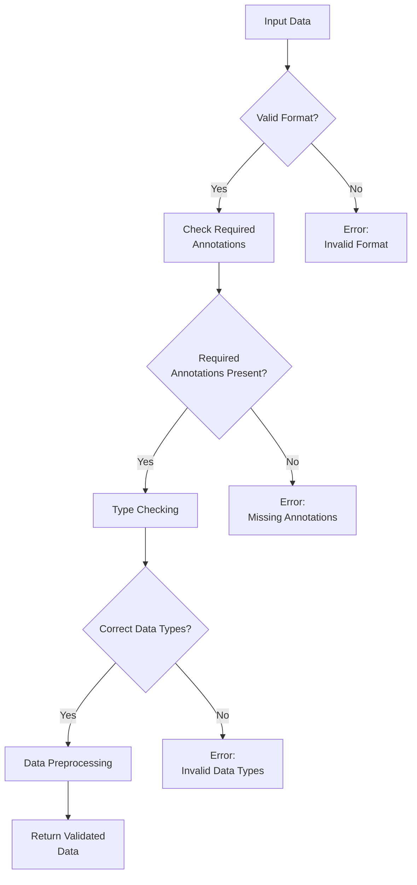
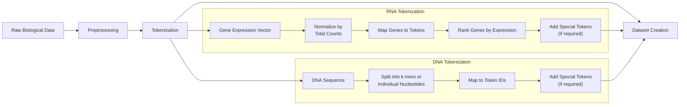
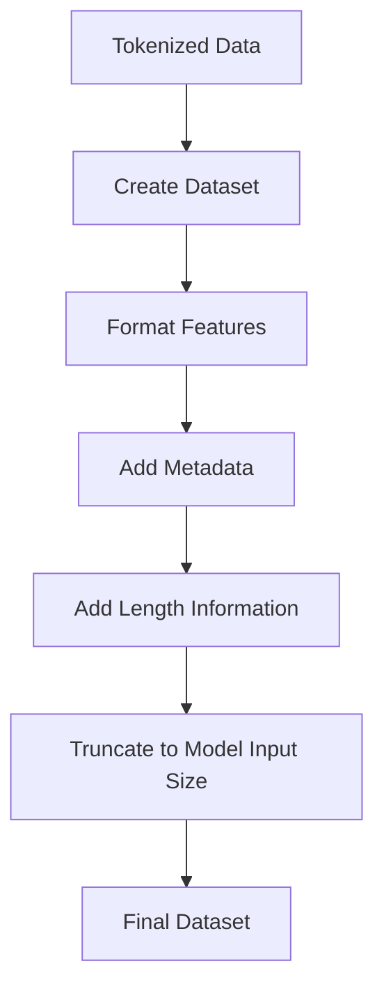
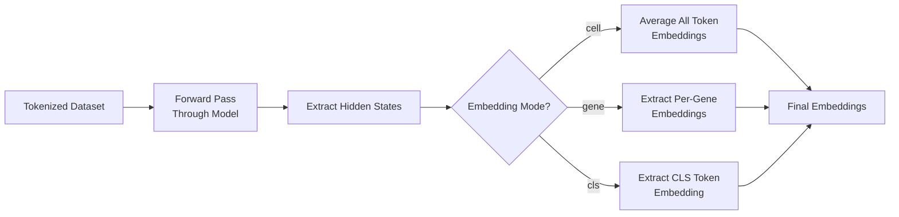
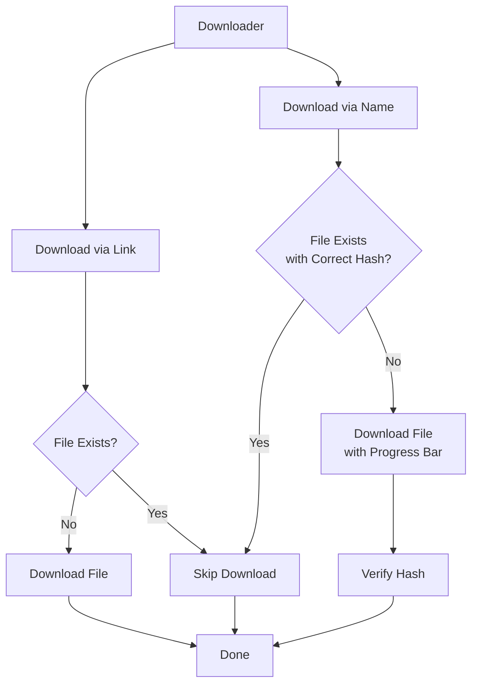
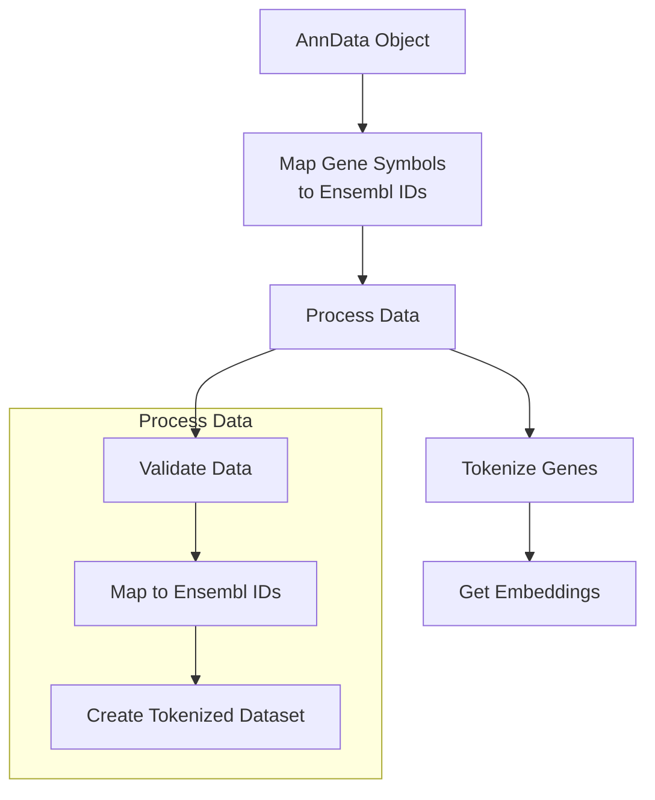
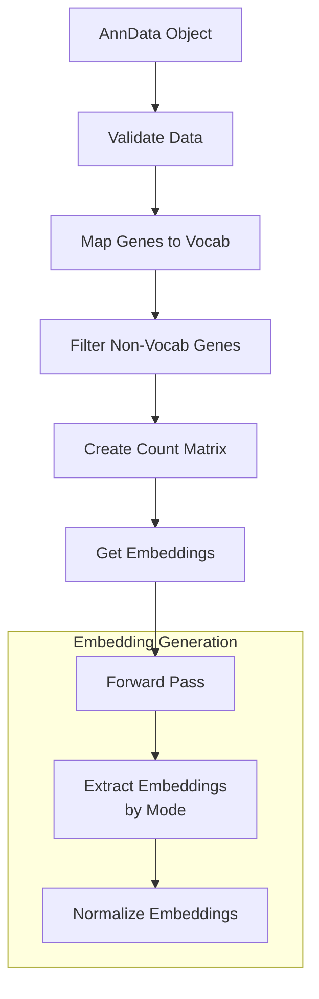

# Data Handling

<details>
<summary>Relevant source files</summary>

The following files were used as context for generating this wiki page:

- [ci/download_all.py](ci/download_all.py)
- [ci/tests/test_geneformer/test_geneformer_model.py](ci/tests/test_geneformer/test_geneformer_model.py)
- [ci/tests/test_geneformer/test_geneformer_tokenizer.py](ci/tests/test_geneformer/test_geneformer_tokenizer.py)
- [ci/tests/test_scgpt/test_scgpt_model.py](ci/tests/test_scgpt/test_scgpt_model.py)
- [helical/models/geneformer/geneformer_tokenizer.py](helical/models/geneformer/geneformer_tokenizer.py)
- [helical/models/geneformer/geneformer_utils.py](helical/models/geneformer/geneformer_utils.py)
- [helical/utils/downloader.py](helical/utils/downloader.py)

</details>


This page explains how Helical processes and manages different types of biological data for foundation models. It covers data formats, preprocessing steps, tokenization, and embedding generation. For information about model-specific configurations, see [Core Architecture](#3).

## Overview

Helical supports multiple biological data types with standardized processing pipelines that convert raw biological data into formats suitable for foundation models.



Sources: [helical/models/geneformer/geneformer_utils.py:41-210](), [helical/models/geneformer/geneformer_tokenizer.py:1-43]()

## Data Types and Formats

Helical processes two primary data types:

### 1. RNA/Gene Expression Data

RNA data is typically handled as gene expression matrices where:
- Rows (observations) represent cells or samples
- Columns (variables) represent genes
- Values represent gene expression counts



**Primary Format**: [AnnData](https://anndata.readthedocs.io/) (`.h5ad` files)

**Required Annotations**:
- For RNA models: Gene identifiers (gene symbols or Ensembl IDs)
- Total counts per cell (for normalization)

**Common RNA Model Data Requirements**:

| Model | Input Format | Required Gene Identifier | Special Notes |
|-------|-------------|--------------------------|---------------|
| Geneformer | AnnData | Gene symbols mapped to Ensembl IDs | Requires integer counts |
| scGPT | AnnData | Gene symbols | Requires integer counts |
| UCE | AnnData | Gene symbols | Supports multiple species |

Sources: [ci/tests/test_geneformer/test_geneformer_model.py:60-82](), [ci/tests/test_scgpt/test_scgpt_model.py:25-40]()

### 2. DNA Sequence Data

DNA data is typically represented as nucleotide sequences with optional annotations:



**Primary Formats**: 
- String sequences ("ATGC...")
- FASTA/FASTQ files

Sources: [ci/download_all.py:95-99]() 

## Data Preprocessing and Validation

Before processing, Helical validates data to ensure it meets model requirements:



### RNA Data Validation

For RNA models, the framework validates:

1. Required annotations in `var` (gene identifiers)
2. Integer gene expression counts
3. Proper gene mapping if required by the model

Example validation code pattern:
```python
def ensure_data_validity(data, gene_names, batch_labels):
    # Check required annotations
    if gene_names not in data.var.columns:
        raise KeyError(f"Gene column '{gene_names}' not found in data.var")
    
    # Check for integer counts
    if np.any(data.X != data.X.astype(int)):
        raise ValueError("Gene expression counts must be integers")
```

Sources: [ci/tests/test_geneformer/test_geneformer_model.py:98-105](), [ci/tests/test_scgpt/test_scgpt_model.py:77-89]()

## Tokenization Process

Tokenization converts raw biological data into sequences of tokens that can be processed by foundation models.



### RNA Tokenization Example (Geneformer)

The `TranscriptomeTokenizer` in Geneformer illustrates the process:

1. Map gene symbols to Ensembl IDs
2. Filter to genes in the vocabulary
3. Normalize gene expression by total counts and gene medians
4. Rank genes by expression
5. Create sequence tokens based on rank
6. Add special tokens (CLS, EOS) if needed

Key tokenization steps:

```python
# Normalize gene expressions
X_norm = X_view / n_counts * target_sum / norm_factor_vector

# Tokenize by ranking genes
tokenized_cells = [
    rank_genes(X_norm[i].data, coding_miRNA_tokens[X_norm[i].indices])
    for i in range(X_norm.shape[0])
]

# Add special tokens if required
if special_token:
    example["input_ids"] = np.insert(
        example["input_ids"], 0, gene_token_dict.get("<cls>")
    )
    example["input_ids"] = np.insert(
        example["input_ids"], len(example["input_ids"]), gene_token_dict.get("<eos>")
    )
```

Sources: [helical/models/geneformer/geneformer_tokenizer.py:392-480](), [helical/models/geneformer/geneformer_tokenizer.py:65-82]()

## Dataset Creation

After tokenization, Helical creates structured datasets that can be passed to models:



Key aspects of dataset creation:

1. Storing tokenized sequences as `input_ids`
2. Adding metadata from the original data
3. Computing sequence lengths
4. Truncating sequences to model input size
5. Saving as a structured dataset (using Hugging Face's `Dataset` format)

Sources: [helical/models/geneformer/geneformer_tokenizer.py:482-547]()

## Embedding Generation

Once data is tokenized, models generate embeddings that capture biological information:



### Embedding Modes

Helical supports different embedding extraction modes:

1. **Cell Mode**: Averages all token embeddings to get a cell-level representation
2. **Gene Mode**: Returns embeddings for each gene in the input
3. **CLS Mode**: Uses the special CLS token embedding as the representation

Example embedding code pattern from Geneformer:

```python
def _compute_embeddings_depending_on_mode(embeddings, data_dict, emb_mode, cls_present, eos_present, token_to_ensembl_dict):
    if emb_mode == "cell":
        # Calculate mean of non-padding embeddings
        batch_embeddings = mean_nonpadding_embs(embeddings, length).cpu().numpy()
    elif emb_mode == "gene":
        # Extract per-gene embeddings
        batch_embeddings = [] 
        for embedding, ids in zip(embeddings, data_dict["input_ids"]):
            cell_dict = {}
            # Map embedding to gene ID
            for id, gene_emb in zip(ids, embedding):
                cell_dict[token_to_ensembl_dict[id.item()]] = gene_emb.cpu().numpy()
            batch_embeddings.append(pd.Series(cell_dict))
    elif emb_mode == "cls":
        # Extract CLS token embeddings
        batch_embeddings = embeddings[:, 0, :].cpu().numpy()
```

Sources: [helical/models/geneformer/geneformer_utils.py:41-98](), [ci/tests/test_geneformer/test_geneformer_model.py:137-195](), [ci/tests/test_scgpt/test_scgpt_model.py:126-171]()

## Data Downloading and Resource Management

Helical includes a robust system for downloading model files and resources:



The `Downloader` class manages:

1. Downloading files via direct links or predefined names
2. Verifying file integrity via hash checking
3. Displaying download progress
4. Caching downloaded files to avoid unnecessary downloads

Sources: [helical/utils/downloader.py:79-275](), [ci/download_all.py:8-53]()

## Model-Specific Data Handling

Each model in Helical has specific data handling requirements:

### Geneformer



- Requires gene symbols that map to Ensembl IDs
- Uses a gene-token dictionary for tokenization
- Supports different embedding modes (cell, gene, cls)

Sources: [ci/tests/test_geneformer/test_geneformer_model.py:60-82](), [helical/models/geneformer/geneformer_tokenizer.py:308-391]()

### scGPT



- Uses gene symbols directly
- Requires integer counts
- Normalizes embeddings after extraction

Sources: [ci/tests/test_scgpt/test_scgpt_model.py:25-40](), [ci/tests/test_scgpt/test_scgpt_model.py:126-171]()

## Best Practices

When working with biological data in Helical:

1. **Always validate your data format**:
   - Ensure gene identifiers are correct
   - Verify count data is in integer format
   - Check for proper annotations

2. **Use the right tokenization for your model**:
   - Geneformer requires Ensembl ID mapping
   - DNA models need sequence-specific tokenization

3. **Choose the right embedding mode**:
   - `cell`: For cell-type classification and other cell-level tasks
   - `gene`: For gene-focused analysis
   - `cls`: For models trained with special classification tokens

4. **Preprocess data appropriately**:
   - Normalize gene expression data
   - Filter low-quality cells if needed
   - Remove genes not in the model vocabulary

5. **Leverage the data pipeline components**:
   - Use model's `process_data()` method
   - Utilize the `Downloader` for resource management

Sources: [ci/tests/test_geneformer/test_geneformer_model.py:97-127](), [ci/tests/test_scgpt/test_scgpt_model.py:58-113]()

---