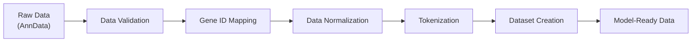
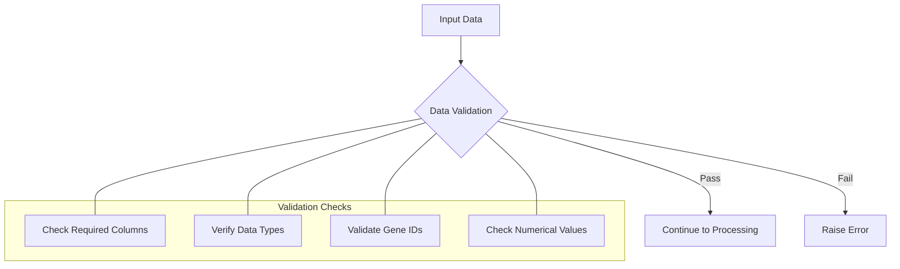
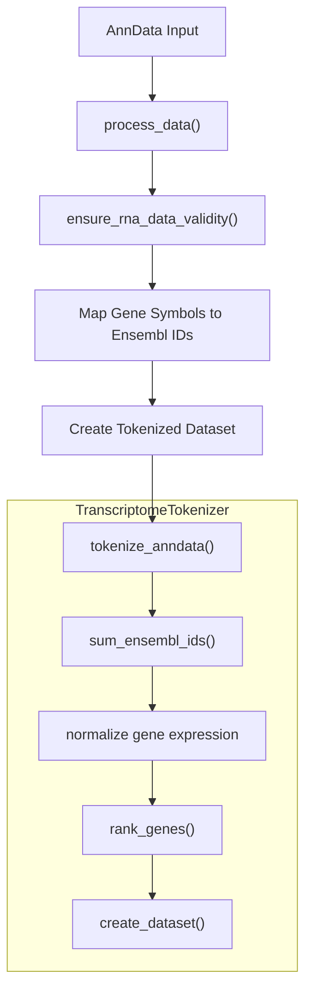
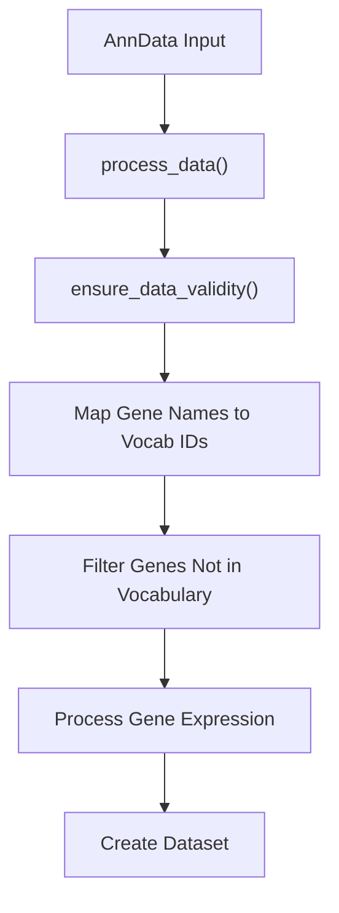
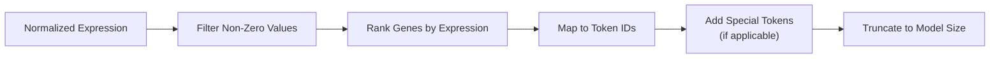
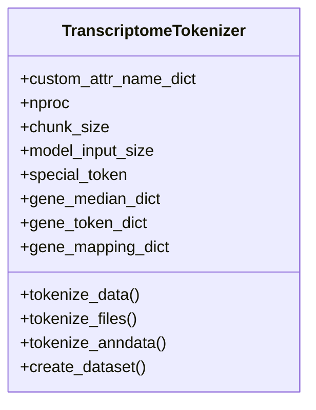
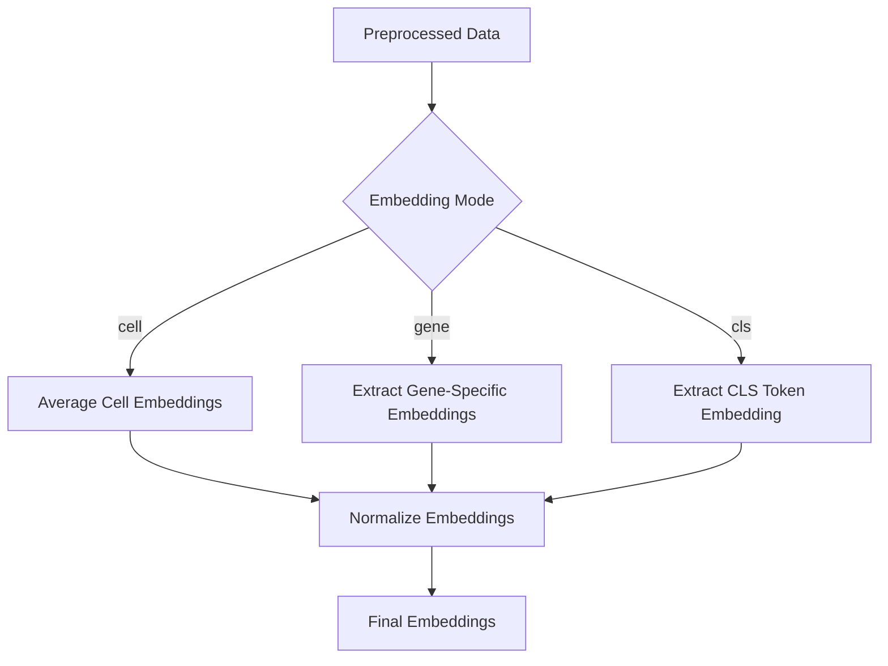

# Data Preprocessing

Relevant source files

The following files were used as context for generating this wiki page:

- [ci/tests/test_geneformer/test_geneformer_model.py](ci/tests/test_geneformer/test_geneformer_model.py)
- [ci/tests/test_geneformer/test_geneformer_tokenizer.py](ci/tests/test_geneformer/test_geneformer_tokenizer.py)
- [ci/tests/test_scgpt/test_scgpt_model.py](ci/tests/test_scgpt/test_scgpt_model.py)
- [helical/constants/__init__.py](helical/constants/__init__.py)
- [helical/models/geneformer/geneformer_tokenizer.py](helical/models/geneformer/geneformer_tokenizer.py)
- [helical/models/geneformer/geneformer_utils.py](helical/models/geneformer/geneformer_utils.py)

This page documents the data preprocessing pipeline in the Helical framework, which transforms raw genomic and transcriptomic data into formats suitable for bio foundation models. The preprocessing system handles data validation, gene/transcript mapping, tokenization, and dataset creation for various model architectures. For information on tokenization specifically, see [Tokenization](#7.2).

## Overview of Data Preprocessing in Helical

The Helical framework implements a unified preprocessing pipeline that standardizes how data is prepared for different bio foundation models. The primary input format is AnnData (`.h5ad`), which contains gene expression matrices along with gene and cell metadata.

**Diagram: Data Preprocessing Pipeline**

Sources: [helical/models/geneformer/geneformer_tokenizer.py:392-479](), [helical/models/geneformer/geneformer_utils.py:20-39]()

## Supported Data Formats and Requirements

### AnnData Structure Requirements

The Helical preprocessing pipeline primarily works with AnnData objects (`.h5ad` files), which must adhere to specific structure requirements depending on the model type.

| Model Type | Required Gene Attributes | Required Cell Attributes | Data Type |
|------------|--------------------------|--------------------------|-----------|
| Geneformer | `gene_symbols` or mappable to Ensembl IDs | `cell_type` | Integer counts |
| scGPT | `gene_names` or `index` with gene names | `cell_type` | Integer counts |

Additional optional attributes:
- `filter_pass`: Binary indicator of whether a cell should be included in tokenization
- `total_counts` or `n_counts`: Total read counts in each cell for normalization
- Custom attributes can be passed through the preprocessing pipeline

Sources: [helical/models/geneformer/geneformer_tokenizer.py:4-42](), [ci/tests/test_scgpt/test_scgpt_model.py:59-91]()

## Data Validation

Helical implements model-specific validation checks to ensure input data meets the requirements before processing. These validation steps catch common issues like missing columns, incorrect data types, or incompatible gene identifiers.

**Diagram: Data Validation Process**

Sources: [ci/tests/test_geneformer/test_geneformer_model.py:84-127](), [ci/tests/test_scgpt/test_scgpt_model.py:58-91]()

## Gene ID Mapping

For Geneformer models, gene symbols are mapped to Ensembl IDs using Ensembl's REST API. This mapping ensures consistent gene identification across datasets and models.

**Diagram: Gene Symbol to Ensembl ID Mapping**

Sources: [helical/models/geneformer/geneformer_utils.py:20-38]()

The mapping function handles batches of gene symbols in groups of 1000 to efficiently interact with the REST API. The resulting mapping is stored in a dictionary for further use in the preprocessing pipeline.

## Model-Specific Preprocessing

### Geneformer Preprocessing

Geneformer preprocessing involves specialized steps for RNA data, focusing on converting gene expression to properly formatted token sequences.

**Diagram: Geneformer Data Preprocessing**

Sources: [helical/models/geneformer/geneformer_tokenizer.py:196-304](), [helical/models/geneformer/geneformer_tokenizer.py:392-479]()

Key components of Geneformer preprocessing:

1. **Gene ID Mapping**: Maps gene symbols to Ensembl IDs for consistent tokenization
2. **Gene Expression Normalization**: Normalizes expression by gene-specific median values
3. **Ranking**: Ranks genes by normalized expression level
4. **Tokenization**: Converts to numeric tokens based on rank values
5. **Special Tokens**: Handles addition of special tokens (CLS/EOS) depending on model version
6. **Truncation**: Limits sequence length to model input size

### scGPT Preprocessing

scGPT preprocessing focuses on validating the input data and mapping gene names to vocabulary IDs.

**Diagram: scGPT Data Preprocessing**

Sources: [ci/tests/test_scgpt/test_scgpt_model.py:25-40](), [ci/tests/test_scgpt/test_scgpt_model.py:58-113]()

Key differences in scGPT preprocessing:
- Uses direct vocabulary mapping rather than Ensembl IDs
- Filters out genes not present in the vocabulary
- Requires integer values in the expression matrix

## Data Transformation and Normalization

The preprocessing pipeline applies several transformations to raw gene expression data:

### Gene Expression Normalization

**Diagram: Gene Expression Normalization**

Sources: [helical/models/geneformer/geneformer_tokenizer.py:460-466]()

The normalization process in Geneformer uses gene-specific normalization factors derived from median expression values across a large corpus. This approach normalizes for both sequencing depth and gene-specific expression patterns.

### Expression to Token Conversion

**Diagram: Expression to Token Conversion**

Sources: [helical/models/geneformer/geneformer_tokenizer.py:65-82](), [helical/models/geneformer/geneformer_tokenizer.py:482-547]()

## TranscriptomeTokenizer

The `TranscriptomeTokenizer` class in the Geneformer module is a key component for preprocessing transcriptome data:

**Diagram: TranscriptomeTokenizer Class Structure**

Sources: [helical/models/geneformer/geneformer_tokenizer.py:196-304]()

The tokenizer handles several important aspects of data preprocessing:

1. **Loading Dictionaries**: Loads mappings for gene normalization, tokens, and gene IDs
2. **Data Chunking**: Processes data in chunks to manage memory usage
3. **Custom Attributes**: Preserves cell metadata during preprocessing
4. **Special Tokens**: Handles model-specific tokens like CLS and EOS
5. **Dataset Creation**: Creates properly formatted datasets for model training

## Embedding Extraction

After preprocessing, the data can be used to extract embeddings through the `get_embeddings` method:

**Diagram: Embedding Extraction Process**

Sources: [helical/models/geneformer/geneformer_utils.py:41-99](), [helical/models/geneformer/geneformer_utils.py:143-210]()

Different embedding modes serve different analytical purposes:
- **cell**: Average of all gene embeddings in a cell (excluding special tokens)
- **gene**: Individual embeddings for each gene in a cell
- **cls**: Embedding of the CLS token (for models that support it)

## Data Processing Utilities

The framework provides several utility functions to support data preprocessing:

| Function | Purpose |
|----------|---------|
| `load_mappings` | Maps gene symbols to Ensembl IDs |
| `sum_ensembl_ids` | Handles duplicate gene IDs by collapsing and summing counts |
| `downsample_and_sort` | Downsamples data and sorts by cell size |
| `pad_tensor` / `pad_tensor_list` | Handles padding for variable-length sequences |
| `gen_attention_mask` | Creates attention masks for model input |
| `mean_nonpadding_embs` | Calculates mean embeddings while excluding padding |

Sources: [helical/models/geneformer/geneformer_utils.py:213-336](), [helical/models/geneformer/geneformer_tokenizer.py:85-186]()

## Practical Considerations

When preprocessing data for bio foundation models in Helical, consider these best practices:

1. **Data Quality**: Ensure raw counts (not normalized) for input data
2. **Gene Identifiers**: Use consistent gene naming (preferably those mappable to Ensembl IDs)
3. **Memory Management**: Large datasets may require chunking or downsampling
4. **Model Compatibility**: Different models have specific preprocessing requirements:
   - Geneformer v1 (30M) models: No special tokens, 2048 input size
   - Geneformer v2 (95M) models: CLS/EOS tokens, 4096 input size
   - scGPT: Special vocabulary handling

Sources: [helical/models/geneformer/geneformer_tokenizer.py:4-42](), [ci/tests/test_geneformer/test_geneformer_tokenizer.py:31-56]()

---