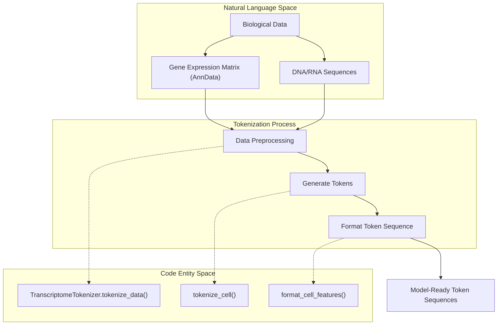
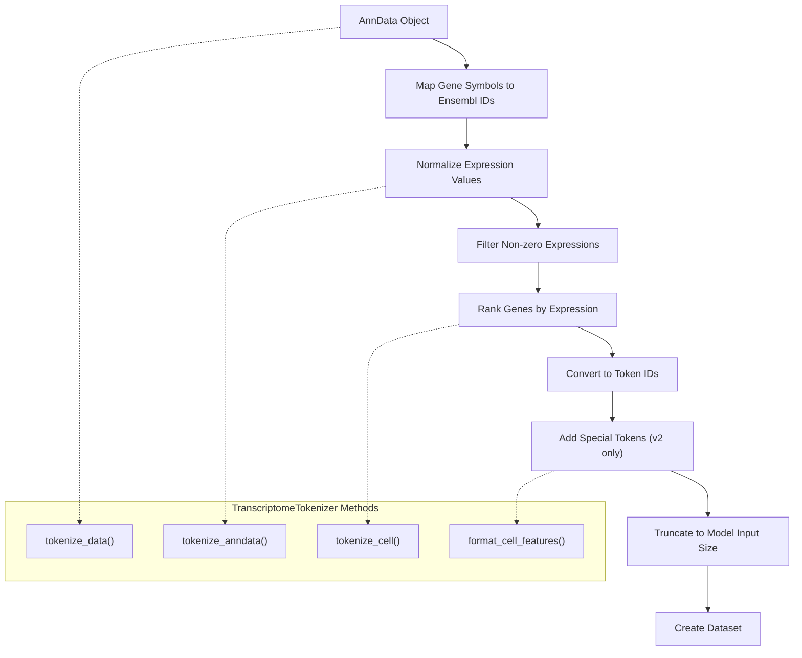
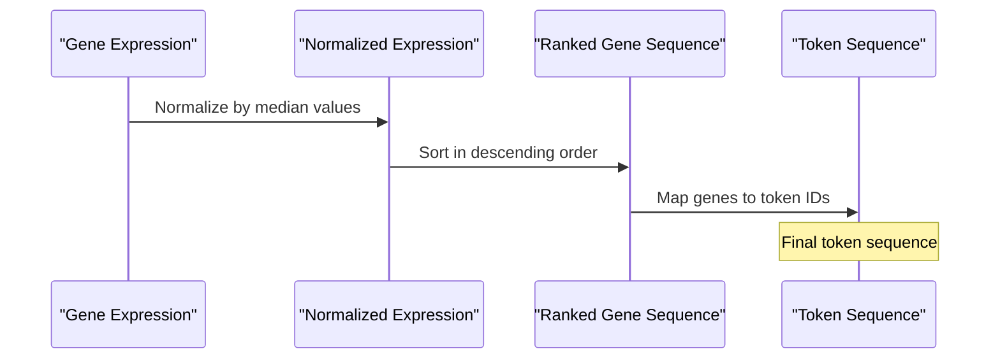
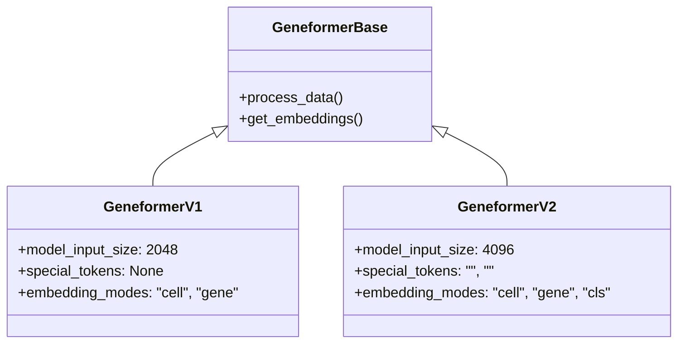
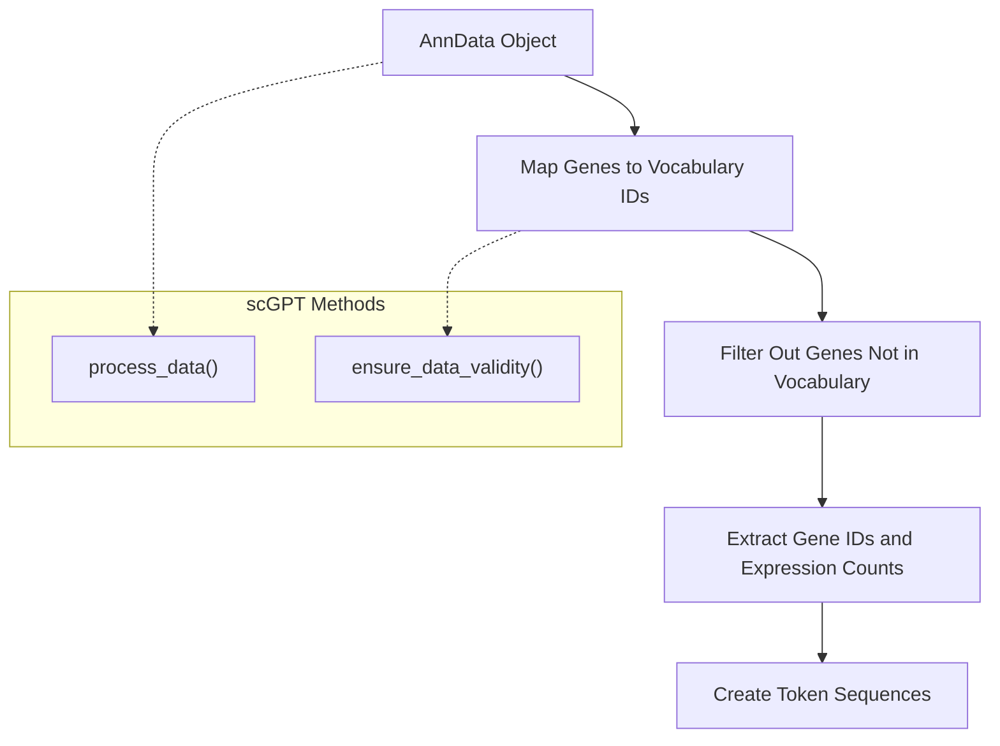
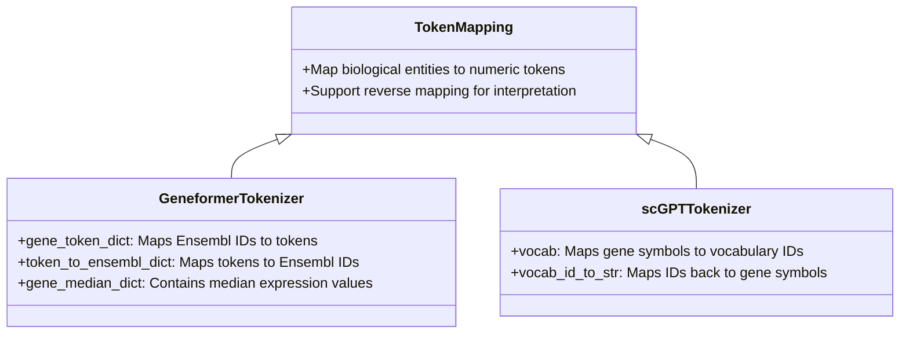
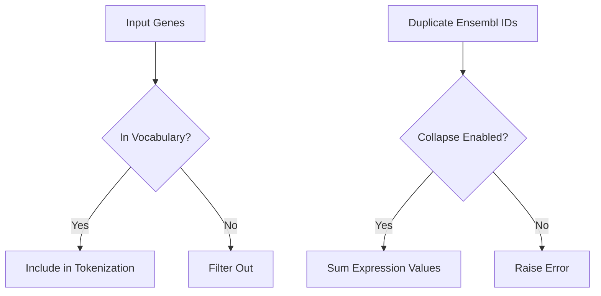
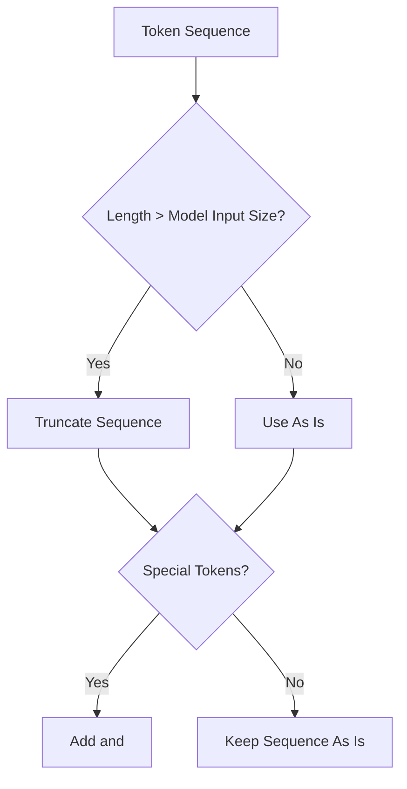
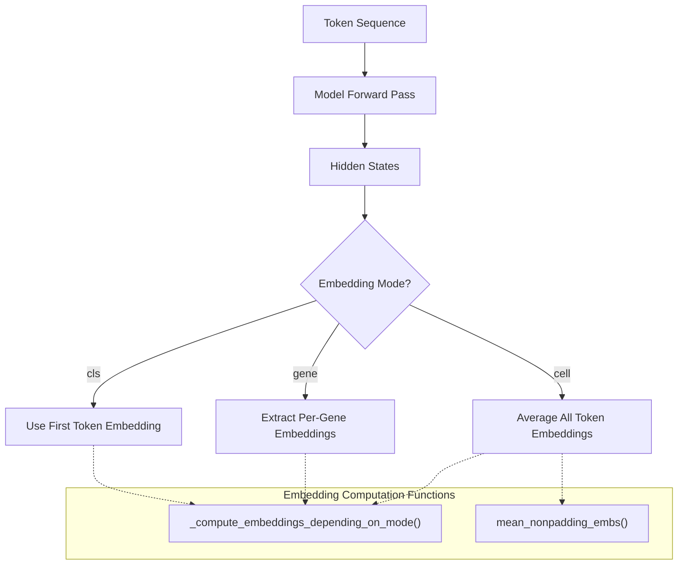

# Tokenization

<details>
<summary>Relevant source files</summary>

The following files were used as context for generating this wiki page:

- [ci/tests/test_geneformer/test_geneformer_model.py](ci/tests/test_geneformer/test_geneformer_model.py)
- [ci/tests/test_geneformer/test_geneformer_tokenizer.py](ci/tests/test_geneformer/test_geneformer_tokenizer.py)
- [ci/tests/test_scgpt/test_scgpt_model.py](ci/tests/test_scgpt/test_scgpt_model.py)
- [helical/models/geneformer/geneformer_tokenizer.py](helical/models/geneformer/geneformer_tokenizer.py)
- [helical/models/geneformer/geneformer_utils.py](helical/models/geneformer/geneformer_utils.py)

</details>


This page documents the tokenization systems used within Helical to convert biological data (DNA sequences, RNA sequences, and gene expression values) into numerical token sequences that can be processed by foundation models. Tokenization is a critical preprocessing step that bridges biological data with neural network inputs.

For information about other data preprocessing steps that occur before tokenization, see [Data Preprocessing](#7.1).

## Tokenization Overview

In computational biology, tokenization transforms raw biological data into numerical tokens that foundation models can process. This transformation is essential because neural networks operate on numerical data, while biological information is typically represented as sequences, counts, or expression values.



Sources:
- [helical/models/geneformer/geneformer_tokenizer.py:308-347]()
- [helical/models/geneformer/geneformer_tokenizer.py:64-82]()

## Model-Specific Tokenization Approaches

Different models in Helical tokenize biological data using distinct approaches:

| Model | Data Type | Tokenization Approach | Special Tokens | Input Size |
|-------|-----------|----------------------|----------------|------------|
| Geneformer v1 | Gene expression | Rank-based gene expression | None | 2048 |
| Geneformer v2 | Gene expression | Rank-based gene expression | `<cls>`, `<eos>` | 4096 |
| scGPT | Gene expression | Gene ID and count pairs | `<cls>` | Variable |
| HyenaDNA | DNA sequences | k-mer or character-level | Model-specific | Variable |
| Caduceus | DNA sequences | k-mer embeddings | Model-specific | Variable |

## Geneformer Tokenization

Geneformer's tokenization process transforms gene expression data into tokens through the `TranscriptomeTokenizer` class. This process is particularly designed for single-cell RNA-seq data.



Sources:
- [helical/models/geneformer/geneformer_tokenizer.py:196-304]()
- [helical/models/geneformer/geneformer_tokenizer.py:392-481]()

### Rank-Based Gene Expression Tokenization

Geneformer uses a unique approach where genes are ranked by their normalized expression values, and these ranks become the token sequence:

1. Normalize gene expression by dividing by cell-specific factors and gene-specific median values
2. Filter out genes with zero expression
3. Sort genes in descending order of normalized expression
4. Represent each gene by its token ID from a predefined dictionary



Sources:
- [helical/models/geneformer/geneformer_tokenizer.py:64-82]()
- [helical/models/geneformer/geneformer_tokenizer.py:427-479]()

### Special Tokens and Version Differences

Geneformer models come in two versions with different tokenization characteristics:



V2 models add special tokens to sequences:
- `<cls>` token at the beginning of the sequence
- `<eos>` token at the end of the sequence

These special tokens enable additional functionality like the "cls" embedding mode, which uses the embedding of just the first (`<cls>`) token.

Sources:
- [helical/models/geneformer/geneformer_tokenizer.py:525-536]()
- [ci/tests/test_geneformer/test_geneformer_model.py:129-135]()

## scGPT Tokenization

The scGPT model handles gene expression data differently from Geneformer:



Key differences in scGPT tokenization:
- Maps gene symbols directly to vocabulary IDs without Ensembl ID conversion
- Filters out genes not present in the model's vocabulary
- Creates a dataset with gene IDs and their corresponding expression counts

Sources:
- [ci/tests/test_scgpt/test_scgpt_model.py:25-40]()

## Token Dictionaries and Mappings

Each model uses dictionaries to map between biological entities and token IDs:



These dictionaries are typically loaded from pre-built files during model initialization and are critical for the tokenization process.

Sources:
- [helical/models/geneformer/geneformer_tokenizer.py:256-303]()
- [ci/tests/test_scgpt/test_scgpt_model.py:19-21]()

## Special Cases in Tokenization

The tokenization process handles several special cases:

### 1. Handling Missing and Duplicate Genes



Sources:
- [helical/models/geneformer/geneformer_tokenizer.py:85-186]()

### 2. Input Sequence Length Handling



Sources:
- [helical/models/geneformer/geneformer_tokenizer.py:525-540]()

## From Tokens to Embeddings

After tokenization, models convert token sequences into embeddings:



The embedding mode determines how token embeddings are processed:
- **cell mode**: Average embeddings across all tokens (excluding special tokens)
- **gene mode**: Extract individual gene embeddings
- **cls mode**: Use only the embedding of the `<cls>` token (only available in models with special tokens)

Sources:
- [helical/models/geneformer/geneformer_utils.py:41-99]()
- [helical/models/geneformer/geneformer_utils.py:323-336]()
- [ci/tests/test_scgpt/test_scgpt_model.py:126-171]()

## Using Tokenization in Helical

In practice, tokenization is usually handled internally by a model's `process_data` method:

```python
# Geneformer example
from helical.models.geneformer import Geneformer, GeneformerConfig

config = GeneformerConfig(model_name="gf-12L-95M-i4096")
model = Geneformer(config)

# This handles tokenization internally
tokenized_dataset = model.process_data(anndata_object, gene_names="gene_symbols")
embeddings = model.get_embeddings(tokenized_dataset)

# scGPT example
from helical.models.scgpt import scGPT, scGPTConfig

model = scGPT(scGPTConfig())
tokenized_dataset = model.process_data(anndata_object, gene_names="gene_names")
embeddings = model.get_embeddings(tokenized_dataset)
```

Sources:
- [ci/tests/test_geneformer/test_geneformer_model.py:60-82]()
- [ci/tests/test_geneformer/test_geneformer_model.py:149-150]()
- [ci/tests/test_scgpt/test_scgpt_model.py:25-40]()
- [ci/tests/test_scgpt/test_scgpt_model.py:149-150]()

## Conclusion

Tokenization is a fundamental step in the Helical framework that bridges biological data with neural network inputs. Each model in Helical implements its own tokenization strategy optimized for specific biological data types and model architectures. The framework provides consistent APIs for tokenization across different models while handling the unique requirements of each.

---