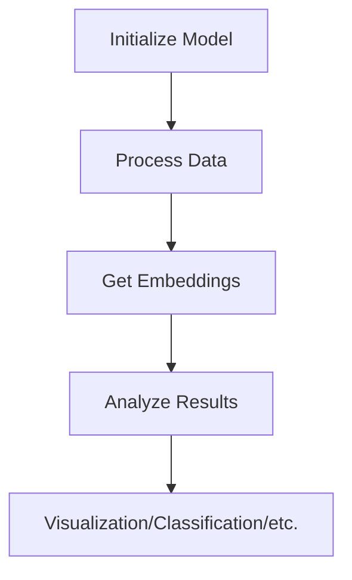
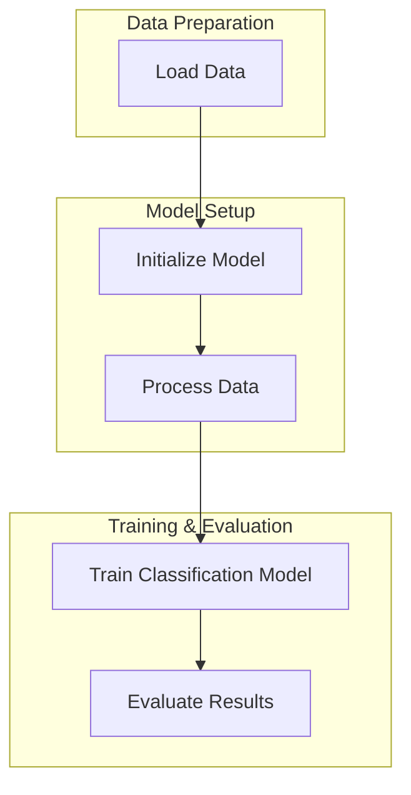
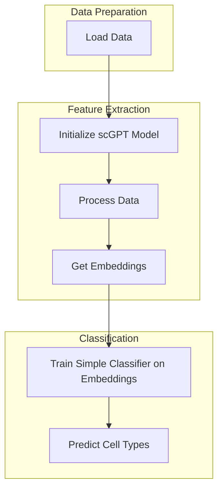
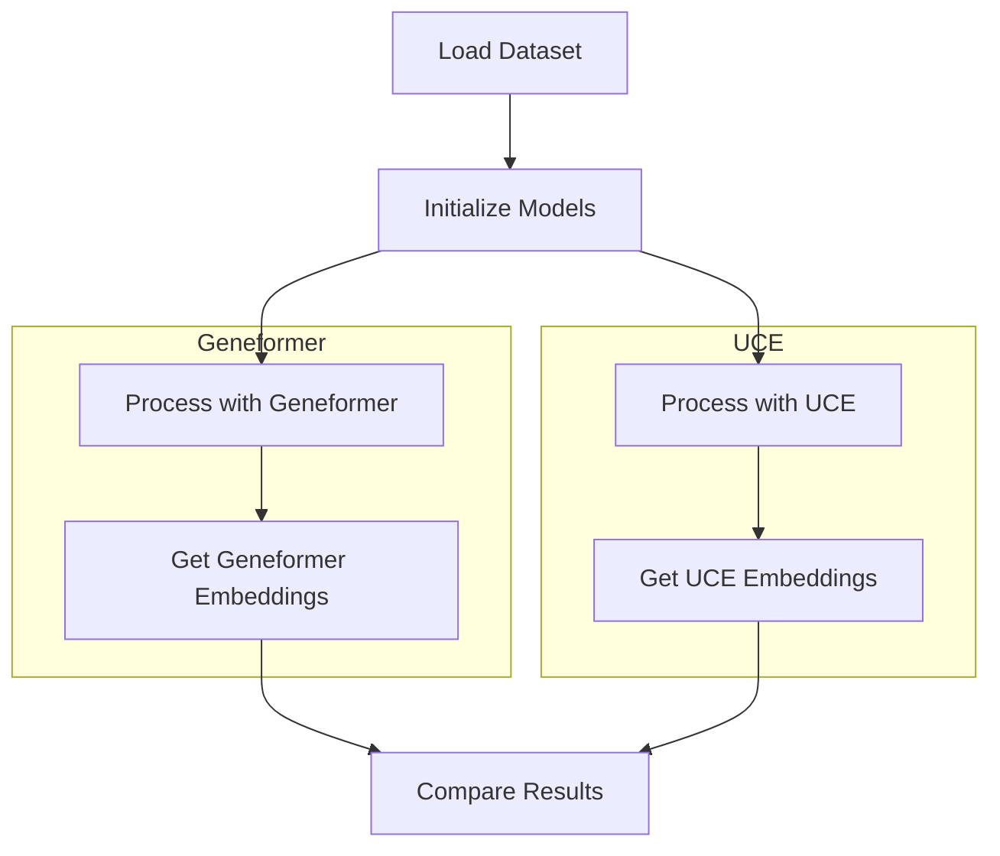
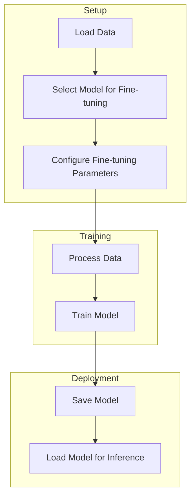
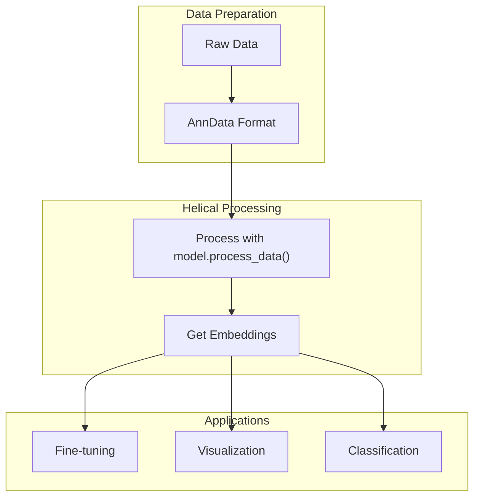

# Usage Examples

<details>
<summary>Relevant source files</summary>

The following files were used as context for generating this wiki page:

- [examples/fine_tune_models/fine_tune_UCE.py](examples/fine_tune_models/fine_tune_UCE.py)
- [examples/fine_tune_models/fine_tune_geneformer.py](examples/fine_tune_models/fine_tune_geneformer.py)
- [examples/fine_tune_models/fine_tune_scgpt.py](examples/fine_tune_models/fine_tune_scgpt.py)
- [examples/notebooks/Cell-Type-Annotation.ipynb](examples/notebooks/Cell-Type-Annotation.ipynb)
- [examples/notebooks/Cell-Type-Classification-Fine-Tuning.ipynb](examples/notebooks/Cell-Type-Classification-Fine-Tuning.ipynb)
- [examples/notebooks/Geneformer-vs-UCE.ipynb](examples/notebooks/Geneformer-vs-UCE.ipynb)
- [examples/notebooks/Quick-Start-Tutorial.ipynb](examples/notebooks/Quick-Start-Tutorial.ipynb)
- [examples/run_models/run_geneformer.py](examples/run_models/run_geneformer.py)
- [examples/run_models/run_scgpt.py](examples/run_models/run_scgpt.py)
- [examples/run_models/run_uce.py](examples/run_models/run_uce.py)
- [helical/utils/__init__.py](helical/utils/__init__.py)

</details>


This page provides practical examples of how to use the Helical framework for working with bio foundation models. It covers basic usage patterns, cell type classification, and model comparison. For information about the core architecture and models included in Helical, see [Core Architecture](#3) and [RNA Models](#4).

## Getting Started

The Helical framework provides a unified interface for working with different bio foundation models in genomics and transcriptomics. The examples in this page demonstrate common usage patterns.

### Basic Model Usage

The basic workflow for using models in Helical follows these steps:



Here's a simple example of using Geneformer to get embeddings:

```python
# Import the model
from helical.models.geneformer import Geneformer, GeneformerConfig
import torch

# Create configuration
device = "cuda" if torch.cuda.is_available() else "cpu"
config = GeneformerConfig(batch_size=10, device=device)

# Initialize model
geneformer = Geneformer(configurer=config)

# Process data
processed_data = geneformer.process_data(ann_data, gene_names="gene_name")

# Get embeddings
embeddings = geneformer.get_embeddings(processed_data)

# Use embeddings for analysis
print(embeddings.shape)
```

Sources: [examples/run_models/run_geneformer.py:11-24](), [examples/notebooks/Quick-Start-Tutorial.ipynb:166-171](), [examples/notebooks/Quick-Start-Tutorial.ipynb:206-207]()

### Loading Data

Most examples use AnnData format for handling gene expression data. You can load data using the Hugging Face datasets library:

```python
from datasets import load_dataset
from helical.utils import get_anndata_from_hf_dataset

# Load dataset from Hugging Face
dataset = load_dataset("helical-ai/yolksac_human", trust_remote_code=True)

# Convert to AnnData format
ann_data = get_anndata_from_hf_dataset(dataset["train"])
```

Sources: [examples/notebooks/Cell-Type-Classification-Fine-Tuning.ipynb:87-100](), [examples/notebooks/Quick-Start-Tutorial.ipynb:66-67](), [examples/notebooks/Quick-Start-Tutorial.ipynb:92-95]()

## Cell Type Classification

One of the most common applications of bio foundation models is cell type classification. This section demonstrates how to use Helical for this task.

### Using Geneformer for Cell Type Classification



Here's an example using Geneformer for cell type classification:

```python
from helical.models.geneformer import GeneformerConfig, GeneformerFineTuningModel
import torch

# Configuration
device = "cuda" if torch.cuda.is_available() else "cpu"
geneformer_config = GeneformerConfig(device=device, batch_size=10, model_name="gf-6L-30M-i2048")

# Initialize fine-tuning model
geneformer_fine_tune = GeneformerFineTuningModel(
    geneformer_config=geneformer_config, 
    fine_tuning_head="classification", 
    output_size=len(label_set)
)

# Process data
geneformer_train_dataset = geneformer_fine_tune.process_data(train_dataset)
geneformer_test_dataset = geneformer_fine_tune.process_data(test_dataset)

# Add labels
geneformer_train_dataset = geneformer_train_dataset.add_column("LVL1", cell_types_train)
geneformer_test_dataset = geneformer_test_dataset.add_column("LVL1", cell_types_test)

# Fine-tune the model
geneformer_fine_tune.train(
    train_dataset=geneformer_train_dataset.shuffle(), 
    validation_dataset=geneformer_test_dataset, 
    label="LVL1", 
    freeze_layers=0, 
    epochs=1, 
    optimizer_params={"lr": 1e-4}, 
    lr_scheduler_params={"name":"linear", "num_warmup_steps":0, 'num_training_steps':1}
)

# Get predictions
outputs = geneformer_fine_tune.get_outputs(geneformer_test_dataset)

# Get embeddings from fine-tuned model
embeddings = geneformer_fine_tune.get_embeddings(geneformer_test_dataset)
```

Sources: [examples/notebooks/Cell-Type-Classification-Fine-Tuning.ipynb:175-177](), [examples/notebooks/Cell-Type-Classification-Fine-Tuning.ipynb:201-203](), [examples/notebooks/Cell-Type-Classification-Fine-Tuning.ipynb:218-220](), [examples/notebooks/Cell-Type-Classification-Fine-Tuning.ipynb:251-252](), [examples/notebooks/Cell-Type-Classification-Fine-Tuning.ipynb:275-276](), [examples/notebooks/Cell-Type-Classification-Fine-Tuning.ipynb:299-300]()

### Visualizing Embeddings

You can visualize the embeddings using dimensionality reduction techniques like UMAP:

```python
import umap
import matplotlib.pyplot as plt
import seaborn as sns
import pandas as pd

# Create UMAP reducer
reducer = umap.UMAP()
embedding = reducer.fit_transform(embeddings)

# Create dataframe for plotting
df = pd.DataFrame({
    'UMAP1': embedding[:, 0],
    'UMAP2': embedding[:, 1],
    'cell_type': cell_types_test
})

# Plot
plt.figure(figsize=(10, 8))
sns.scatterplot(data=df, x='UMAP1', y='UMAP2', hue='cell_type')
plt.title('UMAP of Cell Embeddings')
plt.show()
```

Sources: [examples/notebooks/Cell-Type-Classification-Fine-Tuning.ipynb:313-331]()

## Cell Type Annotation with scGPT

Another common application is using models like scGPT for cell type annotation:



Example code:

```python
from helical.models.scgpt import scGPT, scGPTConfig
import torch
import torch.nn as nn
from torch.utils.data import DataLoader, TensorDataset

# Initialize scGPT model
device = "cuda" if torch.cuda.is_available() else "cpu"
scgpt_config = scGPTConfig(batch_size=50, device=device)
scgpt = scGPT(configurer=scgpt_config)

# Process data
data = scgpt.process_data(adata, gene_names="gene_name")
x_scgpt = scgpt.get_embeddings(data)

# Define a simple neural network for classification
head_model = nn.Sequential(
    nn.Linear(512, 128),
    nn.ReLU(),
    nn.Dropout(0.4),
    nn.Linear(128, 32),
    nn.ReLU(),
    nn.Dropout(0.4),
    nn.Linear(32, num_classes)
)

# Train the model
X_train, X_test, y_train, y_test = train_test_split(x_scgpt, y_encoded, test_size=0.1)
optimizer = optim.Adam(head_model.parameters(), lr=0.001)
criterion = nn.CrossEntropyLoss()

train_dataset = TensorDataset(torch.from_numpy(X_train), y_train)
train_loader = DataLoader(train_dataset, batch_size=64, shuffle=True)

# Training loop
for epoch in range(num_epochs):
    for batch_X, batch_y in train_loader:
        optimizer.zero_grad()
        outputs = head_model(batch_X)
        loss = criterion(outputs, batch_y)
        loss.backward()
        optimizer.step()

# Evaluate
predictions = head_model(torch.Tensor(X_test))
y_pred = np.array(torch.argmax(predictions, dim=1))
y_true = np.array(y_test.argmax(axis=1))
```

Sources: [examples/notebooks/Cell-Type-Annotation.ipynb:263-269](), [examples/notebooks/Cell-Type-Annotation.ipynb:344-351](), [examples/notebooks/Cell-Type-Annotation.ipynb:363-369](), [examples/notebooks/Cell-Type-Annotation.ipynb:511-513]()

## Comparing Different Models

Helical makes it easy to compare different models on the same dataset. Here's an example comparing Geneformer and UCE:



Example code:

```python
# Initialize Geneformer
device = "cuda" if torch.cuda.is_available() else "cpu"
model_config = GeneformerConfig(batch_size=10, device=device)
geneformer = Geneformer(configurer=model_config)

# Initialize UCE
model_config = UCEConfig(batch_size=10)
uce = UCE(configurer=model_config)

# Process data with Geneformer
gf_dataset = geneformer.process_data(ann_data[:100], gene_names="gene_name")
gf_embeddings = geneformer.get_embeddings(gf_dataset)

# Process data with UCE (in batches due to memory requirements)
batch_size = 10
all_uce_embeddings = []

for start in range(0, ann_data.shape[0], batch_size):
    end = min(start + batch_size, ann_data.shape[0])
    ann_data_batch = ann_data[start:end].to_memory()
    
    dataset_batch = uce.process_data(ann_data_batch)
    embeddings_batch = uce.get_embeddings(dataset_batch)
    
    all_uce_embeddings.append(embeddings_batch)

uce_embeddings = np.concatenate(all_uce_embeddings, axis=0)

# Compare models using KNN classifier
knn = KNeighborsClassifier(n_neighbors=5)

# For Geneformer
knn.fit(gf_embeddings[:train_size], y_train)
gf_y_pred = knn.predict(gf_embeddings[train_size:])
gf_accuracy = accuracy_score(y_test, gf_y_pred)

# For UCE
knn.fit(uce_embeddings[:train_size], y_train)
uce_y_pred = knn.predict(uce_embeddings[train_size:])
uce_accuracy = accuracy_score(y_test, uce_y_pred)

print(f"Geneformer accuracy: {gf_accuracy:.4f}")
print(f"UCE accuracy: {uce_accuracy:.4f}")
```

Sources: [examples/notebooks/Geneformer-vs-UCE.ipynb:170-171](), [examples/notebooks/Geneformer-vs-UCE.ipynb:182-183](), [examples/notebooks/Geneformer-vs-UCE.ipynb:198-200](), [examples/run_models/run_uce.py:26-46]()

## Fine-Tuning Models for Custom Tasks

Helical provides a streamlined API for fine-tuning models on custom tasks:



### Geneformer Fine-Tuning Example

```python
from helical.models.geneformer import GeneformerConfig, GeneformerFineTuningModel

# Initialize configuration
geneformer_config = GeneformerConfig(device="cuda", batch_size=32)

# Create fine-tuning model
geneformer_fine_tune = GeneformerFineTuningModel(
    geneformer_config=geneformer_config,
    fine_tuning_head="classification",
    output_size=len(label_set)
)

# Process data
dataset = geneformer_fine_tune.process_data(ann_data)

# Add labels and convert to ids
dataset = dataset.add_column("cell_types", cell_types)
class_id_dict = dict(zip(label_set, [i for i in range(len(label_set))]))

def classes_to_ids(example):
    example["cell_types"] = class_id_dict[example["cell_types"]]
    return example

dataset = dataset.map(classes_to_ids, num_proc=1)

# Train the model
geneformer_fine_tune.train(train_dataset=dataset, label="cell_types")

# Get predictions
outputs = geneformer_fine_tune.get_outputs(dataset)

# Save and load model
geneformer_fine_tune.save_model("./geneformer_fine_tuned_model.pt")
geneformer_fine_tune.load_model("./geneformer_fine_tuned_model.pt")
```

Sources: [examples/fine_tune_models/fine_tune_geneformer.py:26-53]()

### scGPT Fine-Tuning Example

```python
from helical.models.scgpt import scGPTConfig, scGPTFineTuningModel

# Initialize configuration
scgpt_config = scGPTConfig(device="cuda", batch_size=32)

# Create fine-tuning model
scgpt_fine_tune = scGPTFineTuningModel(
    scGPT_config=scgpt_config,
    fine_tuning_head="classification",
    output_size=len(label_set)
)

# Process data
dataset = scgpt_fine_tune.process_data(ann_data)

# Convert labels to ids
class_id_dict = {label: i for i, label in enumerate(label_set)}
cell_types = [class_id_dict[cell] for cell in cell_types]

# Train the model
scgpt_fine_tune.train(train_input_data=dataset, train_labels=cell_types)

# Get predictions
outputs = scgpt_fine_tune.get_outputs(dataset)

# Save and load model
scgpt_fine_tune.save_model("./scgpt_fine_tuned_model.pt")
scgpt_fine_tune.load_model("./scgpt_fine_tuned_model.pt")
```

Sources: [examples/fine_tune_models/fine_tune_scgpt.py:23-44]()

### UCE Fine-Tuning Example

```python
from helical.models.uce import UCEConfig, UCEFineTuningModel

# Initialize configuration
uce_config = UCEConfig(device="cuda", batch_size=32)

# Create fine-tuning model
uce_fine_tune = UCEFineTuningModel(
    uce_config=uce_config,
    fine_tuning_head="classification",
    output_size=len(label_set)
)

# Process data
dataset = uce_fine_tune.process_data(ann_data, name="train")

# Convert labels to ids
class_id_dict = {label: i for i, label in enumerate(label_set)}
cell_types = [class_id_dict[cell] for cell in cell_types]

# Train the model
uce_fine_tune.train(train_input_data=dataset, train_labels=cell_types)

# Get predictions
outputs = uce_fine_tune.get_outputs(dataset)

# Save and load model
uce_fine_tune.save_model("./uce_fine_tuned_model.pt")
uce_fine_tune.load_model("./uce_fine_tuned_model.pt")
```

Sources: [examples/fine_tune_models/fine_tune_UCE.py:25-44]()

## Model Properties Comparison

This table compares key properties of the different models available in Helical:

| Model | Type | Strengths | Typical Use Cases |
|-------|------|-----------|-------------------|
| Geneformer | RNA | Pre-trained on ~30 million single cell transcriptomes, strong zero-shot capabilities | Cell type classification, gene expression analysis |
| scGPT | RNA | GPT-based architecture for single-cell RNA sequencing | Cell type annotation, gene expression analysis |
| UCE | RNA | Universal Cell Embedding model trained on diverse species | Cross-species cell type classification |
| HyenaDNA | DNA | State-space model for long DNA sequences | DNA sequence analysis |
| Caduceus | DNA | Foundation model for genomic sequences | DNA sequence prediction |
| Evo2 | DNA | Evolutionary model for genetic sequences | DNA evolutionary analysis |

Sources: [examples/notebooks/Geneformer-vs-UCE.ipynb:18-31](), [examples/notebooks/Cell-Type-Annotation.ipynb:15-17]()

## Data Processing Overview



Sources: [examples/notebooks/Quick-Start-Tutorial.ipynb:193-194](), [examples/notebooks/Quick-Start-Tutorial.ipynb:214-215](), [examples/notebooks/Quick-Start-Tutorial.ipynb:249-252]()

This page covered the basic usage patterns of the Helical framework for working with bio foundation models. For more specific information about individual models, please refer to their respective documentation pages.

---