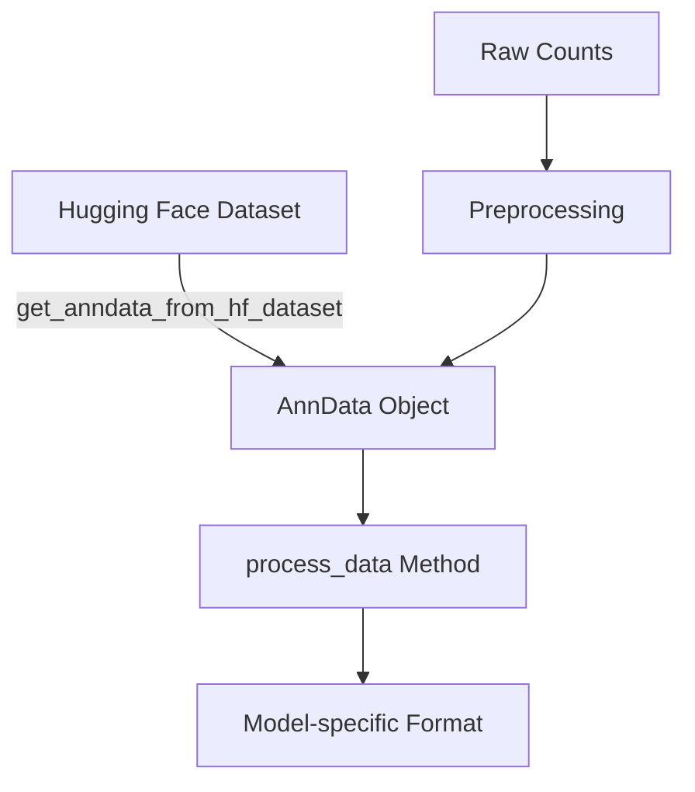
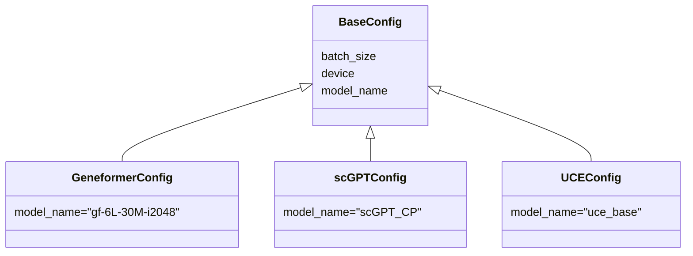
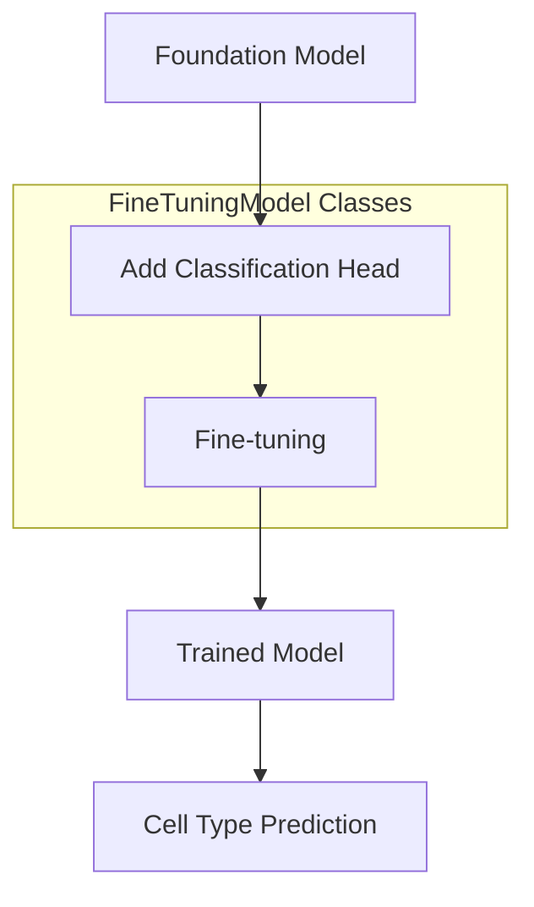
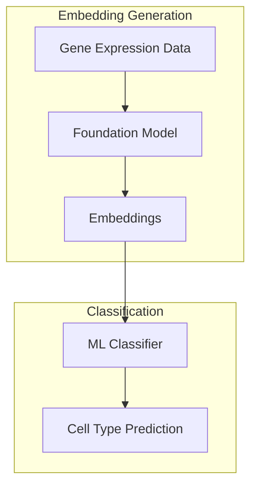
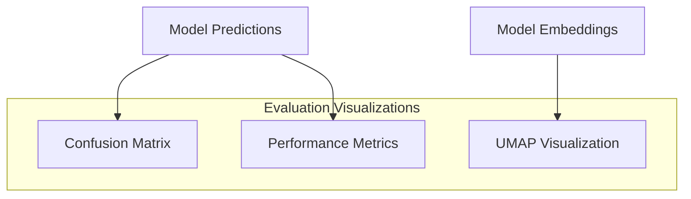

# Cell Type Classification

<details>
<summary>Relevant source files</summary>

The following files were used as context for generating this wiki page:

- [examples/notebooks/Cell-Type-Annotation.ipynb](examples/notebooks/Cell-Type-Annotation.ipynb)
- [examples/notebooks/Cell-Type-Classification-Fine-Tuning.ipynb](examples/notebooks/Cell-Type-Classification-Fine-Tuning.ipynb)
- [examples/notebooks/Geneformer-vs-UCE.ipynb](examples/notebooks/Geneformer-vs-UCE.ipynb)
- [examples/notebooks/Quick-Start-Tutorial.ipynb](examples/notebooks/Quick-Start-Tutorial.ipynb)

</details>


## Purpose and Scope

This page explains how to use Helical's unified API to perform cell type classification using various bio foundation models. Cell type classification is the task of identifying cell types based on their gene expression profiles. With Helical, you can leverage powerful pre-trained models like Geneformer, scGPT, and UCE to generate embeddings from gene expression data, and then use these embeddings to build accurate cell type classifiers.

This page covers the entire workflow of cell type classification including data preprocessing, model selection, embedding generation, classifier training, and evaluation. For fine-tuning foundation models for specific classification tasks, see [Fine-tuning System](#6).

## Classification Workflow Overview

The general workflow for cell type classification with Helical consists of the following steps:

1. **Data Preparation**: Load and preprocess gene expression data
2. **Model Selection**: Choose an appropriate pre-trained foundation model
3. **Embedding Generation**: Generate embeddings from gene expression data
4. **Classifier Building**: Train a classifier on top of the embeddings
5. **Evaluation**: Assess the classifier's performance

### Workflow Diagram


Sources: [examples/notebooks/Cell-Type-Classification-Fine-Tuning.ipynb:1-55](), [examples/notebooks/Cell-Type-Annotation.ipynb:1-22]()

## Data Preparation

Before generating embeddings, you'll need to prepare your gene expression data properly. Helical provides utilities to load and process data from various formats.

### Data Loading

You can load data directly from Hugging Face datasets, AnnData objects, or CSV files. The `get_anndata_from_hf_dataset` function is particularly useful for converting Hugging Face datasets to AnnData format, which is widely used in single-cell analysis.



Sources: [examples/notebooks/Cell-Type-Classification-Fine-Tuning.ipynb:85-100](), [examples/notebooks/Cell-Type-Annotation.ipynb:90-133]()

### Example: Loading Data

```python
# Load data from Hugging Face dataset
from helical.utils import get_anndata_from_hf_dataset
from datasets import load_dataset

ds = load_dataset("helical-ai/yolksac_human", trust_remote_code=True)
adata = get_anndata_from_hf_dataset(ds["train"])

# Extract labels
cell_types = adata.obs["LVL1"].tolist()
```

Sources: [examples/notebooks/Cell-Type-Classification-Fine-Tuning.ipynb:85-124]()

## Model Selection and Configuration

Helical provides a unified interface to various foundation models. For cell type classification, the most commonly used models are:

1. **Geneformer**: Trained on human gene expression data
2. **scGPT**: Specialized for single-cell gene expression analysis
3. **UCE (Universal Cell Embedding)**: Trained on multi-species data

Each model requires specific configuration parameters that can be set through its respective Config class.



Sources: [examples/notebooks/Cell-Type-Classification-Fine-Tuning.ipynb:165-176](), [examples/notebooks/Cell-Type-Annotation.ipynb:226-268]()

### Example: Model Initialization

```python
import torch
from helical.models.geneformer import Geneformer, GeneformerConfig
from helical.models.scgpt import scGPT, scGPTConfig

# Initialize Geneformer
device = "cuda" if torch.cuda.is_available() else "cpu"
geneformer_config = GeneformerConfig(device=device, batch_size=10)
geneformer = Geneformer(configurer=geneformer_config)

# Initialize scGPT
scgpt_config = scGPTConfig(device=device, batch_size=50)
scgpt = scGPT(configurer=scgpt_config)
```

Sources: [examples/notebooks/Cell-Type-Classification-Fine-Tuning.ipynb:175-176](), [examples/notebooks/Cell-Type-Annotation.ipynb:262-268]()

## Embedding Generation

Once your model is initialized, you can generate embeddings for your gene expression data. This is a two-step process:

1. **Process Data**: Convert your data to the format expected by the model
2. **Generate Embeddings**: Feed the processed data through the model to obtain embeddings

### Data Processing

Each model has its own `process_data` method that handles the necessary preprocessing steps for that specific model:

```python
# Process data for Geneformer
geneformer_data = geneformer.process_data(adata, gene_names="gene_name")

# Process data for scGPT
scgpt_data = scgpt.process_data(adata, gene_names="gene_name")
```

Sources: [examples/notebooks/Cell-Type-Classification-Fine-Tuning.ipynb:200-202](), [examples/notebooks/Cell-Type-Annotation.ipynb:268-268]()

### Embedding Extraction

After processing the data, you can use the `get_embeddings` method to extract embeddings:

```python
# Get embeddings from Geneformer
geneformer_embeddings = geneformer.get_embeddings(geneformer_data)

# Get embeddings from scGPT
scgpt_embeddings = scgpt.get_embeddings(scgpt_data)
```

These embeddings are numerical representations of gene expression profiles that capture the biological information learned by the foundation models.

Sources: [examples/notebooks/Cell-Type-Classification-Fine-Tuning.ipynb:316-316](), [examples/notebooks/Cell-Type-Annotation.ipynb:248-268]()

## Building Classifiers

With embeddings in hand, you can now build classifiers for cell type prediction. Helical offers two main approaches:

1. **Fine-tuning a foundation model**: Add a classification head on top of a foundation model and train the entire model or just the head
2. **Training a separate classifier**: Use the embeddings as input features to a standard machine learning classifier

### Fine-tuning Approach

For fine-tuning, Helical provides specialized classes like `GeneformerFineTuningModel` and `scGPTFineTuningModel`:



Sources: [examples/notebooks/Cell-Type-Classification-Fine-Tuning.ipynb:175-176]()

### Example: Fine-tuning Geneformer

```python
from helical.models.geneformer import GeneformerFineTuningModel

# Create fine-tuning model
geneformer_fine_tune = GeneformerFineTuningModel(
    geneformer_config=geneformer_config, 
    fine_tuning_head="classification", 
    output_size=len(label_set)
)

# Train the model
geneformer_fine_tune.train(
    train_dataset=geneformer_train_dataset.shuffle(), 
    validation_dataset=geneformer_test_dataset, 
    label="LVL1", 
    freeze_layers=0, 
    epochs=1, 
    optimizer_params={"lr": 1e-4}, 
    lr_scheduler_params={"name":"linear", "num_warmup_steps":0, 'num_training_steps':1}
)
```

Sources: [examples/notebooks/Cell-Type-Classification-Fine-Tuning.ipynb:175-252]()

### Separate Classifier Approach

Alternatively, you can use the embeddings as features for a standard machine learning classifier:



Sources: [examples/notebooks/Cell-Type-Annotation.ipynb:305-396]()

### Example: Training a Neural Network Classifier

```python
import torch.nn as nn
import torch.optim as optim
from torch.utils.data import TensorDataset, DataLoader

# Define a simple neural network classifier
model = nn.Sequential(
    nn.Linear(512, 128),
    nn.ReLU(),
    nn.Dropout(0.4),
    nn.Linear(128, 32),
    nn.ReLU(),
    nn.Dropout(0.4),
    nn.Linear(32, num_classes)
)

# Train the model
criterion = nn.CrossEntropyLoss()
optimizer = optim.Adam(model.parameters(), lr=0.001)

for epoch in range(50):
    for batch_X, batch_y in train_loader:
        optimizer.zero_grad()
        outputs = model(batch_X)
        loss = criterion(outputs, batch_y)
        loss.backward()
        optimizer.step()
```

Sources: [examples/notebooks/Cell-Type-Annotation.ipynb:313-416]()

## Evaluation and Performance Analysis

After training your classifier, it's important to evaluate its performance. Helical provides utilities to extract predictions and perform evaluation:

### Fine-tuning Approach

```python
# Get outputs for test set
outputs = geneformer_fine_tune.get_outputs(geneformer_test_dataset)

# Get embeddings from fine-tuned model
embeddings = geneformer_fine_tune.get_embeddings(geneformer_test_dataset)
```

Sources: [examples/notebooks/Cell-Type-Classification-Fine-Tuning.ipynb:270-300]()

### Separate Classifier Approach

```python
# Make predictions
predictions = model(torch.Tensor(X_test))
y_pred = np.array(torch.argmax(predictions, dim=1))
y_true = np.array(y_test.argmax(axis=1))

# Calculate metrics
accuracy = accuracy_score(y_true, y_pred)
precision = precision_score(y_true, y_pred, average='macro')
f1 = f1_score(y_true, y_pred, average='macro')
recall = recall_score(y_true, y_pred, average='macro')
```

Sources: [examples/notebooks/Cell-Type-Annotation.ipynb:513-562]()

### Visualizing Results

Visualization is key to understanding the performance of your classifier. Common visualizations include:

1. **Confusion Matrix**: Shows the distribution of predicted vs. actual cell types
2. **UMAP Embedding Visualization**: Displays the distribution of embeddings colored by cell type
3. **Performance Metrics**: Accuracy, precision, recall, and F1 score



Sources: [examples/notebooks/Cell-Type-Classification-Fine-Tuning.ipynb:307-345](), [examples/notebooks/Cell-Type-Annotation.ipynb:740-766]()

## Performance Comparison

Different foundation models may perform differently on the same cell type classification task. Here's a general comparison of the models available in Helical:

| Model | Strengths | Best Used For |
|-------|-----------|---------------|
| Geneformer | Trained on human data, good for human cell types | Human cell type classification |
| scGPT | Specialized for single-cell data | General cell type classification |
| UCE | Trained on multi-species data | Cross-species cell type classification |

The choice of model depends on your specific requirements and the nature of your data.

Sources: [examples/notebooks/Geneformer-vs-UCE.ipynb:11-26](), [examples/notebooks/Cell-Type-Annotation.ipynb:15-21]()

## Example Workflow

Here's a complete example of a cell type classification workflow using Helical:


Sources: [examples/notebooks/Quick-Start-Tutorial.ipynb:63-253]()

## Best Practices

To get the best results when performing cell type classification with Helical:

1. **Data Quality**: Ensure your gene expression data is properly normalized and of high quality
2. **Model Selection**: Choose the most appropriate model for your specific use case
3. **Embedding Analysis**: Examine the embeddings using dimensionality reduction techniques to understand your data better
4. **Hyperparameter Tuning**: Experiment with different hyperparameters for both the embedding generation and classifier training
5. **Balanced Datasets**: Ensure your training dataset has a balanced representation of different cell types
6. **Cross-Validation**: Use cross-validation to ensure your classifier generalizes well to unseen data

Sources: [examples/notebooks/Cell-Type-Annotation.ipynb:305-485]()

## Related Resources

- For more information on fine-tuning foundation models, see [Fine-tuning System](#6)
- For details on model selection, see [Base Models](#3.1)
- For data preprocessing, see [Data Handling](#7)

---