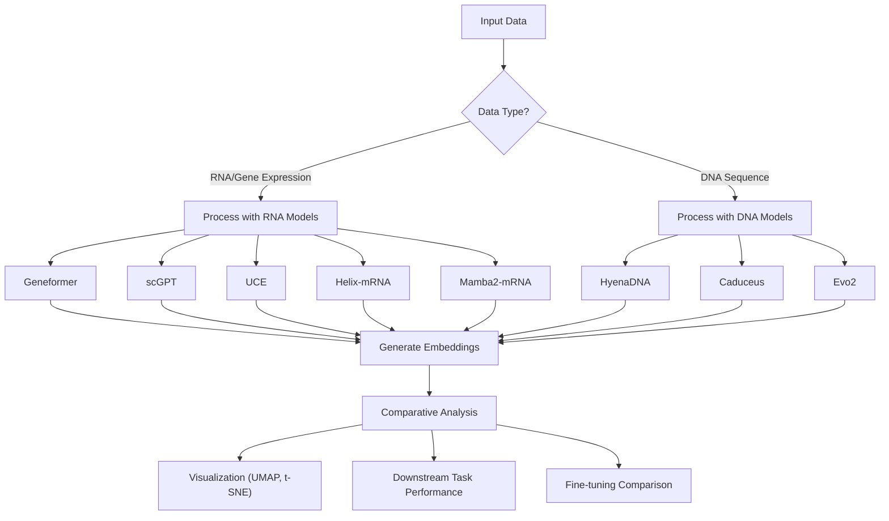
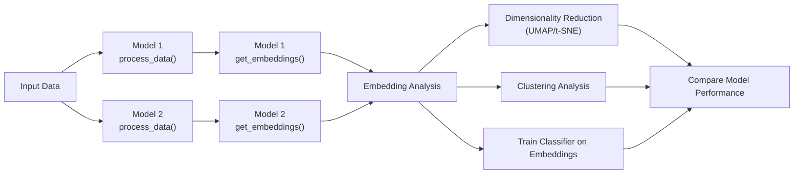
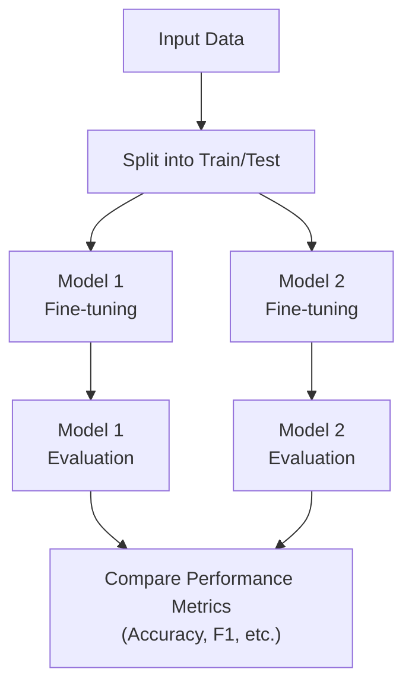
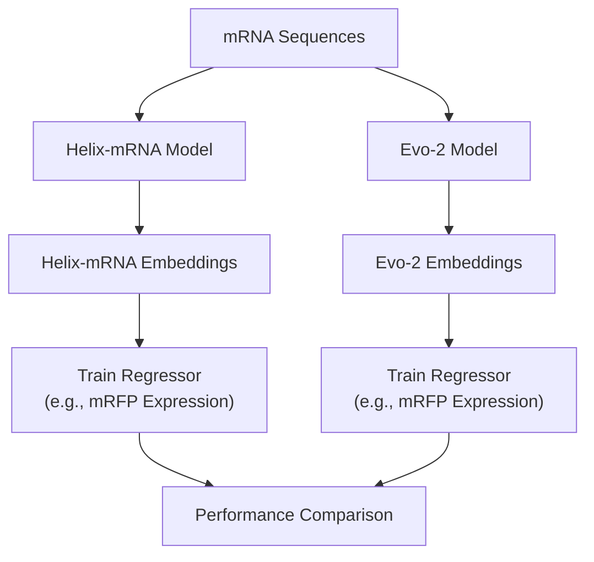
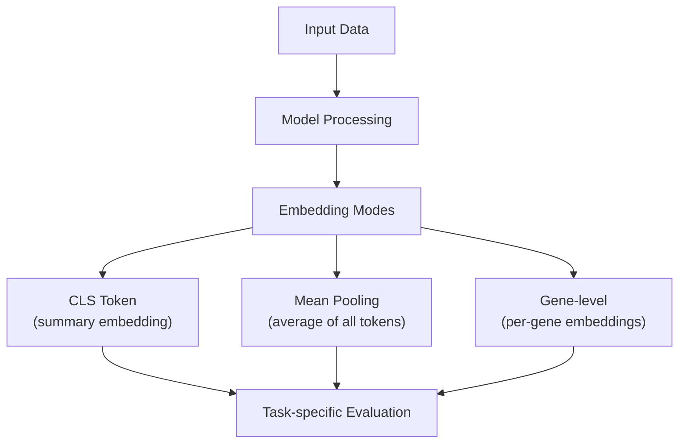

# Model Comparison

<details>
<summary>Relevant source files</summary>

The following files were used as context for generating this wiki page:

- [.readthedocs.yaml](.readthedocs.yaml)
- [ci/tests/test_caduceus/test_caduceus_model.py](ci/tests/test_caduceus/test_caduceus_model.py)
- [docs/configs/evo_2_config.md](docs/configs/evo_2_config.md)
- [docs/models/evo_2.md](docs/models/evo_2.md)
- [docs/notebooks/Cell-Gene-Cls-embedding-generation.ipynb](docs/notebooks/Cell-Gene-Cls-embedding-generation.ipynb)
- [docs/notebooks/Cell-Type-Annotation.ipynb](docs/notebooks/Cell-Type-Annotation.ipynb)
- [docs/notebooks/Cell-Type-Classification-Fine-Tuning.ipynb](docs/notebooks/Cell-Type-Classification-Fine-Tuning.ipynb)
- [docs/notebooks/Evo-2.ipynb](docs/notebooks/Evo-2.ipynb)
- [docs/notebooks/Geneformer-vs-UCE.ipynb](docs/notebooks/Geneformer-vs-UCE.ipynb)
- [docs/notebooks/Genegpt-sample-run.ipynb](docs/notebooks/Genegpt-sample-run.ipynb)
- [docs/notebooks/Helix-mRNA.ipynb](docs/notebooks/Helix-mRNA.ipynb)
- [docs/notebooks/Hyena-DNA-Inference.ipynb](docs/notebooks/Hyena-DNA-Inference.ipynb)
- [docs/notebooks/HyenaDNA-Fine-Tuning.ipynb](docs/notebooks/HyenaDNA-Fine-Tuning.ipynb)
- [examples/notebooks/Evo-2.ipynb](examples/notebooks/Evo-2.ipynb)
- [helical/models/caduceus/__init__.py](helical/models/caduceus/__init__.py)

</details>


This page provides a guide on how to compare different bio foundation models using the Helical framework. Model comparison is essential for selecting the most suitable model for a specific biological task or dataset. The Helical framework simplifies this process by providing a standardized interface across various genomics and transcriptomics models.

For information about fine-tuning specific models, see [Fine-tuning System](#6).

## Overview of Model Comparison in Helical

The Helical framework enables systematic comparison of different bio foundation models through its consistent API design. Models from different architectures and for different biological modalities (RNA, DNA) can be evaluated side-by-side using standardized workflows.



Sources: [examples/notebooks/Geneformer-vs-UCE.ipynb](), [examples/notebooks/Evo-2.ipynb]()

## Comparison Methods

### Embedding-based Comparison

One of the most common ways to compare models is through their embeddings. Helical standardizes the process of generating embeddings from different models.



Sources: [examples/notebooks/Geneformer-vs-UCE.ipynb](), [examples/notebooks/Cell-Type-Classification-Fine-Tuning.ipynb]()

### Fine-tuning Performance Comparison

Another approach is to compare how well different models can be fine-tuned for specific downstream tasks.



Sources: [examples/notebooks/Cell-Type-Classification-Fine-Tuning.ipynb](), [examples/notebooks/HyenaDNA-Fine-Tuning.ipynb]()

## Case Studies

### RNA Models Comparison (Geneformer vs UCE)

The following table compares two leading RNA foundation models used for cell-type classification:

| Feature | Geneformer | UCE (Universal Cell Embedding) |
|---------|------------|--------------------------------|
| Training Data | Genecorpus-30M (~30M human single-cell transcriptomes) | Cell atlas data from 8 species (>36M cells) |
| Architecture | Transformer | Transformer |
| Input Representation | Rank value encoding of gene expression | Normalized gene expression values |
| Zero-shot Capabilities | Yes | Yes |
| Species Generalization | Limited (human-focused) | Strong (multi-species) |

**Sample Code for Comparison**:

```python
# Initialize models
geneformer_config = GeneformerConfig(batch_size=10, device=device)
geneformer = Geneformer(configurer=geneformer_config)

uce_config = UCEConfig(batch_size=10, device=device)
uce = UCE(configurer=uce_config)

# Process data for both models
geneformer_train = geneformer.process_data(train_data, gene_names="gene_name")
uce_train = uce.process_data(train_data)

# Get embeddings
geneformer_embeddings = geneformer.get_embeddings(geneformer_train)
uce_embeddings = uce.get_embeddings(uce_train)

# Compare model performance on downstream tasks
# (e.g., cell type classification)
```

Sources: [examples/notebooks/Geneformer-vs-UCE.ipynb]()

### mRNA Models Comparison (Evo-2 vs Helix-mRNA)

The Helical framework also allows comparison of mRNA-focused models like Evo-2 and Helix-mRNA:



**Helix-mRNA Architecture**:

The Helix-mRNA model features a hybrid architecture combining Mamba blocks and attention mechanisms:

```
HelixmRNAPretrainedModel(
  (embeddings): Embedding(14, 256)
  (layers): ModuleList(
    (0): Mamba2Block
    (1): HelixmRNAMLPLayer
    (2): Mamba2Block
    (3): HelixmRNAAttentionDecoderLayer
    (4): Mamba2Block
    (5): HelixmRNAMLPLayer
    (6): Mamba2Block
    (7): HelixmRNAMLPLayer
  )
  (norm_f): Mamba2RMSNorm()
)
```

Sources: [examples/notebooks/Evo-2.ipynb](), [examples/notebooks/Helix-mRNA.ipynb]()

### DNA Models Comparison

The Helical framework includes several DNA foundation models that can be compared:

| Model | Architecture | Max Sequence Length | Use Cases |
|-------|-------------|---------------------|-----------|
| HyenaDNA | Long-range Hyena architecture | Variable (up to 1M) | Regulatory elements, promoters, splice sites |
| Caduceus | Parallel SSM architecture | Various configurations | DNA binding sites, variant effect prediction |
| Evo2 | SSM-based architecture | Long sequences | Evolutionary analysis, functional annotation |

**Example Comparison Workflow**:

```python
# Initialize DNA models
hyena_config = HyenaDNAConfig(model_name="hyenadna-tiny-1k-seqlen-d256", device=device)
hyena_model = HyenaDNA(hyena_config)

caduceus_config = CaduceusConfig(model_name="caduceus-ph-4L-seqlen-1k-d118")
caduceus_model = Caduceus(caduceus_config)

# Process same DNA sequences
hyena_data = hyena_model.process_data(sequences)
caduceus_data = caduceus_model.process_data(sequences)

# Get embeddings
hyena_emb = hyena_model.get_embeddings(hyena_data)
caduceus_emb = caduceus_model.get_embeddings(caduceus_data)

# Compare on downstream task
```

Sources: [ci/tests/test_caduceus/test_caduceus_model.py](), [docs/notebooks/Hyena-DNA-Inference.ipynb](), [docs/notebooks/HyenaDNA-Fine-Tuning.ipynb]()

## Best Practices for Model Comparison

### Standardized Evaluation Protocol

To ensure fair and meaningful comparisons between models, follow these best practices:

1. **Common Dataset**: Use the same dataset for all models being compared
2. **Balanced Splits**: Ensure train/test splits are consistent across experiments
3. **Hyperparameter Optimization**: Perform equivalent hyperparameter tuning for each model
4. **Multiple Metrics**: Evaluate using several performance metrics (accuracy, F1-score, ROC-AUC)
5. **Statistical Significance**: Run multiple trials to ensure reliable results

### Embedding Generation Modes

Different models offer various embedding modes that can significantly impact performance:



For some models like scGPT, you can choose different embedding modes:
- `cls`: Uses the CLS token embedding (summary representation)
- `cell`: Uses mean pooling across gene embeddings
- `gene`: Returns individual gene embeddings

Sources: [docs/notebooks/Cell-Gene-Cls-embedding-generation.ipynb]()

## Model Selection Guide

When choosing the most appropriate model for your task, consider:

1. **Biological Modality**: Match the model type (RNA, DNA, mRNA) to your data
2. **Species Relevance**: Some models are trained on specific species (e.g., human-only vs. multi-species)
3. **Sequence Length**: Consider maximum sequence length supported by the model
4. **Computational Resources**: Larger models require more GPU memory and compute time
5. **Zero-shot vs. Fine-tuning**: Assess whether zero-shot performance is sufficient or fine-tuning is necessary

The table below provides a high-level comparison of model families in Helical:

| Model Family | Modality | Species Focus | Architectures | Best For |
|--------------|----------|---------------|---------------|----------|
| Geneformer | RNA | Human | Transformer | Cell-type classification, gene expression analysis |
| UCE | RNA | Multi-species | Transformer | Cross-species analysis, cell embedding |
| HyenaDNA | DNA | All | Hyena | Long DNA sequences, regulatory elements |
| Caduceus | DNA | All | Parallel SSM | DNA binding sites, variant effect prediction |
| Helix-mRNA | mRNA | All | Hybrid Mamba-Attention | mRNA expression prediction, sequence analysis |
| Evo2 | mRNA/DNA | All | SSM-based | Evolutionary analysis, sequence modeling |

Sources: [docs/notebooks/Geneformer-vs-UCE.ipynb](), [docs/notebooks/Evo-2.ipynb](), [docs/notebooks/Hyena-DNA-Inference.ipynb]()

## Conclusion

The Helical framework provides a standardized approach to compare different bio foundation models across modalities. By using consistent interfaces for data processing, embedding generation, and model fine-tuning, researchers can efficiently evaluate and select the most suitable model for their specific biological tasks.

When comparing models, remember that performance can vary significantly depending on the specific dataset, task, and evaluation metrics. The best practice is to conduct systematic comparisons using standardized protocols to ensure reliable and reproducible results.

---