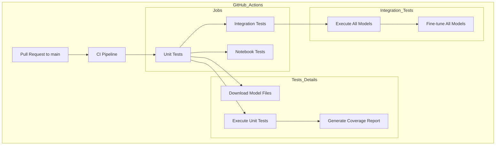
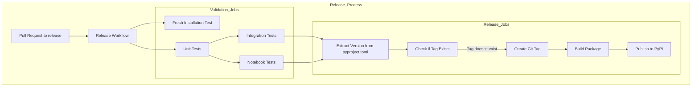
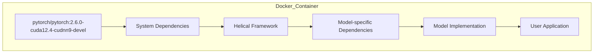
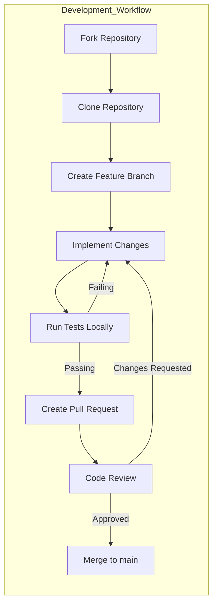

# Development and Deployment

<details>
<summary>Relevant source files</summary>

The following files were used as context for generating this wiki page:

- [.github/workflows/main.yml](.github/workflows/main.yml)
- [.github/workflows/release.yml](.github/workflows/release.yml)
- [ci/tests/data/cell_type_sample.h5ad](ci/tests/data/cell_type_sample.h5ad)
- [helical/models/evo_2/Dockerfile](helical/models/evo_2/Dockerfile)
- [requirements-dev.txt](requirements-dev.txt)

</details>


This document outlines the development workflow, continuous integration, deployment processes, and best practices for the Helical framework. It covers how to set up a development environment, the CI/CD pipeline structure, release process, and containerization options. For information about using the framework's API, see [Core Architecture](#3).

## Development Environment Setup

To contribute to Helical or build upon it, you'll need to set up your development environment with the appropriate dependencies.

### Requirements

1. Python 3.11.8 (recommended)
2. Git
3. CUDA-compatible hardware (for GPU acceleration)

### Installing Development Dependencies

Clone the repository and install the development dependencies:

```bash
git clone https://github.com/helicalAI/helical.git
cd helical
pip install -r requirements-dev.txt
pip install -e .[mamba-ssm]  # Install in development mode with all extras
```

The development dependencies include:

| Dependency | Version | Purpose |
|------------|---------|---------|
| pytest     | 8.2.0   | Testing framework |
| pytest-cov | 5.0.0   | Code coverage reporting |
| pytest-mock| 3.14.0  | Mock objects for testing |
| nbmake     | 1.5.4   | Notebook testing |

Sources: [requirements-dev.txt:1-4]()

## Continuous Integration Pipeline

Helical uses GitHub Actions for continuous integration to ensure code quality and functionality across all models.

### CI Workflow Architecture



The CI pipeline is triggered on every pull request to the main branch and ensures that all changes maintain compatibility with the entire framework.

Sources: [.github/workflows/main.yml:1-159]()

### Unit Tests

Unit tests verify the functionality of individual components of the framework. The test suite uses pytest and reports code coverage.

```bash
CUDA_VISIBLE_DEVICES=-1 pytest --cov-report=html:html_cov --cov-branch --cov-report term --cov=helical ci/
```

Tests are designed to run without GPU to ensure they work in all environments.

Sources: [.github/workflows/main.yml:30-32]()

### Integration Tests

Integration tests validate that the models can be properly loaded, executed, and fine-tuned:

| Model Type | Run Test | Fine-tuning Test |
|------------|----------|------------------|
| Geneformer v1 | Embedding generation | Classification |
| Geneformer v2 | Embedding generation | Classification |
| scGPT | Embedding generation | Classification |
| UCE | Embedding generation | Classification |
| HyenaDNA | Embedding generation | Classification |
| Helix-mRNA | Embedding generation | Classification |
| Mamba2-mRNA | Embedding generation | Classification |
| Caduceus | Embedding generation | Classification |

These tests ensure compatibility across all supported models in both inference and fine-tuning modes.

Sources: [.github/workflows/main.yml:64-126]()

### Notebook Tests

Notebook tests verify that example notebooks execute without errors. Before testing, the pipeline modifies the notebooks to use smaller datasets to speed up testing:

```bash
pytest --durations=0 --nbmake ./examples/notebooks/*.ipynb
```

Sources: [.github/workflows/main.yml:145-159]()

## Release Process

The release process automates versioning, testing, and publishing to PyPI.

### Release Workflow Architecture



Sources: [.github/workflows/release.yml:1-226]()

### Versioning

Helical uses semantic versioning (MAJOR.MINOR.PATCH). The version is extracted from the `pyproject.toml` file during the release process:

```bash
VERSION=$(grep "version =" pyproject.toml | cut -d '"' -f 2)
```

Sources: [.github/workflows/release.yml:195-200]()

### Release to PyPI

Once all tests pass, the package is built and published to PyPI:

```bash
python -m build
```

The PyPI publishing is handled by the `pypa/gh-action-pypi-publish` action, which requires a PyPI API token stored as a GitHub secret.

Sources: [.github/workflows/release.yml:218-224]()

## Containerization

Helical supports containerization through Docker and can be deployed in environments like Singularity for HPC systems.

### Docker Containers

The following diagram illustrates the Docker container structure:



An example Dockerfile for the Evo2 model demonstrates how to build a container with Helical:

```dockerfile
FROM pytorch/pytorch:2.6.0-cuda12.4-cudnn9-devel

RUN apt-get update -y \
    && apt-get upgrade -y \
    && apt-get -y install build-essential \
        wget \
        git \
        curl \
        gcc \
        gfortran \
    && apt-get clean \
    && rm -rf /var/lib/apt/lists/*

RUN pip install git+https://github.com/helicalAI/helical.git
```

Sources: [helical/models/evo_2/Dockerfile:1-14]()

### Singularity Containers

For high-performance computing environments, Helical can be deployed using Singularity containers, which are compatible with Docker containers but provide additional security for multi-tenant systems.

The CI/CD pipeline includes support for generating both Docker and Singularity containers.

## Contributing to Helical

### Development Workflow



### Pull Request Best Practices

1. **Testing**: Ensure all tests pass locally before submitting a PR
2. **Documentation**: Update relevant documentation for new features
3. **Code Style**: Follow the project's coding standards
4. **Commit Messages**: Write clear, descriptive commit messages
5. **PR Description**: Provide a detailed description of changes and their purpose

### Testing Guidelines

When adding new features or fixing bugs, include appropriate tests:

1. **Unit Tests**: For individual components
2. **Integration Tests**: For model compatibility
3. **Example Notebooks**: For user-facing features

Tests should be placed in the `ci/` directory and follow the existing test structure.

Sources: [.github/workflows/main.yml:30-32]()

## Troubleshooting

### Common CI Pipeline Issues

| Issue | Resolution |
|-------|------------|
| Failed unit tests | Check test logs, fix failing assertions |
| Integration test failures | Verify model compatibility, check for API changes |
| Notebook test failures | Ensure notebooks run with the current API |
| Missing dependencies | Update requirements files |

### Debugging Development Environment

For local development issues:

1. Ensure you're using Python 3.11.8
2. Verify all development dependencies are installed
3. Use `pip install -e .` to install changes in development mode
4. Set `CUDA_VISIBLE_DEVICES=-1` to run tests without GPU

## Conclusion

This document provided an overview of the development and deployment processes for the Helical framework. By following these guidelines and utilizing the CI/CD pipeline, contributors can help maintain code quality and ensure the framework's reliability across all supported models.

For more information about testing specific components, see [Testing](#9.2) and for documentation guidelines, see [Documentation](#9.3).

---