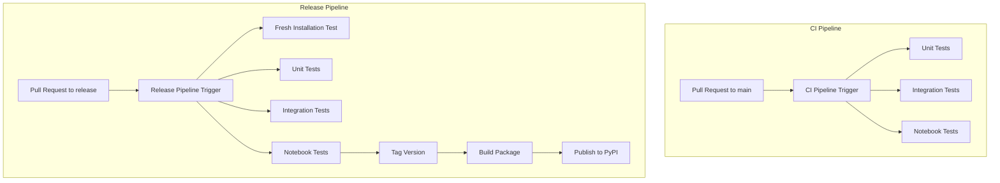
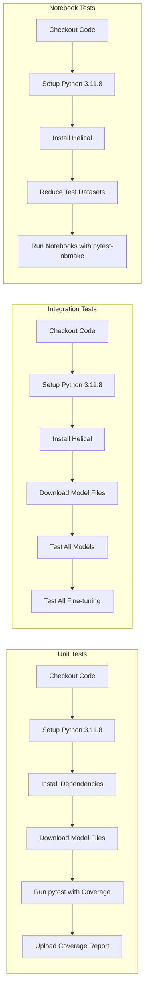
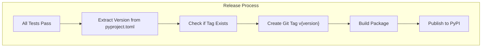
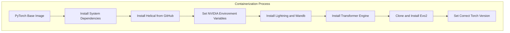
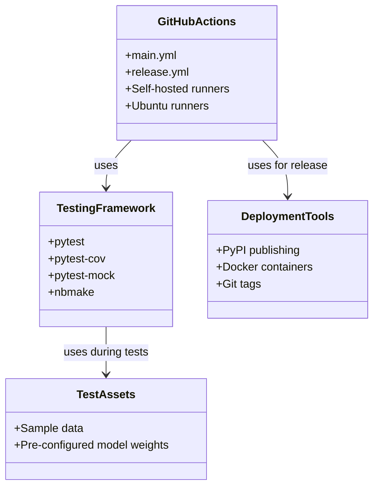
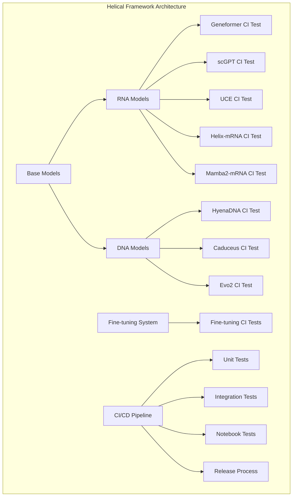

# CI/CD Pipeline

Relevant source files

The following files were used as context for generating this wiki page:

- [.github/workflows/main.yml](.github/workflows/main.yml)
- [.github/workflows/release.yml](.github/workflows/release.yml)
- [ci/tests/data/cell_type_sample.h5ad](ci/tests/data/cell_type_sample.h5ad)
- [helical/models/evo_2/Dockerfile](helical/models/evo_2/Dockerfile)
- [requirements-dev.txt](requirements-dev.txt)

This document describes the Continuous Integration and Continuous Deployment (CI/CD) pipeline implemented for the Helical bio foundation models framework. The pipeline automates testing, verification, and deployment processes to ensure code quality and reliability. For information about testing specifications, see [Testing](#9.2).

## Pipeline Overview

The Helical framework implements two primary CI/CD workflows:

1. **CI Pipeline**: Runs on pull requests to the `main` branch, focusing on testing and verification
2. **Release Pipeline**: Runs on pull requests to the `release` branch, handling both testing and deployment

Both pipelines leverage GitHub Actions to automate these processes, with tests running on self-hosted runners to provide access to GPU resources needed for the bio foundation models.

**Diagram: CI/CD Pipeline Overview**

Sources: [.github/workflows/main.yml](), [.github/workflows/release.yml]()

## CI Pipeline Components

The CI pipeline runs automatically on pull requests to the `main` branch and consists of three parallel jobs:

### 1. Unit Tests

The unit tests job:
- Checks out the repository code
- Sets up Python 3.11.8
- Installs development dependencies and the package itself
- Downloads required model files and datasets
- Runs the unit tests with code coverage reporting
- Uploads the coverage report as an artifact

### 2. Integration Tests

The integration tests verify that all models work as expected:
- Runs all models in the framework with a GPU (`CUDA_VISIBLE_DEVICES: 0`)
- Tests both model loading and fine-tuning for each supported model
- Includes tests for all RNA models (Geneformer, scGPT, UCE, Helix-mRNA, Mamba2-mRNA)
- Includes tests for all DNA models (HyenaDNA, Caduceus)

### 3. Notebook Tests

The notebook tests ensure that all example notebooks execute correctly:
- Runs on a GPU-enabled runner
- Makes slight modifications to input data to speed up notebook execution
- Uses pytest with nbmake to execute all notebooks in the `examples/notebooks` directory

**Diagram: CI Pipeline Job Details**

Sources: [.github/workflows/main.yml:9-159]()

## Release Pipeline

The release pipeline extends the CI pipeline with additional steps to handle the release process:

### 1. Fresh Installation Test

Before running the full test suite, the release pipeline first verifies that the package can be cleanly installed on a fresh environment:

- Uses a standard Ubuntu 24.04 runner (not self-hosted)
- Installs the package without any pre-existing dependencies
- Verifies basic installation integrity

### 2. Testing Suite

The release pipeline runs the same testing jobs as the CI pipeline:
- Unit tests with code coverage
- Integration tests for all models
- Notebook tests

### 3. Release Process

After all tests pass, the release pipeline:
1. Extracts the version number from `pyproject.toml`
2. Checks if a tag for this version already exists
3. Creates a new Git tag (v{version})
4. Builds the Python package
5. Publishes the package to PyPI using a secure API token

**Diagram: Release Process**

Sources: [.github/workflows/release.yml:179-224]()

## Test Execution Environment

The CI/CD pipeline runs tests in specific environments to ensure consistent results:

1. **Unit Tests**: Run with CPU only (`CUDA_VISIBLE_DEVICES=-1`) to verify core functionality without GPU dependency
2. **Integration Tests**: Run with GPU enabled (`CUDA_VISIBLE_DEVICES: 0`) to test model execution
3. **Notebook Tests**: Run with GPU enabled to validate end-to-end workflows

## Model Testing Coverage

The integration tests systematically cover all models in the Helical framework:

| Model Category | Model | Run Test | Fine-tuning Test |
|----------------|-------|----------|-----------------|
| RNA Models | Geneformer v1 | ✓ | ✓ |
| RNA Models | Geneformer v2 | ✓ | ✓ |
| RNA Models | scGPT | ✓ | ✓ |
| RNA Models | UCE | ✓ | ✓ |
| RNA Models | Helix-mRNA | ✓ | ✓ |
| RNA Models | Mamba2-mRNA | ✓ | ✓ |
| DNA Models | HyenaDNA | ✓ | ✓ |
| DNA Models | Caduceus | ✓ | ✓ |

Sources: [.github/workflows/main.yml:64-126](), [.github/workflows/release.yml:82-144]()

## Containerization

The Helical framework provides Docker containerization for deployment and execution in isolated environments. The repository includes a Dockerfile specifically for the Evo-2 model:

**Diagram: Container Build Process**

Sources: [helical/models/evo_2/Dockerfile]()

## CI/CD Infrastructure Components

The CI/CD pipeline is built using the following components:

**Diagram: CI/CD System Components**

Sources: [.github/workflows/main.yml](), [.github/workflows/release.yml](), [requirements-dev.txt]()

## CI/CD Pipeline in the Helical Architecture

The CI/CD pipeline integrates with the overall Helical architecture by ensuring all components function correctly:

**Diagram: CI/CD Integration with Helical Architecture**

Sources: [.github/workflows/main.yml](), [.github/workflows/release.yml]()

## Test Data

The CI pipeline uses sample data files for testing, including:

- Cell type sample data (h5ad format) for testing gene expression models
- Reduced datasets for notebook testing to ensure faster execution

Sources: [ci/tests/data/cell_type_sample.h5ad](), [.github/workflows/main.yml:147-155]()

## Development Tools

The CI/CD pipeline uses the following development tools, specified in the requirements-dev.txt file:

- pytest 8.2.0: Used for running unit tests
- pytest-cov 5.0.0: Used for code coverage reporting
- pytest-mock 3.14.0: Used for mocking components during testing
- nbmake 1.5.4: Used for notebook testing

Sources: [requirements-dev.txt]()

---