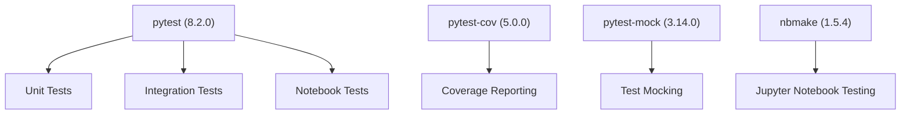
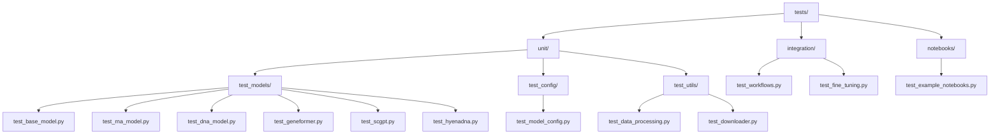
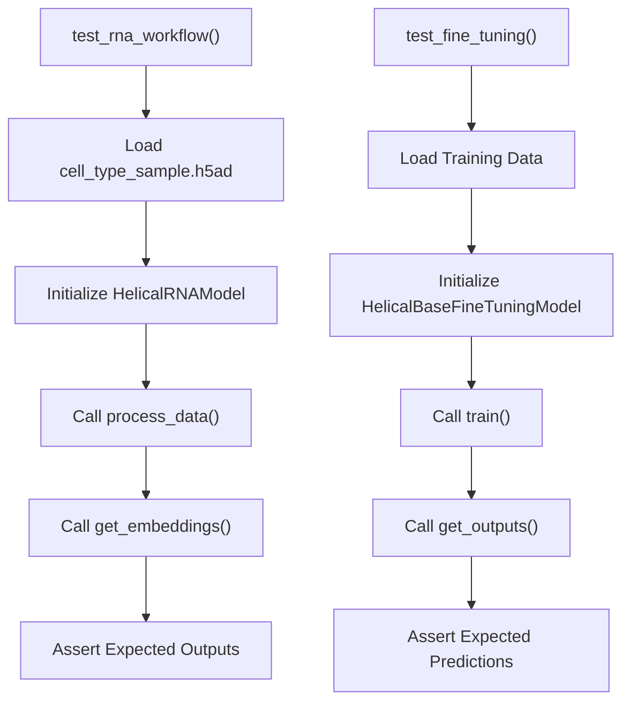
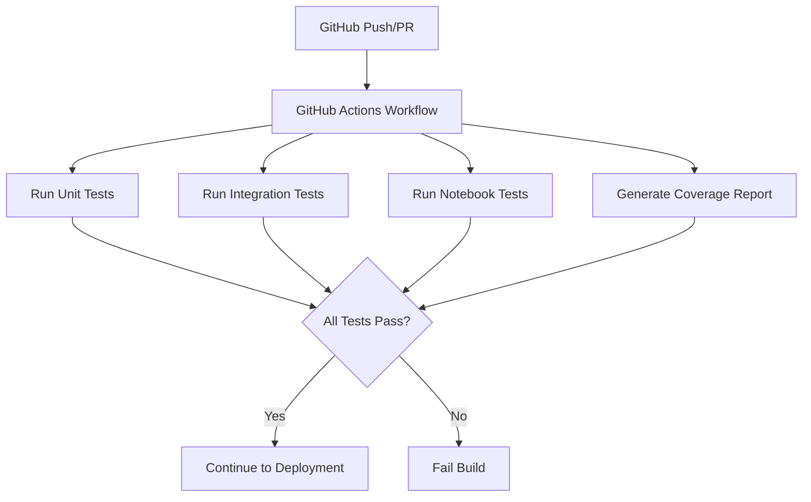

# Testing

<details>
<summary>Relevant source files</summary>

The following files were used as context for generating this wiki page:

- [ci/tests/data/cell_type_sample.h5ad](ci/tests/data/cell_type_sample.h5ad)
- [requirements-dev.txt](requirements-dev.txt)

</details>


This document describes the testing framework and methodologies used in the Helical codebase. It covers test organization, different test types, and procedures for running tests. For information about the continuous integration pipeline, see [CI/CD Pipeline](#9.1).

## Testing Framework Overview

Helical uses pytest as its primary testing framework, along with several extensions that enhance testing capabilities. These dependencies are defined in requirements-dev.txt:



Sources: [requirements-dev.txt:1-4]()

## Test Organization

Tests are organized in a structure that mirrors the main codebase organization, making it easy to locate tests for specific components:



## Types of Tests

### Unit Tests

Unit tests verify that individual components function correctly in isolation. These tests focus on specific classes and methods within the Helical framework.

```mermaid
graph TD
    A["test_base_model.py"] --> B["test_HelicalBaseFoundationModel.init()"]
    A --> C["test_HelicalBaseFoundationModel.get_embeddings()"]
    A --> D["test_HelicalBaseFoundationModel.process_data()"]
    
    E["test_rna_model.py"] --> F["test_HelicalRNAModel.ensure_rna_data_validity()"]
    E --> G["test_HelicalRNAModel.get_valid_rna_sequence()"]
    
    H["test_dna_model.py"] --> I["test_HelicalDNAModel.get_valid_dna_sequence()"]
    
    J["test_model_config.py"] --> K["test_GeneformerConfig"]
    J --> L["test_scGPTConfig"]
    J --> M["test_HyenaDNAConfig"]
```



### Integration Tests

Integration tests ensure different components work together correctly, testing complete workflows from data loading to model inference.



Sources: [ci/tests/data/cell_type_sample.h5ad:1-18]()

### Notebook Tests

Notebook tests use nbmake to execute example Jupyter notebooks, ensuring they remain functional with the current code. These tests provide a valuable way to verify that documentation and examples stay up-to-date with code changes.

## Mock Usage and Test Fixtures

Pytest fixtures are used extensively to provide reusable test components. Common fixture patterns include:

1. **Model mocks**: Creating mock implementations of foundation models
2. **Sample data fixtures**: Loading test data like the cell_type_sample.h5ad file
3. **Configuration fixtures**: Providing standard test configurations for models

Example fixture pattern:

```python
@pytest.fixture
def rna_model_config():
    # Return a standard RNA model configuration for testing
    return GeneformerConfig(parameters...)

@pytest.fixture
def sample_gene_expression_data():
    # Load sample gene expression data for testing
    return anndata.read_h5ad("ci/tests/data/cell_type_sample.h5ad")

def test_rna_model_process_data(rna_model_config, sample_gene_expression_data):
    model = Geneformer(rna_model_config)
    result = model.process_data(sample_gene_expression_data)
    assert result is not None
```

## Test Data

The test suite uses various test data files to verify model behavior:

| File Path | Purpose |
|-----------|---------|
| ci/tests/data/cell_type_sample.h5ad | Sample single-cell data in AnnData format for RNA model tests |
| Mock genomic sequences | Test data for DNA model functionality |
| Configuration fixtures | Test configurations for different model types |

Sources: [ci/tests/data/cell_type_sample.h5ad:1-18]()

## Running Tests

The following commands can be used to run tests in the Helical codebase:

```bash
# Run all tests
pytest

# Run only unit tests
pytest tests/unit/

# Run specific test file
pytest tests/unit/test_models/test_rna_model.py

# Generate coverage report
pytest --cov=helical

# Run notebook tests
pytest tests/notebooks/
```

## CI/CD Integration

Tests are integrated into the CI/CD pipeline through GitHub Actions, which runs the test suite on every push and pull request:



This ensures that code changes maintaining compatibility with the test suite before being merged or deployed. For more details on the CI/CD pipeline, see [CI/CD Pipeline](#9.1).

## Best Practices for Writing Tests

When contributing to Helical, follow these testing best practices:

1. Write tests for new features and bug fixes
2. Ensure tests are isolated and don't rely on external resources
3. Use fixtures to share common setup code
4. Mock external dependencies when appropriate
5. Aim for high test coverage, especially for critical code paths
6. Write descriptive test names that explain what's being tested

## Test Debugging

When tests fail, the following approaches can help identify issues:

1. Use `pytest -v` for verbose output showing individual test results
2. Use `pytest --pdb` to drop into debugger on test failures
3. Use `pytest -xvs test_file.py::test_function` to run a specific test with detailed output

---