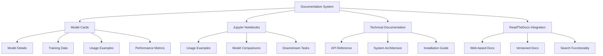
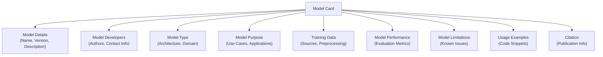
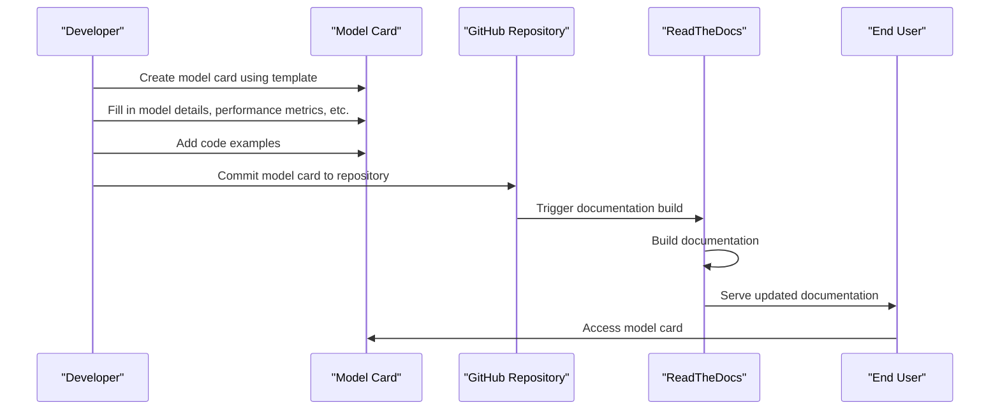
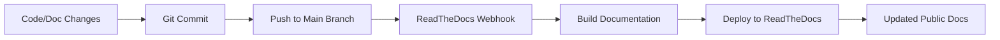
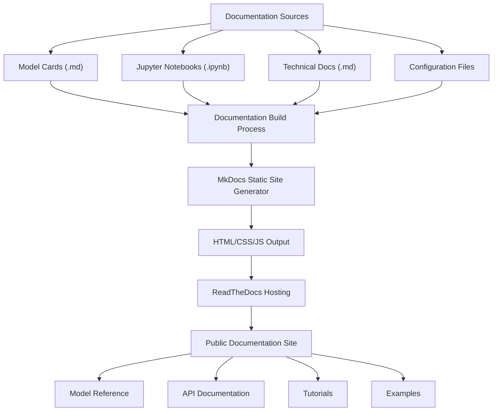
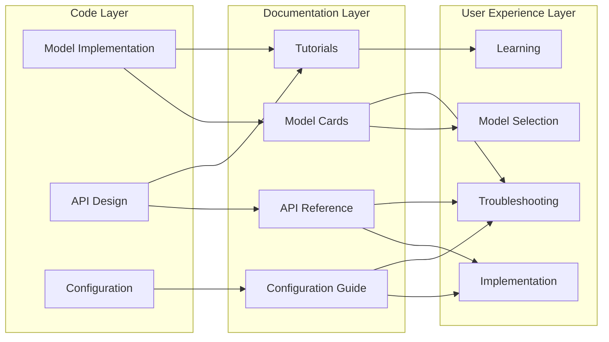

# Documentation

<details>
<summary>Relevant source files</summary>

The following files were used as context for generating this wiki page:

- [.readthedocs.yaml](.readthedocs.yaml)
- [docs/model_cards/caduceus.md](docs/model_cards/caduceus.md)
- [docs/model_cards/geneformer.md](docs/model_cards/geneformer.md)
- [docs/model_cards/helix_mrna.md](docs/model_cards/helix_mrna.md)
- [docs/model_cards/hyena_dna.md](docs/model_cards/hyena_dna.md)
- [docs/model_cards/mamba2_mrna.md](docs/model_cards/mamba2_mrna.md)
- [docs/model_cards/scgpt.md](docs/model_cards/scgpt.md)
- [docs/model_cards/uce.md](docs/model_cards/uce.md)
- [docs/notebooks/Cell-Gene-Cls-embedding-generation.ipynb](docs/notebooks/Cell-Gene-Cls-embedding-generation.ipynb)
- [docs/notebooks/Cell-Type-Annotation.ipynb](docs/notebooks/Cell-Type-Annotation.ipynb)
- [docs/notebooks/Cell-Type-Classification-Fine-Tuning.ipynb](docs/notebooks/Cell-Type-Classification-Fine-Tuning.ipynb)
- [docs/notebooks/Evo-2.ipynb](docs/notebooks/Evo-2.ipynb)
- [docs/notebooks/Geneformer-vs-UCE.ipynb](docs/notebooks/Geneformer-vs-UCE.ipynb)
- [docs/notebooks/Genegpt-sample-run.ipynb](docs/notebooks/Genegpt-sample-run.ipynb)
- [docs/notebooks/Helix-mRNA.ipynb](docs/notebooks/Helix-mRNA.ipynb)
- [docs/notebooks/Hyena-DNA-Inference.ipynb](docs/notebooks/Hyena-DNA-Inference.ipynb)
- [docs/notebooks/HyenaDNA-Fine-Tuning.ipynb](docs/notebooks/HyenaDNA-Fine-Tuning.ipynb)

</details>


This page describes the documentation system used within the Helical framework. It covers the structure and components of documentation, guidelines for writing and maintaining documentation, and the tools and processes used to generate the documentation. For information about setting up the development environment, see [Development and Deployment](#9).

## Overview

Helical's documentation system consists of several components that work together to provide comprehensive information for users and developers:

1. **Model Cards**: Standardized documentation for each supported model
2. **Jupyter Notebooks**: Interactive examples and tutorials
3. **Technical Documentation**: Documentation of the codebase structure and APIs
4. **Read the Docs Integration**: Web-based documentation hosting

The documentation follows a standard structure to ensure consistency across all models, making it easier for users to find information regardless of which model they're working with.

### Documentation Architecture



Sources: [.readthedocs.yaml](). [docs/model_cards/geneformer.md](). [docs/model_cards/uce.md](). [docs/notebooks/Geneformer-vs-UCE.ipynb]().

## Model Cards

Model cards are the primary documentation for each AI model in the Helical framework. They provide standardized information about a model's capabilities, training process, intended use cases, and limitations.

### Model Card Structure



Sources: [docs/model_cards/geneformer.md](). [docs/model_cards/uce.md](). [docs/model_cards/scgpt.md](). [docs/model_cards/helix_mrna.md](). [docs/model_cards/mamba2_mrna.md](). [docs/model_cards/caduceus.md](). [docs/model_cards/hyena_dna.md]().

### Model Card Components

| Section | Purpose | Contents |
|---------|---------|----------|
| Model Details | Basic information | Name, version, description |
| Model Developers | Attribution | Authors, institutions, contact information |
| Model Type | Technical classification | Architecture, domain, input/output types |
| Model Purpose | Use cases | Intended uses, capabilities, applications |
| Training Data | Data information | Data sources, preprocessing, biases |
| Model Performance | Evaluation results | Metrics, benchmarks, comparison |
| Model Limitations | Constraints | Known issues, limitations, edge cases |
| How to Use | Instructions | Code examples, installation, configuration |
| Citation | Academic attribution | BibTeX citations, publication information |

Sources: [docs/model_cards/geneformer.md](). [docs/model_cards/uce.md](). [docs/model_cards/scgpt.md]().

## Creating and Updating Documentation

### Model Card Creation Process



Sources: [.readthedocs.yaml](). [docs/model_cards/geneformer.md](). [docs/model_cards/uce.md]().

### Documentation Updates

The documentation is automatically built and updated whenever changes are pushed to the main branch of the repository. This is configured through the `.readthedocs.yaml` file, which specifies the build process and dependencies.



Sources: [.readthedocs.yaml]().

## Jupyter Notebooks

Jupyter notebooks provide interactive examples and tutorials for using the Helical framework. They demonstrate how to use the different models for various tasks, such as cell type classification, model comparisons, and downstream tasks.

### Notebook Structure

Each notebook typically includes:

1. Installation instructions
2. Imports and setup
3. Data loading and preprocessing
4. Model initialization and configuration
5. Model execution (inference or fine-tuning)
6. Results visualization and analysis

### Notebook Examples

The Helical repository includes several example notebooks:

| Notebook | Purpose | Models Used |
|----------|---------|-------------|
| Geneformer-vs-UCE | Comparing models for cell-type classification | Geneformer, UCE |
| Cell-Type-Annotation | Cell type annotation prediction | scGPT, Geneformer |
| Cell-Type-Classification-Fine-Tuning | Classification fine-tuning | Geneformer, scGPT |
| Hyena-DNA-Inference | Downstream prediction | HyenaDNA |
| HyenaDNA-Fine-Tuning | Fine-tuning for classification | HyenaDNA |
| Evo-2 | mRNA downstream tasks | Evo2, Helix-mRNA |

Sources: [docs/notebooks/Geneformer-vs-UCE.ipynb](). [docs/notebooks/Cell-Type-Annotation.ipynb](). [docs/notebooks/Cell-Type-Classification-Fine-Tuning.ipynb](). [docs/notebooks/Hyena-DNA-Inference.ipynb](). [docs/notebooks/HyenaDNA-Fine-Tuning.ipynb](). [docs/notebooks/Evo-2.ipynb](). [docs/notebooks/Cell-Gene-Cls-embedding-generation.ipynb]().

## Documentation Infrastructure

### Read the Docs Configuration

The Helical documentation is hosted on Read the Docs, which automatically builds and publishes the documentation. The configuration is specified in the `.readthedocs.yaml` file.

```yaml
version: 2
build:
  os: ubuntu-22.04
  tools:
    python: "3.11"

mkdocs:
  configuration: mkdocs.yml
  fail_on_warning: false

python:
   install:
   - requirements: docs/requirements.txt
   - method: pip
     path: .
```

This configuration specifies:
- The build environment (Ubuntu 22.04 with Python 3.11)
- The documentation tool (MkDocs)
- The dependencies required to build the documentation

Sources: [.readthedocs.yaml]().

### Documentation Code to Site Flow



Sources: [.readthedocs.yaml]().

## Documentation Best Practices

### Model Card Guidelines

When creating or updating model cards:

1. Follow the standard template and structure
2. Include all required sections
3. Provide accurate and up-to-date information
4. Include code examples for common use cases
5. Document limitations and biases
6. Include performance metrics and evaluation results
7. Add proper citations and attribution

### Code Example Standards

Code examples should:

1. Be complete and runnable
2. Include imports and setup
3. Use consistent style and formatting
4. Include comments explaining key steps
5. Show both basic and advanced usage
6. Handle errors and edge cases
7. Follow the Helical API conventions

Example from Geneformer model card:

```python
from helical.models.geneformer import Geneformer, GeneformerConfig
import anndata as ad

# Example configuration
model_config = GeneformerConfig(model_name="gf-12L-95M-i4096", batch_size=10)
geneformer_v2 = Geneformer(model_config)

# Example usage for base pretrained model
ann_data = ad.read_h5ad("anndata_file.h5ad")
dataset = geneformer_v2.process_data(ann_data)
embeddings = geneformer_v2.get_embeddings(dataset)
print("Base model embeddings shape:", embeddings.shape)
```

Sources: [docs/model_cards/geneformer.md:189-202]().

## Documentation Tools and Technologies

### Tools Used

| Tool | Purpose | Usage |
|------|---------|-------|
| MkDocs | Static site generator | Converts Markdown to HTML |
| Read the Docs | Documentation hosting | Builds and serves the documentation |
| Markdown | Markup language | Used for writing documentation |
| Jupyter Notebooks | Interactive examples | Used for tutorials and examples |
| GitHub | Version control | Stores and manages documentation |

### Documentation-to-Code Relationship



Sources: [docs/model_cards/geneformer.md](). [docs/model_cards/uce.md](). [docs/notebooks/Geneformer-vs-UCE.ipynb]().

## Maintenance and Updates

### Update Process

Documentation should be updated:

1. When new models are added
2. When existing models are updated
3. When APIs change
4. When new features are added
5. When bugs are fixed
6. When new use cases are identified

### Review Process

Documentation updates should be reviewed for:

1. Technical accuracy
2. Completeness
3. Clarity
4. Consistency with the rest of the documentation
5. Code example correctness
6. Proper formatting and structure

## Conclusion

Effective documentation is crucial for the usability and adoption of the Helical framework. By following the guidelines and processes outlined in this document, you can help ensure that the documentation remains comprehensive, accurate, and useful for both new and experienced users.