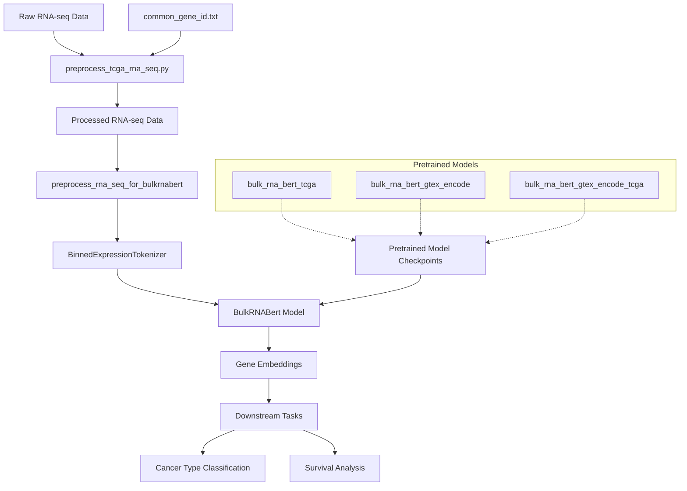
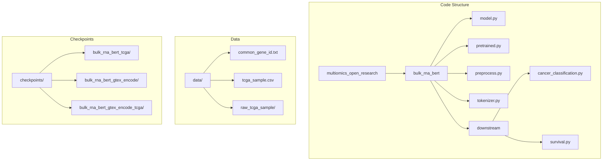
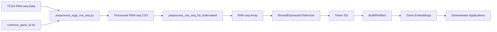
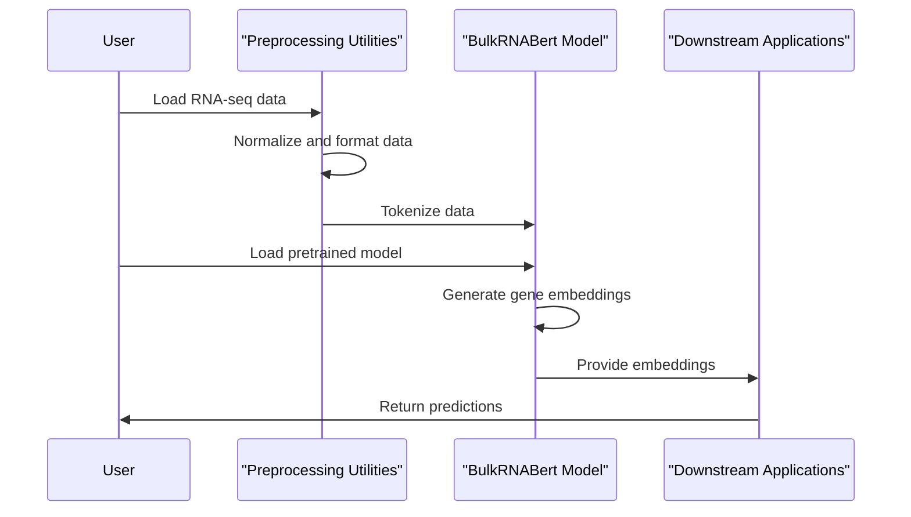

# Overview

Relevant source files

The following files were used as context for generating this wiki page:

- [README.md](README.md)

## Purpose and Scope

BulkRNABert is a transformer-based encoder-only language model pre-trained on bulk RNA-seq data through self-supervision using masked language modeling. This system achieves state-of-the-art performance in cancer type classification and survival time prediction on TCGA dataset. This wiki provides comprehensive documentation for using the pretrained BulkRNABert models, preprocessing RNA-seq data, and applying the models to downstream tasks.

For detailed information about the model architecture, see [BulkRNABert Model](#3). For data preprocessing details, see [Data Preprocessing](#4). For information about downstream applications, see [Downstream Applications](#5).

Sources: [README.md:5-7]()

## System Architecture

BulkRNABert implements an end-to-end pipeline for analyzing bulk RNA sequencing data using transformer-based models, with a modular design that separates preprocessing, tokenization, model definition, and downstream applications.

Sources: [README.md:5-7](), [README.md:49-52]()

## Key Components

BulkRNABert consists of several key components that work together to process RNA-seq data and generate embeddings for downstream tasks.

| Component | Purpose | Implementation |
|-----------|---------|----------------|
| Data Preprocessing | Transform raw RNA-seq data into a format suitable for modeling | `preprocess_tcga_rna_seq.py`, `preprocess_rna_seq_for_bulkrnabert` |
| Tokenization | Convert numerical gene expression values into tokens | `BinnedExpressionTokenizer` |
| Core Model | Generate contextual gene embeddings using transformer architecture | `BulkRNABert` |
| Model Loading | Load pretrained models and configurations | `get_pretrained_model` |
| Downstream Applications | Use gene embeddings for specific tasks like classification | Classification and survival prediction models |

Sources: [README.md:25-47]()

## Code Organization

The codebase is organized to provide a clean separation of concerns between different components of the system.

Sources: [README.md]()

## Pretrained Models

BulkRNABert provides three different pretrained models, each trained on different datasets or combinations of datasets.

| Model Name | Training Data | Description |
|------------|---------------|-------------|
| `bulk_rna_bert_tcga` | TCGA | BulkRNABert pre-trained on TCGA data |
| `bulk_rna_bert_gtex_encode` | GTEx and ENCODE | BulkRNABert pre-trained on GTEx and ENCODE data |
| `bulk_rna_bert_gtex_encode_tcga` | GTEx, ENCODE, and TCGA | BulkRNABert pre-trained on a mix of GTEx, ENCODE and TCGA data |

For more details about these pretrained models, see [Pretrained Models](#3.1).

Sources: [README.md:49-52]()

## Data Processing Pipeline

The data processing pipeline transforms raw RNA-seq data into a format suitable for input to the BulkRNABert model. The pipeline includes preprocessing, normalization, and tokenization steps.

Sources: [README.md:55-69]()

## Typical Usage

Using BulkRNABert typically involves:

1. Loading a pretrained model using `get_pretrained_model`
2. Preprocessing RNA-seq data with `preprocess_rna_seq_for_bulkrnabert`
3. Tokenizing the preprocessed data
4. Running the model to generate embeddings
5. Using the embeddings for downstream tasks

The system is designed to make this process as seamless as possible, with comprehensive utilities for each step.

Sources: [README.md:19-48]()

## Downstream Applications

BulkRNABert embeddings can be used for various downstream tasks related to cancer genomics:

1. **Cancer Type Classification**: Predicting cancer types from RNA-seq data across multiple cohorts (BRCA, BLCA, GBMLGG, LUAD, UCEC)
2. **Survival Analysis**: Predicting patient survival time

For details about cancer classification, see [Cancer Classification](#5.1). For details about survival analysis, see [Survival Analysis](#5.2).

Sources: [README.md:71-73]()

## System Requirements and Installation

To use BulkRNABert:

1. Clone the repository
2. Install the package using `pip install -e .`
3. Download the pretrained model checkpoints

The system is built using JAX and Haiku, providing efficient and scalable model inference.

Sources: [README.md:11-17]()

## Citing BulkRNABert

The BulkRNABert research is published in a bioRxiv paper: "BulkRNABert: Cancer prognosis from bulk RNA-seq based language models" by Gelard et al., 2024.

Sources: [README.md:75-90]()

---