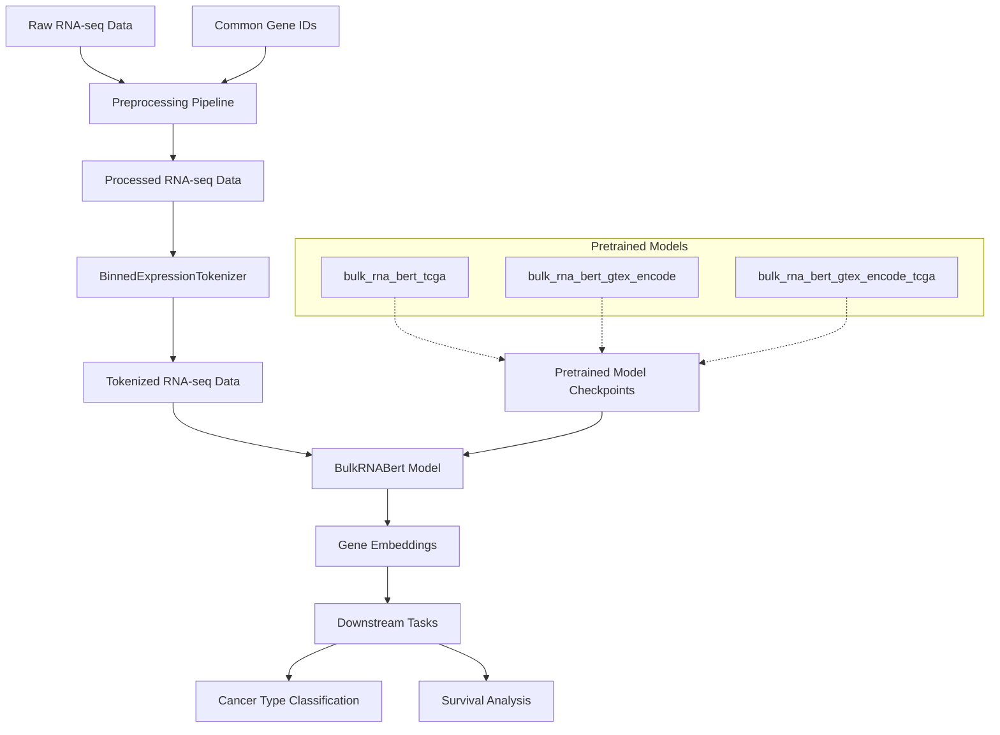
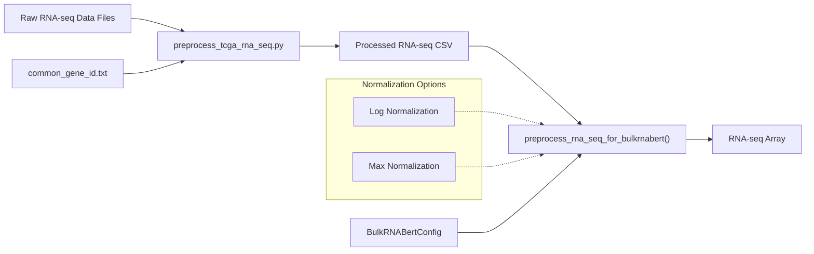
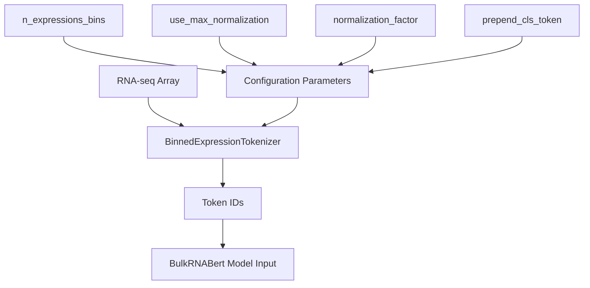
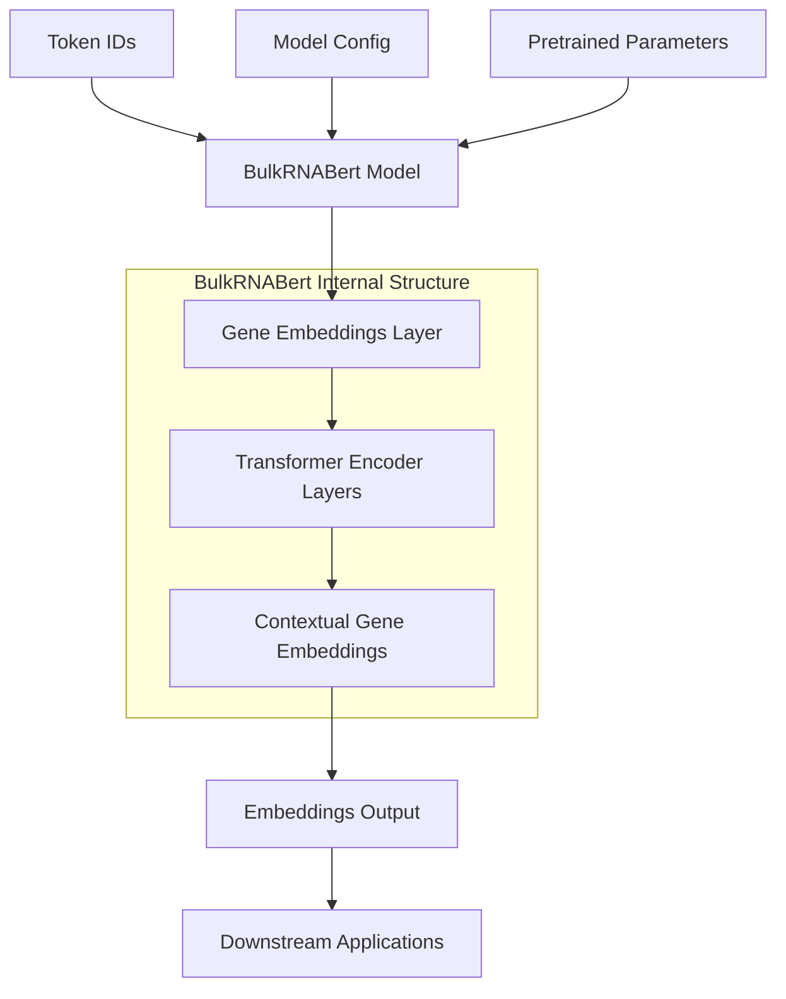
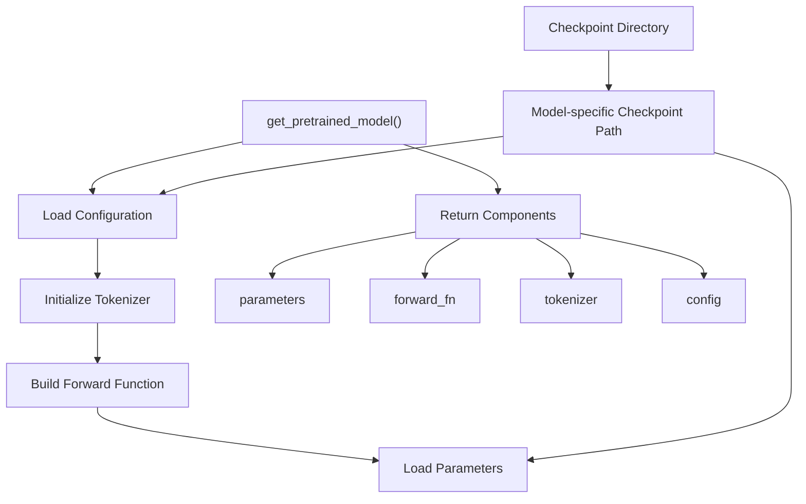
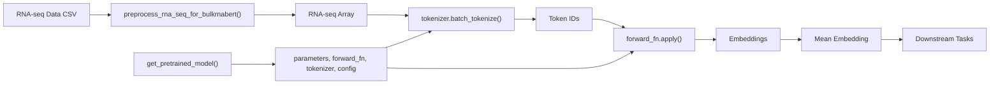
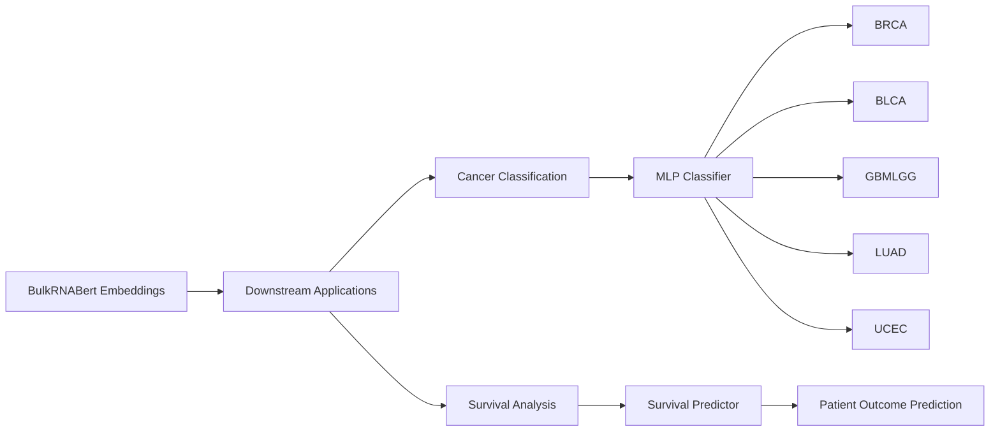
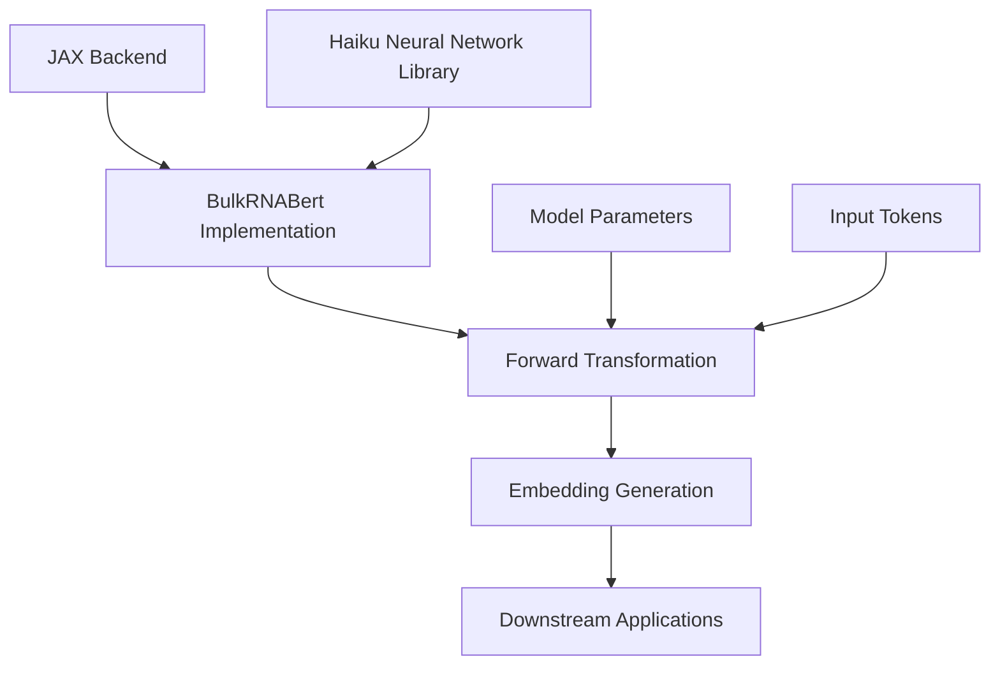
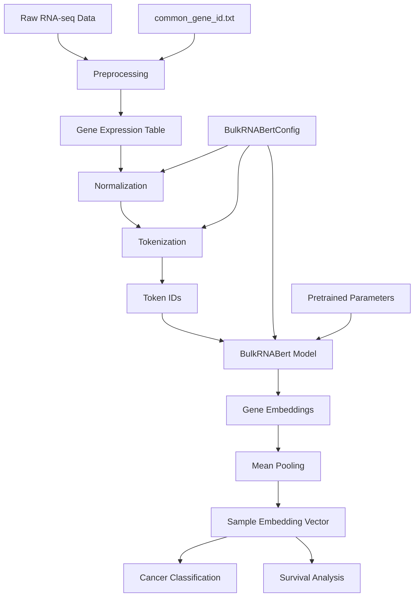

# System Architecture

Relevant source files

The following files were used as context for generating this wiki page:

- [README.md](README.md)
- [multiomics_open_research/bulk_rna_bert/pretrained.py](multiomics_open_research/bulk_rna_bert/pretrained.py)

## Purpose and Scope

This document describes the high-level architecture of BulkRNABert, detailing its main components and how they interact to process RNA-sequencing data through transformer-based models. It covers the data flow from raw RNA-seq data to gene embeddings and explains how these embeddings enable downstream applications. For specific details about the BulkRNABert model itself, see [BulkRNABert Model](#3), and for preprocessing specifics, see [Data Preprocessing](#4).

## System Overview

BulkRNABert is a transformer-based system for analyzing bulk RNA sequencing data. The system processes gene expression data to generate contextualized gene embeddings that can be used for various downstream tasks like cancer classification and survival prediction.

Sources: [README.md:5-7](), [multiomics_open_research/bulk_rna_bert/pretrained.py:29-86]()

## Core Components

The BulkRNABert system consists of the following core components:

1. **Data Preprocessing** - Transforms raw RNA-seq data into a standardized format
2. **Tokenization** - Converts numerical gene expression values into token IDs
3. **BulkRNABert Model** - Processes tokenized data to generate gene embeddings
4. **Model Loading** - Facilitates loading of pretrained models
5. **Downstream Applications** - Utilizes embeddings for specific tasks like cancer classification

### Data Preprocessing Pipeline

The preprocessing pipeline converts raw RNA-seq data (such as from TCGA, GTEx, or ENCODE) into a format suitable for the BulkRNABert model.

Sources: [README.md:55-69]()

Key features of the preprocessing pipeline:
- Uses a standardized set of gene IDs specified in `common_gene_id.txt`
- Supports different normalization strategies (log, max)
- Transforms raw data (like TPM values) into a format ready for tokenization

### Tokenization System

The tokenization system converts normalized gene expression values into token IDs for input to the transformer model.

Sources: [multiomics_open_research/bulk_rna_bert/pretrained.py:67-72](), [README.md:38-40]()

The `BinnedExpressionTokenizer` discretizes continuous gene expression values into bins, turning them into integer token IDs that can be processed by the transformer model.

### Model Architecture

Sources: [multiomics_open_research/bulk_rna_bert/pretrained.py:76-82](), [README.md:41-47]()

BulkRNABert uses a BERT-style transformer architecture that processes token IDs to generate contextual gene embeddings. These embeddings capture complex relationships between genes in the expression profile.

## Model Loading System

The model loading system provides a straightforward way to load pretrained BulkRNABert models.

Sources: [multiomics_open_research/bulk_rna_bert/pretrained.py:29-86](), [README.md:28-33]()

The `get_pretrained_model` function serves as the primary entry point for using pretrained BulkRNABert models. It:
1. Loads the model configuration from the checkpoint directory
2. Initializes the tokenizer with the correct parameters
3. Builds a forward function for the model
4. Loads the pretrained parameters
5. Returns all components needed for inference

## Complete Inference Flow

The following diagram illustrates the complete flow from raw RNA-seq data to embeddings that can be used for downstream tasks:

Sources: [README.md:19-48]()

## Pretrained Model Variants

BulkRNABert offers three pretrained model variants, each trained on different datasets:

| Model Name | Training Data | Use Case |
|------------|---------------|----------|
| `bulk_rna_bert_tcga` | TCGA | Cancer research focused |
| `bulk_rna_bert_gtex_encode` | GTEx and ENCODE | Normal tissue expression patterns |
| `bulk_rna_bert_gtex_encode_tcga` | GTEx, ENCODE, and TCGA | Comprehensive gene expression understanding |

Sources: [README.md:49-52]()

## Downstream Applications System

BulkRNABert embeddings can be used for various downstream tasks, particularly in cancer research:

Sources: [README.md:71-73]()

The system provides pretrained downstream models for specific cancer classification tasks and survival analysis, leveraging the gene embeddings generated by BulkRNABert.

## Technical Implementation Details

BulkRNABert is implemented using JAX and Haiku, providing efficient computation and transformation-based building blocks:

Sources: [README.md:19-48](), [multiomics_open_research/bulk_rna_bert/pretrained.py:29-86]()

The technical implementation uses:
- JAX for high-performance numerical computing
- Haiku for neural network component definitions
- Functional transformations for model application
- Checkpointing for model parameter storage and loading

The model parameters are stored as joblib files in the checkpoint directory, and configuration is stored in JSON format.

## Data Flow Throughout System

The following diagram illustrates how data flows through the entire BulkRNABert system:

Sources: [README.md:19-48](), [multiomics_open_research/bulk_rna_bert/pretrained.py:29-86]()

This diagram shows the complete data transformation process from raw RNA-seq data to actionable insights via the downstream applications, illustrating the role of each component in the system.

---