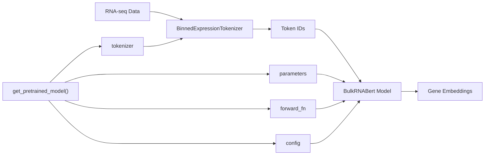
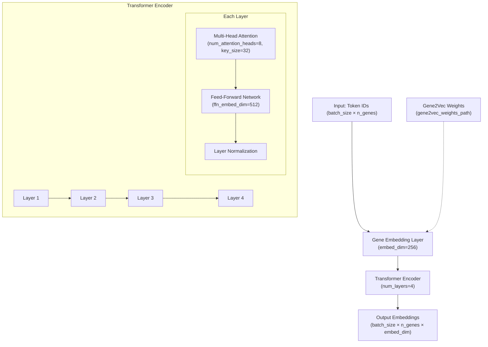
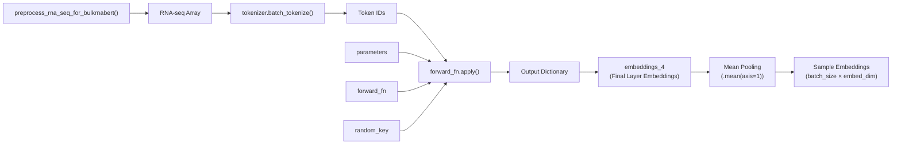
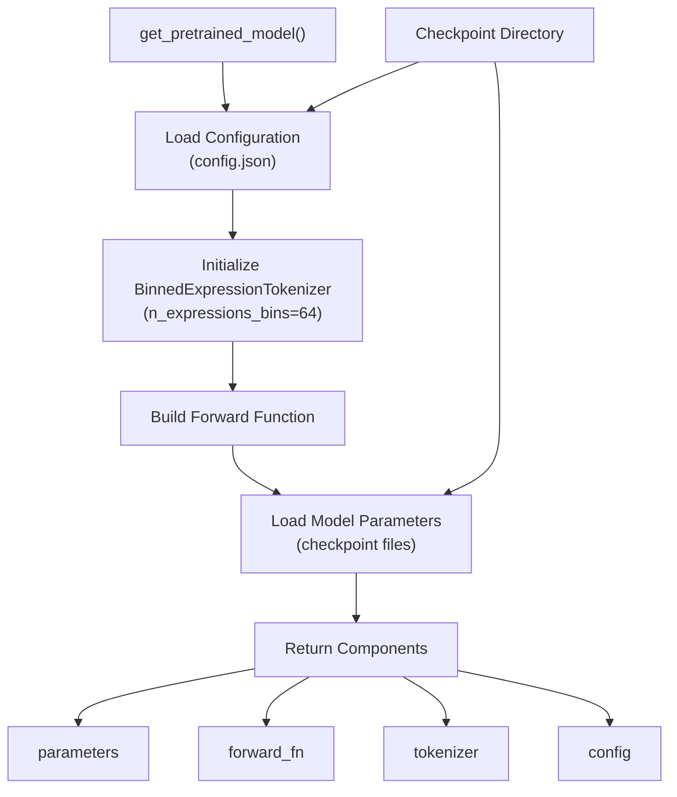

# BulkRNABert Model

Relevant source files

The following files were used as context for generating this wiki page:

- [README.md](README.md)
- [checkpoints/bulk_rna_bert_gtex_encode/config.json](checkpoints/bulk_rna_bert_gtex_encode/config.json)
- [checkpoints/bulk_rna_bert_gtex_encode_tcga/config.json](checkpoints/bulk_rna_bert_gtex_encode_tcga/config.json)
- [checkpoints/bulk_rna_bert_tcga/config.json](checkpoints/bulk_rna_bert_tcga/config.json)

BulkRNABert is a transformer-based encoder-only language model pre-trained on bulk RNA sequencing data through self-supervised learning with masked language modeling. This page details the model's architecture, parameters, and configuration options.

For information on using pretrained models, see [Model Loading and Inference](#3.2). For details on preprocessing data for the model, see [Data Preprocessing](#4).

## Model Overview

BulkRNABert applies transformer architecture principles to RNA-seq data, treating gene expression levels as tokens in a sequence. The model learns contextualized representations of gene expressions that capture biological relationships between genes.

### BulkRNABert in the System Pipeline

Sources: [README.md:19-48]()

## Model Architecture

BulkRNABert follows a transformer encoder architecture with gene-specific adaptations.

### Architecture Diagram

Sources: [checkpoints/bulk_rna_bert_tcga/config.json:1](), [README.md:5-7]()

The model consists of:

1. **Gene Embedding Layer**:
   - Processes 19,062 genes (`n_genes` parameter)
   - Expression values binned into 64 categories (`n_expressions_bins` parameter)
   - Initial embedding dimension of 200 (`init_gene_embed_dim`)
   - Optionally projected to 256 dimensions (`embed_dim`)
   - Initialized using Gene2Vec weights when `use_gene_embedding=true`

2. **Transformer Encoder**:
   - 4 identical layers (`num_layers` parameter)
   - Each layer contains:
     - Multi-head self-attention with 8 heads (`num_attention_heads`)
     - Keys/queries of dimension 32 (`key_size`)
     - Feed-forward network with hidden dimension 512 (`ffn_embed_dim`)
     - Layer normalization and residual connections

3. **Output Layer**:
   - Produces contextualized embeddings for each gene
   - Output dimension: batch_size × n_genes × embed_dim

## Configuration Parameters

BulkRNABert is configured through the following parameters, as defined in the configuration files:

| Parameter | Description | Default Value |
|-----------|-------------|---------------|
| n_genes | Number of genes in the common gene set | 19,062 |
| n_expressions_bins | Number of bins for tokenizing gene expression | 64 |
| embed_dim | Dimension of transformer embeddings | 256 |
| init_gene_embed_dim | Initial gene embedding dimension | 200 |
| project_gene_embedding | Whether to project gene embeddings | true |
| use_gene_embedding | Whether to use gene embeddings initialization | true |
| num_attention_heads | Number of attention heads in transformer | 8 |
| key_size | Size of key vectors in attention | 32 |
| ffn_embed_dim | Feed-forward network hidden dimension | 512 |
| num_layers | Number of transformer encoder layers | 4 |
| use_memory_efficient_attention | Whether to use memory-efficient attention | false |
| use_gradient_checkpointing | Whether to use gradient checkpointing | true |
| gene2vec_weights_path | Path to Gene2Vec weights | "data/gene2vec_weights_common_gene_ids.npy" |
| embeddings_layers_to_save | Layers from which to save embeddings | [] (configurable) |
| attention_layers_to_save | Layers from which to save attention | [] |
| use_log_normalization | Whether to apply log normalization | true |
| use_max_normalization | Whether to apply max normalization | true |
| normalization_factor | Scaling factor for normalization | ~5.55-5.87 (varies by model) |

Sources: [checkpoints/bulk_rna_bert_tcga/config.json:1](), [checkpoints/bulk_rna_bert_gtex_encode/config.json:1](), [checkpoints/bulk_rna_bert_gtex_encode_tcga/config.json:1]()

## Inference Process

During inference, BulkRNABert processes tokenized gene expressions to generate embeddings:

Sources: [README.md:36-47]()

The inference process includes:
1. Preprocessing RNA-seq data with normalization
2. Tokenizing expression values into discrete bins
3. Applying the forward function with loaded parameters
4. Extracting embeddings from specified layers (typically layer 4)
5. Optionally applying mean pooling to get sample-level embeddings

## Model Variants

BulkRNABert is available in three pretrained variants:

1. **bulk_rna_bert_tcga**
   - Trained on The Cancer Genome Atlas (TCGA) data
   - Specialized for cancer genomics applications
   - Normalization factor: 5.547176906585117

2. **bulk_rna_bert_gtex_encode**
   - Trained on Genotype-Tissue Expression (GTEx) and ENCODE data
   - Better for normal tissue expression patterns
   - Normalization factor: 5.873553674586928

3. **bulk_rna_bert_gtex_encode_tcga**
   - Trained on a combination of GTEx, ENCODE, and TCGA data
   - Most comprehensive model with exposure to both normal and cancer tissues
   - Normalization factor: 5.873553674586928

Sources: [README.md:49-52](), [checkpoints/bulk_rna_bert_tcga/config.json:1](), [checkpoints/bulk_rna_bert_gtex_encode/config.json:1](), [checkpoints/bulk_rna_bert_gtex_encode_tcga/config.json:1]()

## Implementation and Usage

BulkRNABert is implemented using JAX and Haiku for efficient computation and automatic differentiation.

### Model Loading Process

Sources: [README.md:28-34]()

The basic usage pattern for BulkRNABert is:
1. Load the pretrained model using `get_pretrained_model`
2. Preprocess RNA-seq data with `preprocess_rna_seq_for_bulkrnabert`
3. Tokenize the preprocessed data with `tokenizer.batch_tokenize`
4. Apply the model using `forward_fn.apply`
5. Extract and use the resulting embeddings

BulkRNABert's outputs can be used for downstream applications such as cancer classification and survival analysis, as detailed in [Downstream Applications](#5).

---