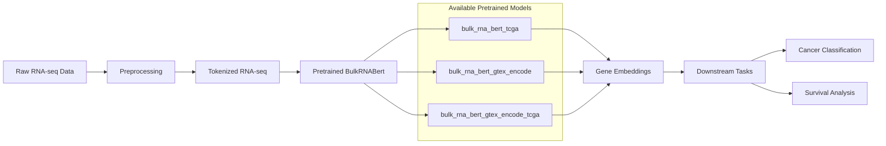
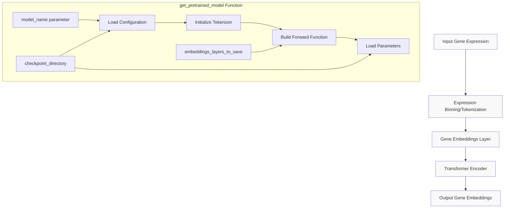
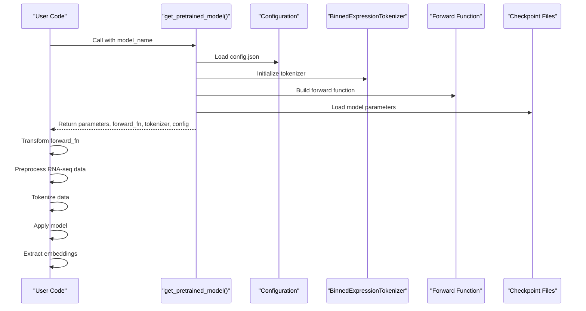

# Pretrained Models

<details>
<summary>Relevant source files</summary>

The following files were used as context for generating this wiki page:

- [README.md](README.md)
- [checkpoints/bulk_rna_bert_gtex_encode/config.json](checkpoints/bulk_rna_bert_gtex_encode/config.json)
- [checkpoints/bulk_rna_bert_gtex_encode/params.joblib](checkpoints/bulk_rna_bert_gtex_encode/params.joblib)
- [checkpoints/bulk_rna_bert_gtex_encode_tcga/config.json](checkpoints/bulk_rna_bert_gtex_encode_tcga/config.json)
- [checkpoints/bulk_rna_bert_gtex_encode_tcga/params.joblib](checkpoints/bulk_rna_bert_gtex_encode_tcga/params.joblib)
- [checkpoints/bulk_rna_bert_tcga/config.json](checkpoints/bulk_rna_bert_tcga/config.json)
- [checkpoints/bulk_rna_bert_tcga/params.joblib](checkpoints/bulk_rna_bert_tcga/params.joblib)

</details>


This document provides detailed information about the available pretrained BulkRNABert models in the repository, their configurations, and how to use them. For information about model loading and inference, see [Model Loading and Inference](#3.2), and for details about the base model architecture, see [BulkRNABert Model](#3).

## Overview

The repository provides three pretrained BulkRNABert models, each trained on different datasets to support various research needs. These models enable researchers to generate meaningful embeddings from bulk RNA-sequencing data without needing to train a transformer model from scratch.



Sources: [README.md:49-52]()

## Model Characteristics

Each pretrained model has been trained on different datasets, making them suitable for various research applications:

| Model Name | Training Dataset | Specialized For | Normalization Factor |
|------------|------------------|-----------------|----------------------|
| bulk_rna_bert_tcga | TCGA (The Cancer Genome Atlas) | Cancer research | 5.547176906585117 |
| bulk_rna_bert_gtex_encode | GTEx (Genotype-Tissue Expression) and ENCODE | Normal tissue expression | 5.873553674586928 |
| bulk_rna_bert_gtex_encode_tcga | GTEx, ENCODE, and TCGA | Both normal and cancer tissue | 5.873553674586928 |

All models support 19,062 genes and have identical architecture parameters, differing only in their trained weights and normalization factors. The complete gene list is available in the `data/common_gene_id.txt` file.

Sources: [checkpoints/bulk_rna_bert_tcga/config.json:1](), [checkpoints/bulk_rna_bert_gtex_encode/config.json:1](), [README.md:9]()

## Model Architecture and Configuration

The pretrained BulkRNABert models follow a BERT-style transformer encoder architecture, with parameters optimized for RNA-seq data analysis.



### Configuration Parameters

All pretrained models share the following configuration parameters:

| Parameter | Value | Description |
|-----------|-------|-------------|
| n_genes | 19,062 | Number of genes in the model |
| n_expressions_bins | 64 | Number of bins for expression tokenization |
| embed_dim | 256 | Embedding dimension size |
| init_gene_embed_dim | 200 | Initial gene embedding dimension size |
| project_gene_embedding | true | Whether to project gene embeddings |
| use_gene_embedding | true | Whether to use gene embeddings |
| num_attention_heads | 8 | Number of attention heads in transformer |
| key_size | 32 | Size of key vectors in attention mechanism |
| ffn_embed_dim | 512 | Feed-forward network embedding dimension |
| num_layers | 4 | Number of transformer layers |
| use_gradient_checkpointing | true | Memory optimization technique |
| use_log_normalization | true | Apply log normalization to data |
| use_max_normalization | true | Apply max normalization to data |

Sources: [checkpoints/bulk_rna_bert_tcga/config.json:1](), [checkpoints/bulk_rna_bert_gtex_encode/config.json:1]()

## Model Loading and Usage

The pretrained models can be loaded using the `get_pretrained_model` function from the BulkRNABert package.



### Basic Usage Example

The following steps demonstrate how to load a pretrained model and use it for inference:

1. Import necessary modules
2. Load the pretrained model
3. Preprocess and tokenize RNA-seq data
4. Run inference to get embeddings

Here's how to select which model to use:

```python
# For cancer research:
model_name = "bulk_rna_bert_tcga"

# For normal tissue expression:
model_name = "bulk_rna_bert_gtex_encode"

# For mixed normal and cancer data:
model_name = "bulk_rna_bert_gtex_encode_tcga"
```

The model checkpoint files are expected to be found in the `checkpoints/` directory, containing both the configuration file (`config.json`) and parameters file (`params.joblib`).

Sources: [README.md:19-47]()

## Output Embeddings

The models generate gene embeddings that capture the contextual relationships between genes in the RNA-seq sample. By default, you can extract the embeddings from any layer of the transformer.

When specifying `embeddings_layers_to_save=(4,)`, as shown in the example, the model will save the embeddings from the 4th (final) layer. These embeddings can be accessed from the model output:

```python
# Get mean embeddings from layer 4
mean_embedding = outs["embeddings_4"].mean(axis=1)
```

You can specify multiple layers to save embeddings from, such as `embeddings_layers_to_save=(1, 2, 3, 4)`, to analyze representations at different depths of the model.

Sources: [README.md:46-47]()

## Dataset Compatibility

The pretrained models require RNA-seq data to be structured with the same genes and in the same order as specified in the `common_gene_id.txt` file. This ensures consistency in the model inputs.

For TCGA data, a preprocessing script is provided to format the data correctly:

```
python scripts/preprocess_tcga_rna_seq.py \
--dataset-path data/tcga_sample_gdc/ \
--output-folder data/ \
--common-gene-ids-path data/common_gene_id.txt \
--rna-seq-column tpm_unstranded
```

The preprocessing pipeline ensures that the input data has the appropriate format and normalization for the pretrained models.

Sources: [README.md:56-69]()

## Applications in Downstream Tasks

The embeddings generated by the pretrained models can be used for downstream tasks such as cancer classification and survival analysis. The example notebook `examples/downstream_task_example.ipynb` demonstrates how to use the pretrained models for cancer type classification across five TCGA cohorts (BRCA, BLCA, GBMLGG, LUAD, UCEC).

For more detailed information on downstream applications, refer to [Downstream Applications](#5) and the specific task sections [Cancer Classification](#5.1) and [Survival Analysis](#5.2).

Sources: [README.md:73-73]()

---