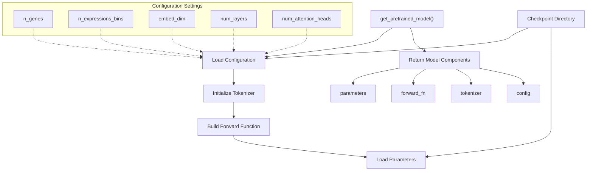
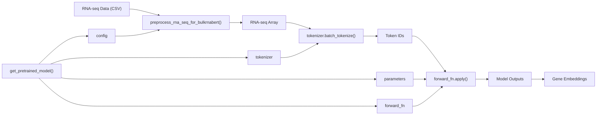
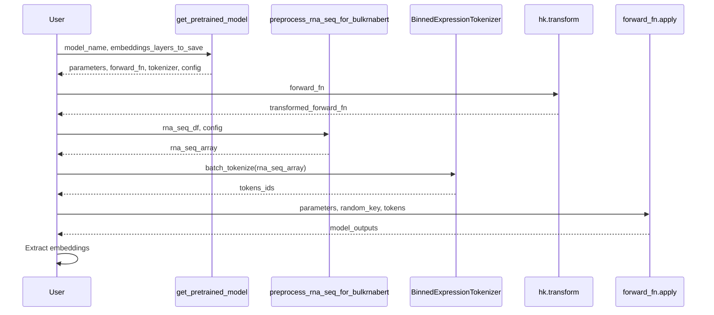
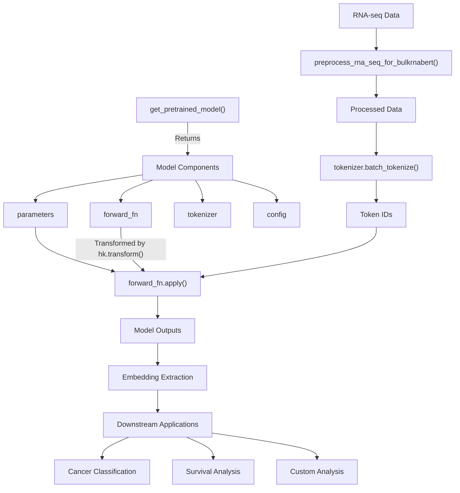

# Model Loading and Inference

<details>
<summary>Relevant source files</summary>

The following files were used as context for generating this wiki page:

- [README.md](README.md)
- [multiomics_open_research/bulk_rna_bert/pretrained.py](multiomics_open_research/bulk_rna_bert/pretrained.py)

</details>


This document explains how to load pretrained BulkRNABert models and perform inference with them. It covers the key components of the model loading process, the inference pipeline, and provides examples of how to use the loaded models for generating gene embeddings. For information about the available pretrained models and their characteristics, see [Pretrained Models](#3.1).

## 1. Model Loading Process

The central function for loading pretrained models is `get_pretrained_model()`, which handles loading the model configuration, initializing the tokenizer, building the forward function, and loading the model parameters.



Sources: [multiomics_open_research/bulk_rna_bert/pretrained.py:29-86]()

### 1.1 Function Parameters

The `get_pretrained_model()` function accepts several parameters that control the loading process:

| Parameter | Type | Description |
|-----------|------|-------------|
| `model_name` | str | Name of the pretrained model to load (e.g., "bulk_rna_bert_tcga") |
| `compute_dtype` | jnp.dtype | Data type used for computations (default: jnp.float32) |
| `param_dtype` | jnp.dtype | Data type for model parameters (default: jnp.float32) |
| `output_dtype` | jnp.dtype | Data type for model outputs (default: jnp.float32) |
| `embeddings_layers_to_save` | tuple[int, ...] | Indices of transformer layers from which to return embeddings |
| `checkpoint_directory` | str | Directory where checkpoints are stored (default: "checkpoints/") |

Sources: [multiomics_open_research/bulk_rna_bert/pretrained.py:29-36]()

### 1.2 Available Pretrained Models

BulkRNABert provides three pretrained models:

| Model Name | Description |
|------------|-------------|
| `bulk_rna_bert_tcga` | BulkRNABert pretrained on TCGA data |
| `bulk_rna_bert_gtex_encode` | BulkRNABert pretrained on GTEx and ENCODE data |
| `bulk_rna_bert_gtex_encode_tcga` | BulkRNABert pretrained on a mix of GTEx, ENCODE, and TCGA data |

Sources: [README.md:49-52]()

## 2. Inference Pipeline

The inference process with BulkRNABert involves several steps: loading the model, preprocessing RNA-seq data, tokenizing, running inference, and extracting embeddings.



Sources: [README.md:19-48]()

### 2.1 Preprocessing Data

Before inference, RNA-seq data must be preprocessed using the `preprocess_rna_seq_for_bulkrnabert()` function. This function:

1. Takes a pandas DataFrame containing RNA-seq data
2. Applies normalization (log or max normalization based on config)
3. Returns a numpy array ready for tokenization

Sources: [README.md:37-38]()

### 2.2 Tokenization

The tokenizer converts normalized RNA-seq values into token IDs that the model can process:

1. The `BinnedExpressionTokenizer` discretizes continuous expression values into bins
2. The `batch_tokenize()` method processes multiple samples at once
3. The output is a 2D array of token IDs (samples × genes)

Sources: [README.md:39-40](), [multiomics_open_research/bulk_rna_bert/pretrained.py:67-72]()

### 2.3 Model Inference

Inference involves:

1. Transforming the model's forward function using `hk.transform()`
2. Converting tokens to JAX arrays
3. Calling the transformed forward function with model parameters
4. Extracting embeddings from the output

Sources: [README.md:43-47]()

## 3. End-to-End Example

The complete process of loading a model and performing inference follows this sequence:



Sources: [README.md:19-48]()

### 3.1 Code Implementation

Here's a reference to the essential code flow for loading a model and performing inference:

1. Import required packages and functions
2. Load the pretrained model using `get_pretrained_model()`
3. Transform the forward function using `hk.transform()`
4. Load and preprocess RNA-seq data
5. Tokenize the preprocessed data
6. Run inference using `forward_fn.apply()`
7. Extract the desired embeddings from the output

Sources: [README.md:20-47]()

### 3.2 Extracting Embeddings

After inference, you can extract embeddings from different transformer layers based on your `embeddings_layers_to_save` setting:

- The output dictionary contains keys like `embeddings_4` for the embeddings from layer 4
- You can compute mean embeddings across genes to get a sample-level representation
- These embeddings can be used for downstream tasks like classification or survival analysis

Sources: [README.md:47-48]()

## 4. Advanced Usage

### 4.1 Working with Different Data Types

BulkRNABert supports different precision levels for computations, parameters, and outputs:

- Use `compute_dtype=jnp.float16` for faster inference when precision is less critical
- Use `param_dtype=jnp.float32` for training for better numerical stability
- Match `output_dtype` to your downstream application requirements

Sources: [multiomics_open_research/bulk_rna_bert/pretrained.py:31-33]()

### 4.2 Accessing Multiple Layer Embeddings

To get embeddings from multiple layers, specify them in `embeddings_layers_to_save`:

```
# Get embeddings from layers 1, 2, and 4
parameters, forward_fn, tokenizer, config = get_pretrained_model(
    model_name="bulk_rna_bert_tcga",
    embeddings_layers_to_save=(1, 2, 4),
)
```

This will result in output keys `embeddings_1`, `embeddings_2`, and `embeddings_4` in the model output.

Sources: [multiomics_open_research/bulk_rna_bert/pretrained.py:34](), [multiomics_open_research/bulk_rna_bert/pretrained.py:74]()

## 5. Model Loading and Inference in the BulkRNABert Architecture

The model loading and inference components fit into the overall BulkRNABert architecture as follows:



Sources: [README.md:19-48](), [multiomics_open_research/bulk_rna_bert/pretrained.py:29-86]()

This page covers how to load pretrained BulkRNABert models and perform inference to generate embeddings. For information on how to use these embeddings for downstream tasks, see [Cancer Classification](#5.1) and [Survival Analysis](#5.2).

---