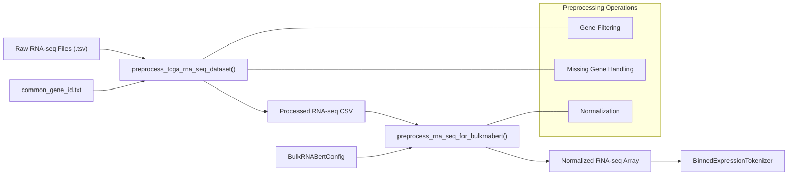
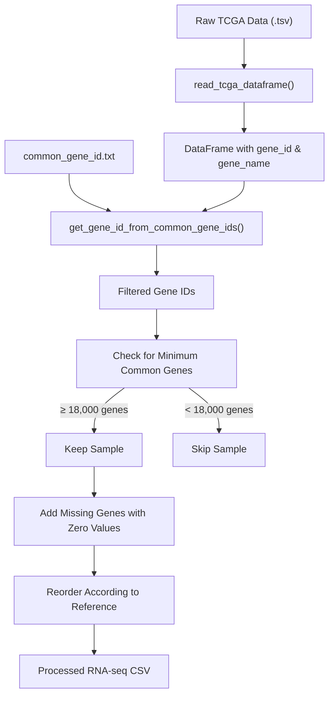
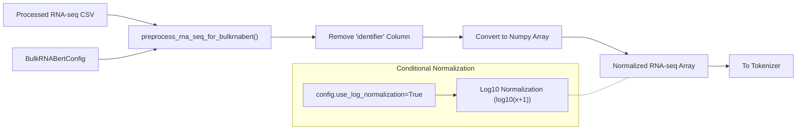
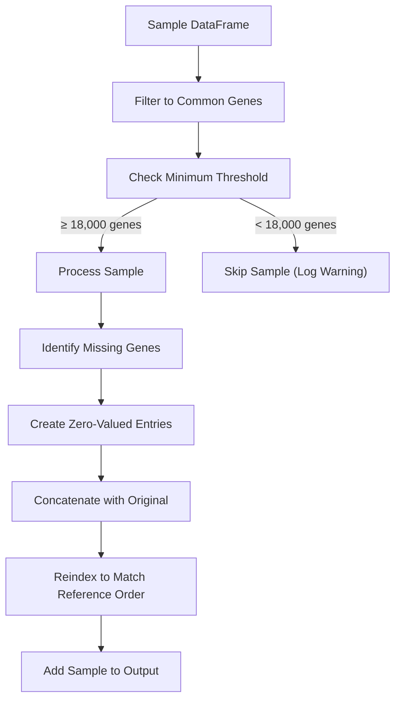
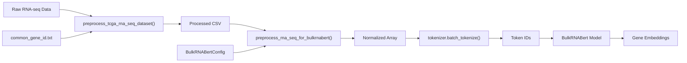

# Data Preprocessing

<details>
<summary>Relevant source files</summary>

The following files were used as context for generating this wiki page:

- [README.md](README.md)
- [data/common_gene_id.txt](data/common_gene_id.txt)
- [data/tcga_sample.csv](data/tcga_sample.csv)
- [multiomics_open_research/bulk_rna_bert/preprocess.py](multiomics_open_research/bulk_rna_bert/preprocess.py)

</details>


This document details the preprocessing pipeline used to prepare bulk RNA sequencing data for input to the BulkRNABert model. The preprocessing steps transform raw RNA-seq data into a standardized format that can be effectively tokenized and processed by the transformer-based model. For information about the tokenization process that follows preprocessing, see [Tokenization](#4.1).

## Overview of the Preprocessing Pipeline

The BulkRNABert system requires RNA-seq data to be preprocessed into a specific format before it can be used for model training or inference. The preprocessing pipeline handles gene ID filtering, normalization, and restructuring of the data.



Sources: [multiomics_open_research/bulk_rna_bert/preprocess.py](), [README.md:55-69]()

## TCGA Data Preprocessing

The BulkRNABert system primarily works with RNA-seq data from The Cancer Genome Atlas (TCGA). A dedicated preprocessing function handles the transformation of raw TCGA data files into a standardized format.

### Common Gene ID Standardization

A fundamental aspect of the preprocessing is the standardization of gene IDs across different RNA-seq datasets. The system uses a predefined list of gene IDs (stored in `common_gene_id.txt`) as a reference for filtering and alignment.



Sources: [multiomics_open_research/bulk_rna_bert/preprocess.py:28-139](), [data/common_gene_id.txt]()

### Key Preprocessing Functions

The preprocessing pipeline includes several specialized functions for handling TCGA RNA-seq data:

| Function | Purpose |
|----------|---------|
| `get_all_tcga_dataset_files` | Locates all TCGA dataset files in a given directory |
| `read_tcga_dataframe` | Reads a TCGA dataframe from a TSV file and filters out rows with missing gene IDs |
| `split_gene_id_version` | Separates a gene ID into base ID and version (e.g., "ENSG00000000003.14" → "ENSG00000000003", "14") |
| `get_gene_id_from_common_gene_ids` | Filters gene IDs to include only those in the reference list |
| `preprocess_tcga_rna_seq_dataset` | Main function that processes an entire directory of TCGA files into a single CSV |

Sources: [multiomics_open_research/bulk_rna_bert/preprocess.py:28-139]()

## RNA-seq Preparation for BulkRNABert

After the initial TCGA preprocessing, the data undergoes additional preparation specifically for the BulkRNABert model:



Sources: [multiomics_open_research/bulk_rna_bert/preprocess.py:141-149](), [README.md:36-40]()

### Using the Preprocessing Functions

To preprocess TCGA RNA-seq data and prepare it for BulkRNABert, two main functions are used:

1. First, raw TCGA data is processed into a standardized CSV:

```python
# Example from README
python scripts/preprocess_tcga_rna_seq.py \
--dataset-path data/tcga_sample_gdc/ \
--output-folder data/ \
--common-gene-ids-path data/common_gene_id.txt \
--rna-seq-column tpm_unstranded
```

2. Then, for BulkRNABert-specific processing:

```python
# From the example in README
rna_seq_df = pd.read_csv("data/tcga_sample.csv")
rna_seq_array = preprocess_rna_seq_for_bulkrnabert(rna_seq_df, config)
```

Sources: [README.md:55-69](), [README.md:24-41]()

## Handling Missing Genes and Minimum Threshold

The preprocessing pipeline includes mechanisms to handle missing genes and ensure data quality:

1. If a sample has fewer than 18,000 common genes with the reference list (defined by `MIN_COMMON_GENES = 18_000`), it is skipped
2. For retained samples, any missing genes from the reference list are added with zero expression values
3. Gene expressions are reordered to match the exact order of the reference gene list

This ensures that all processed samples have consistent gene sets and ordering, which is crucial for the BulkRNABert model.



Sources: [multiomics_open_research/bulk_rna_bert/preprocess.py:88-138]()

## Normalization Options

The BulkRNABert preprocessing supports log normalization (log10(x+1)) based on the configuration:

| Normalization Type | Configuration Flag | Transformation |
|-------------------|-------------------|---------------|
| Log Normalization | `config.use_log_normalization=True` | log10(expression + 1) |
| No Normalization | `config.use_log_normalization=False` | raw expression values |

The normalization is applied in the final preprocessing step before the data is passed to the tokenizer.

Sources: [multiomics_open_research/bulk_rna_bert/preprocess.py:147-148]()

## Gene ID Format Handling

The preprocessing pipeline handles gene IDs with and without version numbers. For example, gene ID "ENSG00000000003.14" would be broken down into:
- Base ID: "ENSG00000000003"
- Version: "14"

The system can accept and process gene IDs in either format (with or without versions) and can output them as needed.

Sources: [multiomics_open_research/bulk_rna_bert/preprocess.py:43-48](), [multiomics_open_research/bulk_rna_bert/preprocess.py:51-85]()

## Integration with the BulkRNABert Pipeline

The preprocessing component fits into the larger BulkRNABert workflow as follows:



Sources: [README.md:24-47](), [multiomics_open_research/bulk_rna_bert/preprocess.py]()

## Command-Line Preprocessing

The repository provides a script for preprocessing TCGA RNA-seq data from the command line:

```bash
python scripts/preprocess_tcga_rna_seq.py \
--dataset-path data/tcga_sample_gdc/ \
--output-folder data/ \
--common-gene-ids-path data/common_gene_id.txt \
--rna-seq-column tpm_unstranded
```

This script takes raw data files and creates a processed CSV file ready for the next steps in the pipeline.

Sources: [README.md:55-69]()

---