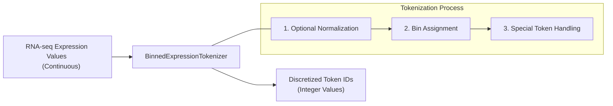
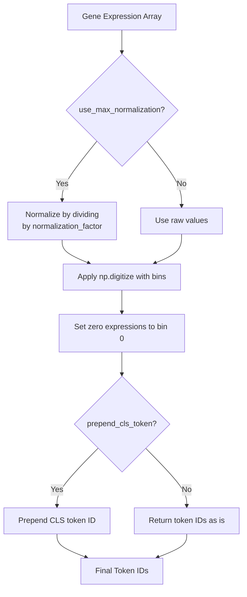
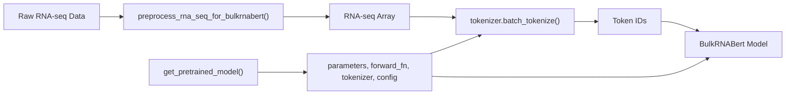
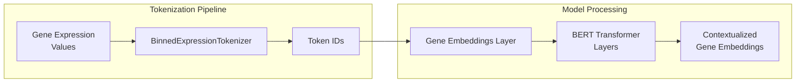

# Tokenization

<details>
<summary>Relevant source files</summary>

The following files were used as context for generating this wiki page:

- [README.md](README.md)
- [multiomics_open_research/bulk_rna_bert/tokenizer.py](multiomics_open_research/bulk_rna_bert/tokenizer.py)

</details>


## Purpose and Scope

This document explains the tokenization process in the BulkRNABert system, which is responsible for converting continuous gene expression values into discrete tokens that the transformer-based model can process. Tokenization serves as the critical bridge between numerical RNA-seq data and the BulkRNABert model's input format. For information about the overall data preprocessing pipeline, see [Data Preprocessing](#4), and for details about the model itself, see [BulkRNABert Model](#3).

## Overview of Tokenization in BulkRNABert

In natural language processing, tokenization typically involves splitting text into words or subwords. For genomic data, BulkRNABert uses a different approach: binning continuous gene expression values into discrete categories. This discretization process creates a vocabulary of expression levels that the model can learn to interpret.



Sources: [multiomics_open_research/bulk_rna_bert/tokenizer.py:20-160]()

## BinnedExpressionTokenizer

The tokenization functionality is implemented in the `BinnedExpressionTokenizer` class. This class handles the conversion of continuous gene expression values into discrete token IDs, which can then be processed by the transformer model.

### Key Configuration Parameters

The tokenizer can be configured with several parameters that affect how gene expressions are binned and processed:

| Parameter | Description | Default Value | Effect |
|-----------|-------------|---------------|--------|
| `n_expressions_bins` | Number of bins to divide expression values into | N/A (Required) | Controls the granularity of expression value discretization |
| `use_max_normalization` | Whether to normalize expressions to [0,1] range | `True` | Affects how expression values are scaled |
| `normalization_factor` | Factor to divide expression values by | 1.0 | Sets the scale for normalization |
| `prepend_cls_token` | Whether to add a CLS token at the beginning | `False` | Adds a classification token similar to BERT |

Sources: [multiomics_open_research/bulk_rna_bert/tokenizer.py:25-35]()

### Vocabulary and Special Tokens

The tokenizer creates a vocabulary consisting of:

1. **Standard tokens**: String representations of integers from 0 to `n_expressions_bins-1`, representing different expression level bins
2. **Special tokens**: Additional tokens for specific purposes

The special tokens include:

| Token | Name | Purpose |
|-------|------|---------|
| `<pad>` | Padding token | Used to pad sequences to equal length |
| `<mask>` | Mask token | Used during masked language modeling training |
| `<cls>` | Classification token | Can be added at the beginning of sequences |
| `<unk>` | Unknown token | Represents unknown or out-of-vocabulary values |
| `<eos>` | End of sequence token | Marks the end of a sequence |
| `<bos>` | Beginning of sequence token | Marks the beginning of a sequence |

Sources: [multiomics_open_research/bulk_rna_bert/tokenizer.py:44-66]()

## Tokenization Process

The tokenization process converts continuous gene expression values into discrete token IDs through the following steps:



Sources: [multiomics_open_research/bulk_rna_bert/tokenizer.py:132-148]()

### Bin Creation

The tokenizer creates bins for expression values in one of two ways, depending on the configuration:

1. If `use_max_normalization=True`: Bins are created in the range [0.0, 1.0]
2. If `use_max_normalization=False`: Bins are created in the range [0.0, normalization_factor]

The bins are created using `np.linspace()` to divide the range into `n_expressions_bins` equal-width intervals.

Sources: [multiomics_open_research/bulk_rna_bert/tokenizer.py:36-42]()

### Digitization

The actual conversion of expression values to bin indices is performed using `np.digitize()`, which assigns each value to a bin based on which range it falls into. Special handling is applied to ensure that expressions with value 0.0 are consistently assigned to bin 0.

Sources: [multiomics_open_research/bulk_rna_bert/tokenizer.py:144-145]()

## Integration with BulkRNABert Pipeline

The tokenizer is a key component in the BulkRNABert workflow, sitting between the data preprocessing step and the model input:



Sources: [README.md:25-47]()

### Batch Processing

For efficiency when processing multiple RNA-seq samples, the tokenizer provides a `batch_tokenize()` method that applies the tokenization process to a batch of gene expression arrays, returning a batch of token ID arrays.

Sources: [multiomics_open_research/bulk_rna_bert/tokenizer.py:150-160]()

## Usage Example

The tokenizer is typically obtained as part of loading a pretrained model and used as shown in this example from the repository documentation:

```python
# Get pretrained model
parameters, forward_fn, tokenizer, config = get_pretrained_model(
    model_name="bulk_rna_bert_tcga",
    embeddings_layers_to_save=(4,),
    checkpoint_directory="checkpoints/",
)
forward_fn = hk.transform(forward_fn)

# Get bulk RNASeq data and tokenize it
rna_seq_df = pd.read_csv("data/tcga_sample.csv")
rna_seq_array = preprocess_rna_seq_for_bulkrnabert(rna_seq_df, config)
tokens_ids = tokenizer.batch_tokenize(rna_seq_array)
tokens = jnp.asarray(tokens_ids, dtype=jnp.int32)
```

Sources: [README.md:19-40]()

## Relation to Machine Learning Model

The tokenization scheme directly impacts how the BulkRNABert model perceives gene expression patterns. By discretizing continuous expression values into bins, the model can learn relationships between expression levels of different genes in a manner similar to how language models learn relationships between words.



Sources: [multiomics_open_research/bulk_rna_bert/tokenizer.py:20-160](), [README.md:5-6]()

## Summary

The tokenization process in BulkRNABert serves as a crucial step that transforms continuous gene expression data into a format suitable for a transformer model. The `BinnedExpressionTokenizer` class provides a flexible approach to this conversion by offering various configuration options for normalization and binning. This discretization enables the transformer model to process genomic data in a manner analogous to how language models process text, allowing it to capture complex relationships between gene expression patterns.

---