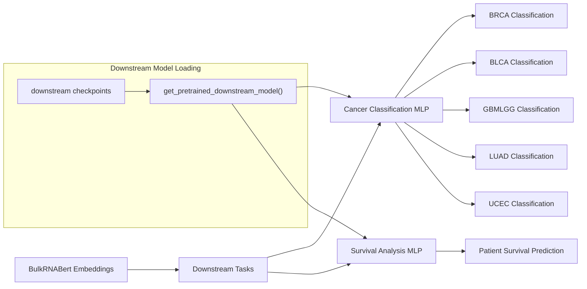
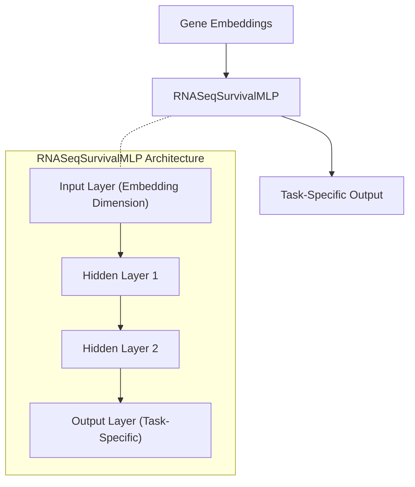
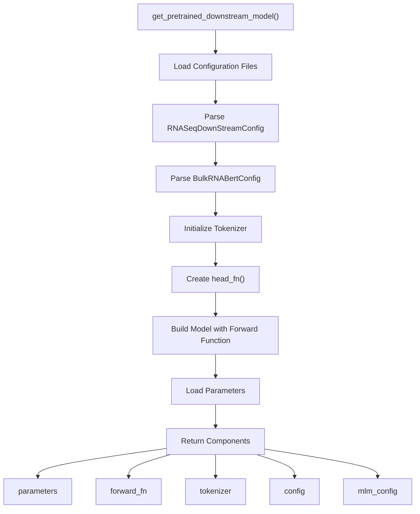
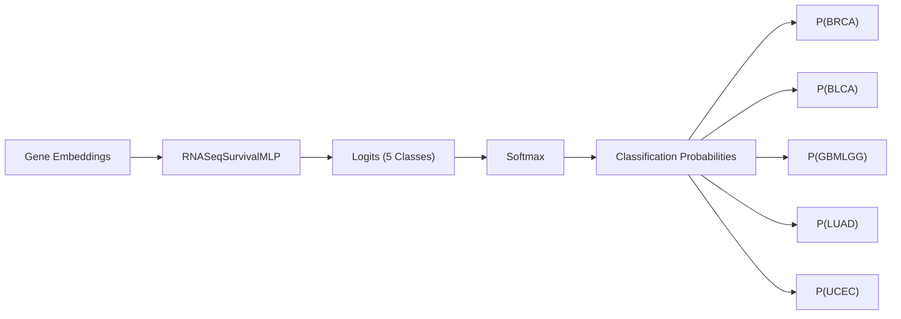
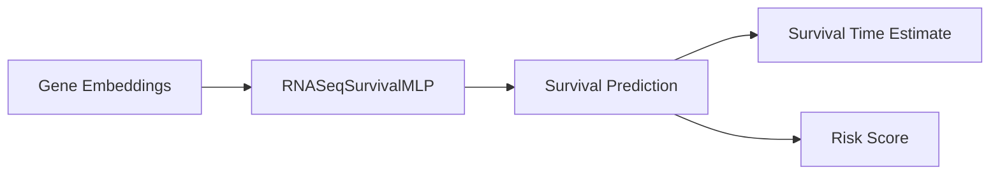
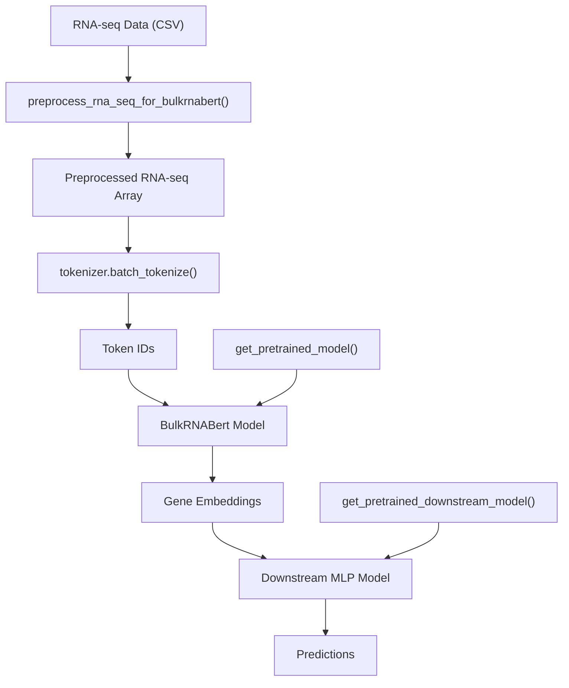
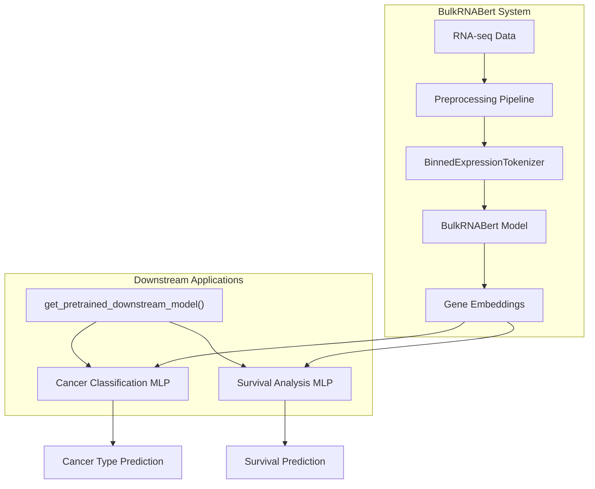

# Downstream Applications

<details>
<summary>Relevant source files</summary>

The following files were used as context for generating this wiki page:

- [README.md](README.md)
- [multiomics_open_research/bulk_rna_bert/downstream/pretrained.py](multiomics_open_research/bulk_rna_bert/downstream/pretrained.py)

</details>


This page documents the downstream applications that leverage BulkRNABert gene embeddings for specific predictive tasks. For information about the BulkRNABert model itself, see [BulkRNABert Model](#3). For details on tokenization and preprocessing, see [Data Preprocessing](#4).

## Overview

BulkRNABert generates contextual gene embeddings from RNA-seq data that capture meaningful relationships between genes and their expression patterns. These high-dimensional embeddings serve as powerful feature representations for downstream predictive tasks, currently focused on two primary applications:

1. **Cancer Type Classification**: Identifying cancer types from gene expression profiles
2. **Survival Analysis**: Predicting patient survival outcomes

## System Architecture



This diagram illustrates how the embeddings generated by BulkRNABert are used in downstream applications and how these models are loaded.

Sources: [multiomics_open_research/bulk_rna_bert/downstream/pretrained.py:38-118]()

## Available Downstream Models

Currently, BulkRNABert provides the following pretrained downstream models:

| Model Name | Description | Head Name | Task |
|------------|-------------|-----------|------|
| `tcga_5_cohorts` | Classification for 5 TCGA cancer cohorts | `classification_head` | Cancer Type Classification |

Sources: [multiomics_open_research/bulk_rna_bert/downstream/pretrained.py:33-35]()

## Downstream Model Implementation

Both cancer classification and survival analysis use the same underlying architecture, `RNASeqSurvivalMLP`, which is a multi-layer perceptron that takes gene embeddings as input and produces task-specific predictions.



The model architecture uses the same underlying structure for both tasks but with different output dimensions depending on the specific application.

Sources: [multiomics_open_research/bulk_rna_bert/downstream/model.py]()

## Loading Pretrained Downstream Models

The `get_pretrained_downstream_model` function provides a standardized interface for loading pretrained downstream models:



This function loads all necessary components for performing inference with downstream models.

Sources: [multiomics_open_research/bulk_rna_bert/downstream/pretrained.py:38-118]()

## Cancer Classification Application

The cancer classification model classifies samples into one of five cancer types from The Cancer Genome Atlas (TCGA):

1. **BRCA**: Breast Invasive Carcinoma
2. **BLCA**: Bladder Urothelial Carcinoma 
3. **GBMLGG**: Glioblastoma Multiforme and Lower Grade Glioma
4. **LUAD**: Lung Adenocarcinoma
5. **UCEC**: Uterine Corpus Endometrial Carcinoma



The output of the model is a vector of probabilities for each cancer type, with the highest probability indicating the predicted class.

Sources: [README.md:71-73]()

## Survival Analysis Application

The survival analysis model predicts patient survival time based on gene expression patterns, which is particularly valuable for prognosis and treatment planning.



While the current repository primarily focuses on cancer classification, the same `RNASeqSurvivalMLP` architecture can be adapted for survival analysis.

Sources: [multiomics_open_research/bulk_rna_bert/downstream/model.py]()

## End-to-End Workflow



This diagram shows the complete workflow from raw RNA-seq data to final predictions, illustrating how the different components of the system interact.

Sources: [README.md:19-48]()

## Example Usage

Here's an example of how to use the cancer classification downstream model:

```python
import haiku as hk
import jax
import jax.numpy as jnp
import pandas as pd

from multiomics_open_research.bulk_rna_bert.downstream.pretrained import get_pretrained_downstream_model
from multiomics_open_research.bulk_rna_bert.preprocess import preprocess_rna_seq_for_bulkrnabert

# Load pretrained downstream model
parameters, forward_fn, tokenizer, config, mlm_config = get_pretrained_downstream_model(
    model_name="tcga_5_cohorts",
    checkpoint_directory="checkpoints/"
)
forward_fn = hk.transform(forward_fn)

# Preprocess RNA-seq data
rna_seq_df = pd.read_csv("data/tcga_sample.csv")
rna_seq_array = preprocess_rna_seq_for_bulkrnabert(rna_seq_df, mlm_config)
tokens_ids = tokenizer.batch_tokenize(rna_seq_array)
tokens = jnp.asarray(tokens_ids, dtype=jnp.int32)

# Perform inference
random_key = jax.random.PRNGKey(0)
outputs = forward_fn.apply(parameters, random_key, tokens)

# Get classification probabilities
classification_probs = outputs["logits"]
predicted_class = jnp.argmax(classification_probs, axis=-1)
```

For more detailed examples, refer to the notebook at `examples/downstream_task_example.ipynb` which demonstrates an inference with the classification model trained on the 5 cohorts.

Sources: [README.md:71-73]()

## Integration with BulkRNABert



This diagram shows how the downstream applications are integrated with the core BulkRNABert system, highlighting the flow of information from raw RNA-seq data to final predictions.

Sources: [multiomics_open_research/bulk_rna_bert/downstream/pretrained.py:38-118](), [README.md:19-48]()

---