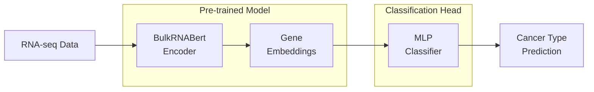
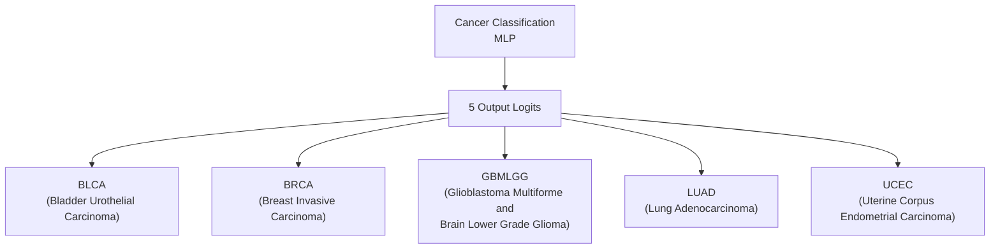
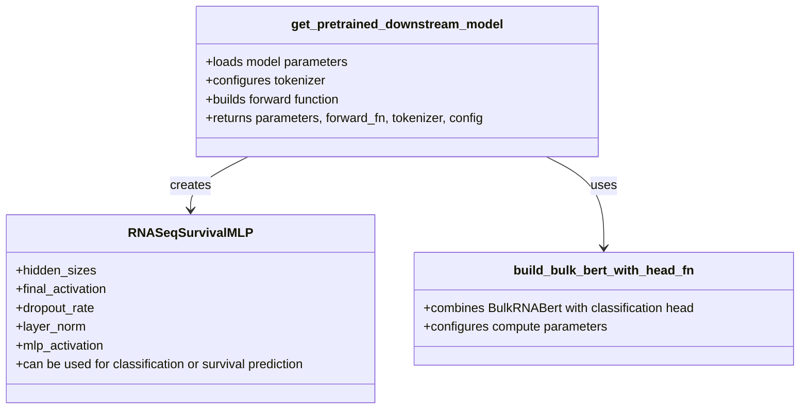
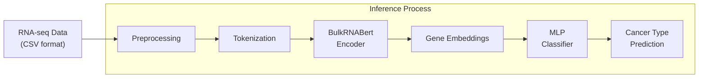
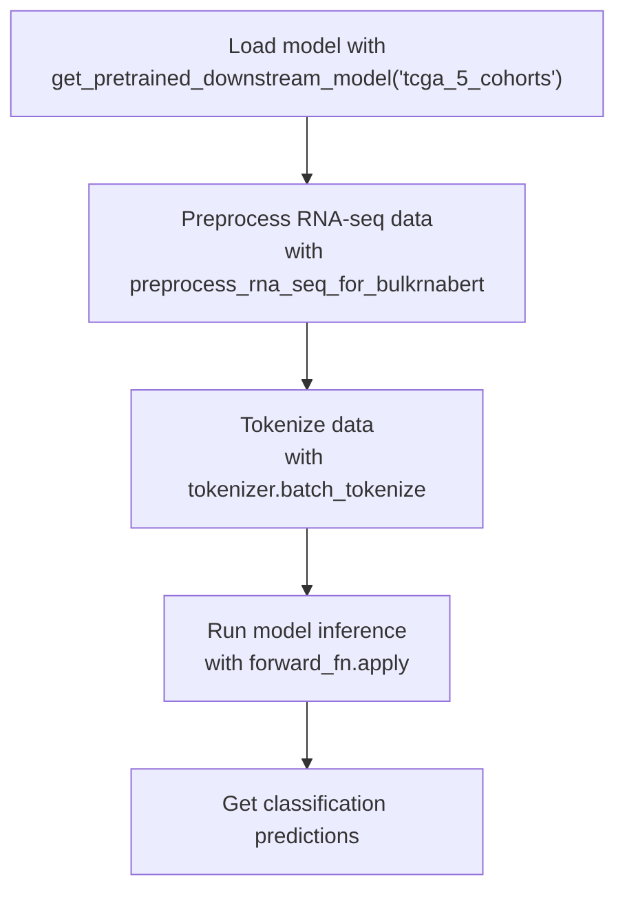
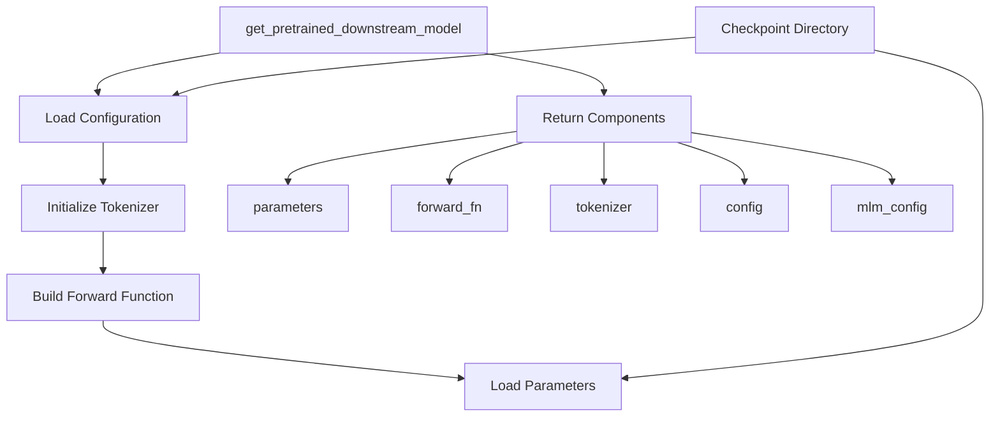

# Cancer Classification

Relevant source files

The following files were used as context for generating this wiki page:

- [README.md](README.md)
- [checkpoints/tcga_5_cohorts/config.json](checkpoints/tcga_5_cohorts/config.json)
- [checkpoints/tcga_5_cohorts/params.joblib](checkpoints/tcga_5_cohorts/params.joblib)
- [data/5_cohorts_labels_mapping.pkl](data/5_cohorts_labels_mapping.pkl)
- [multiomics_open_research/bulk_rna_bert/downstream/pretrained.py](multiomics_open_research/bulk_rna_bert/downstream/pretrained.py)

## Purpose and Scope

This document describes how to use BulkRNABert for cancer type classification. It explains the architecture of the cancer classification module, the available pre-trained models, and provides practical guidance on implementing cancer classification using the BulkRNABert embeddings. For information about survival prediction, see [Survival Analysis](#5.2).

## System Architecture

The cancer classification pipeline in BulkRNABert uses a two-stage approach:

1. A pre-trained BulkRNABert model generates gene embeddings from RNA-seq data
2. A classification head (MLP) takes these embeddings to predict cancer types

Sources: [multiomics_open_research/bulk_rna_bert/downstream/pretrained.py:26-29]()

The pre-trained model for cancer classification supports 5 cancer cohorts:

Sources: [data/5_cohorts_labels_mapping.pkl:1](), [checkpoints/tcga_5_cohorts/config.json:1]()

## Model Configuration

The cancer classification model uses the following configuration:

| Component | Configuration |
|-----------|---------------|
| Base Model | BulkRNABert pre-trained on TCGA data |
| Hidden Layer Sizes | [256, 128] |
| Final Activation | Identity |
| MLP Activation | SELU |
| Dropout Rate | 0.0 |
| Layer Normalization | Disabled |
| Number of Output Classes | 5 (BLCA, BRCA, GBMLGG, LUAD, UCEC) |

Sources: [checkpoints/tcga_5_cohorts/config.json:1]()

## Implementation Details

The cancer classification system utilizes the `RNASeqSurvivalMLP` module for the classification head, despite its name suggesting survival analysis. The same underlying architecture is used for both tasks with different output configurations.

Sources: [multiomics_open_research/bulk_rna_bert/downstream/pretrained.py:38-118](), [multiomics_open_research/bulk_rna_bert/downstream/pretrained.py:103-105]()

## Data Flow

The cancer classification pipeline processes data through the following steps:

Sources: [README.md:19-48]()

## Usage

To use the pre-trained cancer classification model:

1. First, prepare your RNA-seq data according to the expected format (see [Data Preprocessing](#4))
2. Load the pre-trained downstream model using the `get_pretrained_downstream_model` function
3. Preprocess and tokenize your RNA-seq data
4. Run the model to get predictions

Example workflow:

Sources: [multiomics_open_research/bulk_rna_bert/downstream/pretrained.py:38-118](), [README.md:19-48]()

## Model Loading and Inference

The system provides the `get_pretrained_downstream_model` function to load the pre-trained cancer classification model:

Sources: [multiomics_open_research/bulk_rna_bert/downstream/pretrained.py:38-118]()

The model uses "tcga_5_cohorts" as the model name, which maps to "classification_head" in the internal model configuration.

Sources: [multiomics_open_research/bulk_rna_bert/downstream/pretrained.py:33-35]()

## Key Files and Resources

| Resource | Description |
|----------|-------------|
| `get_pretrained_downstream_model` | Function to load pre-trained cancer classification model |
| `tcga_5_cohorts` | Pre-trained model name for 5 cancer cohort classification |
| `data/5_cohorts_labels_mapping.pkl` | Mapping of numerical labels to cancer cohort names |
| `examples/downstream_task_example.ipynb` | Example notebook for cancer classification |

Sources: [README.md:71-73](), [multiomics_open_research/bulk_rna_bert/downstream/pretrained.py:33-35](), [multiomics_open_research/bulk_rna_bert/downstream/pretrained.py:38-118]()

## Notes on Model Performance

The BulkRNABert approach achieves state-of-the-art performance in cancer type classification on the TCGA dataset. The model was trained on the 5 cancer cohorts (BRCA, BLCA, GBMLGG, LUAD, UCEC) and demonstrates the effectiveness of transformer-based models for capturing gene expression patterns specific to different cancer types.

Sources: [README.md:5-7]()

For a complete example demonstrating cancer classification, refer to the notebook at `examples/downstream_task_example.ipynb`.

Sources: [README.md:71-73]()

---