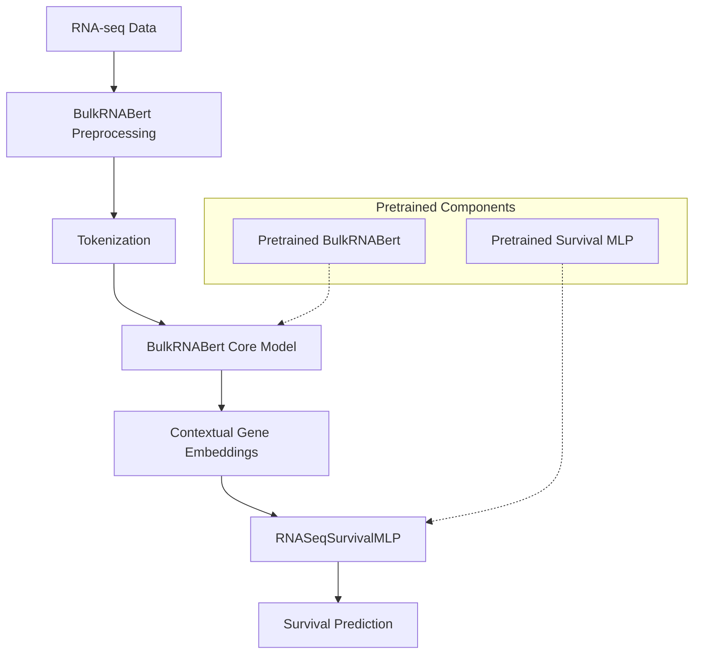
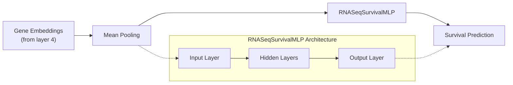
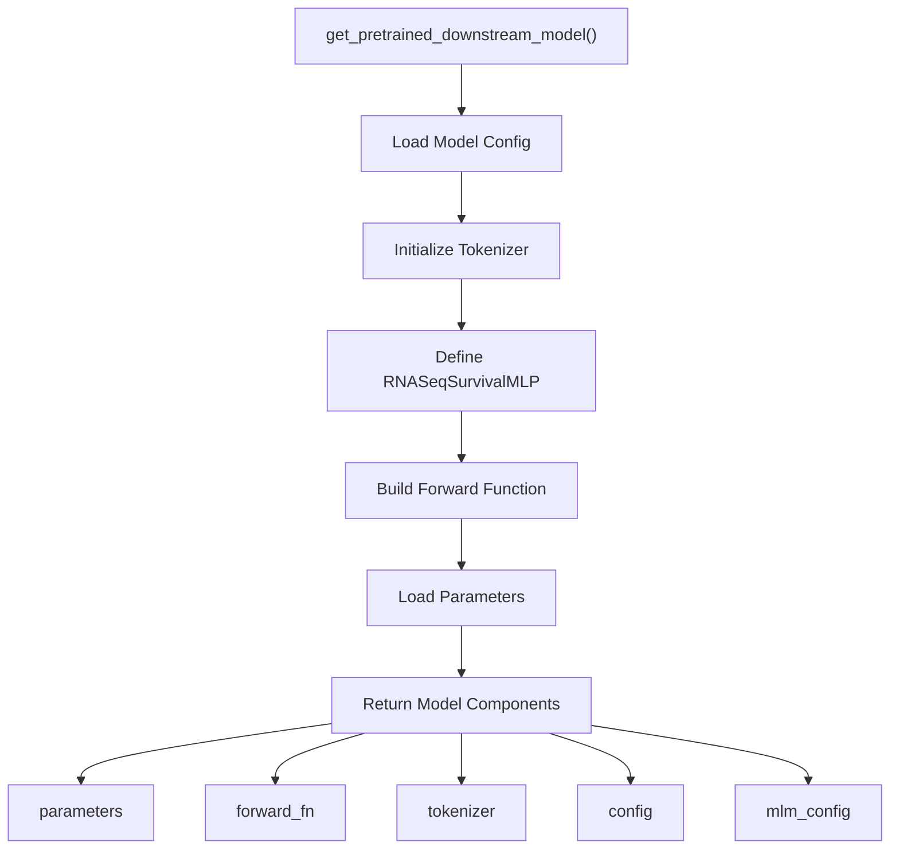
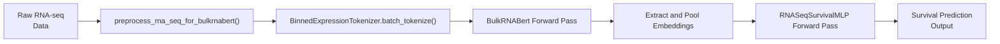
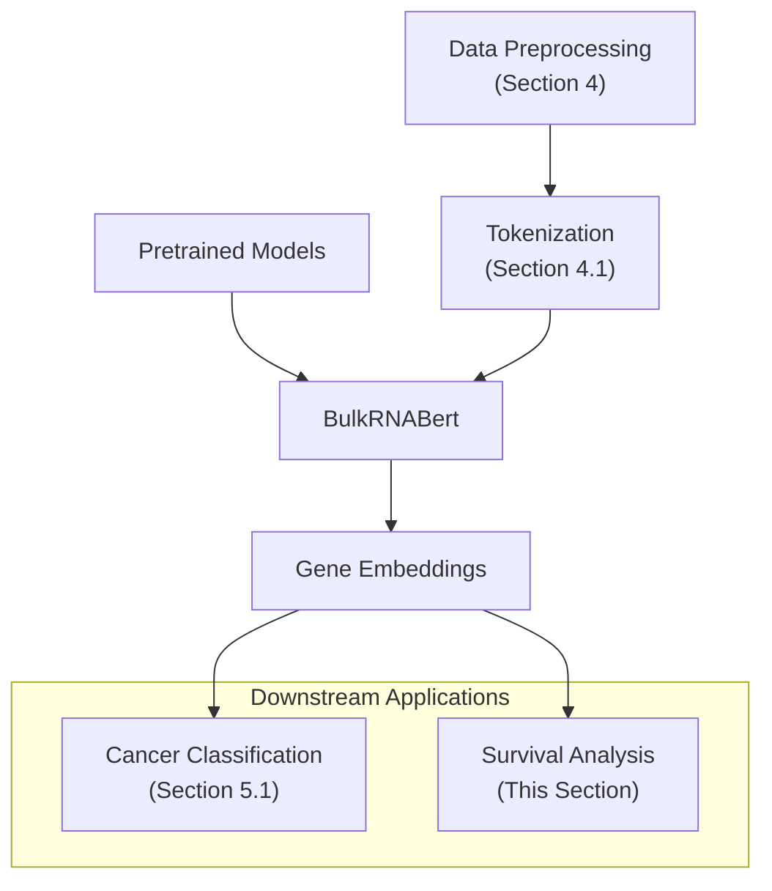

# Survival Analysis

Relevant source files

The following files were used as context for generating this wiki page:

- [README.md](README.md)
- [multiomics_open_research/bulk_rna_bert/downstream/pretrained.py](multiomics_open_research/bulk_rna_bert/downstream/pretrained.py)

## Overview

This document details the Survival Analysis system within the BulkRNABert framework. Survival analysis in this context refers to the prediction of patient survival outcomes using bulk RNA-seq data processed through BulkRNABert embeddings. The system leverages transformer-based representations of gene expression data to predict patient prognosis, which is valuable for personalized treatment planning and clinical decision-making.

For information about cancer type classification using BulkRNABert, see [Cancer Classification](#5.1).

## System Architecture

Survival Analysis in BulkRNABert functions as a downstream application that builds upon the gene embeddings generated by the core transformer model. The system follows a two-stage approach where RNA-seq data is first processed through the primary BulkRNABert model to generate contextual gene embeddings, and then a specialized survival prediction model uses these embeddings to predict patient outcomes.

Sources: [multiomics_open_research/bulk_rna_bert/downstream/pretrained.py:37-118]()

## Survival Prediction Model

The survival prediction capability is implemented through the `RNASeqSurvivalMLP` model, which takes contextualized gene embeddings from BulkRNABert and outputs survival predictions. This model is a specialized Multi-Layer Perceptron (MLP) designed specifically for survival analysis tasks.

Sources: [multiomics_open_research/bulk_rna_bert/downstream/pretrained.py:103-105]()

The model architecture consists of:
- Input layer that takes the mean pooled gene embeddings
- Configurable hidden layers with customizable dimensions
- Output layer that provides survival prediction values

## Using the Survival Analysis System

To use the pretrained survival analysis model, you need to:

1. Load the pretrained model using the `get_pretrained_downstream_model` function
2. Preprocess your RNA-seq data
3. Generate embeddings using BulkRNABert
4. Feed the embeddings to the survival model to get predictions

### Loading the Model

The survival model can be loaded using the `get_pretrained_downstream_model` function, which retrieves both the BulkRNABert model and the survival prediction head.

Sources: [multiomics_open_research/bulk_rna_bert/downstream/pretrained.py:38-118]()

### Data Processing Pipeline

The survival analysis pipeline follows these steps:

1. Preprocess RNA-seq data using common gene IDs
2. Normalize and tokenize the gene expression values
3. Run the BulkRNABert model to get gene embeddings
4. Feed the embeddings to the survival MLP for prediction

Sources: [README.md:19-48](), [multiomics_open_research/bulk_rna_bert/downstream/pretrained.py:107-114]()

## Technical Implementation

### Survival Model Configuration

The survival prediction model's behavior is controlled by the `RNASeqDownStreamConfig` which specifies:

- Which embedding layer to use from the BulkRNABert model
- The architecture of the survival MLP (hidden layers, dimensions)
- Other training and inference parameters

| Configuration Parameter | Description |
|-------------------------|-------------|
| `embeddings_layer_to_use` | Which layer of BulkRNABert to extract embeddings from (defaults to layer 4) |
| `model.hidden_dims` | Dimensions of hidden layers in the MLP |
| `model.dropout_rate` | Dropout rate applied during training |
| `rnaseq_representation_model.checkpoint_path` | Path to the pretrained BulkRNABert checkpoint |

Sources: [multiomics_open_research/bulk_rna_bert/downstream/pretrained.py:81-90]()

### Calling the Model

The integrated model (BulkRNABert + survival head) is created using the `build_bulk_bert_with_head_fn` function, which:

1. Builds the BulkRNABert model according to the provided configuration
2. Extracts embeddings from the specified layer
3. Applies mean pooling to get a single embedding vector per sample
4. Feeds this embedding to the survival MLP to get predictions

The survival prediction process is designed to work seamlessly with the BulkRNABert embeddings, making it straightforward to use once the models are loaded.

Sources: [multiomics_open_research/bulk_rna_bert/downstream/pretrained.py:107-114]()

## Relation to Other Components

The survival analysis system is part of the broader downstream applications of BulkRNABert:

The survival analysis model leverages the same gene embeddings as other downstream tasks but is specifically optimized for predicting patient survival outcomes.

Sources: [README.md:6-7]()

## Performance

According to the repository description, BulkRNABert achieves state-of-the-art performance in survival time prediction on the TCGA dataset. This demonstrates the effectiveness of using transformer-based embeddings from RNA-seq data for this critical clinical application.

Sources: [README.md:5-7]()

---