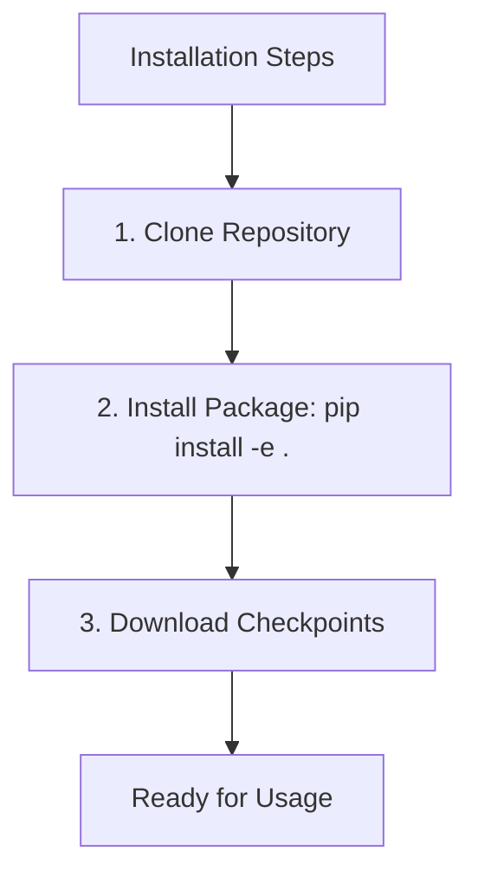
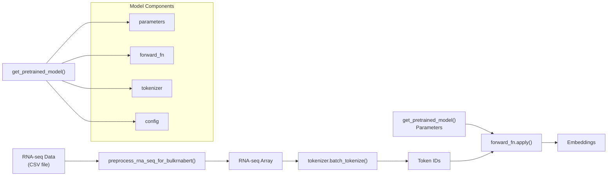
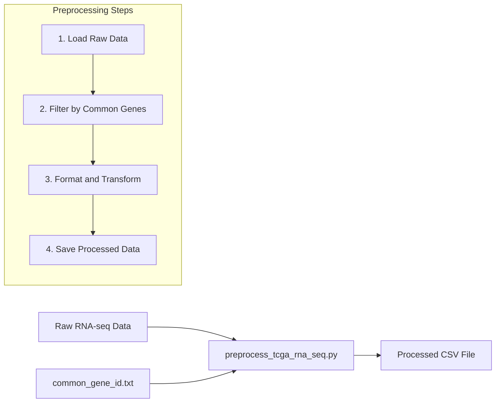
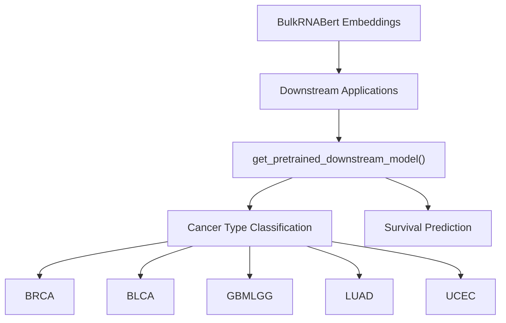
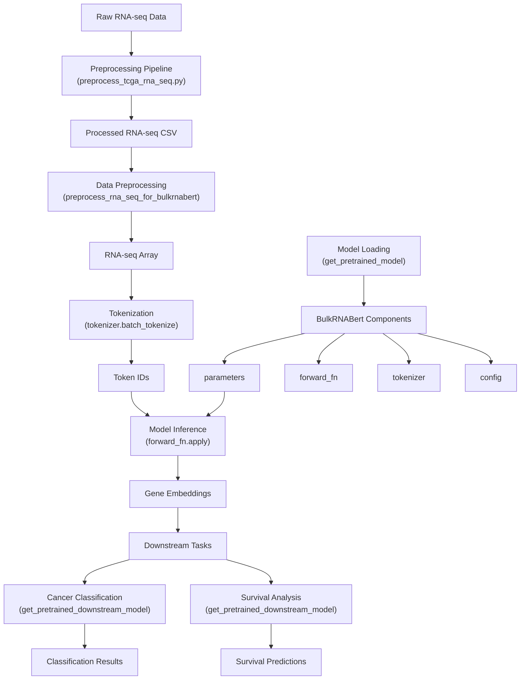

# Usage Examples

<details>
<summary>Relevant source files</summary>

The following files were used as context for generating this wiki page:

- [README.md](README.md)

</details>


This page provides practical examples of how to use BulkRNABert for various tasks, from basic model inference to specialized downstream applications. For information about the model architecture itself, see [BulkRNABert Model](#3), and for details on data preprocessing, see [Data Preprocessing](#4).

## Getting Started

Before diving into examples, ensure you have installed the package and downloaded the necessary model checkpoints.



Sources: [README.md:13-16]()

## Basic Model Loading and Inference

The following example demonstrates how to load a pretrained BulkRNABert model and perform basic inference to obtain gene embeddings.



### Example: Loading a Pretrained Model

```python
# Import necessary libraries
import haiku as hk
import jax
import jax.numpy as jnp
import pandas as pd

from multiomics_open_research.bulk_rna_bert.pretrained import get_pretrained_model
from multiomics_open_research.bulk_rna_bert.preprocess import preprocess_rna_seq_for_bulkrnabert

# Get pretrained model
parameters, forward_fn, tokenizer, config = get_pretrained_model(
    model_name="bulk_rna_bert_tcga",
    embeddings_layers_to_save=(4,),
    checkpoint_directory="checkpoints/",
)
forward_fn = hk.transform(forward_fn)
```

Sources: [README.md:19-35]()

### Example: Processing and Tokenizing RNA-seq Data

```python
# Load RNA-seq data from file
rna_seq_df = pd.read_csv("data/tcga_sample.csv")

# Preprocess data for BulkRNABert
rna_seq_array = preprocess_rna_seq_for_bulkrnabert(rna_seq_df, config)

# Tokenize the processed data
tokens_ids = tokenizer.batch_tokenize(rna_seq_array)
tokens = jnp.asarray(tokens_ids, dtype=jnp.int32)
```

Sources: [README.md:36-40]()

### Example: Running Inference

```python
# Create a random key for JAX
random_key = jax.random.PRNGKey(0)

# Run the forward pass
outs = forward_fn.apply(parameters, random_key, tokens)

# Extract mean embeddings from the 4th layer
mean_embedding = outs["embeddings_4"].mean(axis=1)
```

Sources: [README.md:42-47]()

## Available Pretrained Models

BulkRNABert offers three pretrained models, each trained on different datasets:

| Model Name | Description | Training Data |
|------------|-------------|---------------|
| bulk_rna_bert_tcga | Base BulkRNABert model | TCGA data only |
| bulk_rna_bert_gtex_encode | Alternative model | GTEx and ENCODE data |
| bulk_rna_bert_gtex_encode_tcga | Comprehensive model | Mix of GTEx, ENCODE, and TCGA data |

To specify which model to use, modify the `model_name` parameter in the `get_pretrained_model` function.

Sources: [README.md:49-52]()

## Data Preprocessing Examples

BulkRNABert requires RNA-seq data to be in a specific format. Below is an example of preprocessing raw TCGA RNA-seq data.



### Example: Preprocessing TCGA RNA-seq Data

```bash
python scripts/preprocess_tcga_rna_seq.py \
--dataset-path data/tcga_sample_gdc/ \
--output-folder data/ \
--common-gene-ids-path data/common_gene_id.txt \
--rna-seq-column tpm_unstranded
```

This script processes raw RNA-seq data from the GDC portal into a format that can be used with BulkRNABert. The script uses the common gene IDs provided in `data/common_gene_id.txt` to ensure compatibility with the model.

Sources: [README.md:55-69]()

## Downstream Tasks Examples

BulkRNABert's gene embeddings can be used for various downstream tasks, including cancer classification and survival analysis.



### Example: Cancer Type Classification

The repository includes a notebook that demonstrates how to use BulkRNABert embeddings for cancer type classification across five cancer cohorts.

```python
# First, obtain gene embeddings as shown in previous examples
# Then, load the pretrained downstream classification model
from multiomics_open_research.bulk_rna_bert.pretrained import get_pretrained_downstream_model

# Load the classification model
classification_params, classification_forward_fn = get_pretrained_downstream_model(
    downstream_task="classification",
    checkpoint_directory="checkpoints/"
)

# Transform the forward function
classification_forward_fn = hk.transform(classification_forward_fn)

# Run inference
random_key = jax.random.PRNGKey(1)
classification_outputs = classification_forward_fn.apply(
    classification_params, 
    random_key, 
    mean_embedding
)

# Get predicted classes
predicted_classes = jnp.argmax(classification_outputs, axis=1)
```

Sources: [README.md:71-73]()

### Example: Survival Analysis

Similarly, you can use BulkRNABert embeddings for survival prediction.

```python
# Load the survival prediction model
survival_params, survival_forward_fn = get_pretrained_downstream_model(
    downstream_task="survival",
    checkpoint_directory="checkpoints/"
)

# Transform the forward function
survival_forward_fn = hk.transform(survival_forward_fn)

# Run inference
random_key = jax.random.PRNGKey(1)
survival_outputs = survival_forward_fn.apply(
    survival_params, 
    random_key, 
    mean_embedding
)

# Get survival predictions
predicted_survival = survival_outputs
```

## End-to-End Example Workflow

Below is a comprehensive diagram showing the entire workflow from data preprocessing to downstream applications.



This diagram illustrates the complete process of using BulkRNABert, from preprocessing raw RNA-seq data to obtaining gene embeddings and using them for downstream tasks.

## Tips for Effective Usage

1. **Model Selection**: Choose the appropriate pretrained model based on your data:
   - `bulk_rna_bert_tcga`: Best for cancer-related studies using TCGA data
   - `bulk_rna_bert_gtex_encode`: Suitable for normal tissue analysis
   - `bulk_rna_bert_gtex_encode_tcga`: Best for mixed datasets containing both normal and cancer samples

2. **Embedding Layer Selection**: The model allows you to extract embeddings from different layers:
   - Earlier layers (1-2): Capture more basic gene expression patterns
   - Middle layers (3-4): Balance between basic and complex features
   - Later layers (5-6): Represent more abstract, task-specific features

3. **Gene Set Compatibility**: Ensure your RNA-seq data contains the genes listed in `common_gene_id.txt` for optimal performance.

4. **Preprocessing Options**: The `preprocess_rna_seq_for_bulkrnabert` function offers different normalization options (log normalization and max normalization) that can affect model performance.

Sources: [README.md]()

---