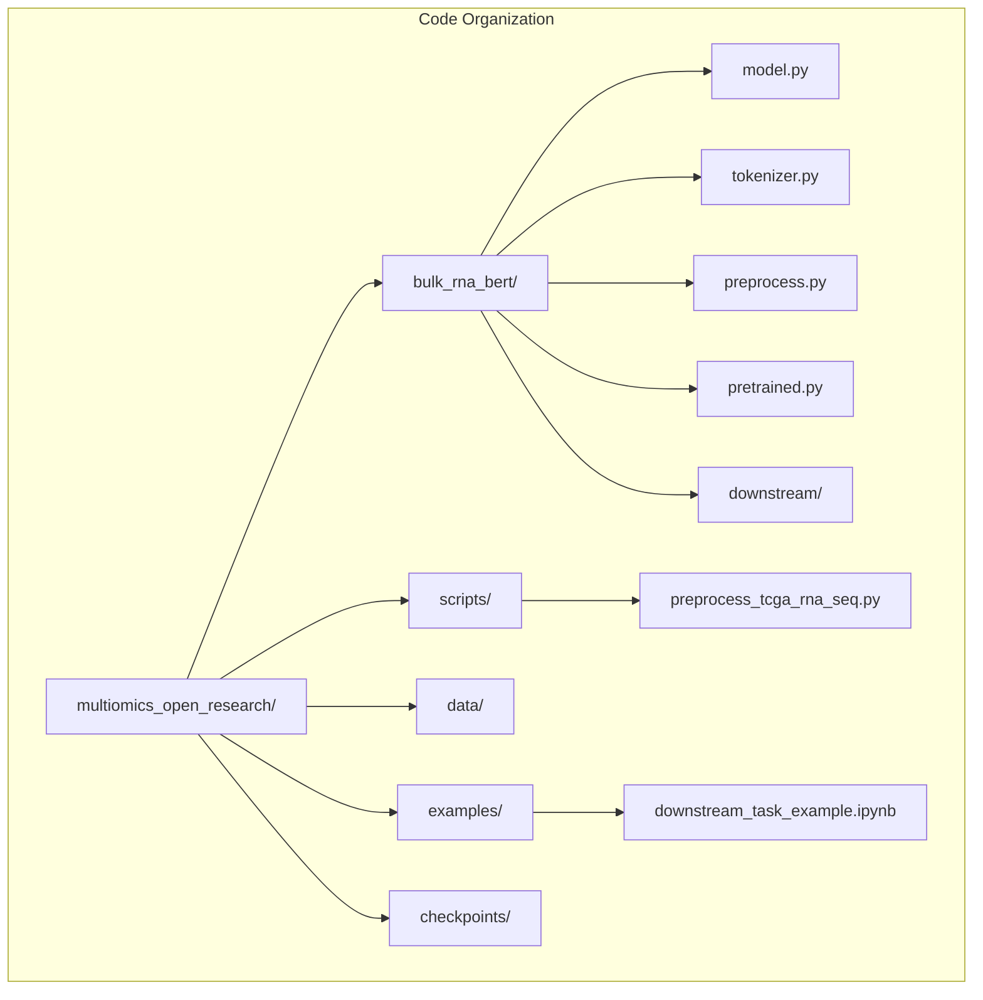
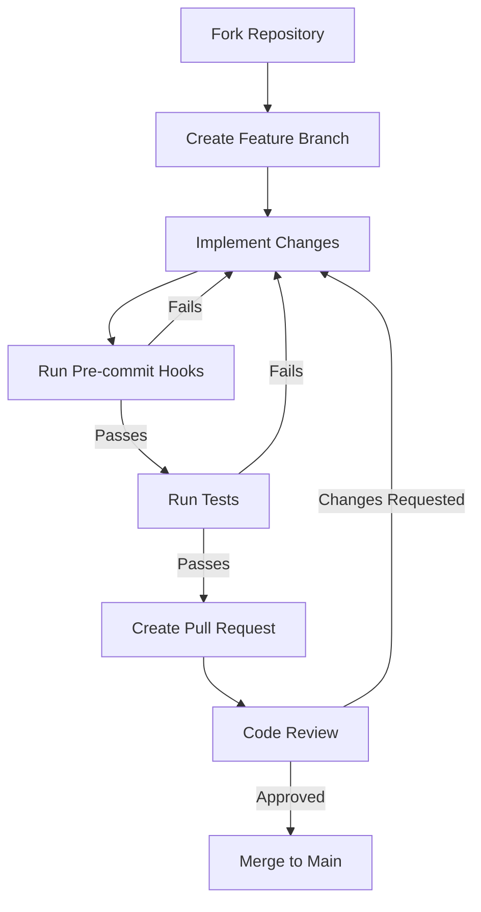
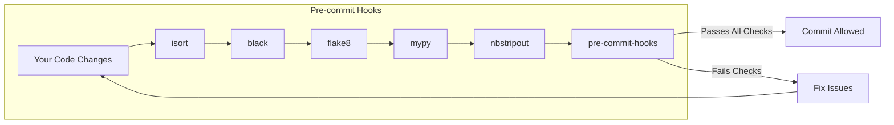
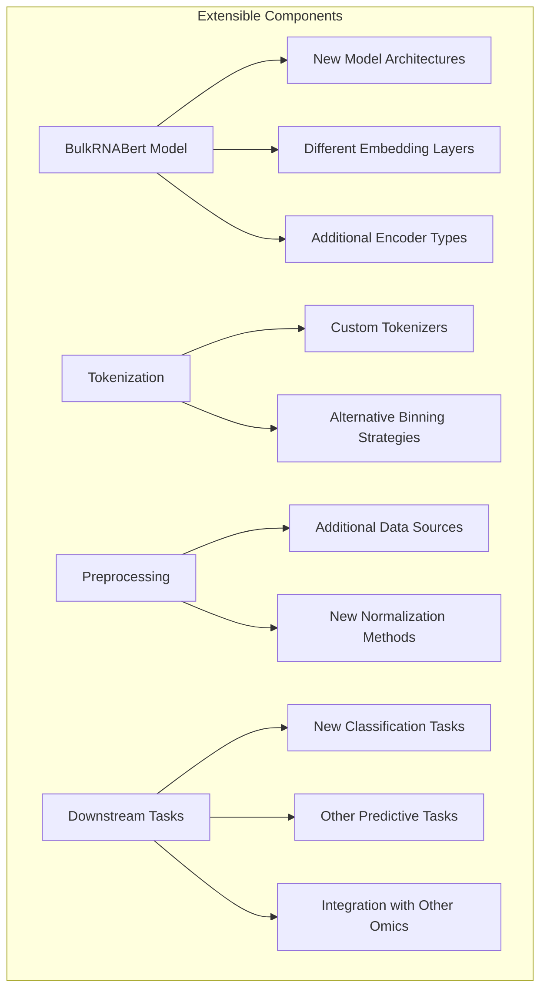
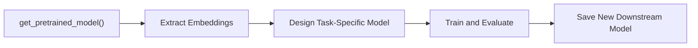
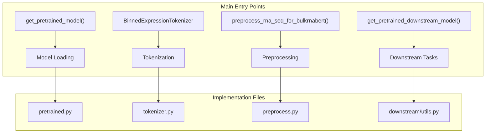

# Development and Contribution

<details>
<summary>Relevant source files</summary>

The following files were used as context for generating this wiki page:

- [.gitignore](.gitignore)
- [.pre-commit-config.yaml](.pre-commit-config.yaml)
- [LICENSE.md](LICENSE.md)
- [README.md](README.md)

</details>


## Purpose and Scope

This page provides essential information for developers who want to contribute to or extend the BulkRNABert codebase. It covers development setup, code quality standards, workflow, and contribution guidelines. For information on using the pretrained models, see [Overview](#1) and [Model Loading and Inference](#3.2).

## Repository Setup

To start developing or contributing to BulkRNABert, follow these steps:

1. Clone the repository:
   ```bash
   git clone https://github.com/instadeepai/multiomics-open-research.git
   cd multiomics-open-research
   ```

2. Install the package in development mode:
   ```bash
   pip install -e .
   ```

3. Install development tools and pre-commit hooks:
   ```bash
   pip install pre-commit
   pre-commit install
   ```

Sources: [README.md:13-16](), [.pre-commit-config.yaml:1-45]()

## Development Workflow

### Code Structure

The following diagram illustrates the high-level structure of the codebase and the main components developers might work with:



Sources: [README.md:11-53]()

### Development Process

The diagram below outlines the recommended development workflow for contributing to the BulkRNABert project:



Sources: [.pre-commit-config.yaml:1-45]()

## Code Quality Standards

The BulkRNABert project enforces strict code quality standards through automated checks. The following diagram shows the relationship between code changes and quality checks:



### Code Formatting and Linting

The project uses the following tools for code quality:

| Tool | Purpose | Configuration |
|------|---------|--------------|
| isort | Import sorting | Profile: black |
| black | Code formatting | Default settings |
| flake8 | Linting | Max line length: 88, Extended ignore: E203 |
| mypy | Type checking | Default settings |
| nbstripout | Cleaning notebook outputs | Default settings |
| pre-commit-hooks | General checks | merge conflict, EOF, trailing whitespace |

Sources: [.pre-commit-config.yaml:1-45]()

## Extending BulkRNABert

BulkRNABert is designed to be extensible. Here are the main components that you might want to extend:



### Using BulkRNABert in New Downstream Tasks

To use BulkRNABert for a new downstream task, you typically need to:

1. Load the pretrained model
2. Extract embeddings
3. Train a task-specific model

Here's a diagram showing the typical workflow for extending with new downstream tasks:



Sources: [README.md:19-48]()

## License and Attribution

BulkRNABert is released under the Creative Commons Attribution-NonCommercial-ShareAlike 4.0 International License (CC BY-NC-SA 4.0). This license allows:

- Sharing and adaptation for non-commercial purposes
- Attribution to the original authors
- Sharing adaptations under the same license

When contributing to or extending BulkRNABert, ensure that your work:

1. Maintains the same license
2. Includes appropriate attribution to the original work
3. Is not used for commercial purposes without explicit permission

Additionally, when using BulkRNABert in academic work, please cite the associated paper as mentioned in the README.

Sources: [LICENSE.md:1-438](), [README.md:75-90]()

## Code Entry Points

The following diagram illustrates the main entry points for developers looking to contribute to or extend BulkRNABert:



Sources: [README.md:25-46]()

## Contribution Best Practices

When contributing to BulkRNABert, consider the following best practices:

1. **Documentation**: Include docstrings for all functions and classes
2. **Testing**: Add tests for new functionality
3. **Type Hints**: Use Python type hints for better code quality
4. **Modularity**: Keep components modular to facilitate reuse and extension
5. **Reproducibility**: Ensure that random seeds are set for reproducible results
6. **Dependencies**: Minimize dependencies to maintain portability

Sources: [.pre-commit-config.yaml:1-45](), [README.md:13-16]()

## Troubleshooting Development Issues

Common development issues and their solutions:

| Issue | Solution |
|-------|----------|
| Pre-commit hooks failing | Run `pre-commit run --all-files` to see detailed errors |
| Import errors after adding new modules | Make sure __init__.py files are properly set up |
| Type checking issues | Add appropriate type hints or use Any where necessary |
| Model loading errors | Check checkpoint paths and ensure model architecture matches |

Sources: [.pre-commit-config.yaml:1-45](), [README.md:29-33]()