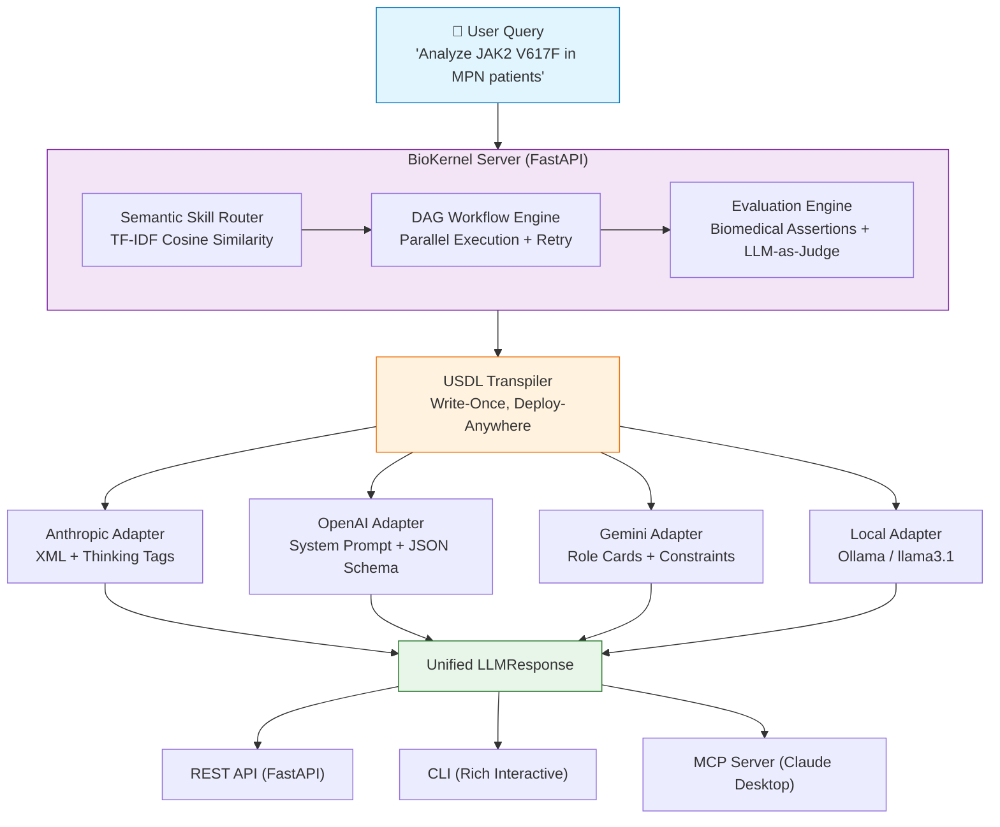

Welcome to the **Universal Biomedical Skills & Agents** platform — a Biomedical Operating System (BioOS) that transforms static scientific scripts into autonomous, agentic AI workflows. If you have ever wished that a single natural-language query could seamlessly route through 886 curated biomedical skills, execute across multiple LLM providers, and return validated results with safety checks, this is the project that makes it possible. This overview will orient you to the platform's purpose, its core architecture, and how the major components connect — giving you the conceptual map you need before diving into any specific subsystem.

Sources: [README.md](/README.md#L23-L28), [Skills/README.md](/Skills/README.md#L23-L27)

## What Is This Project?

At its heart, this repository is a **Biomedical Operating System** — a runtime platform that orchestrates a comprehensive library of skills, agents, and mathematical foundations for modern AI-driven life science research. Unlike traditional bioinformatics toolkits that require manual scripting for every pipeline step, this system transforms static scripts into **Agentic Workflows**: autonomous systems that plan, execute, use tools, and self-correct to solve complex scientific problems. The platform is designed to support high-impact research, clinical decision support, and automated laboratory operations — all accessible through a unified interface that works identically whether you are querying from a CLI, a REST API, or an MCP-compatible client like Claude Desktop.

Sources: [README.md](/README.md#L23-L28), [biokernel/README.md](/biokernel/README.md#L8-L22)

## The Big Picture: How It All Fits Together

Before examining individual components, it is essential to understand the data flow from the moment a user submits a biomedical query to the moment a validated response returns. The following diagram illustrates the core architecture:



The flow works as follows: a natural-language query enters the **BioKernel Server**, where the **Semantic Skill Router** matches it against 886 registered skills using TF-IDF cosine similarity (no GPU required). The matched skill is then either executed as a single agent call or orchestrated through the **DAG Workflow Engine** for multi-step pipelines. Before execution, the **USDL Transpiler** compiles the skill's canonical specification into a provider-optimized prompt bundle. The chosen **LLM Provider Adapter** (Anthropic, OpenAI, Gemini, or local) executes the query, and the **Evaluation Engine** validates the response against biomedical assertions. Results are returned via REST API, CLI, or MCP protocol.

Sources: [biokernel/README.md](/biokernel/README.md#L31-L65), [biokernel/biokernel/server.py](/biokernel/biokernel/server.py#L74-L115)

## Core Architectural Components

The platform is built on four foundational pillars, each addressing a distinct challenge in biomedical AI orchestration:

| Component | Location | Purpose | Key Technology |
|-----------|----------|---------|----------------|
| **Semantic Skill Router** | `biokernel/biokernel/router.py` | Match natural-language queries to the best skill | TF-IDF + cosine similarity |
| **DAG Workflow Engine** | `biokernel/biokernel/workflow_engine.py` | Execute multi-step agent pipelines | Async topological execution |
| **USDL Transpiler** | `biokernel/optimizer/usdl_transpiler.py` | Compile one skill spec into multi-provider formats | Provider-specific prompt compilation |
| **Evaluation Engine** | `biokernel/evaluator/eval_engine.py` | Validate outputs with biomedical assertions | Gene entity detection, safety checks, citation verification |

> [!TIP]
> The Semantic Skill Router runs in pure Python with no GPU dependency — it uses TF-IDF vectorization and cosine similarity with a default threshold of 0.35. This design choice ensures the platform can be deployed in resource-constrained environments while still providing substantially better routing than keyword matching alone.

Sources: [biokernel/biokernel/router.py](/biokernel/biokernel/router.py#L1-L15), [biokernel/biokernel/workflow_engine.py](/biokernel/biokernel/workflow_engine.py#L1-L15), [biokernel/optimizer/usdl_transpiler.py](/biokernel/optimizer/usdl_transpiler.py#L1-L13), [biokernel/evaluator/eval_engine.py](/biokernel/evaluator/eval_engine.py#L1-L15)

## The Skills Ecosystem

The `Skills/` directory is the heart of the platform's knowledge — a curated collection of **886 biomedical AI skills** spanning 59+ domains. Each skill is defined using the **SKILL.md** standard, which makes capabilities discoverable, self-documenting, and executable by AI agents. Skills are organized into domain-specific directories:

| Domain | Directory | Featured Agents |
|--------|-----------|-----------------|
| **Genomics & Bioinformatics** | `Skills/Genomics/` | BioMaster (multi-pipeline orchestrator), CellAgent (single-cell QC), STAgent (spatial transcriptomics) |
| **Clinical & Operations** | `Skills/Clinical/` | ChatEHR (patient record assistant), TrialGPT (patient-to-trial matching), RadGPT (radiology reports) |
| **Drug Discovery & Chemistry** | `Skills/Drug_Discovery/` | MAGE (antibody design), CheMatAgent (computational chemistry), Medea (omics-driven discovery) |
| **Knowledge & Research** | `Skills/Research_Tools/` | KRAGEN (knowledge-graph RAG), LEADS (systematic review), Biomni (150+ tools) |
| **Agentic AI** | `Skills/Agentic_AI/` | DeepResearch Swarm, Claude Code Operations, Computer Use Agents |
| **MCP Servers** | `Skills/MCP_Servers/` | BioMCP (PubMed, ClinicalTrials.gov), MCPmed (GEO, STRING) |

Every skill follows the same structural pattern — a `SKILL.md` definition file (required), an optional implementation script (`impl.py`), and an optional `references/` directory for supporting documentation. This uniformity is what enables the BioKernel to discover and route to any skill automatically.

Sources: [README.md](/README.md#L96-L106), [Skills/README.md](/Skills/README.md#L87-L97), [skills_catalog.json](/skills_catalog.json#L1-L6), [Skills/TUTORIAL_ADDING_NEW_SKILLS.md](/Skills/TUTORIAL_ADDING_NEW_SKILLS.md#L27-L35)

## The SKILL.md Standard

The **SKILL.md** standard is the lingua franca of this platform — the metadata format that makes every skill discoverable by the BioKernel router. A SKILL.md file combines YAML frontmatter for machine-readable metadata with Markdown body for operational instructions. The frontmatter captures the skill name, description, allowed tools, and compatibility constraints, while the body provides the workflow steps an agent should follow. When the BioKernel starts, it recursively scans all configured skill paths for `SKILL.md` files and `*_agent.py` scripts, parsing each into a `SkillMetadata` object that feeds the routing index. This design means adding a new capability to the platform is as simple as writing a correctly formatted SKILL.md file in the right directory.

```text
Skills/
└── Domain_Name/
    └── Skill_Name/
        ├── SKILL.md          # The Definition (Required)
        ├── impl.py           # The Implementation (Optional)
        └── references/       # Supporting docs (Optional)
```

Sources: [Skills/TUTORIAL_ADDING_NEW_SKILLS.md](/Skills/TUTORIAL_ADDING_NEW_SKILLS.md#L16-L35), [biokernel/biokernel/server.py](/biokernel/biokernel/server.py#L157-L197)

## Cross-Provider Abstraction: USDL

A central challenge in multi-LLM platforms is that each provider speaks a different prompt dialect — Anthropic expects XML-structured prompts with thinking blocks, OpenAI uses system/user messages with function schemas, and Gemini prefers role cards with structured context. The **Universal Skill Description Language (USDL)** solves this by providing a canonical, model-agnostic schema for defining biomedical skills. You write a skill spec once in USDL, and the transpiler compiles it into provider-specific artifacts:

| Provider | Compiled Artifact |
|----------|-------------------|
| **OpenAI** | System prompt + JSON schema bundle for ChatGPT Health / function calling |
| **Anthropic** | Claude coworker transcript template with `<thinking>/<analysis>/<decision>` XML tags |
| **Gemini** | Role card + output constraints tuned for long-context reasoning |

This "write-once, deploy-anywhere" approach ensures that a single skill definition stays in sync across all LLM backends — a critical property for maintaining auditability and safety compliance in clinical settings.

Sources: [docs/USDL_OVERVIEW.md](/docs/USDL_OVERVIEW.md#L14-L43), [biokernel/optimizer/usdl_transpiler.py](/biokernel/optimizer/usdl_transpiler.py#L132-L157)

## Execution Modes

The BioKernel supports three execution modes that cater to different usage patterns, from production APIs to exploratory research sessions:

| Mode | How It Works | Best For |
|------|-------------|----------|
| **Autonomous** | Automatic routing + execution — the system selects the best skill and runs it | Production APIs, batch processing, CI/CD pipelines |
| **Interactive** | User selects from ranked skill matches presented by the router | Exploratory research, learning the platform |
| **Manual** | User specifies an exact `skill_id` to bypass routing entirely | Debugging, benchmarking, targeted evaluation |

> [!TIP]
> When using Autonomous mode, the router's fallback chain tries Anthropic → OpenAI → Gemini → Local in sequence if your preferred provider is unavailable. Configure `default_provider` in `config.yaml` to set your preference, but always set at least one API key environment variable to avoid a "No LLM providers available" error.

Sources: [biokernel/README.md](/biokernel/README.md#L169-L178), [biokernel/biokernel/server.py](/biokernel/biokernel/server.py#L136-L153), [biokernel/config.yaml](/biokernel/config.yaml#L7-L33)

## Project Directory Map

Understanding where things live is the first step to working effectively with this codebase. Here is the top-level structure with the role of each major directory:

```text
.
├── Skills/                     # 886 biomedical AI skill definitions
│   ├── Genomics/               # Single-cell, spatial, CRISPR, variant interpretation
│   ├── Clinical/               # EHR, radiology, oncology, trial matching
│   ├── Drug_Discovery/         # Antibody design, chemistry, molecule design
│   ├── Agentic_AI/             # Orchestrators, swarms, planning agents
│   ├── MCP_Servers/            # Model Context Protocol servers (BioMCP, MCPmed)
│   ├── Research_Tools/         # Biomni, literature mining, knowledge graphs
│   └── TUTORIAL_ADDING_NEW_SKILLS.md  # Guide for contributing new skills
│
├── biokernel/                  # BioKernel Runtime Platform (v2026.4.0)
│   ├── biokernel/              # Core: server, router, workflow engine, MCP server
│   ├── adapters/               # LLM provider adapters (Anthropic, OpenAI, Gemini, Local)
│   ├── interface/              # Abstract LLMProvider base class
│   ├── schema/                 # Pydantic type system (io_types.py)
│   ├── optimizer/              # USDL transpiler + meta-prompter
│   ├── evaluator/              # Assertion + LLM-judge evaluation engine
│   └── tests/                  # 74+ tests across all components
│
├── docs/                       # Documentation hub
│   ├── architecture/           # Repository maps + onboarding guides
│   ├── operations/             # Runbooks and stack documentation
│   ├── standards/              # USDL specification and governance
│   └── strategy/               # LLM curation playbook, platform strategy
│
├── tests/                      # Integration tests + scRNA-seq analysis scripts
├── skills_catalog.json         # Auto-generated catalog of all 886 skills
└── skills_reliability_report.json  # Skill reliability assessment data
```

Sources: [README.md](/README.md#L95-L122), [biokernel/README.md](/biokernel/README.md#L192-L229)

## Configuration at a Glance

The platform is configured through `biokernel/config.yaml`, which controls provider selection, routing thresholds, workflow timeouts, and safety checks. Here are the key configuration knobs you should know about:

| Section | Key Setting | Default | What It Controls |
|---------|------------|---------|------------------|
| `default_provider` | — | `anthropic` | Which LLM provider to use when none is specified |
| `providers.*.model` | — | Varies | Model identifier per provider (e.g., `claude-sonnet-4-20250514`, `gpt-4o`) |
| `routing.strategy` | — | `semantic` | Routing algorithm: `semantic`, `keyword`, or `hybrid` |
| `routing.similarity_threshold` | — | `0.35` | Minimum cosine similarity for a skill match |
| `workflow.retry_count` | — | `2` | Number of retries per failed workflow step |
| `evaluation.pass_threshold` | — | `0.80` | Minimum score for an evaluation case to pass |
| `evaluation.safety_pass_threshold` | — | `0.95` | Minimum safety score (stricter than general) |

Sources: [biokernel/config.yaml](/biokernel/config.yaml#L1-L76)

## Where to Go Next

Now that you understand the platform's architecture and how its components interconnect, here is the recommended reading path through the documentation:

1. **[Quick Start](2-quick-start)** — Install the platform and run your first biomedical query in under 5 minutes
2. **[SKILL.md Standard](3-skill-md-standard)** — Learn the metadata format that makes every skill discoverable
3. **[Architecture Overview](4-architecture-overview)** — Deep dive into the BioKernel runtime and data flow
4. **Domain-specific pages** — Explore [Genomics and Single-Cell Agents](10-genomics-and-single-cell-agents), [Clinical Decision Support Agents](11-clinical-decision-support-agents), or [Drug Discovery and Chemistry Agents](12-drug-discovery-and-chemistry-agents) based on your research focus
5. **[Adding New Skills](17-adding-new-skills)** — Contribute your own capabilities to the platform

For the fastest path to productivity, start with [Quick Start](2-quick-start) and return here whenever you need to re-orient within the broader architecture.
