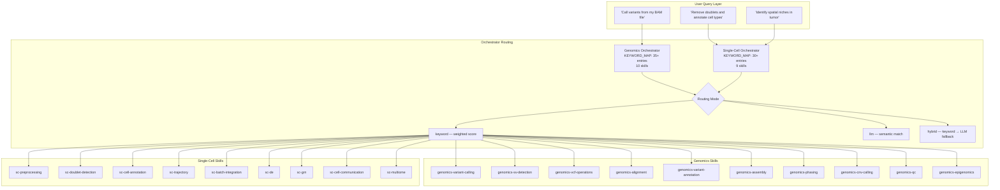
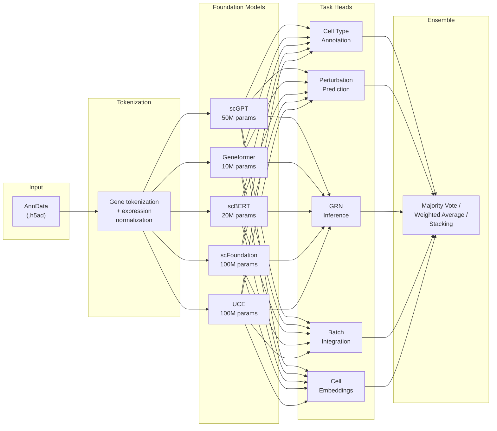
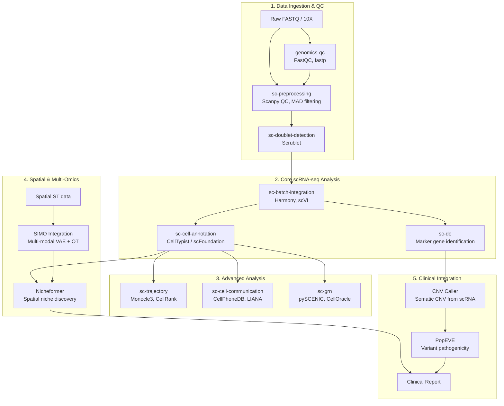

The genomics and single-cell agent ecosystem represents the most expansive domain within the Universal Biomedical Skills platform, spanning over 50 individual skills and 12 specialized AI agents that collectively cover the entire continuum from raw sequencing reads to spatially resolved multi-omics tissue atlases. This domain is organized around two **orchestrators** — one for bulk genomics pipelines and one for single-cell workflows — that route natural language queries to the appropriate skill using keyword-weighted scoring and optional LLM-based semantic matching. The architecture follows a consistent pattern: each agent exposes a `SKILL.md` manifest declaring its capabilities, measurable outcomes, and guardrails; an orchestrator decomposes user intent into skill invocations; and the BioKernel's DAG engine executes the resulting workflow with traceability and safety checks.

## Architecture: Dual-Orchestrator Routing Model

The genomics and single-cell domain is governed by two independent but interoperable orchestrators. The **Genomics Orchestrator** manages bulk sequencing workflows — variant calling, alignment, VCF operations, CNV detection, and epigenomics — while the **Single-Cell Orchestrator** handles scRNA-seq preprocessing, batch integration, trajectory inference, cell communication, and multi-ome analysis. Both orchestrators share an identical routing architecture: a `KEYWORD_MAP` dictionary maps domain-specific terms to skill identifiers, a `route_query()` function scores candidate skills by cumulative keyword length, and a `route_query_with_mode()` function optionally delegates to an LLM-based router for semantic disambiguation. When no keywords match, the Genomics Orchestrator falls back to `genomics-qc` and the Single-Cell Orchestrator falls back to `sc-preprocessing`, ensuring every query produces a deterministic result.

The routing algorithm uses **cumulative keyword length** as a scoring heuristic: for each keyword present in the lowercased query, the matched skill accumulates a score equal to the keyword's character length. The skill with the highest score wins, and confidence is computed as `min(1.0, score / 20.0)`. This design intentionally biases toward longer, more specific keywords (e.g., "structural variant" scores 19 points vs. "snp" scoring 3 points), reducing ambiguity when queries contain multiple overlapping terms.

Sources: [genomics_orchestrator.py](Skills/Genomics/orchestrator/genomics_orchestrator.py#L56-L101), [sc_orchestrator.py](Skills/Transcriptomics/orchestrator/sc_orchestrator.py#L51-L98)

## Genomics Skill Landscape

The Genomics Orchestrator routes queries across 10 canonical skills covering the complete bulk sequencing analysis pipeline. Each skill has both a `SKILL.md` manifest and a Python implementation file, enabling both LLM-guided and programmatic invocation. The following table summarizes the full skill catalog with their routing keywords and primary tools.

| Skill | Description | Primary Tools | Key Routing Keywords |
|-------|-------------|---------------|---------------------|
| `genomics-qc` | Sequencing QC and adapter trimming | FastQC, MultiQC, fastp | quality control, qc, fastqc, fastp |
| `genomics-alignment` | Short/long read alignment | BWA-MEM, Bowtie2, Minimap2 | alignment, align reads, bwa, bowtie, minimap |
| `genomics-variant-calling` | Germline/somatic variant calling | GATK, DeepVariant, FreeBayes | variant call, snp, indel, gatk, deepvariant |
| `genomics-sv-detection` | Structural variant calling | Manta, Lumpy, Delly, Sniffles | structural variant, sv detection, manta, lumpy |
| `genomics-cnv-calling` | Copy number variation analysis | CNVkit, Control-FREEC, GATK gCNV | cnv, copy number, cnvkit |
| `genomics-vcf-operations` | VCF manipulation and filtering | bcftools, GATK SelectVariants | vcf, filter vcf, merge vcf, bcftools |
| `genomics-variant-annotation` | Variant functional annotation | VEP, snpEff, ANNOVAR | variant annotation, annotate variants, vep, snpeff, annovar |
| `genomics-assembly` | De novo genome assembly | SPAdes, Megahit, Flye, Canu | assembly, genome assembly, spades, flye |
| `genomics-epigenomics` | ChIP-seq/ATAC-seq peak calling | MACS2, Homer | chip-seq, atac-seq, peak calling, macs2 |
| `genomics-phasing` | Haplotype phasing | WhatsHap, SHAPEIT, Eagle | phasing, haplotype, whatshap, shapeit |

Beyond the orchestrator-routed skills, the Genomics domain contains a deep taxonomy of sub-skills organized into standalone directories: `genome-assembly/` (8 sub-skills spanning HiFi assembly to contamination detection), `genome-engineering/` (5 sub-skills covering gRNA design through prime editing), `genome-intervals/` (7 sub-skills for BED/BIGWIG/GTF operations), `crispr-screens/` (8 sub-skills from library design to hit calling), `copy-number/` (4 sub-skills for CNV annotation and visualization), `phasing-imputation/` (4 sub-skills), and `long-read-sequencing/` (8 sub-skills from basecalling to structural variant detection). These sub-skills each follow the `SKILL.md` + `examples/` + `usage-guide.md` convention and are individually addressable by the BioKernel's semantic router.

Sources: [genomics_orchestrator.py](Skills/Genomics/orchestrator/genomics_orchestrator.py#L34-L55), [Genomics directory structure](Skills/Genomics)

## Single-Cell Skill Landscape

The Single-Cell Orchestrator manages 9 core skills that span the standard scRNA-seq analysis pipeline, from raw count matrices through biological interpretation. The skill set is designed to mirror the canonical Scanpy/Seurat workflow while extending into emerging modalities like multi-ome integration and gene regulatory network inference.

| Skill | Description | Primary Tools | Key Routing Keywords |
|-------|-------------|---------------|---------------------|
| `sc-preprocessing` | QC, normalization, HVG, PCA/UMAP, Leiden clustering | Scanpy, Seurat, SCTransform | preprocess, qc, normalize, clustering, single cell |
| `sc-doublet-detection` | Doublet detection and removal | Scrublet, scDblFinder, DoubletFinder | doublet, scrublet, doubletfinder, remove doublets |
| `sc-cell-annotation` | Cell type annotation | CellTypist, SingleR, scANVI, GARNET | cell type, annotation, celltypist, singler, annotate |
| `sc-trajectory` | Trajectory inference and pseudotime | Monocle3, Slingshot, CellRank | trajectory, pseudotime, monocle, slingshot, cellrank |
| `sc-batch-integration` | Multi-sample batch correction | Harmony, scVI, BBKNN | integration, batch correction, harmony, scvi, integrate |
| `sc-de` | Differential expression | Wilcoxon, MAST, pseudobulk PyDESeq2 | differential expression, de analysis, marker genes, wilcoxon |
| `sc-grn` | Gene regulatory network inference | pySCENIC, CellOracle | grn, gene regulatory, scenic, celloracle |
| `sc-cell-communication` | Cell-cell communication | CellPhoneDB, LIANA+, NicheNet | cell communication, ligand receptor, cellphonedb, nichenet |
| `sc-multiome` | Paired multi-omics integration | WNN, MOFA+, scVI-tools | multiome, cite-seq, atac, wnn |

The single-cell domain also contains a rich sub-skill taxonomy under `Skills/Genomics/Single_Cell/` with 22 categorized sub-directories covering everything from `data-io` and `preprocessing` through `metabolite-communication` and `perturb-seq` to `lineage-tracing`. The `scverse_Ecosystem/` and `Seurat_Ecosystem/` directories provide framework-specific entry points, while `Tool_Database.md` catalogs the full inventory of supported tools across both Python and R ecosystems.

Sources: [sc_orchestrator.py](Skills/Transcriptomics/orchestrator/sc_orchestrator.py#L30-L49), [Single_Cell README.md](Skills/Genomics/Single_Cell/README.md#L1-L96)

## Specialized AI Agents

Beyond the orchestrator-routed skills, the platform includes 12 **specialized AI agents** that deliver domain-specific intelligence for complex analytical tasks. These agents are distinguished from skills by their use of foundation models, multi-step planning, and autonomous code generation. The following table provides a comparative overview.

| Agent | Domain | Foundation Model | Key Capability | GPU Required |
|-------|--------|-----------------|----------------|--------------|
| **scFoundation Model Agent** | scRNA-seq | scGPT, Geneformer, scBERT, UCE | Cross-species annotation, perturbation prediction | 16GB+ VRAM |
| **CellAgent** | Cell annotation | LLM (multi-provider) | Multi-agent planning, self-correcting code generation | No |
| **BioStudio Alpha SC** | GPU-accelerated scRNA | BioTuring Alpha SC | 10-30× GPU speedup, Blackwell-class acceleration | Blackwell/Hopper GPU |
| **CompBioAgent** | Interactive exploration | LLM + Cellxgene VIP | Natural language querying, web-based visualization | No |
| **CNV Caller Agent** | Cancer genomics | Deep learning segmentation | Somatic/germline CNV, purity/ploidy estimation | No |
| **CRISPR Design Agent** | Genome engineering | DeepCRISPR, CFD scoring | sgRNA selection, off-target evaluation, oligo generation | No |
| **RNA Velocity Agent** | scRNA dynamics | scVelo dynamical, veloVI | Differentiation trajectory prediction, driver gene ID | GPU recommended |
| **Nicheformer Spatial Agent** | Spatial transcriptomics | Nicheformer (53M+ cells) | Spatial niche discovery, zero-shot annotation | 16GB+ VRAM |
| **Epigenomics MethylGPT Agent** | DNA methylation | MethylGPT, DiffuCpG | DMR detection, cancer epigenome profiling | No |
| **PopEVE Variant Predictor** | Variant pathogenicity | PopEVE (Harvard) | VUS resolution, population-aware scoring | No |
| **Cell-Free RNA Agent** | Liquid biopsy | Gradient boosting, neural nets | Cancer detection from cfRNA, tissue deconvolution | No |
| **SIMO Integration Agent** | Spatial multi-omics | Multi-modal VAE, optimal transport | Spatial-epigenomic integration, niche discovery | GPU recommended |

> [!TIP]
> When selecting an agent for a task, start with the orchestrator's routing output to identify the base skill, then evaluate whether the task requires foundation model inference (e.g., cross-species annotation → scFoundation Model Agent) or can be handled by traditional tools (e.g., standard QC → sc-preprocessing). The foundation model agents are computationally expensive and should be reserved for tasks that genuinely benefit from transfer learning.

Sources: [scFoundation Model Agent SKILL.md](Skills/Genomics/scFoundation_Model_Agent/SKILL.md#L1-L210), [CellAgent SKILL.md](Skills/Genomics/Single_Cell/CellAgent/SKILL.md#L1-L69), [BioStudio Alpha SC SKILL.md](Skills/Genomics/Single_Cell/BioStudio_Alpha_SC/SKILL.md#L1-L95), [CompBioAgent SKILL.md](Skills/Genomics/Single_Cell/CompBioAgent/SKILL.md#L1-L67), [CNV Caller Agent SKILL.md](Skills/Genomics/CNV_Caller_Agent/SKILL.md#L1-L171), [CRISPR Design Agent SKILL.md](Skills/Genomics/CRISPR_Design_Agent/SKILL.md#L1-L72), [RNA Velocity Agent SKILL.md](Skills/Genomics/RNA_Velocity_Agent/SKILL.md#L1-L174), [Nicheformer Spatial Agent SKILL.md](Skills/Genomics/Nicheformer_Spatial_Agent/SKILL.md#L1-L197), [Epigenomics MethylGPT Agent SKILL.md](Skills/Genomics/Epigenomics_MethylGPT_Agent/SKILL.md#L1-L111), [PopEVE Variant Predictor SKILL.md](Skills/Genomics/PopEVE_Variant_Predictor_Agent/SKILL.md#L1-L213), [CellFree RNA Agent SKILL.md](Skills/Genomics/CellFree_RNA_Agent/SKILL.md#L1-L182), [SIMO Integration Agent SKILL.md](Skills/Genomics/SIMO_Multiomics_Integration_Agent/SKILL.md#L1-L178)

## Foundation Model Ecosystem for Single-Cell Analysis

The scFoundation Model Agent serves as the unified gateway to six transformer-based foundation models trained on tens of millions of single-cell profiles. These models share a common architectural paradigm — gene-level tokenization, masked expression prediction pretraining, and attention-based gene interaction modeling — but differ in training data composition, parameter count, and task specialization. The following comparison guides model selection.

| Model | Parameters | Training Data | Best For | Perturbation R² | Annotation Accuracy |
|-------|-----------|---------------|----------|-----------------|-------------------|
| scGPT | 50M | 33M human cells | General purpose, perturbations | 0.87 (Norman 2019) | 93% (Tabula Sapiens) |
| Geneformer | 10M | 30M cells | Chromatin, gene networks | — | 91% (HLCA) |
| scBERT | 20M | 1.2M cells | Cell type annotation | — | — |
| scFoundation | 100M | 50M cells | Large-scale, multi-species | — | — |
| scTab | 15M | 22M cells | Tabular classification | — | — |
| UCE | 100M | 36M cells | Cross-species transfer | — | 85% F1 (Human→Mouse) |

The agent supports five task modes — `annotation`, `perturbation`, `grn_inference`, `integration`, and `embedding` — each with model-specific command-line arguments. For annotation, the workflow accepts a query AnnData object and a reference atlas, generates embeddings for both, and transfers labels via nearest-neighbor matching in the shared embedding space. For perturbation prediction, the model takes a gene knockout specification and produces a counterfactual expression profile. For GRN inference, attention patterns are decomposed into transcription-factor-to-target edge weights.

> [!TIP]
> Gene coverage is the most common failure mode for foundation model agents. Before invoking any model, verify that the model's training gene set overlaps sufficiently with your dataset's expressed genes. Models trained on human-only data (scGPT, scBERT) will fail silently on mouse data unless you use UCE, which was explicitly designed for cross-species transfer with species-agnostic embeddings.

Sources: [scFoundation Model Agent SKILL.md](Skills/Genomics/scFoundation_Model_Agent/SKILL.md#L59-L96), [scFoundation Model Agent SKILL.md](Skills/Genomics/scFoundation_Model_Agent/SKILL.md#L146-L178)

## Single-Cell QC Pipeline

The **Single-Cell RNA QC** skill implements a MAD (Median Absolute Deviation) based quality control workflow that serves as the mandatory entry point for all downstream single-cell analyses. It accepts `.h5ad`, 10x `.h5`, or 10x directory inputs, computes mitochondrial and ribosomal gene metrics, applies configurable MAD thresholds for cell filtering, and generates before/after visualization plots alongside a `qc_summary.json` artifact. The workflow is deliberately scoped to QC only — doublet detection and batch correction remain separate skills to enforce modularity and reproducibility.

The QC pipeline is implemented across three modules: `qc_core.py` provides the filtering logic and metric computation, `qc_analysis.py` exposes the CLI interface and orchestrates the workflow, and `qc_plotting.py` generates the standard before/after metric visualizations with threshold overlays. The `reliability` field in the SKILL.md manifest explicitly scores the pipeline against the Scanpy repository (0.90) and the Theis Lab single-cell best-practices playbook (0.88), providing auditable provenance for the MAD-based threshold methodology.

| QC Parameter | Default | Description |
|-------------|---------|-------------|
| `mad_counts` | 5 | MAD multiplier for total counts filter |
| `mad_genes` | 5 | MAD multiplier for gene count filter |
| `mt_threshold` | 20% | Hard mitochondrial percentage ceiling |
| `min_cells` | 3 | Minimum cells expressing a gene |
| `log1p` | true | Apply log1p transform after scaling |

Sources: [Single_Cell_RNA_QC SKILL.md](Skills/Genomics/Single_Cell_RNA_QC/SKILL.md#L1-L54), [qc_core.py](Skills/Genomics/Single_Cell_RNA_QC/qc_core.py#L1-L1)

## Spatial and Multi-Omics Agent Integration

The spatial transcriptomics and multi-omics integration agents represent the frontier of the platform's analytical capabilities, bridging single-cell resolution with tissue-level architecture. The **Nicheformer Spatial Agent** leverages a foundation model pretrained on 53 million spatially resolved cells, using a dual-encoder architecture (expression transformer + spatial graph attention) fused via cross-attention to produce spatial-context-aware embeddings. The **SIMO Multiomics Integration Agent** takes a complementary probabilistic approach, using variational autoencoders and optimal transport to align disparate modalities — scRNA-seq, scATAC-seq, scMethylation, and CITE-seq protein — onto shared spatial coordinates.

The two agents are designed to interoperate: Nicheformer provides the spatial embedding and niche discovery layer, while SIMO provides the multi-modal alignment and uncertainty quantification. A typical combined workflow first runs SIMO to integrate scATAC-seq chromatin accessibility data with spatial transcriptomics, then feeds the integrated spatial multi-omics object into Nicheformer for spatially-aware niche clustering. The following table summarizes the supported spatial platforms across both agents.

| Platform | Resolution | Cells/Spots | Gene Coverage | Nicheformer | SIMO |
|----------|-----------|-------------|---------------|-------------|------|
| 10x Xenium | Subcellular | >100K | 300-5,000 panel | ✓ | ✓ |
| MERFISH | Subcellular | >1M | 100-10,000 panel | ✓ | ✓ |
| CosMx | Subcellular | >1M | 1,000-6,000 panel | ✓ | ✓ |
| 10x Visium | 55 μm spot | ~5K | Whole transcriptome | ✓ | ✓ |
| 10x Visium HD | 8 μm spot | ~300K | Whole transcriptome | ✓ | ✓ |
| Slide-seq | 10 μm bead | ~60K | Whole transcriptome | ✓ | ✓ |

Sources: [Nicheformer Spatial Agent SKILL.md](Skills/Genomics/Nicheformer_Spatial_Agent/SKILL.md#L53-L95), [SIMO Integration Agent SKILL.md](Skills/Genomics/SIMO_Multiomics_Integration_Agent/SKILL.md#L48-L110)

## Variant Analysis and Clinical Genomics Agents

Three agents form the clinical genomics axis: the **CNV Caller Agent** for copy number alteration detection, the **PopEVE Variant Predictor** for missense variant pathogenicity scoring, and the **Epigenomics MethylGPT Agent** for DNA methylation analysis. These agents address distinct clinical scenarios but share a common design principle: they augment traditional statistical methods with deep learning models that capture patterns inaccessible to conventional pipelines.

The CNV Caller Agent supports six calling methods (FACETS, ASCAT, CNVkit, GATK CNV, PURPLE, CONICS) and produces allele-specific copy number calls with purity/ploidy estimation. Its AI/ML enhancements focus on three areas: deep learning segmentation for improved breakpoint detection in low-coverage data, sample quality prediction with artifact detection, and GISTIC-style driver prioritization with functional impact scoring. The PopEVE Variant Predictor integrates four feature modules — evolutionary (UniRef90, 250M sequences), structural (AlphaFold2, 200M+ structures), population (gnomAD, 800K+ individuals), and clinical (ClinVar, 100K+ classifications) — achieving an AUROC of 0.95 on ClinVar benchmarks and resolving 45% of VUS cases. The Epigenomics MethylGPT Agent combines a transformer-based foundation model for methylation state prediction with a DiffuCpG generative model for missing data imputation, supporting WGBS, RRBS, and Illumina array (450K, EPIC) platforms.

| Agent | Clinical Application | AI Enhancement | Key Metric |
|-------|---------------------|----------------|------------|
| CNV Caller | Tumor somatic CNV, rare disease germline | DL segmentation, driver prioritization | Purity/ploidy estimation |
| PopEVE | Rare disease VUS resolution | Multi-modal deep learning (evo+struct+pop) | 0.95 AUROC, 45% VUS resolution |
| MethylGPT | Cancer epigenome profiling | Transformer + diffusion imputation | Single-base DMR resolution |

Sources: [CNV Caller Agent SKILL.md](Skills/Genomics/CNV_Caller_Agent/SKILL.md#L52-L122), [PopEVE Variant Predictor SKILL.md](Skills/Genomics/PopEVE_Variant_Predictor_Agent/SKILL.md#L50-L145), [Epigenomics MethylGPT Agent SKILL.md](Skills/Genomics/Epigenomics_MethylGPT_Agent/SKILL.md#L37-L95)

## Liquid Biopsy and Cell-Free RNA

The **Cell-Free RNA Agent** extends the genomics domain into non-invasive diagnostics, analyzing circulating cfRNA from plasma for cancer detection, tissue-of-origin identification, and transcriptomic profiling. Unlike cfDNA-based liquid biopsy (which captures genomic mutations and methylation), cfRNA captures the **active transcriptional state** of source tissues, enabling real-time monitoring of gene expression changes. The agent implements tissue deconvolution using GTEx reference transcriptomes and single-cell atlases, cancer detection via gradient boosting classifiers operating on gene panels, and multi-analyte integration with cfDNA for combined genomic-transcriptomic biomarker panels.

The cfRNA analysis pipeline requires careful attention to pre-analytical variables: sample collection must use EDTA or cell-stabilizing tubes, processing must complete within 4 hours, and hemolysis avoidance is critical since red blood cell lysis introduces confounding transcripts. The agent's cancer detection performance varies by cancer type, with lung cancer achieving AUC 0.80-0.90 using marker panels including XIST and MALAT1, while prostate cancer detection leverages established markers PCA3 and TMPRSS2-ERG.

Sources: [CellFree RNA Agent SKILL.md](Skills/Genomics/CellFree_RNA_Agent/SKILL.md#L38-L145)

## End-to-End Workflow: From Raw Data to Biological Insight

The following diagram illustrates a typical end-to-end workflow that chains multiple skills and agents across both orchestrators, demonstrating how a user query like "Analyze my scRNA-seq tumor dataset, integrate with spatial data, and identify tumor microenvironment niches" traverses the full agent ecosystem.

Sources: [sc_orchestrator.py](Skills/Transcriptomics/orchestrator/sc_orchestrator.py#L30-L49), [genomics_orchestrator.py](Skills/Genomics/orchestrator/genomics_orchestrator.py#L34-L55), [Single_Cell README.md](Skills/Genomics/Single_Cell/README.md#L24-L60)

## Next Steps

The genomics and single-cell agents produce variant calls, cell type annotations, and spatial niche assignments that feed directly into clinical and drug discovery workflows. To understand how these outputs are validated and incorporated into decision-making:

- **Clinical integration**: See [Clinical Decision Support Agents](11-clinical-decision-support-agents) for how variant calls and cell annotations are incorporated into diagnostic workflows with ACMG classification and safety assertions.
- **Drug discovery applications**: See [Drug Discovery and Chemistry Agents](12-drug-discovery-and-chemistry-agents) for how CRISPR perturbation predictions and gene regulatory networks inform target identification.
- **Quality assurance**: See [Biomedical Evaluation Framework](13-biomedical-evaluation-framework) for how the `reliability` scores in SKILL.md manifests are computed and how agent outputs are evaluated against gold-standard benchmarks.
- **Adding new skills**: See [Adding New Skills](17-adding-new-skills) for the SKILL.md specification and the process of extending the orchestrator's KEYWORD_MAP with new domain entries.