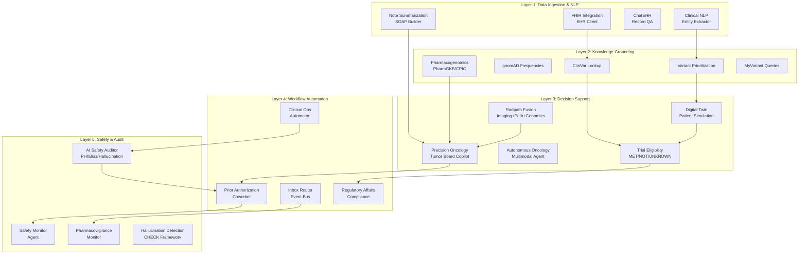
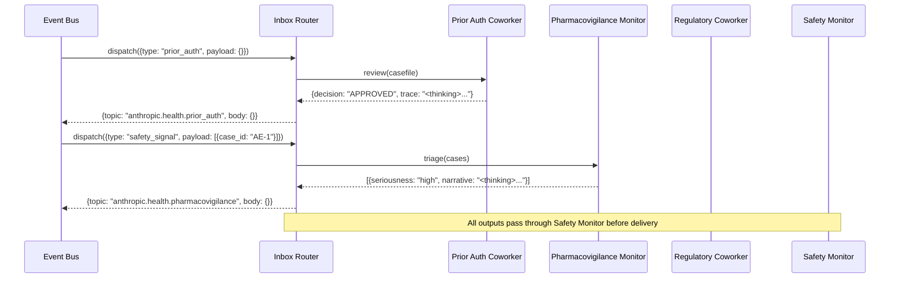

The Clinical Decision Support Agents form the most densely populated domain in the BioKernel skills catalog—a layered system of AI-powered agents that transform raw clinical data into actionable, evidence-anchored decisions. These agents span the full clinical pipeline from unstructured note parsing through pharmacogenomic interpretation, oncology treatment planning, trial eligibility screening, prior authorization automation, and safety auditing. What unifies them is a shared architectural commitment: every agent produces structured, citable output with explicit gap identification rather than opaque recommendations, and every agent operates under guardrails that mark its outputs as advisory—never as autonomous clinical decisions.

## Agent Architecture Overview

The clinical agents are organized into five functional layers that mirror the natural flow of clinical reasoning. Data ingestion and NLP agents parse raw clinical artifacts into structured representations. Knowledge query agents ground those representations against authoritative biomedical databases. Decision support agents synthesize patient-specific evidence into ranked recommendations. Workflow automation agents route those recommendations through administrative and regulatory pipelines. Finally, safety and audit agents intercept all outputs before delivery, enforcing compliance, detecting hallucinations, and scrubbing protected health information.

Sources: [SKILL.md](Skills/Clinical/Clinical_NLP/SKILL.md#L1-L59), [SKILL.md](Skills/Clinical/EHR_FHIR_Integration/SKILL.md#L1-L60), [SKILL.md](Skills/Clinical/Safety/SKILL.md#L1-L56), [SKILL.md](Skills/Clinical/Oncology/Precision_Oncology_Agent/SKILL.md#L1-L53)

## Layer 1: Data Ingestion and NLP Agents

The data ingestion layer converts unstructured clinical artifacts—free-text notes, dictation transcripts, OCR exports—into structured, machine-readable representations that downstream agents can reason over. Three specialized agents handle this transformation, each targeting a different access pattern.

**Clinical NLP Entity Extractor** implements a two-pass extraction architecture. The first pass applies high-precision regex patterns against predefined entity categories (PROBLEM, MEDICATION, PROCEDURE) with built-in negation detection that examines a 20-character lookbehind window for triggers like "no," "denies," "without," and "negative for." The second pass invokes an LLM via the platform's `runtime_adapter` to capture complex or non-canonical entities that regex misses—such as "headache" phrased in clinical jargon. The hybrid design ensures that even when the LLM call fails, the regex pass still returns valid results, making the agent resilient to API outages. [entity_extractor.py](Skills/Clinical/Clinical_NLP/entity_extractor.py#L36-L110)

**Clinical Note Summarization** converts raw clinical text into SOAP-format (Subjective/Objective/Assessment/Plan) summaries with explicit contradiction detection and missing-data surfacing. Its guardrails are strict: the system prompt in `prompt.md` enforces a no-hallucination policy requiring every extracted value to be cross-checked against source text, and any absent finding must be stated as "not provided" rather than inferred. The agent produces both markdown and JSON outputs, with JSON payloads conforming to a schema compatible with downstream FHIR/USDL validators. [SKILL.md](Skills/Clinical/Clinical_Note_Summarization/SKILL.md#L1-L52)

**ChatEHR** provides a natural-language query interface over patient medical records, enabling clinicians to ask questions like "What was the last creatinine level?" or "Summarize the last 3 oncology visits" and receive answers grounded in FHIR-connected data. It operates as both a chart summarizer and a QA engine, with sub-10-second latency targets. [SKILL.md](Skills/Clinical/EHR/ChatEHR/SKILL.md#L1-L67)

**EHR/FHIR Integration** serves as the foundational data access layer. The `fhir_client.py` wraps the `fhirpy` library to provide CLI and programmatic access to any HL7 FHIR R4 server, supporting patient search, clinical data retrieval (Conditions, Observations, MedicationRequests, Procedures), and export to JSON or Pandas-ready formats. All other agents that need EHR data ultimately depend on this client for authenticated FHIR transactions. [fhir_client.py](Skills/Clinical/EHR_FHIR_Integration/fhir_client.py#L30-L90)

| Agent | Input | Output | Key Feature |
|-------|-------|--------|-------------|
| Clinical NLP | Free-text notes | JSON entity list with negation flags | Dual regex+LLM extraction |
| Note Summarization | Raw clinical text | SOAP markdown + JSON | Contradiction & gap detection |
| ChatEHR | NL queries + patient context | Summaries, answers | FHIR-native record access |
| FHIR Integration | FHIR server URL + search params | JSON resource bundles | Universal EHR connectivity |

Sources: [entity_extractor.py](Skills/Clinical/Clinical_NLP/entity_extractor.py#L1-L157), [SKILL.md](Skills/Clinical/Clinical_Note_Summarization/SKILL.md#L1-L52), [fhir_client.py](Skills/Clinical/EHR_FHIR_Integration/fhir_client.py#L1-L105)

## Layer 2: Clinical Database and Knowledge Grounding

Once clinical data is structured, it must be grounded against authoritative biomedical knowledge. The Clinical Databases skill collection provides ten specialized sub-skills that query population genetics, variant interpretation, and pharmacogenomic databases—each designed to be composable so that downstream agents can chain them into multi-evidence pipelines.

**Variant Prioritization** implements ACMG-style filtering with a composite scoring system. Variants are scored across four evidence dimensions: ClinVar pathogenicity (weight 10), population rarity via gnomAD AF < 0.01 (weight 3), CADD phred > 20 (weight 2), and REVEL > 0.5 (weight 2). The scoring weights reflect clinical convention—database-verified pathogenicity dominates, while computational predictions serve as tiebreakers. Inheritance-mode filtering further refines results: autosomal dominant cases filter for rare heterozygous variants (AF < 0.0001), while autosomal recessive cases identify homozygous variants and compound heterozygous candidates by finding genes with two or more heterozygous hits. [SKILL.md](Skills/Clinical/Clinical_Databases/variant-prioritization/SKILL.md#L1-L212)

**Pharmacogenomics** queries PharmGKB and CPIC for drug-gene interactions and translates star allele diplotypes into metabolizer phenotypes using CPIC-defined activity score thresholds. The CYP2D6 interpreter, for example, maps allele pairs to activity scores (e.g., `*1` = 1.0, `*4` = 0.0) and then classifies the sum into Poor Metabolizer (score = 0), Intermediate (0 < score ≤ 1.25), Normal (1.25 < score ≤ 2.25), or Ultrarapid (> 2.25). This enables agents to flag drugs like codeine—which requires CYP2D6 activation—for poor metabolizers who would receive no analgesic benefit, or ultrarapid metabolizers at risk of toxicity. [SKILL.md](Skills/Clinical/Clinical_Databases/pharmacogenomics/SKILL.md#L1-L223)

| Sub-Skill | Primary Database | Key Query Type | Clinical Application |
|-----------|-----------------|----------------|---------------------|
| clinvar-lookup | ClinVar | Pathogenicity classification | Variant interpretation |
| gnomad-frequencies | gnomAD | Population allele frequency | Rarity filtering |
| dbsnp-queries | dbSNP | rsID annotation | Variant identification |
| myvariant-queries | myvariant.info | Aggregated annotations | Multi-source annotation |
| variant-prioritization | ClinVar + gnomAD + CADD + REVEL | Composite scoring | Rare disease analysis |
| pharmacogenomics | PharmGKB + CPIC | Drug-gene interactions | Dosing guidance |
| polygenic-risk | PRSice-2 + LDpred2 | PRS calculation | Complex disease risk |
| tumor-mutational-burden | Panel-normalized TMB | Mutation load | Immunotherapy eligibility |
| hla-typing | OptiType + HLA-HD | Allele calling | Transplant matching |
| somatic-signatures | SigProfiler | Signature extraction | Mutational process inference |

Sources: [README.md](Skills/Clinical/Clinical_Databases/README.md#L1-L70), [SKILL.md](Skills/Clinical/Clinical_Databases/variant-prioritization/SKILL.md#L1-L212), [SKILL.md](Skills/Clinical/Clinical_Databases/pharmacogenomics/SKILL.md#L1-L223)

## Layer 3: Clinical Decision Support Core

The decision support layer is where structured data meets grounded knowledge to produce patient-specific recommendations. These agents are the primary clinical value drivers—each synthesizing multiple evidence streams into ranked, cited, and gap-annotated outputs.

### Precision Oncology and Multimodal Fusion

**Precision Oncology Agent** operates as a "tumor board copilot," fusing genomic variants, pathology findings, and clinical context into evidence-linked therapy options. Its workflow follows a five-stage pipeline: ingest and normalize gene symbols and genome builds, annotate against OncoKB/NCCN for actionability tiers, contextualize by blending pathology and prior therapy history to filter contraindicated options, recommend with therapies ordered by evidence strength plus patient fit, and finally surface gaps highlighting assays or confirmations still required before treatment. Every recommendation carries explicit evidence citations including guideline version and publication reference. [SKILL.md](Skills/Clinical/Oncology/Precision_Oncology_Agent/SKILL.md#L1-L53)

**Autonomous Oncology Agent** extends precision oncology into multimodal territory by combining LLM reasoning with specialized vision models for H&E slide analysis. It can predict MSI status and key mutations (KRAS, BRAF) directly from pathology images using vision transformers, then synthesize those predictions with clinical notes and genomic panels. The agent queries OncoKB for actionable mutations in real-time and generates comprehensive "Tumor Board" style reports with ranked treatment options and evidence levels. A representative workflow: vision model predicts "MSI-High" from an H&E slide → LLM extracts ECOG status from clinical notes → knowledge base confirms Pembrolizumab responsiveness for MSI-High CRC → agent recommends immunotherapy over standard chemotherapy. [SKILL.md](Skills/Clinical/Oncology/Autonomous_Oncology_Agent/SKILL.md#L1-L77)

**Multimodal Radpath Fusion Agent** provides the most comprehensive data integration, combining CT/MRI/PET radiology, whole-slide pathology images, WES/WGS genomics, RNA-seq expression, and EHR clinical data. It supports five fusion architectures—AMRI-Net (attention fusion for radiology focus), PathOmCLIP (contrastive learning for path-omics alignment), SMuRF (Swin Transformer for multi-region integration), MultiModal Transformer (self-attention across all modalities), and GNN Fusion (graph networks for spatial relationships). Clinical performance benchmarks show AUC values ranging from 0.82 (HCC treatment selection) to 0.89 (HNSCC HPV/prognosis), while imaging-genomics predictions achieve 85-90% accuracy for MSI status from H&E alone. [SKILL.md](Skills/Clinical/Multimodal_Radpath_Fusion_Agent/SKILL.md#L1-L213)

### Trial Eligibility and Patient Simulation

**Trial Eligibility Agent** parses clinical trial protocols and patient data to produce criterion-level MET/NOT/UNKNOWN determinations. It decomposes complex eligibility criteria into atomic checks with AND/OR logic and thresholds, maps narrative and FHIR patient data into canonical features (age, labs, ECOG, biomarkers), and assigns status with cited evidence for each criterion. The key design principle: default to UNKNOWN rather than guessing, ensuring that missing data is explicitly surfaced rather than silently assumed. The agent outputs an overall recommendation (`potentially_eligible`, `not_eligible`, or `needs_more_information`) along with a data gap checklist. [SKILL.md](Skills/Clinical/Trial_Eligibility_Agent/SKILL.md#L1-L54)

**TrialGPT Matching** operates as the retrieval and ranking upstream of the eligibility agent. It searches ClinicalTrials.gov for candidate trials matching a patient's condition, parses inclusion/exclusion text into structured criteria JSON, profiles patient facts from labs and prior therapies, ranks trials by relevance score, and exports the ranked list for downstream criterion-level review. The measurable target: produce ≥5 ranked trials with rationale within 3 minutes. [SKILL.md](Skills/Clinical/Trial_Matching/TrialGPT/SKILL.md#L1-L66)

**Digital Twin Clinical Agent** creates AI-powered virtual patient replicas integrating genomics, imaging, wearable data, and clinical records. It supports counterfactual generation ("What if we used Drug A instead of Drug B?"), longitudinal trajectory prediction, and clinical trial simulation with virtual control arms. The twin architecture comprises five components—Genomic Twin (mutation effects, expression), Phenotypic Twin (EHR trajectories), Imaging Twin (tumor dynamics), Behavioral Twin (activity, symptoms from wearables), and Pharmacokinetic Twin (PK/PD models)—each built with different model classes including ClinicalGANs, variational autoencoders, temporal transformers, and Gaussian processes. Disease-specific model maturity varies: Alzheimer's and oncology models are advanced, cardiovascular and diabetes are moderate, and multiple sclerosis is emerging. [SKILL.md](Skills/Clinical/Digital_Twin_Clinical_Agent/SKILL.md#L1-L228)

Sources: [SKILL.md](Skills/Clinical/Oncology/Precision_Oncology_Agent/SKILL.md#L1-L53), [SKILL.md](Skills/Clinical/Oncology/Autonomous_Oncology_Agent/SKILL.md#L1-L77), [SKILL.md](Skills/Clinical/Multimodal_Radpath_Fusion_Agent/SKILL.md#L1-L213), [SKILL.md](Skills/Clinical/Trial_Eligibility_Agent/SKILL.md#L1-L54), [SKILL.md](Skills/Clinical/Digital_Twin_Clinical_Agent/SKILL.md#L1-L228)

## Layer 4: Workflow Automation and Orchestration

Clinical decisions must traverse administrative and regulatory pipelines before they reach patients. The workflow automation layer provides agents that handle prior authorization, clinical operations packaging, and event-driven orchestration—reducing the administrative burden that consumes clinician time.

**Prior Authorization Coworker** implements an Anthropic-style "coworker" pattern that produces auditable reasoning traces alongside structured JSON determinations. The `PriorAuthCoworker` class loads policy criteria from `policies.json`, evaluates each criterion against facts extracted from clinical notes, and generates a `<thinking>...<analysis>...<decision>` trace that allows human auditors to replay the determination logic. The standalone `PriorAuthAgent` provides a simpler alternative using keyword-based fact extraction with hardcoded policy matching. Both implementations follow the same contract: input a clinical note and procedure code, output a determination (APPROVED/DENIED) with per-criterion reasoning and a generated letter. [anthropic_coworker.py](Skills/Clinical/Prior_Authorization/anthropic_coworker.py#L1-L187), [agent.py](Skills/Clinical/Prior_Authorization/agent.py#L1-L106)

**Clinical Ops Automator** (OpenAI Health Stack) produces a complete encounter package from a clinical note and vitals data. The `ClinicalOpsAutomator` class generates ICD-10 and CPT code suggestions, a structured SOAP note, and a prior authorization hint packet—all validated against an internal schema that enforces required sections. The ICD-10 mapper uses keyword matching against a predefined map (e.g., "back pain" → M54.50, "hypertension" → I10, "diabetes" → E11.9), while the SOAP builder extracts sections by keyword proximity from the source text. [openai_clinical_ops_automator.py](Skills/Clinical/openai_clinical_ops_automator.py#L1-L122)

**Anthropic Inbox Router** serves as the event bus dispatcher for the Anthropic Health Stack. It routes incoming work items to the correct coworker skill by type: `prior_auth` envelopes dispatch to `PriorAuthCoworker`, `regulatory_query` to `RegulatoryCoworker`, and `safety_signal` to `PharmacovigilanceMonitor`. Each dispatch returns a topic-tagged response body, enabling downstream consumers to subscribe to specific event channels. [anthropic_inbox_router.py](Skills/Clinical/anthropic_inbox_router.py#L1-L73)

Sources: [anthropic_coworker.py](Skills/Clinical/Prior_Authorization/anthropic_coworker.py#L1-L187), [agent.py](Skills/Clinical/Prior_Authorization/agent.py#L1-L106), [openai_clinical_ops_automator.py](Skills/Clinical/openai_clinical_ops_automator.py#L1-L122), [anthropic_inbox_router.py](Skills/Clinical/anthropic_inbox_router.py#L1-L73)

## Layer 5: Safety, Compliance, and Hallucination Detection

Every clinical agent output must pass through the safety layer before reaching end users. This layer implements a defense-in-depth strategy: the Safety Monitor provides first-pass content inspection, the AI Safety Auditor performs comprehensive compliance checks, the Pharmacovigilance Monitor triages adverse event signals, and the Hallucination Detection system uses the CHECK framework to verify factual accuracy at the claim level.

**Safety Monitor Agent** inspects content for dangerous recommendations, medical misinformation, PHI leakage, and toxicity. It uses a separate LLM call to perform an independent safety review, returning one of three statuses: `approved`, `flagged`, or `rejected`. The dual-LLM pattern—where the generating agent and the safety reviewer use separate model calls—prevents shared blind spots from propagating to the user. [safety_agent.py](Skills/Clinical/Safety/safety_agent.py#L1-L54)

**AI Safety Auditor** extends the safety monitor with four specialized checks: PHI scrubbing verification (ensuring no identifiers leaked into non-secure outputs), hallucination detection (cross-referencing claims against trusted knowledge bases), bias scanning (checking for demographic or socioeconomic bias in clinical reasoning), and contraindication verification (checking treatment recommendations against patient allergies and conditions). It intercepts candidate responses from other agents, runs parallel safety checks, and returns a verdict of Pass, Flag for Review, or Reject—with specific rejection reasons fed back to the generating agent. [SKILL.md](Skills/Clinical/Safety/AI_Safety_Auditor/SKILL.md#L1-L70)

**Pharmacovigilance Monitor** analyzes adverse event feeds and prioritizes them using seriousness scoring. Events containing terms from a serious-term set ("anaphylaxis," "death," "hospitalisation") receive high-priority classification with "Immediate medical review" recommendations; all others are queued for routine monitoring. Each triaged signal includes a structured `<thinking>...<analysis>...<decision>` trace following the Anthropic coworker convention, ensuring that auditors can replay the triage logic. [pharmacovigilance_monitor.py](Skills/Clinical/Safety/pharmacovigilance_monitor.py#L1-L84)

**Hallucination Detection System** implements the CHECK framework (arXiv:2506.11129), which reduces hallucination rates from 31% to 0.3% on clinical benchmarks. It decomposes agent outputs into verifiable claims, classifies each claim by type (factual error, unsupported claim, reasoning error, temporal error, contraindication, dosing error, guideline violation, fabricated reference), and verifies each against a clinical knowledge base. The knowledge base integrates drug information (indications, contraindications, max doses), clinical guidelines (ADA, JNC), and diagnostic criteria. Claims receive confidence scores and risk levels (LOW/MEDIUM/HIGH/CRITICAL), and flagged claims generate constraints for regeneration—specifying topics to avoid, sources to require, and verifications to perform. [hallucination_detector.py](Skills/Clinical/Hallucination_Detection/hallucination_detector.py#L1-L200)

| Safety Agent | Primary Check | Detection Method | Output |
|-------------|---------------|-----------------|--------|
| Safety Monitor | Dangerous content, misinformation | Separate LLM review | approved/flagged/rejected |
| AI Safety Auditor | PHI, bias, hallucination, contraindications | Parallel multi-check | Pass/Flag/Reject with reasons |
| Pharmacovigilance | Adverse event seriousness | Term-based scoring | Triage signal with trace |
| Hallucination Detection | Factual accuracy at claim level | CHECK framework + KB verification | Risk level + regeneration constraints |

> [!TIP]
> The CHECK framework's constraint-generation mechanism is the key integration point: when the hallucination detector flags a claim, it produces a structured `constraints` object (`avoid_topics`, `require_sources`, `verification_required`) that can be fed directly back into the generating agent's prompt to force correction—creating a closed-loop self-correction cycle rather than a simple pass/fail gate.

Sources: [safety_agent.py](Skills/Clinical/Safety/safety_agent.py#L1-L54), [SKILL.md](Skills/Clinical/Safety/AI_Safety_Auditor/SKILL.md#L1-L70), [pharmacovigilance_monitor.py](Skills/Clinical/Safety/pharmacovigilance_monitor.py#L1-L84), [hallucination_detector.py](Skills/Clinical/Hallucination_Detection/hallucination_detector.py#L1-L200)

## Cross-Provider Integration Patterns

The clinical agents support two distinct provider integration patterns, each reflecting the conventions of a major LLM platform while maintaining a shared underlying skill architecture.

The **Anthropic Health Stack** pattern follows a "coworker" model where each agent produces structured reasoning traces (`<thinking>`, `<analysis>`, `<decision>` tags) alongside JSON payloads. The `AnthropicInboxRouter` dispatches typed envelopes to the appropriate coworker, and each coworker generates an auditable trace that can be replayed by human reviewers. This pattern prioritizes transparency and auditability—the traces serve as deterministic documentation of the agent's reasoning chain, even when the underlying LLM call is non-deterministic. The stack currently covers prior authorization, pharmacovigilance triage, and regulatory query response. [anthropic_inbox_router.py](Skills/Clinical/anthropic_inbox_router.py#L38-L56)

The **OpenAI Health Stack** pattern follows a "JSON-schema-first" approach where the `ClinicalOpsAutomator` produces a complete encounter package (ICD-10 codes, CPT codes, SOAP note, prior auth hints) validated against an internal schema. The `ClinicalSchemaViolation` exception enforces structural correctness—if any required section is missing or malformed, the entire package is rejected rather than partially delivered. This pattern prioritizes structural completeness and schema conformance, ensuring downstream systems always receive well-formed payloads. [openai_clinical_ops_automator.py](Skills/Clinical/openai_clinical_ops_automator.py#L17-L95)

| Pattern | Provider | Orchestration | Output Format | Primary Strength |
|---------|----------|--------------|---------------|-----------------|
| Coworker | Anthropic | Event bus + typed envelopes | Trace + JSON | Auditability |
| Schema-first | OpenAI | Direct function call | Validated JSON package | Structural correctness |

> [!TIP]
> When building new clinical agents, choose the Anthropic coworker pattern if your use case requires human-auditable reasoning traces (e.g., prior auth determinations subject to regulatory review). Choose the OpenAI schema-first pattern if your use case requires guaranteed structural output for automated downstream processing (e.g., FHIR resource generation). The underlying skill logic is provider-agnostic—only the output wrapping differs.

Sources: [anthropic_inbox_router.py](Skills/Clinical/anthropic_inbox_router.py#L1-L73), [openai_clinical_ops_automator.py](Skills/Clinical/openai_clinical_ops_automator.py#L1-L122)

## Unified Guardrail Principles

Across all five layers, every clinical agent adheres to a consistent set of guardrail principles that collectively define the safety contract of the system:

1. **Advisory-only outputs**: No agent makes autonomous clinical decisions. All outputs are explicitly marked as documentation support or advisory—human clinicians retain decision authority. The Precision Oncology Agent states "No autonomous treatment decisions—flag outputs as advisory," the Trial Eligibility Agent declares "Never claim enrollment decisions; mark outputs as advisory," and the Note Summarization guardrail enforces "Mark outputs as documentation support only—not clinical decisions."

2. **Explicit gap identification**: Rather than silently filling gaps with inference, agents surface missing data as first-class output. The Trial Eligibility Agent defaults to UNKNOWN rather than guessing. The Note Summarization states "not provided" explicitly. The Precision Oncology Agent produces a missing-test checklist.

3. **Cited evidence**: Every recommendation carries source attribution. The Precision Oncology Agent cites OncoKB/NCCN with guideline version and publication. The Trial Eligibility Agent provides evidence snippets for each MET/NOT determination. The Pharmacogenomics skill references CPIC guideline thresholds.

4. **PHI protection**: All agents respect PHI handling expectations. The Note Summarization strips or re-masks PHI before storing prompts and responses. The AI Safety Auditor verifies no identifiers leaked into non-secure outputs. The Hallucination Detector ensures clinical knowledge base queries don't persist raw patient data.

Sources: [SKILL.md](Skills/Clinical/Oncology/Precision_Oncology_Agent/SKILL.md#L46-L53), [SKILL.md](Skills/Clinical/Trial_Eligibility_Agent/SKILL.md#L38-L48), [SKILL.md](Skills/Clinical/Clinical_Note_Summarization/SKILL.md#L37-L41), [SKILL.md](Skills/Clinical/Safety/AI_Safety_Auditor/SKILL.md#L32-L49)

## Composing Clinical Agent Pipelines

The real power of this architecture emerges when agents are composed into end-to-end pipelines. A typical oncology decision support pipeline might chain: FHIR Integration → Clinical NLP → Variant Prioritization → Pharmacogenomics → Precision Oncology → Prior Authorization → Safety Audit. Each agent consumes the structured output of its predecessor and produces enriched output for its successor, with the safety layer serving as the final gatekeeper.

The BioKernel's [Semantic Skill Router](5-semantic-skill-router) automatically selects and sequences these agents based on user queries, while the [DAG Workflow Engine](6-dag-workflow-engine) manages execution dependencies and parallelism. The [USDL Transpiler](8-usdl-transpiler) ensures that skill definitions remain portable across LLM providers, so the same clinical pipeline can run on Anthropic, OpenAI, or other supported backends.

To extend the system with new clinical capabilities, follow the patterns established in [Adding New Skills](17-adding-new-skills) and ensure your agent implements the guardrail principles described above. For evaluation of clinical agent outputs against biomedical benchmarks, see [Biomedical Evaluation Framework](13-biomedical-evaluation-framework). For assertion and safety check patterns that complement the agents described here, see [Assertion and Safety Checks](14-assertion-and-safety-checks).
