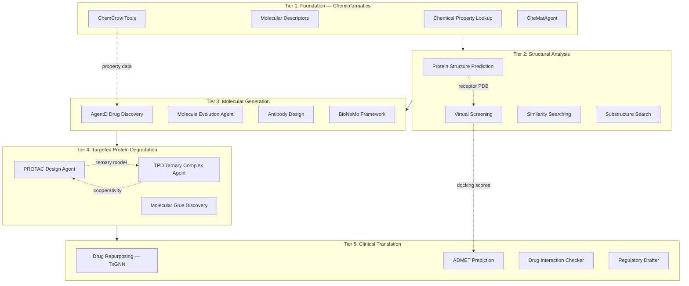
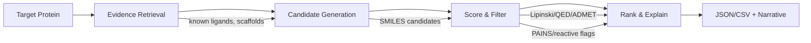
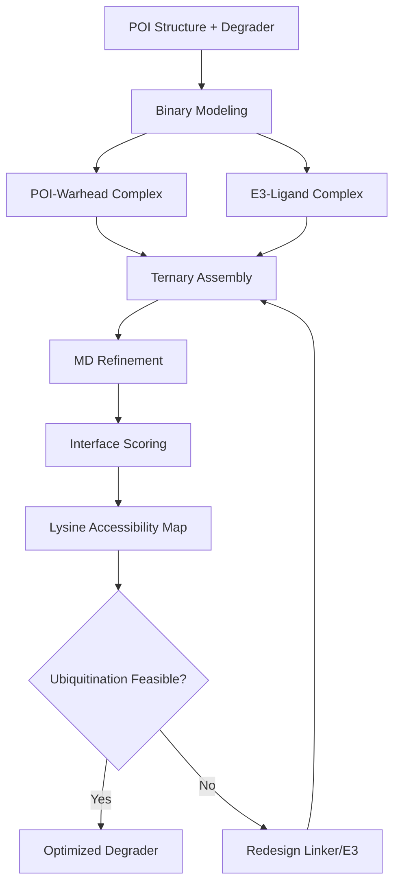

The Drug Discovery and Chemistry Agents domain within the BioKernel ecosystem provides a comprehensive, multi-layered skill fabric that spans the entire early-stage drug discovery pipeline—from target identification and molecular generation through ADMET filtering, targeted protein degradation, and regulatory drafting. These agents are not isolated scripts; they form an **interconnected computational pharmacology platform** where each skill's output feeds naturally into downstream skills via the BioKernel's semantic routing and DAG workflow engine. The architecture embraces a progressive-complexity model: lightweight cheminformatics utilities at the base, autonomous multi-step agents in the middle, and enterprise-grade GPU-accelerated frameworks at the apex.

Sources: [SKILL.md](Skills/Drug_Discovery/AgentD_Drug_Discovery/SKILL.md#L1-L52), [SKILL.md](Skills/Drug_Discovery/ChemCrow_Tools/SKILL.md#L1-L61), [SKILL.md](Skills/Drug_Discovery/Molecular_Glue_Discovery_Agent/SKILL.md#L1-L200)

## Architectural Overview

The drug discovery skill domain is organized into five functional tiers, each addressing a distinct phase of the discovery lifecycle. Understanding this layered architecture is essential for composing effective agent workflows—skills within the same tier can often run in parallel, while cross-tier dependencies enforce a natural execution order.

The diagram above captures the primary data-flow relationships between tiers. Note the **bidirectional link** between PROTAC Design and the Ternary Complex Agent—PROTAC designs require ternary complex validation, which in turn informs iterative linker optimization. This feedback loop is a core architectural pattern in the targeted protein degradation tier.

Sources: [SKILL.md](Skills/Drug_Discovery/ChemCrow_Tools/SKILL.md#L1-L61), [SKILL.md](Skills/Drug_Discovery/Protein_Structure/SKILL.md#L1-L59), [SKILL.md](Skills/Drug_Discovery/TPD_Ternary_Complex_Agent/SKILL.md#L1-L200), [SKILL.md](Skills/Drug_Discovery/PROTAC_Design_Agent/SKILL.md#L1-L200)

## Tier 1: Cheminformatics Foundation

The cheminformatics tier provides the molecular property calculation and manipulation primitives that every downstream agent depends upon. These skills are **stateless, deterministic, and fast**—designed for invocation as tool calls within larger agent workflows rather than as standalone pipelines.

### Chemical Property Lookup

The `chemical-property-lookup` skill wraps a lightweight RDKit utility module that validates SMILES strings and returns a structured property summary including molecular weight, LogP, TPSA, hydrogen bond donor/acceptor counts, QED score, and a Lipinski Rule-of-Five verdict. The implementation in `molecular_tools.py` uses a clean separation: `_load_molecule()` handles SMILES validation, while `summarize_properties()` returns a complete dictionary suitable for JSON serialization. A critical design choice is that **stereochemistry is never inferred**—if not explicitly encoded in the SMILES, the tool reports "not provided" rather than guessing, which prevents silent propagation of incorrect chiral assignments through the pipeline.

Sources: [SKILL.md](Skills/Drug_Discovery/Chemical_Property_Lookup/SKILL.md#L1-L42), [molecular_tools.py](Skills/Drug_Discovery/Chemical_Property_Lookup/molecular_tools.py#L1-L173)

### ChemCrow Tools

ChemCrow is a production-grade cheminformatics toolkit that wraps RDKit with graceful fallback behavior when RDKit is unavailable. The `ChemTools` class exposes four categories of functionality: **property calculation** (MolWt, LogP, TPSA, QED via the `MolecularProperties` dataclass), **drug-likeness assessment** (Lipinski Rule-of-Five through `LipinskiResult`), **synthetic accessibility scoring** (`SAScoreResult` with categories from "Easy" to "Very Hard"), and **toxicity alerting** via SMARTS pattern matching. The toxicity system uses a three-tier severity model—High (nitroaromatics, azides, Michael acceptors, acyl halides), Medium (anilines, hydrazines, epoxides), and Low (aldehydes, phenols)—and includes a PAINS (Pan-Assay Interference Compounds) filter covering quinone, catechol, rhodanine, and azo patterns. This dual-filter approach (toxicity + PAINS) ensures that candidates flagged by AgentD's generative step are caught before reaching downstream ADMET prediction.

Sources: [SKILL.md](Skills/Drug_Discovery/ChemCrow_Tools/SKILL.md#L1-L61), [chem_tools.py](Skills/Drug_Discovery/ChemCrow_Tools/chem_tools.py#L1-L200)

### CheMatAgent

CheMatAgent takes a qualitatively different approach: rather than providing individual tools, it orchestrates a library of **137 Python-wrapped chemical tools** through a two-tiered agent architecture. The lower tier handles tool execution (property prediction, synthesis planning), while the upper tier manages planning and sequencing. CheMatAgent is the appropriate choice when a task requires multi-scale modeling that bridges quantum mechanics and molecular dynamics, or when generating instructions for robotic synthesis platforms in self-driving lab contexts.

Sources: [SKILL.md](Skills/Drug_Discovery/CheMatAgent/SKILL.md#L1-L68)

### Foundation Skills Comparison

| Skill | Tool Count | Key Differentiator | Execution Model |
|-------|-----------|-------------------|-----------------|
| Chemical Property Lookup | 7 functions | Minimal footprint, single-SMILES focus | Stateless tool call |
| ChemCrow Tools | 15+ methods | PAINS/toxicity filters, graceful RDKit fallback | Stateless tool call |
| CheMatAgent | 137 tools | Multi-scale modeling, lab automation integration | Two-tier agent |
| Molecular Descriptors | ECFP4/6, MACCS, 200+ RDKit | Fingerprint generation for ML pipelines | Stateless tool call |

Sources: [SKILL.md](Skills/Drug_Discovery/Chemical_Property_Lookup/SKILL.md#L1-L42), [SKILL.md](Skills/Drug_Discovery/ChemCrow_Tools/SKILL.md#L1-L61), [SKILL.md](Skills/Drug_Discovery/CheMatAgent/SKILL.md#L1-L68), [SKILL.md](Skills/Drug_Discovery/Chemoinformatics/molecular-descriptors/SKILL.md#L1-L191)

## Tier 2: Structural Analysis and Screening

Once molecular properties are characterized, the next tier provides structural biology and virtual screening capabilities that connect small molecules to their protein targets.

### Protein Structure Prediction

The `protein-structure-prediction` skill wraps ESMFold (with AlphaFold3 as a planned backend) to generate 3D protein coordinates from amino acid sequences. The `esmfold_client.py` implementation accepts a FASTA string, validates that all characters belong to the standard 20 amino acids, and returns a PDB structure with per-residue pLDDT confidence scores. This skill is typically invoked **before** virtual screening to prepare receptor PDBQT files for docking. The current implementation mocks ESMFold inference for demonstration, but the interface contract—sequence in, PDB + pLDDT out—is stable and production-ready.

Sources: [SKILL.md](Skills/Drug_Discovery/Protein_Structure/SKILL.md#L1-L59), [esmfold_client.py](Skills/Drug_Discovery/Protein_Structure/esmfold_client.py#L1-L85)

### Virtual Screening Pipeline

The virtual screening skill implements a complete AutoDock Vina 1.2 pipeline with three stages: **receptor preparation** (water removal, hydrogen addition at pH 7.4, Gasteiger charge assignment, PDBQT conversion via Open Babel), **ligand preparation** (3D conformer generation with ETKDGv3, MMFF minimization, PDBQT conversion), and **docking** (configurable exhaustiveness from 8 for quick scans to 64 for production runs, with multi-pose output). The screening pipeline accepts a dictionary of `{name: SMILES}` pairs and returns ranked results with binding affinities in kcal/mol. A critical implementation detail: the `compute_vina_maps()` call is made once per receptor, then reused across all ligands—this avoids redundant affinity map calculation and provides significant speedup for large libraries.

Sources: [SKILL.md](Skills/Drug_Discovery/Chemoinformatics/virtual-screening/SKILL.md#L1-L200)

### Similarity Searching and Molecular Fingerprints

The similarity searching skill provides Tanimoto-based molecular similarity using Morgan fingerprints (ECFP4/ECFP6) or MACCS keys. Beyond simple pairwise comparison, it implements **bulk similarity search** via `BulkTanimotoSimilarity` for efficient library-scale queries, and **Butina clustering** for partitioning compound libraries into structurally related groups. The similarity threshold conventions are standardized across the platform: >0.85 indicates same-scaffold equivalence, >0.70 suggests a related series, and <0.50 implies structural dissimilarity. The Maximum Common Substructure (MCS) finder complements fingerprint-based methods by identifying shared structural motifs across hit clusters.

Sources: [SKILL.md](Skills/Drug_Discovery/Chemoinformatics/similarity-searching/SKILL.md#L1-L195)

## Tier 3: Molecular Generation Agents

This tier contains the autonomous generative agents that produce novel molecular candidates. These are the "hypothesis foundries" of the platform—they take biological context as input and return structured candidate lists with property annotations.

### AgentD: Drug Discovery Agent

AgentD is the platform's primary end-to-end drug discovery agent. Its workflow proceeds through five stages: **evidence retrieval** (literature + database mining for known ligands and liabilities), **candidate generation** (scaffold hopping and fragment growth constrained by user-specified property thresholds), **scoring and filtering** (Lipinski, QED, ADMET heuristics with optional docking), **ranking with explanation** (multi-objective combination of efficacy, developability, and novelty with SAR rationale), and **delivery** (JSON/CSV output plus narrative recommendations). The implementation in `agent_d.py` demonstrates the integration pattern: it imports `ChemCrowAgent` from the sibling ChemCrow_Tools directory for real property prediction, while providing a mock generative model (string manipulation placeholder for REINVENT-style models). AgentD's literature mining currently covers EGFR and BRAF as built-in targets with reference inhibitors, scaffolds, and known LogP values.

> [!TIP]
> AgentD's `generate_analogues()` method uses simple SMILES string manipulation as a placeholder. In production, replace this with a generative model call (e.g., REINVENT, MolMIM) by swapping the string operations with a model inference call—the rest of the pipeline remains unchanged.

Sources: [SKILL.md](Skills/Drug_Discovery/AgentD_Drug_Discovery/SKILL.md#L1-L52), [agent_d.py](Skills/Drug_Discovery/AgentD_Drug_Discovery/agent_d.py#L1-L112)

### Molecule Evolution Agent

The Molecule Evolution Agent takes a different generative approach: **iterative LLM-guided molecular optimization**. Starting from a seed molecule (defaulting to Aspirin), it runs for N generations where each generation asks the LLM to suggest a chemically valid structural modification, applies the modification, and scores the result. The agent integrates with the platform's `runtime_adapter.llm` for LLM calls, extracting new SMILES from the model's response. This evolutionary strategy is particularly effective for lead optimization where the search space around a known hit should be explored systematically rather than broadly.

Sources: [SKILL.md](Skills/Drug_Discovery/Molecule_Design/SKILL.md#L1-L62), [evolution_agent.py](Skills/Drug_Discovery/Molecule_Design/evolution_agent.py#L1-L72)

### Antibody Design Agent

The Antibody Design Agent combines two complementary design paradigms: **MAGE** (Monoclonal Antibody Generator) for sequence-first design from viral strain data, and **RFdiffusion** for structure-first design against specific epitopes. The workflow starts from a target antigen PDB structure, generates backbone candidates via RFdiffusion, sequences them with ProteinMPNN, and validates complexes through AlphaFold3/ESMFold folding. This agent is particularly relevant for rapid-response scenarios—designing VHH nanobodies against emerging viral variants where traditional hybridoma approaches are too slow.

Sources: [SKILL.md](Skills/Drug_Discovery/Antibody_Design/SKILL.md#L1-L64)

### NVIDIA BioNeMo Framework

BioNeMo represents the enterprise GPU-accelerated tier of the generative stack. It provides three deployment modalities: the **OSS Framework** (Apache 2.0) with training recipes and model zoo including Evo2, DiffDock, MolMIM, and AlphaBind; **NIM microservices** for sub-5-minute inference deployment via Docker; and **DGX Cloud** for multi-node training. The standard workflow converts PDB/FASTA/SMILES to BioNeMo dataloaders, fine-tunes models using recipe scripts, packages inference endpoints as NIMs, and integrates with BioNeMo Blueprints for turnkey virtual screening and protein design pipelines. Hardware baseline requires Hopper/Blackwell class GPUs with ≥80 GB HBM for full-recipe throughput.

Sources: [SKILL.md](Skills/Drug_Discovery/BioNeMo_Framework/SKILL.md#L1-L94)

### Medea Therapeutic Discovery Agent

Medea occupies a unique position in the generation tier—it operates not at the molecular level but at the **omics-to-target level**. Medea executes multi-stage therapeutic discovery by formulating analysis plans, generating and executing Python/R scripts for data processing, retrieving and synthesizing literature, and reconciling experimental evidence with published findings through a consensus validation stage. Medea is the appropriate entry point when the discovery question is "what should we target?" rather than "what molecule should we design?"

Sources: [SKILL.md](Skills/Drug_Discovery/Medea/SKILL.md#L1-L58)

### Generative Agent Selection Guide

| Agent | Input | Output | Best For | GPU Required |
|-------|-------|--------|----------|-------------|
| AgentD | Target protein + constraints | Ranked SMILES with ADMET | Small-molecule lead discovery | No (mock gen) |
| Molecule Evolution | Seed SMILES + target | Optimized SMILES + history | Lead optimization | No (LLM only) |
| Antibody Design | Antigen PDB/sequence | Antibody sequences + structures | Biotherapeutic design | Yes (RFdiffusion) |
| BioNeMo Framework | Custom datasets | Fine-tuned models + NIMs | Enterprise-scale generation | Yes (Hopper+) |
| Medea | Disease + omics data | Validated drug targets | Target identification | Optional |

Sources: [SKILL.md](Skills/Drug_Discovery/AgentD_Drug_Discovery/SKILL.md#L1-L52), [SKILL.md](Skills/Drug_Discovery/Molecule_Design/SKILL.md#L1-L62), [SKILL.md](Skills/Drug_Discovery/Antibody_Design/SKILL.md#L1-L64), [SKILL.md](Skills/Drug_Discovery/BioNeMo_Framework/SKILL.md#L1-L94), [SKILL.md](Skills/Drug_Discovery/Medea/SKILL.md#L1-L58)

## Tier 4: Targeted Protein Degradation

The targeted protein degradation (TPD) tier is the most architecturally sophisticated domain in the drug discovery skills catalog. It contains three tightly coupled agents that form a design-validate-optimize loop, addressing both major degrader modalities: PROTACs (bifunctional chimeras) and molecular glues (small-molecule interface modulators).

### PROTAC Design Agent

The PROTAC Design Agent manages the full lifecycle of Proteolysis Targeting Chimera design across six core capabilities: **warhead selection** (identifying optimal POI-binding ligands), **E3 ligase selection** (CRBN, VHL, MDM2, IAP, DCAF15 with tissue expression and advantage profiles), **linker design** (PEG, alkyl, piperazine, triazole with length range 2–20 atoms), **ternary complex prediction**, **degradation efficiency modeling** (DC50, Dmax, kinetics), and **ADMET optimization** with chameleonicity assessment. The clinical pipeline awareness is notable—the agent tracks active compounds including ARV-471 (ER, Phase 3/NDA), ARV-110 (AR, Phase 2), and BGB-16673 (BTK, Phase 3), providing context for design decisions based on validated E3-target combinations.

| PROTAC Component | Function | Optimization Target |
|-----------------|----------|---------------------|
| Warhead | Binds target protein (POI) | Affinity, selectivity |
| E3 Ligand | Recruits E3 ubiquitin ligase | CRBN/VHL binding |
| Linker | Connects warhead to E3 ligand | Length, flexibility, solubility |

Sources: [SKILL.md](Skills/Drug_Discovery/PROTAC_Design_Agent/SKILL.md#L1-L220)

### Molecular Glue Discovery Agent

Molecular glues represent a fundamentally different degradation strategy—instead of linking two separate binding moieties, a single small molecule (<500 Da) induces or stabilizes a protein-protein interface between an E3 ligase and a neo-substrate. The agent covers five IMiD/CELMoD glue classes (CRBN-mediated degradation of IKZF1/3, CK1α, GSPT1), DCAF15 glues (indisulam-mediated RBM39 degradation), and emerging mechanisms (CDK12 via CR8, β-catenin). The discovery workflow proceeds through interface analysis, virtual screening for interface binders, neo-substrate recruitment prediction, selectivity analysis, and iterative optimization. A key differentiator from PROTACs is the **degron motif analysis** capability, which recognizes that different E3 ligases engage specific substrate motifs—zinc finger domains for CRBN-IMiD, phosphodegrons for SCF E3s, N-degrons for UBR1/2.

| Feature | Molecular Glue | PROTAC |
|---------|---------------|--------|
| Molecular Weight | <500 Da | 700–1500 Da |
| Target Discovery | Serendipitous/AI-guided | Rational |
| Selectivity | Can be exquisite | Often broader |
| Oral Bioavailability | Generally better | Challenging |

Sources: [SKILL.md](Skills/Drug_Discovery/Molecular_Glue_Discovery_Agent/SKILL.md#L1-L224)

### TPD Ternary Complex Agent

The Ternary Complex Agent is the analytical backbone of the degradation tier—it predicts and models the POI-degrader-E3 ligase assembly that determines whether a designed degrader will actually trigger ubiquitination. The scoring system combines five weighted components: shape complementarity (25%), interface area (20%), electrostatics (20%), complex stability ΔG (20%), and linker strain (15%). Beyond structure prediction, the agent provides **ubiquitination site analysis**—mapping surface-accessible lysines (>30 Ų) within 15 Å of the E2~Ub conjugate—which directly predicts whether the ternary complex geometry supports Ub transfer. The cooperativity analysis distinguishes three regimes: positive cooperativity (α > 1, where E3 binding enhances POI binding), no cooperativity (α = 1), and negative cooperativity (α < 1), each with distinct implications for degrader optimization.

> [!TIP]
> The ternary complex agent's cooperativity factor (α) is the single most predictive metric for degradation efficiency—prioritize designs with α > 1 even if the binary binding affinities appear weaker, as positive cooperativity compensates for modest warhead affinity.

Sources: [SKILL.md](Skills/Drug_Discovery/TPD_Ternary_Complex_Agent/SKILL.md#L1-L226)

## Tier 5: Clinical Translation

The final tier bridges computational discovery with clinical and regulatory realities. These skills address repurposing approved drugs, predicting adverse interactions, and generating regulatory documentation.

### Drug Repurposing via TxGNN

The TxGNN Drug Repurposing Agent implements a zero-shot graph neural network that predicts therapeutic indications and contraindications using medical knowledge graphs spanning DrugBank, OMIM, STRING, and Hetionet. Its defining capability is **zero-shot inference**—predicting drug-disease relationships for conditions with no existing training examples, which is critical for rare diseases. The agent produces structured output including ranked repurposing candidates with TxGNN scores, mechanistic knowledge-graph paths explaining each prediction, contraindication risk assessments, and suggested clinical trial designs. The example output for Huntington's disease demonstrates the full pipeline: Riluzole (score 0.89, path: Drug→BDNF→Neuroprotection→HD), Memantine (0.85), Cysteamine (0.82), with concurrent flagging of high-risk drugs like Haloperidol (contraindication risk 0.78).

Sources: [README.md](Skills/Drug_Discovery/Drug_Repurposing/TxGNN_Agent/README.md#L1-L146)

### ADMET Prediction

The ADMET prediction skill provides a multi-stage filtering pipeline with three computational backends: **ADMETlab 3.0 API** (119 endpoints with uncertainty quantification covering Caco-2 permeability, BBB penetration, CYP inhibition across five isoforms, hERG liability, and AMES mutagenicity), **DeepChem models** (GraphConvModel for Tox21 classification with circular fingerprint featurization), and **RDKit-based structural alert filters** (PAINS, BRENK, NIH, and ZINC filter catalogs). The prioritization pipeline applies four sequential gates: Lipinski violations ≤ 1, Veber compliance (RotBonds ≤ 10, TPSA ≤ 140), QED ≥ 0.5, and PAINS exclusion. This tiered approach avoids wasting compute on compounds that fail basic drug-likeness criteria before reaching expensive endpoint predictions.

Sources: [SKILL.md](Skills/Drug_Discovery/Chemoinformatics/admet-prediction/SKILL.md#L1-L200)

### Drug Interaction Checker and Regulatory Affairs

Moving into clinical-facing skills, the Drug Interaction Checker analyzes medication lists for known DDIs with severity grading (Minor, Moderate, Major) and mechanism-level clinical recommendations. The Regulatory Affairs skill automates drafting of FDA Common Technical Document (CTD) sections—specifically Module 2.4 (Nonclinical Overview) and Module 2.5 (Clinical Overview)—with citation linking to source PDFs and eCTD format compliance. Together, these skills close the loop from molecular design through clinical safety assessment and regulatory submission.

Sources: [SKILL.md](Skills/Pharma/Drug_Interaction/SKILL.md#L1-L56), [SKILL.md](Skills/Pharma/Regulatory_Affairs/SKILL.md#L1-L56)

## Composing Multi-Agent Workflows

The true power of this skill domain emerges when agents are composed through the BioKernel's [DAG Workflow Engine](6-dag-workflow-engine). A representative end-to-end drug discovery workflow would chain skills as follows:

1. **Target Identification**: Invoke Medea on omics data to identify and validate a disease target.
2. **Receptor Preparation**: Fold the target protein via ESMFold, producing a PDB file.
3. **Hit Discovery**: Run AgentD against the target, using ChemCrow for property calculation at each generation step.
4. **Virtual Screening**: Dock AgentD's top candidates using the Vina pipeline against the prepared receptor.
5. **ADMET Filtering**: Route docked hits through the ADMET prediction pipeline (Lipinski → Veber → QED → PAINS → ADMETlab).
6. **Safety Assessment**: Check drug-drug interactions for any co-medications relevant to the disease population.
7. **Output**: Ranked candidate list with binding affinities, ADMET profiles, toxicity alerts, and DDI flags.

For targeted protein degradation workflows, steps 3–6 are replaced by the PROTAC/Glue design loop: warhead selection → E3 selection → linker design → ternary complex prediction → cooperativity scoring → ubiquitination feasibility → redesign if needed.

Sources: [SKILL.md](Skills/Drug_Discovery/AgentD_Drug_Discovery/SKILL.md#L1-L52), [SKILL.md](Skills/Drug_Discovery/Chemoinformatics/virtual-screening/SKILL.md#L1-L200), [SKILL.md](Skills/Drug_Discovery/TPD_Ternary_Complex_Agent/SKILL.md#L1-L226)

## Skill Directory Reference

| Skill | Path | Primary Backend |
|-------|------|-----------------|
| AgentD Drug Discovery | `Skills/Drug_Discovery/AgentD_Drug_Discovery/` | RDKit + LLM |
| Antibody Design | `Skills/Drug_Discovery/Antibody_Design/` | MAGE + RFdiffusion |
| BioNeMo Framework | `Skills/Drug_Discovery/BioNeMo_Framework/` | NVIDIA GPU |
| CheMatAgent | `Skills/Drug_Discovery/CheMatAgent/` | 137 chemical tools |
| Chemical Property Lookup | `Skills/Drug_Discovery/Chemical_Property_Lookup/` | RDKit |
| ChemCrow Tools | `Skills/Drug_Discovery/ChemCrow_Tools/` | RDKit |
| ADMET Prediction | `Skills/Drug_Discovery/Chemoinformatics/admet-prediction/` | ADMETlab 3.0 + DeepChem |
| Molecular Descriptors | `Skills/Drug_Discovery/Chemoinformatics/molecular-descriptors/` | RDKit |
| Similarity Searching | `Skills/Drug_Discovery/Chemoinformatics/similarity-searching/` | RDKit |
| Virtual Screening | `Skills/Drug_Discovery/Chemoinformatics/virtual-screening/` | AutoDock Vina 1.2 |
| Drug Repurposing (TxGNN) | `Skills/Drug_Discovery/Drug_Repurposing/TxGNN_Agent/` | Knowledge Graph GNN |
| Medea | `Skills/Drug_Discovery/Medea/` | LLM + omics scripts |
| Molecular Glue Discovery | `Skills/Drug_Discovery/Molecular_Glue_Discovery_Agent/` | AF-Multimer + DL |
| Molecule Evolution | `Skills/Drug_Discovery/Molecule_Design/` | LLM-guided |
| PROTAC Design | `Skills/Drug_Discovery/PROTAC_Design_Agent/` | AF-Multimer + generative |
| Protein Structure | `Skills/Drug_Discovery/Protein_Structure/` | ESMFold |
| TPD Ternary Complex | `Skills/Drug_Discovery/TPD_Ternary_Complex_Agent/` | AF-Multimer + MD |
| Drug Interaction Checker | `Skills/Pharma/Drug_Interaction/` | DDI database |
| Regulatory Drafter | `Skills/Pharma/Regulatory_Affairs/` | LLM + eCTD |

Sources: [SKILL.md](Skills/Drug_Discovery/ChemCrow_Tools/SKILL.md#L1-L61), [SKILL.md](Skills/Drug_Discovery/AgentD_Drug_Discovery/SKILL.md#L1-L52), [SKILL.md](Skills/Drug_Discovery/Protein_Structure/SKILL.md#L1-L59), [SKILL.md](Skills/Drug_Discovery/Molecular_Glue_Discovery_Agent/SKILL.md#L1-L200), [SKILL.md](Skills/Drug_Discovery/PROTAC_Design_Agent/SKILL.md#L1-L220), [SKILL.md](Skills/Drug_Discovery/TPD_Ternary_Complex_Agent/SKILL.md#L1-L226), [SKILL.md](Skills/Drug_Discovery/BioNeMo_Framework/SKILL.md#L1-L94), [SKILL.md](Skills/Pharma/Drug_Interaction/SKILL.md#L1-L56), [SKILL.md](Skills/Pharma/Regulatory_Affairs/SKILL.md#L1-L56)

## Next Steps

- To understand how the BioKernel routes natural-language requests to these skills, see [Semantic Skill Router](5-semantic-skill-router).
- To compose the multi-agent workflows described above, see [DAG Workflow Engine](6-dag-workflow-engine).
- To evaluate the biomedical accuracy of drug discovery outputs, see [Biomedical Evaluation Framework](13-biomedical-evaluation-framework).
- To add new drug discovery skills to the catalog, see [Adding New Skills](17-adding-new-skills).