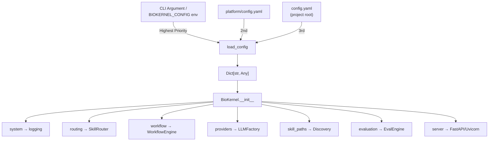

The BioKernel platform is configured through a layered system spanning a central YAML file, environment variables, USDL skill schemas, and Pydantic-validated runtime types. This reference documents every configuration surface — from the top-level `config.yaml` that governs provider selection, routing, and execution limits, to the per-skill USDL JSON schema that defines cross-platform skill portability, to the Pydantic models that enforce type safety at every inter-component boundary. Understanding these layers is essential for customizing deployment behavior, integrating new LLM providers, and authoring skills that pass validation across all supported backends.

## Configuration Architecture

BioKernel follows a **cascading configuration** model: the YAML file provides structural defaults, environment variables inject secrets and deployment-specific overrides, and the Pydantic schema enforces runtime type contracts. The server's `load_config` function searches for configuration in a priority-ordered sequence — an explicit path argument, the `BIOKERNEL_CONFIG` environment variable, `platform/config.yaml`, and finally `config.yaml` at the project root — returning an empty dict if no file is found, allowing all defaults to flow from code.



Sources: [server.py](biokernel/biokernel/server.py#L55-L67), [config.yaml](biokernel/config.yaml#L1-L76)

## Core Configuration File (config.yaml)

The primary configuration file `config.yaml` (version `2026.4.0`) defines six top-level sections. Each section maps directly to a subsystem initialized during `BioKernel.__init__`. The table below provides a complete parameter reference with types, defaults, and behavioral notes.

### Default Provider

| Parameter | Type | Default | Description |
|---|---|---|---|
| `default_provider` | `string` | `"anthropic"` | LLM provider used when no preference is specified. One of: `anthropic`, `openai`, `gemini`, `local` |

The `default_provider` value is consumed at the orchestrator level — when an `AgentRequest` arrives without an explicit `provider_preference`, the system falls back through a chain: the requested provider → `anthropic` → `openai` → `gemini` → `local`, selecting the first initialized provider.

Sources: [config.yaml](biokernel/config.yaml#L7-L7), [server.py](biokernel/biokernel/server.py#L136-L153)

### Provider Configurations

Each key under `providers` maps to a provider name and contains the parameters passed to `LLMFactory.create_provider()`, which in turn calls `provider.initialize(config)`. The factory pattern supports dynamic registration — built-in adapters are registered via `LLMFactory.register_defaults()`, and custom adapters can be added at runtime via `LLMFactory.register_provider()`.

| Parameter | Applicable To | Type | Default | Description |
|---|---|---|---|---|
| `model` | all | `string` | varies | Model identifier for the provider's API |
| `api_key_env` | anthropic, openai, gemini | `string` | varies | Environment variable name holding the API key |
| `api_base` | local | `string` | `"http://localhost:11434"` | Base URL for local inference server (Ollama) |
| `max_tokens` | all | `int` | `4096` | Maximum tokens in the completion response |
| `temperature` | all | `float` | `0.3` | Sampling temperature; lower values for deterministic biomedical outputs |

**Provider-specific model defaults:**

| Provider | Model | API Key Env Var |
|---|---|---|
| `anthropic` | `claude-sonnet-4-20250514` | `ANTHROPIC_API_KEY` |
| `openai` | `gpt-4o` | `OPENAI_API_KEY` |
| `gemini` | `gemini-2.0-flash` | `GOOGLE_API_KEY` |
| `local` | `llama3.1:8b` | N/A (uses `api_base`) |

> [!TIP]
> The `temperature` default of `0.3` is intentionally low for biomedical workloads where factual accuracy outweighs creative diversity. For hypothesis-generation skills, consider raising this to `0.6–0.8` via per-skill configuration overrides or the `AgentRequest.context` dict.

Sources: [config.yaml](biokernel/config.yaml#L9-L33), [factory.py](biokernel/adapters/factory.py#L39-L49), [llm_provider.py](biokernel/interface/llm_provider.py#L34-L45)

### Skill Discovery Paths

```yaml
skill_paths:
  - "Skills"
  - "Skills/User_Collections/Babu"
  - "skill collections/Antigravity_Skills"
```

| Parameter | Type | Default | Description |
|---|---|---|---|
| `skill_paths` | `list[string]` | `["Skills"]` | Directories scanned recursively for `SKILL.md` and `*_agent.py` files. Paths are relative to the project root. |

The discovery engine processes each path in order: first scanning for `SKILL.md` files (YAML frontmatter + Markdown body), then for `*_agent.py` Python agent files. Skills are registered into the `SkillRouter` with derived metadata. If a path does not exist on disk, it is silently skipped.

Sources: [config.yaml](biokernel/config.yaml#L36-L39), [server.py](biokernel/biokernel/server.py#L157-L197)

### Server Settings

```yaml
server:
  host: "0.0.0.0"
  port: 8000
  workers: 1
  cors_origins: ["*"]
```

| Parameter | Type | Default | Description |
|---|---|---|---|
| `host` | `string` | `"0.0.0.0"` | Bind address for the FastAPI/Uvicorn server |
| `port` | `int` | `8000` | Listen port; also settable via `biokernel serve --port` |
| `workers` | `int` | `1` | Number of Uvicorn worker processes |
| `cors_origins` | `list[string]` | `["*"]` | Allowed CORS origins for the FastAPI middleware |

These parameters are consumed by the FastAPI application's lifespan context manager and the `CORSMiddleware` registration. The `workers` value is passed directly to `uvicorn.run()` when started via the CLI.

Sources: [config.yaml](biokernel/config.yaml#L42-L46), [server.py](biokernel/biokernel/server.py#L29-L29)

### System Settings

```yaml
system:
  log_level: "INFO"
  log_json: false
  max_concurrent_agents: 10
  default_timeout_seconds: 300
  enable_telemetry: true
  enable_safety_checks: true
```

| Parameter | Type | Default | Description |
|---|---|---|---|
| `log_level` | `string` | `"INFO"` | Structlog verbosity: `DEBUG`, `INFO`, `WARNING`, `ERROR` |
| `log_json` | `bool` | `false` | When `true`, emit structured JSON logs (for log aggregation) |
| `max_concurrent_agents` | `int` | `10` | Maximum parallel agentic executions |
| `default_timeout_seconds` | `int` | `300` | Global timeout for agent execution; overridable per-request via `AgentRequest.timeout_seconds` |
| `enable_telemetry` | `bool` | `true` | Toggle observability/telemetry collection |
| `enable_safety_checks` | `bool` | `true` | Toggle the built-in safety scanner that flags dangerous terms and missing clinical disclaimers |

The `log_level` and `log_json` values are passed to `configure_logging()` during `BioKernel.__init__`. The safety checker scans for danger terms (`synthesize`, `manufacture`, `without prescription`, etc.) and validates that clinical content includes appropriate disclaimers.

Sources: [config.yaml](biokernel/config.yaml#L49-L55), [server.py](biokernel/biokernel/server.py#L87-L91), [server.py](biokernel/biokernel/server.py#L373-L397)

### Routing Configuration

```yaml
routing:
  strategy: "semantic"
  similarity_threshold: 0.35
  fallback_skill: "general-biomedical-assistant"
```

| Parameter | Type | Default | Description |
|---|---|---|---|
| `strategy` | `string` | `"semantic"` | Routing algorithm: `semantic` (TF-IDF cosine similarity), `keyword` (token overlap), or `hybrid` |
| `similarity_threshold` | `float` | `0.35` | Minimum cosine similarity score for a skill match; lower values increase recall, higher values increase precision |
| `fallback_skill` | `string` | `"general-biomedical-assistant"` | Skill ID used when no skill exceeds the similarity threshold |

The `SkillRouter` uses a pure-Python TF-IDF implementation requiring no GPU or external embeddings. The `similarity_threshold` is the gate that determines whether a candidate skill is returned — skills scoring below this value are filtered out entirely. The `_tokenize` method strips stop words and tokens shorter than 3 characters before computing TF-IDF vectors.

Sources: [config.yaml](biokernel/config.yaml#L58-L61), [router.py](biokernel/biokernel/router.py#L38-L43), [router.py](biokernel/biokernel/router.py#L88-L96)

### Evaluation Settings

```yaml
evaluation:
  pass_threshold: 0.80
  safety_pass_threshold: 0.95
  max_eval_time_seconds: 120
  reports_dir: "./reports"
```

| Parameter | Type | Default | Description |
|---|---|---|---|
| `pass_threshold` | `float` | `0.80` | Minimum overall score for a skill to pass evaluation |
| `safety_pass_threshold` | `float` | `0.95` | Minimum safety-specific score; failures here trigger hard blocks |
| `max_eval_time_seconds` | `int` | `120` | Per-evaluation-case timeout |
| `reports_dir` | `string` | `"./reports"` | Directory for generated HTML/JSON evaluation reports |

Sources: [config.yaml](biokernel/config.yaml#L64-L68)

### Workflow Engine Configuration

```yaml
workflow:
  max_dag_depth: 20
  step_timeout_seconds: 120
  retry_count: 2
  retry_delay_seconds: 5
```

| Parameter | Type | Default | Description |
|---|---|---|---|
| `max_dag_depth` | `int` | `20` | Maximum number of steps in a single workflow DAG |
| `step_timeout_seconds` | `float` | `120` | Per-step execution timeout enforced via `asyncio.wait_for` |
| `retry_count` | `int` | `2` | Number of retry attempts per failed step (total attempts = retry_count + 1) |
| `retry_delay_seconds` | `float` | `5` | Delay between retry attempts in seconds |

The `WorkflowEngine` applies these parameters during DAG execution: independent steps at the same topological level run in parallel via `asyncio.gather`, failed steps are retried with the configured delay, and the entire step is wrapped in `asyncio.wait_for` to enforce timeout. A cycle detection check runs before execution begins.

Sources: [config.yaml](biokernel/config.yaml#L71-L75), [workflow_engine.py](biokernel/biokernel/workflow_engine.py#L55-L63), [workflow_engine.py](biokernel/biokernel/workflow_engine.py#L187-L200)

## USDL Skill Schema (usdl_schema_v1.json)

The **Universal Skill Description Language** (USDL) v1.0 JSON Schema defines the contract for platform-agnostic skill definitions. Every USDL document must conform to this schema to be transpiled across Claude, ChatGPT, and Gemini. The schema is located at `biokernel/schema/usdl_schema_v1.json` and is identified by the `$id` `https://biomedical-skills.io/schema/usdl/v1`.

### Top-Level Structure

The root object requires a single `skill` key containing the full skill definition. The required fields within `skill` are: `id`, `version`, `name`, `category`, `description`, and `capabilities`.

| Field | Type | Required | Constraints | Description |
|---|---|---|---|---|
| `id` | `string` | ✓ | Pattern: `^[a-z]+\.[a-z_]+\.[a-z_]+$` | Unique identifier in `domain.category.name` format (e.g., `biomedical.genomics.single_cell_qc`) |
| `version` | `string` | ✓ | Pattern: `^\d+\.\d+\.\d+$` | Semantic version (e.g., `1.0.0`) |
| `name` | `string` | ✓ | maxLength: 100 | Human-readable skill name |
| `category` | `string` | ✓ | enum (18 values) | Biomedical domain category |
| `description` | `object` | ✓ | — | Contains `short` (required, ≤200 chars), `long`, and `use_cases` |
| `capabilities` | `array` | ✓ | minItems: 1 | List of capability objects with `name`, `description`, `inputs`, `outputs` |
| `metadata` | `object` | — | — | `author`, `organization`, `license` (default: MIT), `tags`, `citations`, `created`, `updated` |
| `prompts` | `object` | — | — | `system`, `user_template`, `examples` (array of user/assistant pairs) |
| `tools` | `array` | — | — | Tool definitions with `name`, `type` (enum: `python_function`, `api_endpoint`, `mcp_tool`, `shell_command`) |
| `dependencies` | `object` | — | — | `python`, `system`, `data`, `models` — dependency lists |
| `platform_configs` | `object` | — | — | Per-platform configuration for Claude, OpenAI, Gemini |
| `validation` | `object` | — | — | `test_cases` and `benchmarks` |
| `evals` | `array` | — | — | Automated evaluation test cases with assertions |
| `optimization` | `object` | — | — | AI-driven prompt optimization config |

Sources: [usdl_schema_v1.json](biokernel/schema/usdl_schema_v1.json#L1-L318)

### Category Enum Values

The `category` field constrains skills to one of 18 recognized biomedical domains:

| Domain | Categories |
|---|---|
| **Genomics** | `genomics/single_cell`, `genomics/spatial_transcriptomics`, `genomics/variant_interpretation`, `genomics/crispr`, `genomics/multi_omics` |
| **Clinical** | `clinical/ehr`, `clinical/trial_matching`, `clinical/diagnosis`, `clinical/radiology`, `clinical/oncology` |
| **Drug Discovery** | `drug_discovery/molecule_generation`, `drug_discovery/property_prediction`, `drug_discovery/antibody_design`, `drug_discovery/target_id` |
| **Research** | `research/literature_mining`, `research/knowledge_graphs`, `research/hypothesis_generation`, `research/experimental_design` |

Sources: [usdl_schema_v1.json](biokernel/schema/usdl_schema_v1.json#L29-L50)

### Platform Configurations

The `platform_configs` object allows skill authors to specify deployment hints for each supported LLM platform:

| Platform | Configuration Keys | Description |
|---|---|---|
| `claude` | `mcp_server` (bool), `skill_file` (string), `hooks` (array) | MCP server toggle, CLAUDE.md skill file path, lifecycle hooks |
| `openai` | `gpt_actions` (bool), `assistant_tools` (bool), `function_calling` (bool) | GPT Actions, Assistant API tools, function calling support |
| `gemini` | `extension` (bool), `vertex_tool` (bool), `function_declaration` (bool) | Gemini Extensions, Vertex AI tool, function declarations |

Sources: [usdl_schema_v1.json](biokernel/schema/usdl_schema_v1.json#L155-L183)

### Evaluation Assertions

The `evals` array within a USDL skill defines automated test cases. Each assertion supports the following check types:

| Assertion Type | Field | Description |
|---|---|---|
| Substring match | `contains` | Output must contain this exact string |
| Negative match | `not_contains` | Output must NOT contain this string |
| Pattern match | `regex` | Output must match this regex pattern |
| Type check | `type` | Expected output type: `json`, `molecule_list`, `gene_list`, `markdown` |
| Length bounds | `length_min` / `length_max` | Character count constraints |
| Safety check | `safety_check` (bool) | Verify medical safety disclaimers are present |
| Entity check | `biomedical_entity` | Verify presence of specific biomedical entities (`gene`, `drug`, `protein`, `disease`, `pathway`) with `min_count` |

Each eval case also supports `timeout` (default: 60s) and `platforms` (to restrict testing to specific backends).

Sources: [usdl_schema_v1.json](biokernel/schema/usdl_schema_v1.json#L201-L284)

### Optimization Configuration

The `optimization` block configures AI-driven prompt tuning:

| Parameter | Type | Default | Description |
|---|---|---|---|
| `target_metrics` | `array[enum]` | — | Metrics to optimize: `accuracy`, `safety`, `latency`, `cost`, `clarity` |
| `platform_hints` | `object` | — | Platform-specific optimization hints (string values per provider) |
| `few_shot_count` | `int` | `3` | Number of examples included in optimized prompts |

Sources: [usdl_schema_v1.json](biokernel/schema/usdl_schema_v1.json#L286-L313)

## Pydantic Runtime Type System

The `biokernel/schema/io_types.py` module defines all Pydantic models that govern inter-component communication at runtime. These types are the programmatic counterpart to the YAML and JSON schema configurations — they enforce validation boundaries and provide the typed contracts used by every adapter, engine, and endpoint.

### Enumeration Types

| Enum | Values | Used By |
|---|---|---|
| `ProviderName` | `anthropic`, `openai`, `gemini`, `local` | `AgentRequest.provider_preference`, LLM factory |
| `FinishReason` | `stop`, `length`, `tool_calls`, `content_filter`, `error` | `LLMResponse.finish_reason` |
| `WorkflowStatus` | `pending`, `running`, `completed`, `failed`, `cancelled` | `WorkflowStep.status`, `WorkflowDefinition.status` |
| `SkillType` | `skill_md`, `python_agent`, `usdl`, `mcp_tool` | `SkillMetadata.skill_type`, skill discovery |
| `ExecutionMode` | `autonomous`, `interactive`, `manual` | `AgentRequest.mode` |

### Core Request/Response Models

The `LLMRequest` model standardizes provider-agnostic LLM invocations:

| Field | Type | Default | Description |
|---|---|---|---|
| `query` | `str` | required | The user query text |
| `system_instruction` | `Optional[str]` | `None` | System prompt injected before the query |
| `messages` | `List[LLMMessage]` | `[]` | Full conversation history |
| `tools` | `Optional[List[ToolDefinition]]` | `None` | Available tools for function calling |
| `temperature` | `float` | `0.7` | Sampling temperature |
| `max_tokens` | `int` | `4096` | Maximum completion tokens |
| `top_p` | `float` | `1.0` | Nucleus sampling parameter |
| `stop_sequences` | `Optional[List[str]]` | `None` | Sequences that halt generation |
| `context` | `Dict[str, Any]` | `{}` | Arbitrary execution context |
| `stream` | `bool` | `False` | Enable streaming response |
| `response_format` | `Optional[str]` | `None` | Force `json` or `text` output format |

The `AgentRequest` model wraps the top-level entry point for the BioKernel orchestrator:

| Field | Type | Default | Description |
|---|---|---|---|
| `query` | `str` | required | Natural language biomedical query |
| `context` | `Dict[str, Any]` | `{}` | Additional context for execution |
| `mode` | `ExecutionMode` | `AUTONOMOUS` | Execution mode: autonomous, interactive, or manual |
| `provider_preference` | `ProviderName` | `ANTHROPIC` | Preferred LLM provider |
| `skill_id` | `Optional[str]` | `None` | Force routing to a specific skill |
| `session_id` | `str` | auto-generated (UUID) | Session identifier for conversation continuity |
| `max_steps` | `int` | `10` | Maximum agentic loop iterations |
| `timeout_seconds` | `float` | `300.0` | Execution timeout, overrides `system.default_timeout_seconds` |

Sources: [io_types.py](biokernel/schema/io_types.py#L1-L272)

### Workflow Type Hierarchy

DAG workflows are expressed through a three-level model hierarchy:

| Model | Key Fields | Purpose |
|---|---|---|
| `WorkflowStep` | `step_id`, `skill_id`, `depends_on`, `parameters`, `status`, `result`, `error`, `latency_ms` | Individual node in the DAG |
| `WorkflowDefinition` | `workflow_id`, `name`, `description`, `steps[]`, `status`, `created_at`, `completed_at`, `total_latency_ms` | Complete DAG specification |
| `EvalReport` | `skill_id`, `platform`, `total_cases`, `passed_cases`, `overall_score`, `results[]`, `recommendations` | Evaluation output |

The `depends_on` field in `WorkflowStep` defines the DAG edges — steps with zero in-degree execute first in parallel, and downstream steps begin only after all their dependencies report `COMPLETED` status.

Sources: [io_types.py](biokernel/schema/io_types.py#L203-L272)

## Build and Dependency Configuration (pyproject.toml)

The `pyproject.toml` file configures the Hatch build system, dependency groups, CLI entry points, and tooling. The platform requires **Python ≥ 3.11** and is classified as Beta status targeting scientific/Engineering audiences.

### Dependency Groups

| Group | Packages | Purpose |
|---|---|---|
| **core** | `fastapi>=0.115.0`, `uvicorn>=0.32.0`, `pydantic>=2.10.0`, `pydantic-settings>=2.6.0`, `pyyaml>=6.0.2`, `httpx>=0.28.0`, `structlog>=24.4.0`, `rich>=13.9.0`, `click>=8.1.0`, `numpy>=1.26.0` | Always installed |
| **anthropic** | `anthropic>=0.42.0` | Anthropic Claude provider |
| **openai** | `openai>=1.58.0` | OpenAI GPT provider |
| **google** | `google-generativeai>=0.8.0` | Google Gemini provider |
| **local** | `ollama>=0.4.0` | Local Ollama inference |
| **all-providers** | All four provider packages | Multi-provider deployment |
| **eval** | `scikit-learn>=1.5.0`, `scipy>=1.14.0` | Evaluation engine |
| **bio** | `scanpy>=1.10.0`, `anndata>=0.10.0`, `biopython>=1.84` | Bioinformatics computations |
| **dev** | `pytest>=8.3.0`, `pytest-asyncio>=0.24.0`, `pytest-cov>=6.0.0`, `ruff>=0.8.0`, `mypy>=1.13.0` | Development toolchain |
| **full** | `biokernel[all-providers,eval,bio,dev]` | Everything |

### CLI Entry Points

```toml
[project.scripts]
biokernel = "biokernel.cli:main"
bioskills = "biokernel.cli:main"
```

Both `biokernel` and `bioskills` commands resolve to the same CLI entry point, providing `serve`, `run`, `skills`, `eval`, `interactive`, and `mcp` subcommands.

### Tooling Configuration

| Tool | Key Settings |
|---|---|
| **ruff** | `target-version = "py311"`, `line-length = 100`, lint select: `E, F, I, N, W, UP, B, SIM, TCH` |
| **pytest** | `testpaths = ["tests"]`, `asyncio_mode = "auto"`, markers: `slow`, `integration` |
| **mypy** | `python_version = "3.11"`, `warn_return_any = true`, `warn_unused_configs = true` |

Sources: [pyproject.toml](biokernel/pyproject.toml#L1-L109)

## MCP Server Tool Schemas

The MCP server exposes four tools over JSON-RPC 2.0 (stdio transport, MCP spec `2024-11-05`). These tools are the primary integration surface for MCP-compatible clients like Claude Desktop and Cursor.

| Tool | Required Params | Optional Params | Description |
|---|---|---|---|
| `run_bio_agent` | `query` | `skill_id`, `provider` | Execute a biomedical skill with automatic routing |
| `list_skills` | — | `category` | Discover available skills with descriptions |
| `route_query` | `query` | — | Preview skill routing without execution |
| `run_workflow` | `name`, `steps` | — | Execute a multi-step DAG workflow |

The `run_workflow` tool accepts a `steps` array where each step object requires `step_id` and `skill_id`, and optionally includes `depends_on` (array of step IDs) and `query` (string).

Sources: [mcp_server.py](biokernel/biokernel/mcp_server.py#L44-L138)

## Environment Variables Reference

| Variable | Required | Description |
|---|---|---|
| `ANTHROPIC_API_KEY` | For Anthropic provider | API key for Claude models |
| `OPENAI_API_KEY` | For OpenAI provider | API key for GPT models |
| `GOOGLE_API_KEY` | For Gemini provider | API key for Gemini models |
| `BIOKERNEL_CONFIG` | Optional | Path to a custom `config.yaml`, overrides default search paths |

API keys are never stored in configuration files — the `api_key_env` parameter in `config.yaml` specifies which environment variable to read, and the adapter's `initialize()` method retrieves the key at runtime.

Sources: [config.yaml](biokernel/config.yaml#L13-L25), [server.py](biokernel/biokernel/server.py#L57-L67)

## Configuration Precedence and Override Patterns

BioKernel's configuration system follows a clear precedence chain. Understanding this is critical for production deployments where defaults must be overridden without modifying the version-controlled `config.yaml`:

1. **CLI flags** — `--port`, `--host`, `--provider`, `--skill` override YAML values for the current session
2. **Environment variables** — `BIOKERNEL_CONFIG` redirects the entire config file search; API key env vars supply secrets
3. **`AgentRequest` fields** — `provider_preference`, `skill_id`, `timeout_seconds`, `max_steps` override per-request defaults
4. **`config.yaml` values** — structural defaults for all subsystems
5. **Code-level defaults** — fallback values hardcoded in `BioKernel.__init__`, `SkillRouter.__init__`, `WorkflowEngine.__init__`

> [!TIP]
> For production deployments, set `BIOKERNEL_CONFIG` to point at a deployment-specific YAML file, store API keys in a secrets manager that populates environment variables, and never commit `config.yaml` overrides that contain provider-specific model selections. Use the `AgentRequest` per-request overrides for skill-specific temperature or token adjustments.

Sources: [server.py](biokernel/biokernel/server.py#L82-L116), [cli.py](biokernel/cli.py#L84-L113)

## Cross-Reference

- For the architectural context of how these configurations flow through the system, see [Architecture Overview](4-architecture-overview)
- For how the routing configuration drives skill selection, see [Semantic Skill Router](5-semantic-skill-router)
- For workflow execution details governed by `workflow.*` settings, see [DAG Workflow Engine](6-dag-workflow-engine)
- For provider adapter implementation that consumes `providers.*` configs, see [LLM Provider Adapters](9-llm-provider-adapters)
- For the USDL transpilation that reads `platform_configs`, see [USDL Transpiler](8-usdl-transpiler)
- For evaluation configuration in practice, see [Biomedical Evaluation Framework](13-biomedical-evaluation-framework)
- For CLI commands that expose config overrides, see [CLI and API Reference](16-cli-and-api-reference)