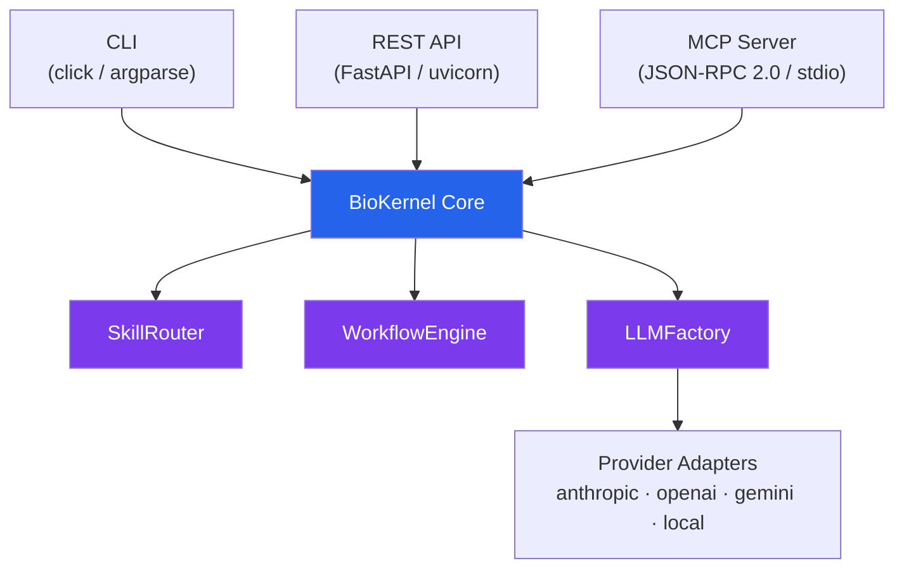

BioKernel exposes three complementary interfaces for interacting with the biomedical skills platform: a **CLI** for terminal-driven workflows, a **REST API** for service integration, and an **MCP server** for AI assistant tool use. Every interface converges on the same core pipeline — the `BioKernel` class handles skill discovery, semantic routing, LLM execution, and safety checks regardless of entry point. This page documents every command, endpoint, protocol method, and data model you need to integrate BioKernel into your development workflow.

Sources: [cli.py](/biokernel/cli.py#L1-L19), [server.py](/biokernel/biokernel/server.py#L1-L16), [mcp_server.py](/biokernel/biokernel/mcp_server.py#L1-L18)

## Interface Architecture

Before diving into individual commands and endpoints, it is essential to understand how the three interfaces relate to the shared core. The diagram below shows the convergence pattern: each interface instantiates or delegates to the `BioKernel` orchestrator, which coordinates the `SkillRouter`, `WorkflowEngine`, and `LLMFactory` subsystems.



The `BioKernel` class is intentionally independent of FastAPI and can be used programmatically in scripts, notebooks, or embedded applications — see the **Python SDK** section below for direct usage patterns.

Sources: [server.py](/biokernel/biokernel/server.py#L74-L80), [cli.py](/biokernel/cli.py#L67-L69), [mcp_server.py](/biokernel/biokernel/mcp_server.py#L153-L154)

## Installation and Entry Points

BioKernel requires Python ≥ 3.11 and is installed as a package with two console entry points registered in `pyproject.toml`:

| Entry Point | Module Path | Purpose |
|---|---|---|
| `biokernel` | `biokernel.cli:main` | Primary CLI command |
| `bioskills` | `biokernel.cli:main` | Alias for the same CLI |

Install with optional dependency groups depending on your target providers and use cases:

| Group | Includes | Use Case |
|---|---|---|
| `anthropic` | `anthropic>=0.42.0` | Claude provider |
| `openai` | `openai>=1.58.0` | GPT provider |
| `google` | `google-generativeai>=0.8.0` | Gemini provider |
| `local` | `ollama>=0.4.0` | Local Ollama models |
| `all-providers` | All four provider packages | Multi-provider setups |
| `eval` | `scikit-learn`, `scipy` | Evaluation suite |
| `bio` | `scanpy`, `anndata`, `biopython` | Bioinformatics workloads |
| `dev` | `pytest`, `ruff`, `mypy` | Development |
| `full` | All of the above | Complete installation |

```bash
# Minimal install (anthropic only)
pip install -e ".[anthropic]"

# Full install with all providers and bio tools
pip install -e ".[full]"
```

> [!TIP]
> The CLI uses `click` for rich interactive commands when available, but gracefully falls back to `argparse` with reduced functionality. Install `click` and `rich` (`pip install click rich`) for the full terminal experience with tables, panels, and Markdown rendering.

Sources: [pyproject.toml](/biokernel/pyproject.toml#L34-L80), [cli.py](/biokernel/cli.py#L32-L46)

## CLI Command Reference

The `biokernel` CLI provides eight subcommands covering server lifecycle, skill inspection, query execution, evaluation, prompt optimization, and catalog management. The click-based interface is the canonical version; the argparse fallback supports a subset of commands.

### Command Overview

| Command | Description | Click-only? |
|---|---|---|
| `serve` | Start the BioKernel REST API server | No |
| `run` | Execute a biomedical query | No |
| `skills` | List all registered skills | No |
| `interactive` | Start an interactive chat session | No |
| `mcp` | Start the MCP server on stdio | No |
| `eval` | Run evaluation suite | Yes |
| `optimize` | Optimize a prompt for a target provider | Yes |
| `catalog` | Scan and catalog SKILL.md files | Yes |

### `biokernel serve`

Starts the FastAPI REST API server using uvicorn. This is the primary way to expose BioKernel as a network service.

```bash
biokernel serve [--port PORT] [--host HOST] [--reload]
```

| Option | Default | Description |
|---|---|---|
| `--port` | `8000` | TCP port to bind |
| `--host` | `0.0.0.0` | Host interface to bind |
| `--reload` | `False` | Enable uvicorn auto-reload (development) |

The server initializes the `BioKernel` instance on startup via the FastAPI lifespan handler, making it available to all endpoint handlers. Upon shutdown, the kernel is destroyed.

Sources: [cli.py](/biokernel/cli.py#L84-L97), [server.py](/biokernel/biokernel/server.py#L427-L444)

### `biokernel run`

Executes a single biomedical query through the full BioKernel pipeline: routing → prompt construction → LLM execution → safety check → structured output.

```bash
biokernel run "analyze BRCA1 variants" [--provider PROVIDER] [--skill SKILL_ID]
```

| Option | Default | Choices | Description |
|---|---|---|---|
| `--provider`, `-p` | `anthropic` | `anthropic`, `openai`, `gemini`, `local` | LLM provider to use |
| `--skill`, `-s` | `None` | Any registered skill_id | Force a specific skill (bypass routing) |

The command constructs an `AgentRequest` with the specified parameters and invokes `kernel.execute()` asynchronously. With `rich` installed, the response is rendered as a styled panel showing the skill used, provider/model, and execution time. Without `rich`, a plain-text fallback is used. Safety flags, if any, are printed in yellow.

Sources: [cli.py](/biokernel/cli.py#L99-L133)

### `biokernel skills`

Lists all discovered and registered skills. Skills are sourced from SKILL.md files and Python agent files found in the configured `skill_paths`.

```bash
biokernel skills [--category CATEGORY]
```

| Option | Default | Description |
|---|---|---|
| `--category`, `-c` | `None` | Filter by category or tag (case-insensitive substring match) |

With `rich`, output is rendered as a formatted table with columns for ID, Type, Description, and Tags. Without `rich`, a compact line-per-skill format is used.

Sources: [cli.py](/biokernel/cli.py#L135-L168)

### `biokernel interactive`

Launches a persistent interactive chat session. Each query goes through the full routing and execution pipeline, and the provider can be pre-selected.

```bash
biokernel interactive [--provider PROVIDER]
```

| Option | Default | Description |
|---|---|---|
| `--provider`, `-p` | `anthropic` | Default LLM provider for the session |

**Built-in session commands:**

| Command | Action |
|---|---|
| `skills` | List all registered skills |
| `providers` | Show provider availability status |
| `help` | Show available commands |
| `quit` / `exit` / `q` | End the session |

Sources: [cli.py](/biokernel/cli.py#L195-L246)

### `biokernel eval`

Runs the evaluation engine against a skill or across multiple LLM platforms. This command requires the `eval` optional dependency group.

```bash
biokernel eval tests/eval.yaml [--platform PLATFORM] [--html]
```

| Option | Default | Description |
|---|---|---|
| `--platform`, `-p` | `all` | Target platform, or `all` for cross-platform comparison |
| `--html` | `False` | Generate an HTML report in `./reports/` |

When `--platform all` is used, the engine runs the evaluation against every configured provider and reports a comparative score table. Each platform scores `PASS` at ≥ 0.80 or `FAIL` otherwise.

Sources: [cli.py](/biokernel/cli.py#L170-L193)

### `biokernel mcp`

Starts the Model Context Protocol server communicating over stdio. Designed for integration with MCP-compatible clients such as Claude Desktop, Claude Code, or Cursor.

```bash
biokernel mcp
```

The server reads JSON-RPC 2.0 messages from stdin and writes responses to stdout. Logging is redirected to stderr to avoid corrupting the protocol stream. See the **MCP Protocol Reference** section below for tool definitions.

Sources: [cli.py](/biokernel/cli.py#L248-L253), [mcp_server.py](/biokernel/biokernel/mcp_server.py#L345-L374)

### `biokernel optimize`

Optimizes a prompt text for a specific LLM provider using the `PromptOptimizer`.

```bash
biokernel optimize "Analyze this variant" --target claude [--output FILE]
```

| Option | Required | Choices | Description |
|---|---|---|---|
| `--target`, `-t` | Yes | `claude`, `openai`, `gemini` | Target LLM provider |
| `--output`, `-o` | No | — | Output file path (stdout if omitted) |

Sources: [cli.py](/biokernel/cli.py#L255-L272)

### `biokernel catalog`

Scans all SKILL.md files in the configured skills root, validates their frontmatter, and reports the count of discovered skills plus any parse errors.

```bash
biokernel catalog
```

This command delegates to `scan_skills()` from the skills catalog module, which performs recursive file discovery and YAML frontmatter parsing. It reports the total skills found and up to 10 parse errors.

Sources: [cli.py](/biokernel/cli.py#L274-L283), [skills_catalog.py](/biokernel/skills_catalog.py#L73-L158)

## REST API Reference

The FastAPI application exposes six endpoints under the `/v1` prefix. The server is created with CORS middleware allowing all origins, making it suitable for both local development and containerized deployments. The BioKernel instance is initialized during the application lifespan and is shared across all requests.

### Endpoint Summary

| Method | Path | Description | Request Body | Response |
|---|---|---|---|---|
| `GET` | `/` | Health check | — | System status |
| `POST` | `/v1/agent/run` | Execute a query | `AgentRequest` | `AgentResponse` |
| `POST` | `/v1/workflow/run` | Execute a DAG workflow | `WorkflowDefinition` | Workflow result |
| `GET` | `/v1/skills` | List registered skills | — | Skills list |
| `GET` | `/v1/providers` | List available providers | — | Provider status |
| `POST` | `/v1/route` | Preview skill routing | `AgentRequest` | Ranked matches |

### `GET /` — Health Check

Returns the system status, version, registered skill count, and provider availability.

**Response:**
```json
{
  "status": "active",
  "system": "BioKernel",
  "version": "2026.4.0",
  "skills_registered": 59,
  "providers": {
    "anthropic": true,
    "openai": false
  }
}
```

Sources: [server.py](/biokernel/biokernel/server.py#L463-L473)

### `POST /v1/agent/run` — Execute Query

The primary execution endpoint. Accepts an `AgentRequest` body, routes the query to the best-matching skill, executes it via the selected LLM provider, runs safety checks, and returns a structured `AgentResponse`.

**Request Body (`AgentRequest`):**

| Field | Type | Default | Description |
|---|---|---|---|
| `query` | `string` | *required* | Natural language biomedical query |
| `context` | `object` | `{}` | Additional context for the agent |
| `mode` | `ExecutionMode` | `autonomous` | Execution mode: `autonomous`, `interactive`, `manual` |
| `provider_preference` | `ProviderName` | `anthropic` | Preferred LLM provider |
| `skill_id` | `string` | `null` | Force a specific skill (bypass routing) |
| `session_id` | `string` | *auto-generated* | Session identifier for continuity |
| `max_steps` | `integer` | `10` | Maximum agentic steps |
| `timeout_seconds` | `float` | `300.0` | Overall execution timeout |

**Response Body (`AgentResponse`):**

| Field | Type | Description |
|---|---|---|
| `response` | `string` | The generated response text |
| `skill_used` | `string` | Skill ID that was routed to |
| `provider_used` | `string` | Provider name that executed the query |
| `model_used` | `string` | Model identifier used by the provider |
| `steps` | `AgentStep[]` | Execution trace (routing, generation, etc.) |
| `tools_used` | `string[]` | List of tools invoked during execution |
| `execution_time_ms` | `float` | Total wall-clock time in milliseconds |
| `token_usage` | `object` | `prompt_tokens`, `completion_tokens`, `total_tokens` |
| `session_id` | `string` | Echo of the request session ID |
| `request_id` | `string` | Unique ID for this response |
| `safety_flags` | `string[]` | Any safety concerns detected |

**Example:**
```bash
curl -X POST http://localhost:8000/v1/agent/run \
  -H "Content-Type: application/json" \
  -d '{"query": "Analyze BRCA1 pathogenic variants", "provider_preference": "anthropic"}'
```

Sources: [server.py](/biokernel/biokernel/server.py#L476-L480), [io_types.py](/biokernel/schema/io_types.py#L158-L196)

### `POST /v1/workflow/run` — Execute DAG Workflow

Submits a multi-step workflow for DAG-orchestrated execution. Independent steps run in parallel; dependent steps wait for their upstream inputs. Each step's output becomes context for downstream steps.

**Request Body (`WorkflowDefinition`):**

| Field | Type | Default | Description |
|---|---|---|---|
| `workflow_id` | `string` | *auto-generated* | Unique workflow identifier |
| `name` | `string` | *required* | Workflow name |
| `description` | `string` | `""` | Workflow description |
| `steps` | `WorkflowStep[]` | `[]` | List of workflow steps |
| `status` | `WorkflowStatus` | `pending` | Initial status |

**`WorkflowStep` fields:**

| Field | Type | Default | Description |
|---|---|---|---|
| `step_id` | `string` | *required* | Unique step identifier |
| `skill_id` | `string` | *required* | Skill to invoke |
| `depends_on` | `string[]` | `[]` | Step IDs this step depends on |
| `parameters` | `object` | `{}` | Step-specific parameters (including `query`) |
| `status` | `WorkflowStatus` | `pending` | Step status (updated during execution) |
| `result` | `string` | `null` | Step output (populated on completion) |
| `error` | `string` | `null` | Error message (populated on failure) |

**Example:**
```bash
curl -X POST http://localhost:8000/v1/workflow/run \
  -H "Content-Type: application/json" \
  -d '{
    "name": "Drug Discovery Pipeline",
    "steps": [
      {"step_id": "mine", "skill_id": "literature-miner"},
      {"step_id": "design", "skill_id": "molecule-designer", "depends_on": ["mine"]},
      {"step_id": "safety", "skill_id": "safety-officer", "depends_on": ["design"]}
    ]
  }'
```

The workflow engine validates the DAG for cycles before execution, retries failed steps up to `max_retries` times with configurable delay, and enforces per-step timeouts. Step results are truncated to 500 characters in the API response.

Sources: [server.py](/biokernel/biokernel/server.py#L483-L504), [io_types.py](/biokernel/schema/io_types.py#L203-L224), [workflow_engine.py](/biokernel/biokernel/workflow_engine.py#L65-L176)

### `GET /v1/skills` — List Skills

Returns all registered skills as an array of metadata objects.

**Response:**
```json
{
  "skills": [
    {
      "skill_id": "bioinformatics-singlecell",
      "name": "Bioinformatics Singlecell",
      "description": "Single-cell RNA-seq analysis agent",
      "type": "skill_md",
      "category": "genomics",
      "tags": ["scRNA-seq", "anndata"]
    }
  ],
  "total": 59
}
```

Sources: [server.py](/biokernel/biokernel/server.py#L507-L511)

### `GET /v1/providers` — List Providers

Returns the availability status of each configured LLM provider.

**Response:**
```json
{
  "providers": {
    "anthropic": true,
    "openai": true,
    "gemini": false,
    "local": false
  }
}
```

Sources: [server.py](/biokernel/biokernel/server.py#L514-L518)

### `POST /v1/route` — Preview Routing

Routes a query to skills without executing, returning ranked matches with similarity scores. Useful for debugging routing behavior or previewing which skill will handle a query.

**Request Body:** Same `AgentRequest` schema (only `query` is used).

**Response:**
```json
{
  "query": "analyze BRCA1 variants",
  "matches": [
    {
      "skill_id": "bioinformatics-variant-analysis",
      "score": 0.8721,
      "name": "Variant Analysis",
      "description": "Analyze genetic variants for clinical significance"
    }
  ]
}
```

Matches are filtered by the `similarity_threshold` (default 0.35) configured in `config.yaml` and returned up to `top_k=5`.

Sources: [server.py](/biokernel/biokernel/server.py#L521-L537)

## MCP Protocol Reference

The MCP server implements the Model Context Protocol (spec `2024-11-05`) over JSON-RPC 2.0 on stdio. It exposes four tools that any MCP-compatible client can discover and invoke directly.

### Protocol Methods

| Method | Description |
|---|---|
| `initialize` | Handshake; returns protocol version and capabilities |
| `notifications/initialized` | Client confirmation (no response) |
| `tools/list` | Returns all available MCP tools |
| `tools/call` | Invokes a specific tool with arguments |
| `prompts/list` | Lists all skills as MCP prompts |
| `prompts/get` | Returns a skill's instruction body as a prompt |

### Tool Definitions

**`run_bio_agent`** — Execute any registered biomedical skill. If `skill_id` is omitted, the system routes automatically based on the query.

| Parameter | Type | Required | Description |
|---|---|---|---|
| `query` | `string` | Yes | Natural language request |
| `skill_id` | `string` | No | Specific skill ID to invoke |
| `provider` | `string` | No | One of `anthropic`, `openai`, `gemini`, `local` |

**`list_skills`** — Discover available skills with descriptions.

| Parameter | Type | Required | Description |
|---|---|---|---|
| `category` | `string` | No | Filter by category or tag |

**`route_query`** — Preview skill routing without execution. Returns ranked matches with similarity scores.

| Parameter | Type | Required | Description |
|---|---|---|---|
| `query` | `string` | Yes | The query to route |

**`run_workflow`** — Execute a multi-step DAG workflow.

| Parameter | Type | Required | Description |
|---|---|---|---|
| `name` | `string` | Yes | Workflow name |
| `steps` | `array` | Yes | Array of step objects (see below) |

**Step object schema:**

| Field | Type | Required | Description |
|---|---|---|---|
| `step_id` | `string` | Yes | Unique step identifier |
| `skill_id` | `string` | Yes | Skill to invoke |
| `depends_on` | `string[]` | No | Step IDs this step waits for |
| `query` | `string` | No | Query for this step |

**Example MCP tool call (JSON-RPC):**
```json
{
  "jsonrpc": "2.0",
  "id": 1,
  "method": "tools/call",
  "params": {
    "name": "run_bio_agent",
    "arguments": {
      "query": "What are pathogenic BRCA1 variants?",
      "provider": "anthropic"
    }
  }
}
```

Sources: [mcp_server.py](/biokernel/biokernel/mcp_server.py#L44-L138), [mcp_server.py](/biokernel/biokernel/mcp_server.py#L158-L188), [mcp_server.py](/biokernel/biokernel/mcp_server.py#L205-L331)

## Python SDK (Programmatic Usage)

The `BioKernel` class is fully independent of the web framework and can be instantiated directly in any Python environment — scripts, Jupyter notebooks, or embedded applications. This is the most flexible integration path for programmatic access.

### Core Execution

```python
from biokernel.biokernel.server import BioKernel, load_config
from biokernel.schema.io_types import AgentRequest, ProviderName

# Initialize with default or custom config
kernel = BioKernel(config=load_config())

# Execute a query
request = AgentRequest(
    query="Analyze this VCF file for pathogenic variants",
    provider_preference=ProviderName.ANTHROPIC,
    skill_id=None,  # Let the router decide
)
result = await kernel.execute(request)

print(result.response)
print(f"Skill: {result.skill_used}")
print(f"Provider: {result.provider_used}/{result.model_used}")
print(f"Time: {result.execution_time_ms:.0f}ms")
if result.safety_flags:
    print(f"Safety: {result.safety_flags}")
```

### Workflow Execution

```python
from biokernel.schema.io_types import WorkflowDefinition, WorkflowStep

workflow = WorkflowDefinition(
    name="Multi-step Analysis",
    steps=[
        WorkflowStep(step_id="qc", skill_id="ngs-quality-control"),
        WorkflowStep(step_id="align", skill_id="sequence-alignment",
                     depends_on=["qc"]),
        WorkflowStep(step_id="call", skill_id="variant-calling",
                     depends_on=["align"]),
    ],
)
result = await kernel.execute_workflow(workflow)
print(f"Status: {result.status.value}")
for step in result.steps:
    print(f"  {step.step_id}: {step.status.value}")
```

### Introspection Methods

The `BioKernel` class exposes two introspection methods for programmatic skill and provider discovery:

| Method | Return Type | Description |
|---|---|---|
| `kernel.list_skills()` | `List[Dict[str, Any]]` | All registered skills with metadata |
| `kernel.list_providers()` | `Dict[str, bool]` | Provider name → availability mapping |
| `kernel.get_provider(name)` | `LLMProvider` | Get a provider instance (with fallback chain) |

> [!TIP]
> When `get_provider()` cannot find the requested provider, it falls back through the chain `anthropic → openai → gemini → local` and logs the fallback. If no provider is available at all, it raises `RuntimeError`. Always check `list_providers()` first if you need to handle missing API keys gracefully.

Sources: [server.py](/biokernel/biokernel/server.py#L74-L115), [server.py](/biokernel/biokernel/server.py#L254-L314), [server.py](/biokernel/biokernel/server.py#L316-L344), [server.py](/biokernel/biokernel/server.py#L399-L417)

## Data Model Reference

All inter-component communication uses Pydantic v2 models defined in the schema module. These models validate request/response payloads at the API boundary and provide typed contracts for programmatic usage.

### Enumerations

| Enum | Values | Usage |
|---|---|---|
| `ProviderName` | `anthropic`, `openai`, `gemini`, `local` | LLM provider selection |
| `FinishReason` | `stop`, `length`, `tool_calls`, `content_filter`, `error` | LLM generation end reason |
| `WorkflowStatus` | `pending`, `running`, `completed`, `failed`, `cancelled` | Workflow and step status |
| `SkillType` | `skill_md`, `python_agent`, `usdl`, `mcp_tool` | Skill source type |
| `ExecutionMode` | `autonomous`, `interactive`, `manual` | Agent interaction mode |

### Key Model Fields

**`LLMRequest`** — Standardized request to any LLM provider:

| Field | Type | Default | Description |
|---|---|---|---|
| `query` | `string` | *required* | The prompt text |
| `system_instruction` | `string` | `null` | System-level instructions |
| `messages` | `LLMMessage[]` | `[]` | Conversation history |
| `tools` | `ToolDefinition[]` | `null` | Available tools for agent loops |
| `temperature` | `float` | `0.7` | Sampling temperature |
| `max_tokens` | `int` | `4096` | Maximum output tokens |
| `top_p` | `float` | `1.0` | Nucleus sampling threshold |
| `stream` | `bool` | `False` | Enable streaming |
| `response_format` | `string` | `null` | `json` or `text` |

**`SkillMetadata`** — Registered skill definition:

| Field | Type | Description |
|---|---|---|
| `skill_id` | `string` | Unique identifier (from YAML `name` field) |
| `name` | `string` | Human-readable name |
| `description` | `string` | What this skill does |
| `skill_type` | `SkillType` | Source type (SKILL_MD, Python agent, etc.) |
| `file_path` | `string` | Filesystem path to skill definition |
| `category` | `string` | Optional domain category |
| `tags` | `string[]` | Searchable tags |
| `instructions_body` | `string` | Full markdown body of skill instructions |
| `capabilities` | `string[]` | Extracted from body headings |
| `safety_checks` | `string[]` | Required safety validations |
| `embedding` | `float[]` | Optional vector for semantic routing |

Sources: [io_types.py](/biokernel/schema/io_types.py#L25-L65), [io_types.py](/biokernel/schema/io_types.py#L103-L152), [io_types.py](/biokernel/schema/io_types.py#L158-L196)

## Configuration Reference

BioKernel loads its configuration from a YAML file searched in the following order: the `BIOKERNEL_CONFIG` environment variable, `platform/config.yaml`, or `config.yaml` in the working directory. If none is found, defaults are used.

| Section | Key | Default | Description |
|---|---|---|---|
| *(root)* | `default_provider` | `anthropic` | Default LLM provider |
| `providers` | *(per-provider)* | — | `model`, `api_key_env`, `max_tokens`, `temperature` |
| `skill_paths` | — | `["Skills"]` | Directories to scan for SKILL.md files |
| `server` | `host` / `port` / `workers` | `0.0.0.0` / `8000` / `1` | HTTP server settings |
| `system` | `log_level` | `INFO` | Logging verbosity |
| `system` | `log_json` | `false` | Structured JSON logging |
| `system` | `max_concurrent_agents` | `10` | Parallelism limit |
| `system` | `enable_safety_checks` | `true` | Toggle safety scanning |
| `routing` | `strategy` | `semantic` | `semantic`, `keyword`, or `hybrid` |
| `routing` | `similarity_threshold` | `0.35` | Minimum cosine similarity for routing match |
| `routing` | `fallback_skill` | `general-biomedical-assistant` | Skill used when no match exceeds threshold |
| `evaluation` | `pass_threshold` | `0.80` | Minimum evaluation score to pass |
| `workflow` | `step_timeout_seconds` | `120` | Per-step timeout |
| `workflow` | `retry_count` | `2` | Maximum retries per step |
| `workflow` | `retry_delay_seconds` | `5` | Delay between retries |

Sources: [config.yaml](/biokernel/config.yaml#L1-L76), [server.py](/biokernel/biokernel/server.py#L55-L67)

## LLM Provider Adapter Interface

All LLM providers implement the `LLMProvider` abstract base class, which normalizes provider-specific APIs into the unified `LLMRequest` / `LLMResponse` schema. The `LLMFactory` manages provider registration, instantiation, and caching.

| Method | Signature | Description |
|---|---|---|
| `initialize` | `(config: Dict) → bool` | Configure API keys, model, parameters |
| `provider_name` | `property → str` | Canonical provider name |
| `is_available` | `property → bool` | Whether the provider is ready |
| `generate` | `async (LLMRequest) → LLMResponse` | Single-turn generation |
| `generate_with_tools` | `async (LLMRequest, tool_executor, max_iterations) → LLMResponse` | Multi-turn agentic loop |
| `stream` | `async (LLMRequest) → AsyncIterator[str]` | Token streaming (falls back to `generate`) |
| `check_health` | `async () → Dict` | Health probe with latency measurement |

**Registered providers** (via `LLMFactory.register_defaults()`):

| Name | Adapter Class | Package Dependency |
|---|---|---|
| `anthropic` | `AnthropicAdapter` | `anthropic>=0.42.0` |
| `openai` | `OpenAIRuntimeAdapter` | `openai>=1.58.0` |
| `gemini` | `GeminiAdapter` | `google-generativeai>=0.8.0` |
| `local` | `LocalAdapter` | `ollama>=0.4.0` |

Custom providers can be registered at runtime via `LLMFactory.register_provider(name, cls)`, enabling plugin-style extensibility without modifying core code.

Sources: [llm_provider.py](/biokernel/interface/llm_provider.py#L25-L121), [factory.py](/biokernel/adapters/factory.py#L21-L119)

## What's Next

With the CLI commands, REST endpoints, MCP tools, and Python SDK documented, you have the complete interface surface of BioKernel. The logical next steps depend on your integration goals:

- **Extend the skill catalog**: Learn how to author and register new SKILL.md files → [Adding New Skills](17-adding-new-skills)
- **Understand the routing engine**: Deep dive into the semantic matching algorithm → [Semantic Skill Router](5-semantic-skill-router)
- **Configure multi-provider setups**: Provider adapter details and fallback chains → [LLM Provider Adapters](9-llm-provider-adapters)
- **Production deployment**: Server configuration and operational concerns → [Configuration Reference](15-configuration-reference)