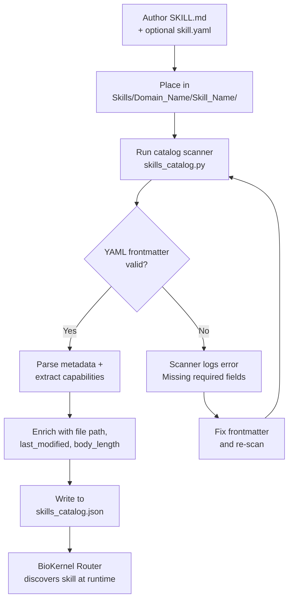
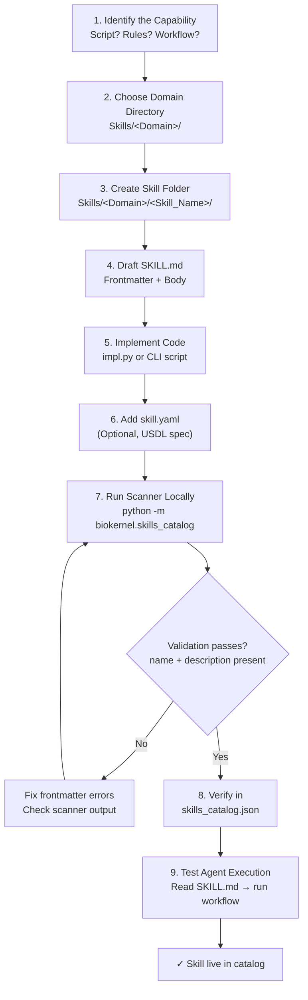

The BioKernel platform treats every capability as a **Skill**—a discrete, discoverable, and executable unit of biomedical AI functionality. Adding a new skill means authoring a `SKILL.md` definition (and optionally a companion `skill.yaml`), placing it in the correct domain directory, and verifying it passes the catalog scanner's validation. This page walks you through the full lifecycle: from identifying your capability's shape, through authoring and validation, to integration with the BioKernel runtime and cross-provider deployment.

Sources: [TUTORIAL_ADDING_NEW_SKILLS.md](Skills/TUTORIAL_ADDING_NEW_SKILLS.md#L14-L99), [skills_catalog.py](biokernel/skills_catalog.py#L1-L200)

## How Skills Flow Through the Platform

Before writing a single line, it helps to understand where your skill fits in the BioKernel processing pipeline. The scanner discovers your `SKILL.md`, parses its YAML frontmatter, validates required fields, enriches it with file metadata and extracted capabilities, and writes the result into the global `skills_catalog.json`. The BioKernel's [Semantic Skill Router](5-semantic-skill-router) then uses this catalog at runtime to match user queries to the right skill.



> [!TIP]
> The scanner's `REQUIRED_FIELDS` are `["name", "description"]`. If either is missing from your YAML frontmatter, the skill will be logged as an error and excluded from the catalog. Always validate locally before pushing.

Sources: [skills_catalog.py](biokernel/skills_catalog.py#L29-L119)

## The SKILL.md Standard

Every skill is defined by a `SKILL.md` file placed inside a domain-appropriate directory. This file combines a **YAML frontmatter** block (machine-parseable metadata) with a **Markdown body** (human-readable documentation and workflow). The frontmatter acts as the "prompt" the BioKernel uses to decide *whether* to invoke your skill; the body tells the agent *how* to execute it.

### Required Directory Structure

```text
Skills/
└── Domain_Name/              # e.g., Genomics, Clinical, Drug_Discovery
    └── Skill_Name/           # e.g., CRISPR_Design_Agent, Medea
        ├── SKILL.md          # The Definition (Required)
        ├── impl.py           # Implementation script (Optional)
        ├── skill.yaml        # USDL machine-readable spec (Optional)
        └── references/       # Supporting docs (Optional)
            └── rules.md
```

### Frontmatter Fields Reference

The YAML frontmatter is delimited by `---` markers. The table below documents every recognized field, whether it is required by the scanner, and its purpose.

| Field | Required | Type | Description |
|-------|----------|------|-------------|
| `name` | **Yes** | `string` | Unique skill identifier (e.g., `crispr-guide-design`, `scrna-qc`). Used for catalog indexing and routing. |
| `description` | **Yes** | `string` | One-sentence summary of what the skill does. Acts as the primary "prompt" for agent selection—write this carefully. |
| `keywords` | No | `list[string]` | Core terms for semantic indexing (e.g., `CRISPR`, `sgRNA`, `off-target`). |
| `tool_type` | No | `string` | Execution type: `python`, `cli`, or `mixed`. |
| `primary_tool` | No | `string` | Primary software dependency (e.g., `scanpy`, `pairtools`, `cooltools`). |
| `measurable_outcome` | No | `string` | SMART goal defining success (e.g., "Return ≥4 guides with scores within 10 minutes per gene"). |
| `allowed-tools` | No | `list[string]` | Security sandbox—limits which tools the agent may use (e.g., `read_file`, `run_shell_command`). |
| `license` | No | `string` | License identifier (default: `MIT`). |
| `metadata` | No | `object` | Author, version, compatibility nested fields. |
| `reliability` | No | `list[object]` | Source reliability scores with `source`, `score` (0–1), and `rationale`. |

Sources: [TUTORIAL_ADDING_NEW_SKILLS.md](Skills/TUTORIAL_ADDING_NEW_SKILLS.md#L37-L81), [skills_catalog.py](biokernel/skills_catalog.py#L29-L29), [CRISPR_Design_Agent/SKILL.md](Skills/Genomics/CRISPR_Design_Agent/SKILL.md#L14-L33)

### Frontmatter Examples by Complexity

Skills in the repository range from minimal to richly annotated. Here are three real examples at increasing levels of detail:

**Minimal** (only required fields):
```yaml
---
name: bio-medea-therapeutic-discovery
description: An AI agent for therapeutic discovery that executes transparent,
  multi-step omics analyses including research planning, code execution,
  and literature reasoning.
---
```

**Standard** (with execution metadata and security):
```yaml
---
name: prior-auth-coworker
description: Prior Auth Review
measurable_outcome: Execute skill workflow successfully with valid output within 15 minutes.
allowed-tools:
  - read_file
  - run_shell_command
---
```

**Full** (with keywords, reliability, and compatibility):
```yaml
---
name: scrna-qc
description: Execute the MAD-based single-cell RNA-seq QC workflow to filter
  low-quality cells and emit reports plus filtered AnnData files.
measurable_outcome: Produce filtered .h5ad files, before/after plots, and
  qc_summary.json within 20 minutes per dataset.
keywords:
  - scRNAseq
  - MAD
  - h5ad
  - QC
allowed-tools:
  - read_file
  - run_shell_command
reliability:
  - source: https://github.com/scverse/scanpy
    score: 0.90
    rationale: >-
      Scanpy repository maintained by the scverse core team with actively
      tested QC utilities.
  - source: https://github.com/theislab/single-cell-best-practices
    score: 0.88
    rationale: >-
      Theis Lab best-practices playbook detailing MAD-based QC thresholds.
---
```

Sources: [Medea/SKILL.md](Skills/Drug_Discovery/Medea/SKILL.md#L14-L25), [Prior_Authorization/SKILL.md](Skills/Clinical/Prior_Authorization/SKILL.md#L14-L21), [Single_Cell_RNA_QC/SKILL.md](Skills/Genomics/Single_Cell_RNA_QC/SKILL.md#L14-L30)

## Step-by-Step: Adding a New Skill

The following flowchart captures the complete authoring workflow, from capability identification through validation and catalog integration.



### Step 1 — Identify the Capability

Determine what your skill does at the atomic level. The repository enforces a design principle: **skills should do one thing well**. Ask yourself:

- Is this a **Python script** that processes data (e.g., QC filtering, variant calling)?
- Is this a **set of rules** an agent should follow (e.g., clinical policy matching)?
- Is this a **complex workflow** orchestrating multiple steps (e.g., multi-omics discovery)?

If your capability spans multiple concerns, consider splitting it into separate skills that the [DAG Workflow Engine](6-dag-workflow-engine) can compose.

### Step 2 — Choose the Domain Directory

Place your skill in the correct top-level domain under `Skills/`. The repository currently organizes skills across 40+ domains. The most active domains include:

| Domain | Typical Skills | Example Path |
|--------|---------------|--------------|
| `Genomics` | Single-cell, CRISPR, variant calling, spatial | `Skills/Genomics/CRISPR_Design_Agent/` |
| `Clinical` | EHR, radiology, trial matching, prior auth | `Skills/Clinical/Prior_Authorization/` |
| `Drug_Discovery` | Antibody design, chemoinformatics, MD | `Skills/Drug_Discovery/Medea/` |
| `MCP_Servers` | BioMCP, MCPmed protocol servers | `Skills/MCP_Servers/BioMCP/` |
| `Research_Tools` | Literature mining, knowledge graphs | `Skills/Research_Tools/KRAGEN/` |
| `Protein_Science` | Structure prediction, docking | `Skills/Protein_Science/` |

If no existing domain fits, create a new top-level directory following the `Pascal_Case` naming convention.

Sources: [Skills/README.md](Skills/README.md#L83-L97)

### Step 3 — Create the Skill Folder

```bash
mkdir -p Skills/Your_Domain/Your_Skill_Name
```

Use `Pascal_Case` or `snake_case` consistent with neighboring directories. The folder name becomes the primary identifier in the catalog's `relative_path`.

### Step 4 — Draft SKILL.md

Use the following template as your starting point. Every section after the frontmatter becomes part of the Markdown body that the agent reads at execution time.

```markdown
<!--
  COPYRIGHT NOTICE
  (Retain repository copyright header)
-->
---
name: my-new-skill
description: A one-sentence description of what this skill does.
keywords:
  - keyword1
  - keyword2
measurable_outcome: SMART goal defining success criteria.
allowed-tools:
  - read_file
  - run_shell_command
license: MIT
metadata:
  author: Your Name
  version: "1.0.0"
---

# My New Skill

A more detailed description of the skill.

## When to Use This Skill

*   Trigger condition 1
*   Trigger condition 2

## Core Capabilities

1.  **Capability A**: Description.
2.  **Capability B**: Description.

## Workflow

1.  **Step 1**: What the agent should do first.
2.  **Step 2**: The command to run or file to read.

## Example Usage

**User**: "Do X."

**Agent Action**:
\`\`\`bash
python3 path/to/script.py --arg "value"
\`\`\`
```

> [!TIP]
> The `description` field is the single most important line you write—it is the primary signal the [Semantic Skill Router](5-semantic-skill-router) uses for skill selection. Write it as a precise, action-oriented sentence: "Execute the MAD-based single-cell RNA-seq QC workflow to filter low-quality cells" is far better than "Handles QC."

Sources: [TUTORIAL_ADDING_NEW_SKILLS.md](Skills/TUTORIAL_ADDING_NEW_SKILLS.md#L37-L81)

### Step 5 — Implement Code

If the skill requires execution (as opposed to being a pure knowledge/rules skill), write the implementation script. The script should:

- **Accept CLI arguments** for parameterization (`argparse` is standard).
- **Handle errors gracefully** with meaningful exit codes and messages.
- **Produce structured output** (JSON, CSV, or .h5ad) that downstream skills can consume.
- **Log parameters** for reproducibility.

Reference patterns from existing implementations like `crispr_designer.py` or `qc_core.py`:

```bash
# Example: CRISPR Design Agent invocation
python3 Skills/Genomics/CRISPR_Design_Agent/crispr_designer.py \
    --sequence "ATGGAGGAGCCGCAGTCAG..." \
    --output guides.json
```

### Step 6 — Add skill.yaml (Optional)

For skills that need cross-provider deployment, add a `skill.yaml` file conforming to the **Universal Skill Definition Language (USDL)** schema. This machine-readable spec defines capabilities with typed inputs/outputs, platform-specific configurations, and validation test cases—enabling the [USDL Transpiler](8-usdl-transpiler) to generate provider-native artifacts.

```yaml
skill:
  id: biomedical.drug_discovery.molecule_design
  version: 1.0.0
  name: MoleculeEvolution
  category: drug_discovery/molecule_generation
  description:
    short: "Evolve molecules against a target protein."
    long: "Generational molecule optimization using evolutionary algorithms."
    use_cases:
      - Lead optimization for drug candidates
  capabilities:
    - name: evolve
      description: Execute molecular evolution
      inputs:
        - name: target_protein
          type: str
          required: true
      outputs:
        - name: result
          type: Dict
  metadata:
    created: '2026-01-12'
    author: Your Name
```

The USDL schema enforces the `id` pattern `domain.category.name` (e.g., `biomedical.genomics.single_cell_qc`) and enumerates valid `category` values. Capabilities define typed `inputs` and `outputs` that the [LLM Provider Adapters](9-llm-provider-adapters) use to generate function-calling interfaces.

Sources: [usdl_schema_v1.json](biokernel/schema/usdl_schema_v1.json#L1-L200), [Molecule_Design/skill.yaml](Skills/Drug_Discovery/Molecule_Design/skill.yaml#L1-L26), [Prior_Authorization/skill.yaml](Skills/Clinical/Prior_Authorization/skill.yaml#L1-L30)

### Step 7 — Run the Scanner Locally

The `skills_catalog.py` module recursively discovers all `SKILL.md` files, parses their frontmatter with PyYAML, validates required fields, and writes the catalog to `skills_catalog.json`. Run it locally to verify your skill passes validation:

```python
from biokernel.skills_catalog import generate_catalog

catalog = generate_catalog(
    root_dir="Skills",
    output_file="skills_catalog.json"
)

print(f"Total skills: {catalog['total_skills']}")
print(f"Errors: {catalog['total_errors']}")
for err in catalog.get("errors", []):
    print(f"  ✗ {err}")
```

The scanner performs these validation checks:

| Check | Behavior on Failure |
|-------|-------------------|
| YAML frontmatter present | Skill skipped; logged as warning |
| `name` field present | Logged as error; skill included with `_validation_errors` |
| `description` field present | Logged as error; skill included with `_validation_errors` |
| `reliability` entries are well-formed | Logged as error; record skipped from reliability report |
| Copyright comment header | Stripped automatically before parsing |

Sources: [skills_catalog.py](biokernel/skills_catalog.py#L43-L158)

### Step 8 — Verify in the Catalog

After a successful scan, confirm your skill appears in `skills_catalog.json`:

```bash
cat skills_catalog.json | python3 -m json.tool | grep -A5 '"name": "my-new-skill"'
```

Verify these enriched fields are populated:
- `file_path` — absolute path to your `SKILL.md`
- `relative_path` — path relative to `Skills/`
- `last_modified` — ISO 8601 timestamp
- `body_length` — character count of the Markdown body
- `capabilities` — auto-extracted from `##` headings in the body

Sources: [skills_catalog.py](biokernel/skills_catalog.py#L110-L119)

### Step 9 — Test Agent Execution

Verify that an LLM agent reading your `SKILL.md` can successfully execute the workflow end-to-end. This means:

1. **Trigger test**: Confirm the [Semantic Skill Router](5-semantic-skill-router) selects your skill when given a relevant query.
2. **Workflow test**: Follow the `## Workflow` steps as an agent would—run the commands, check outputs.
3. **Measurable outcome test**: Validate against the `measurable_outcome` SMART goal.
4. **Safety test**: For clinical skills, ensure guardrails and `allowed-tools` constraints are enforced. See [Assertion and Safety Checks](14-assertion-and-safety-checks) for the evaluation framework.

## The USDL Schema: Extended Skill Definition

For skills targeting cross-provider deployment (Claude, OpenAI, Gemini), the USDL schema provides a richer specification format than YAML frontmatter alone. The schema is defined in [usdl_schema_v1.json](biokernel/schema/usdl_schema_v1.json) and covers:

### USDL Top-Level Structure

| Section | Purpose | Required |
|---------|---------|----------|
| `skill.id` | Unique identifier matching `^[a-z]+\.[a-z_]+\.[a-z_]+$` | **Yes** |
| `skill.version` | Semantic version (`x.y.z`) | **Yes** |
| `skill.name` | Human-readable name (≤100 chars) | **Yes** |
| `skill.category` | Enumerated domain (e.g., `genomics/single_cell`, `clinical/ehr`) | **Yes** |
| `skill.description` | Short, long, and use_cases | **Yes** (short only) |
| `skill.capabilities` | Array of named capabilities with inputs/outputs | **Yes** |
| `skill.prompts` | System prompt, user template, examples | No |
| `skill.tools` | python_function, api_endpoint, mcp_tool, shell_command | No |
| `skill.dependencies` | python, system, data, models | No |
| `skill.platform_configs` | Per-provider config (claude, openai, gemini) | No |
| `skill.validation` | Test cases and benchmarks | No |
| `skill.evals` | Automated evaluation with assertions | No |
| `skill.optimization` | AI-driven prompt optimization config | No |

### Valid Category Enumerations

The USDL schema restricts `skill.category` to a fixed enumeration ensuring consistent domain classification:

- **Genomics**: `genomics/single_cell`, `genomics/spatial_transcriptomics`, `genomics/variant_interpretation`, `genomics/crispr`, `genomics/multi_omics`
- **Clinical**: `clinical/ehr`, `clinical/trial_matching`, `clinical/diagnosis`, `clinical/radiology`, `clinical/oncology`
- **Drug Discovery**: `drug_discovery/molecule_generation`, `drug_discovery/property_prediction`, `drug_discovery/antibody_design`, `drug_discovery/target_id`
- **Research**: `research/literature_mining`, `research/knowledge_graphs`, `research/hypothesis_generation`, `research/experimental_design`

### USDL Evals: Built-in Assertion Types

The `skill.evals` section supports automated quality gates with these assertion types:

| Assertion | Purpose |
|-----------|---------|
| `contains` | Output must contain this string |
| `not_contains` | Output must NOT contain this string |
| `regex` | Output must match this regex |
| `type` | Expected output type: `json`, `molecule_list`, `gene_list`, `markdown` |
| `length_min` / `length_max` | Character length bounds |
| `safety_check` | Verify medical safety disclaimers present |
| `biomedical_entity` | Assert minimum count of gene/drug/protein/disease/pathway entities |

Sources: [usdl_schema_v1.json](biokernel/schema/usdl_schema_v1.json#L1-L318)

## SKILL.md vs. skill.yaml: When to Use Each

The repository supports two complementary definition formats. Understanding when to use each prevents duplication and ensures proper integration.

| Aspect | SKILL.md | skill.yaml (USDL) |
|--------|----------|-------------------|
| **Purpose** | Agent-readable definition + documentation | Machine-readable cross-provider spec |
| **Required** | **Yes** — every skill must have one | No — only for cross-provider deployment |
| **Parsed by** | `skills_catalog.py` scanner | [USDL Transpiler](8-usdl-transpiler) |
| **Format** | YAML frontmatter + Markdown body | Pure YAML (USDL schema) |
| **Contains** | Description, workflow, example usage, guardrails | Typed I/O, platform configs, evals |
| **Consumer** | LLM agents at runtime | Transpiler → provider-native artifacts |
| **Validation** | Scanner checks `name` + `description` | Full JSON Schema validation |

**Rule of thumb**: Always author `SKILL.md`. Add `skill.yaml` only when your skill needs typed inputs/outputs for function calling, platform-specific configuration, or automated evaluation test cases.

Sources: [TUTORIAL_ADDING_NEW_SKILLS.md](Skills/TUTORIAL_ADDING_NEW_SKILLS.md#L24-L35), [Molecule_Design/skill.yaml](Skills/Drug_Discovery/Molecule_Design/skill.yaml#L1-L26)

## Reliability Scoring

Skills may include a `reliability` block in their frontmatter to document the provenance and trustworthiness of underlying data sources or tools. The scanner extracts these into a separate `skills_reliability_report.json`. Each entry requires:

| Field | Type | Description |
|-------|------|-------------|
| `source` | `string` | URL or identifier of the source (e.g., GitHub repo) |
| `score` | `float` | Reliability score between 0 and 1 |
| `rationale` | `string` | Justification for the score |

The scanner validates that `reliability` is a list of mappings with valid `source` and numeric `score` fields. Malformed entries are logged as errors and excluded from the reliability report.

Example from the scRNA-seq QC skill:
```yaml
reliability:
  - source: https://github.com/scverse/scanpy
    score: 0.90
    rationale: >-
      Scanpy repository maintained by the scverse core team with actively
      tested QC utilities (mito/ribo scoring, MAD filtering).
```

Sources: [skills_catalog.py](biokernel/skills_catalog.py#L123-L152), [Single_Cell_RNA_QC/SKILL.md](Skills/Genomics/Single_Cell_RNA_QC/SKILL.md#L21-L29)

## Best Practices and Design Principles

The repository enforces four design principles for skill authoring, drawn from the tutorial standard and validated by the existing 886-skill catalog.

**Atomic** — Each skill should encapsulate a single, well-defined capability. The scRNA-seq QC skill filters cells and emits reports, but deliberately excludes doublet detection and batch correction, which are separate skills. This composability allows the [DAG Workflow Engine](6-dag-workflow-engine) to chain skills without coupling.

**Discoverable** — The `name` and `description` fields are your skill's public API to the router. Use lowercase-hyphen names (`crispr-guide-design`, not `CRISPR Guide Design`). Write descriptions as action sentences: "Execute the MAD-based single-cell RNA-seq QC workflow to filter low-quality cells" tells the router exactly when to select this skill.

**Safe** — Always define `allowed-tools` to create a security sandbox. The most common tool set is `["read_file", "run_shell_command"]`, which permits file I/O and shell execution without granting unrestricted system access. For clinical skills, include a `## Guardrails` section in the body documenting safety constraints.

**Contextual** — For skills relying on domain knowledge, provide a `references/` directory with rules, checklists, or literature citations. The CRISPR Design Agent demonstrates this pattern with its `prompt.md` and `README.md` supporting files. The [Biomedical Evaluation Framework](13-biomedical-evaluation-framework) can validate that agents correctly use these references.

Sources: [TUTORIAL_ADDING_NEW_SKILLS.md](Skills/TUTORIAL_ADDING_NEW_SKILLS.md#L91-L97), [CRISPR_Design_Agent/SKILL.md](Skills/Genomics/CRISPR_Design_Agent/SKILL.md#L63-L69), [Single_Cell_RNA_QC/SKILL.md](Skills/Genomics/Single_Cell_RNA_QC/SKILL.md#L43-L46)

## Troubleshooting Common Issues

| Problem | Cause | Resolution |
|---------|-------|------------|
| Skill not appearing in catalog | Missing YAML frontmatter | Ensure `SKILL.md` starts with `---` delimiters around metadata block |
| `Missing fields ['name']` error | Required field absent | Add `name:` and/or `description:` to frontmatter |
| `YAML parse error in frontmatter` | Invalid YAML syntax | Validate YAML with `python -c "import yaml; yaml.safe_load(open('SKILL.md'))"` |
| `Reliability block must be a list` | `reliability` is a mapping instead of array | Wrap reliability entries in YAML list syntax (`- source: ...`) |
| Skill selected for wrong queries | Vague `description` | Rewrite description as a precise, action-oriented sentence with domain-specific terms |
| HTML comment breaks parsing | Copyright header before frontmatter | Scanner auto-strips `<!-- -->` comments; ensure they are properly closed with `-->` |
| Capabilities not extracted | Body uses `**bold**` instead of `## headings` | Scanner extracts capabilities from `## ` headings, not inline formatting |

Sources: [skills_catalog.py](biokernel/skills_catalog.py#L32-L70), [skills_catalog.py](biokernel/skills_catalog.py#L100-L120)

## Next Steps

Once your skill is live in the catalog, these pages provide the next level of integration:

- **[SKILL.md Standard](3-skill-md-standard)** — Deep reference for every frontmatter field and body section
- **[Semantic Skill Router](5-semantic-skill-router)** — How the router matches queries to your skill's description
- **[USDL Transpiler](8-usdl-transpiler)** — Generating provider-native artifacts from your `skill.yaml`
- **[Biomedical Evaluation Framework](13-biomedical-evaluation-framework)** — Setting up automated evals for your skill
- **[Assertion and Safety Checks](14-assertion-and-safety-checks)** — Enforcing guardrails for clinical skills