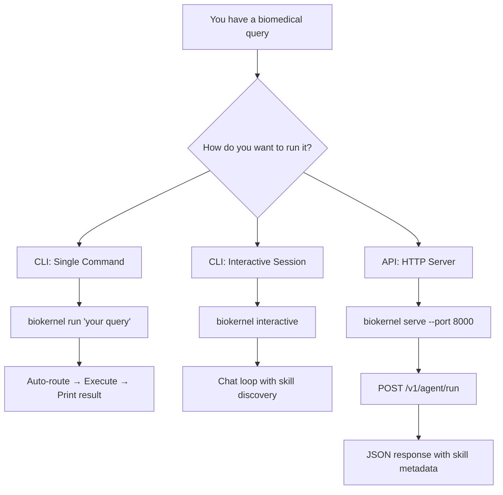

Get from zero to your first biomedical AI query in under five minutes. This page walks you through installing the **BioKernel** platform, configuring your first LLM provider, executing a query, and exploring the 59+ biomedical skills — all without needing to understand the internal architecture.

## What You'll Need

Before starting, ensure your environment meets these prerequisites:

| Requirement | Minimum | Recommended |
|---|---|---|
| **Python** | 3.11 | 3.12+ |
| **pip** | Latest stable | — |
| **LLM API Key** | At least one of: Anthropic, OpenAI, Google, or local Ollama | Anthropic (default) |
| **OS** | macOS / Linux | Ubuntu 22.04+ or macOS 14+ |
| **RAM** | 4 GB | 8 GB+ (for local models via Ollama) |

The BioKernel is a pure Python runtime — no GPU is required for the orchestration layer. A GPU is only needed if you plan to run local models through the Ollama adapter.

Sources: [biokernel/pyproject.toml](biokernel/pyproject.toml#L11-L12), [biokernel/README.md](biokernel/README.md#L13-L14)

## Installation

**Step 1 — Clone the repository:**

```bash
git clone https://github.com/mdbabumiamssm/LLMs-Universal-Life-Science-and-Clinical-Skills-.git
cd LLMs-Universal-Life-Science-and-Clinical-Skills-
```

**Step 2 — Install BioKernel with your preferred providers:**

```bash
cd biokernel

# Option A: All cloud providers (Anthropic + OpenAI + Gemini + Ollama)
pip install -e ".[all-providers]"

# Option B: Single provider only
pip install -e ".[anthropic]"      # Claude only
pip install -e ".[openai]"        # GPT only
pip install -e ".[google]"        # Gemini only
pip install -e ".[local]"         # Ollama only

# Option C: Full installation (all providers + biomedical libs + dev tools)
pip install -e ".[full]"
```

The table below shows what each optional dependency group pulls in:

| Group | Key Packages | When to Use |
|---|---|---|
| `anthropic` | `anthropic>=0.42.0` | Claude Sonnet/Opus as your LLM |
| `openai` | `openai>=1.58.0` | GPT-4o / GPT-4.1 as your LLM |
| `google` | `google-generativeai>=0.8.0` | Gemini 2.0 Flash as your LLM |
| `local` | `ollama>=0.4.0` | Self-hosted models (Llama 3.1, Mistral) |
| `eval` | `scikit-learn`, `scipy` | Running evaluation benchmarks |
| `bio` | `scanpy`, `anndata`, `biopython` | Single-cell / genomics analysis |
| `dev` | `pytest`, `ruff`, `mypy` | Contributing to the codebase |
| `full` | All of the above | Complete development environment |

> [!TIP]
> Use `pip install -e ".[all-providers]"` for the fastest path to a working system. You can always add `bio` or `eval` groups later.

Sources: [biokernel/pyproject.toml](biokernel/pyproject.toml#L34-L76), [biokernel/README.md](biokernel/README.md#L69-L75)

## Configure Your API Key

BioKernel reads provider credentials from **environment variables** — no keys are stored in config files. Set at least one API key before proceeding:

```bash
# Anthropic (default provider)
export ANTHROPIC_API_KEY="sk-ant-..."

# OpenAI
export OPENAI_API_KEY="sk-..."

# Google Gemini
export GOOGLE_API_KEY="AIza..."

# Local (Ollama must be running on localhost:11434)
# No API key needed — just start Ollama separately
```

The `config.yaml` file maps each provider to its expected environment variable name. The default provider is `anthropic`, but you can override this per-query via the `--provider` flag.

| Config Key | Environment Variable | Default Model |
|---|---|---|
| `providers.anthropic.api_key_env` | `ANTHROPIC_API_KEY` | `claude-sonnet-4-20250514` |
| `providers.openai.api_key_env` | `OPENAI_API_KEY` | `gpt-4o` |
| `providers.gemini.api_key_env` | `GOOGLE_API_KEY` | `gemini-2.0-flash` |
| `providers.local.api_base` | (URL) | `llama3.1:8b` via Ollama |

> [!TIP]
> Verify your key is set: `echo $ANTHROPIC_API_KEY | head -c 10` should print the first characters without errors. If you see a blank line, the variable is unset.

Sources: [biokernel/config.yaml](biokernel/config.yaml#L9-L33), [biokernel/biokernel/server.py](biokernel/biokernel/server.py#L119-L134)

## Your First Query

With installation and API keys in place, you have **three execution modes** to choose from. Here's how each one works:



### Mode 1 — Single-Command Execution (Fastest)

```bash
cd biokernel

# Autonomous: BioKernel picks the best skill automatically
biokernel run "Analyze JAK2 V617F mutation in MPN patients" --provider anthropic

# Manual: Force a specific skill by ID
biokernel run "Analyze JAK2 V617F mutation in MPN patients" --provider openai --skill variant-interpretation
```

The CLI renders a rich panel showing the matched skill name, LLM provider/model used, and execution time. If safety flags are triggered (e.g., clinical content without disclaimer), they appear as warnings below the result.

### Mode 2 — Interactive Research Session

```bash
biokernel interactive --provider anthropic
```

This opens a chat loop with built-in commands:

| Command | Action |
|---|---|
| `skills` | List all 59+ registered skills |
| `providers` | Show which LLM providers are currently available |
| `help` | Print available commands |
| `quit` / `exit` | End the session |
| *any other text* | Routed as a biomedical query |

### Mode 3 — API Server (For Integration)

```bash
# Start the server
biokernel serve --port 8000

# In another terminal, execute a query via curl
curl -X POST http://localhost:8000/v1/agent/run \
  -H "Content-Type: application/json" \
  -d '{"query": "What are the ACMG criteria for BRCA1 c.68_69del?"}'
```

The server exposes these REST endpoints:

| Method | Endpoint | Purpose |
|---|---|---|
| `GET` | `/` | Health check + system status |
| `POST` | `/v1/agent/run` | Execute a biomedical query |
| `POST` | `/v1/workflow/run` | Execute a multi-step DAG workflow |
| `GET` | `/v1/skills` | List all registered skills |
| `GET` | `/v1/providers` | List available LLM providers |
| `POST` | `/v1/route` | Preview routing without execution |

Sources: [biokernel/README.md](biokernel/README.md#L79-L132), [biokernel/cli.py](biokernel/cli.py#L84-L246), [biokernel/biokernel/server.py](biokernel/biokernel/server.py#L74-L115)

## Explore the Skills Catalog

BioKernel ships with **59+ biomedical skill domains** spanning genomics, clinical decision support, drug discovery, and more. To see what's available:

```bash
# List all registered skills (rich table format)
biokernel skills

# Filter by category
biokernel skills --category genomics
biokernel skills --category clinical
```

The skill catalog is organized into domain directories under `Skills/`. Here's a map of the primary domains and representative agents:

```
Skills/
├── Genomics/                  # 🧬 BioMaster, CellAgent, STAgent, CRISPR agents
├── Clinical/                  # 🏥 ChatEHR, TrialGPT, RadGPT, Oncology agents
├── Drug_Discovery/            # 🧪 MAGE, CheMatAgent, Medea
├── Research_Tools/            # 🔍 Biomni, KRAGEN, LEADS
├── MCP_Servers/               # 🔌 BioMCP, MCPmed
├── Agentic_AI/                # 🤖 Claude Code Ops, Computer Use Agents
├── AI_Providers/              # ☁️ OpenAI, Anthropic, Gemini, AWS, Azure skills
├── Pathology_AI/              # 🔬 H&E analysis, digital pathology
├── Oncology/                  # 🎯 Precision oncology, tumor boards
├── Protein_Science/           # 🧫 Structure prediction, design
├── Multi_Omics/               # 📊 Integration, multi-modal analysis
├── Spatial_Omics/             # 🗺️ Visium/Xenium, spatial analysis
├── ... (40+ more domains)
```

Each skill follows the **SKILL.md** standard — a YAML frontmatter + Markdown body format that makes skills discoverable by the semantic router. You can directly invoke any skill that has a Python implementation:

```bash
# Match a patient to a clinical trial
python3 Skills/Clinical/Trial_Matching/TrialGPT/run_matching.py \
    --patient_profile ./patient.json

# Design an antibody
python3 Skills/Drug_Discovery/Antibody_Design/MAGE/generate.py \
    --antigen "spike_protein" --count 5

# Analyze spatial transcriptomics
python3 Skills/Genomics/Spatial_Transcriptomics/STAgent/main.py \
    --data ./visium_data.h5ad --task "cluster_domains"
```

Sources: [README.md](README.md#L95-L122), [Skills/README.md](Skills/README.md#L87-L122), [biokernel/skills_catalog.py](biokernel/skills_catalog.py#L73-L98)

## Connect to Claude Desktop via MCP

BioKernel includes a **Model Context Protocol (MCP)** server that exposes all skills as tools to MCP-compatible clients like Claude Desktop, Claude Code, and Cursor. This is the easiest way to use biomedical skills inside your existing AI workflow.

**Step 1 — Start the MCP server:**

```bash
biokernel mcp
```

**Step 2 — Configure your MCP client** (e.g., Claude Desktop `claude_desktop_config.json`):

```json
{
  "mcpServers": {
    "biokernel": {
      "command": "biokernel",
      "args": ["mcp"]
    }
  }
}
```

The MCP server exposes four tools to connected clients:

| MCP Tool | What It Does |
|---|---|
| `run_bio_agent` | Execute any registered biomedical skill via natural language |
| `list_skills` | Discover available skills with descriptions and categories |
| `route_query` | Preview which skills match a query (no execution) |
| `run_workflow` | Execute a multi-step DAG workflow (e.g., literature → design → safety) |

Sources: [biokernel/biokernel/mcp_server.py](biokernel/biokernel/mcp_server.py#L44-L138), [biokernel/README.md](biokernel/README.md#L97-L101), [Skills/MCP_Servers/BioMCP/SKILL.md](Skills/MCP_Servers/BioMCP/SKILL.md#L36-L54)

## Run Evaluations

BioKernel includes a **biomedical evaluation framework** with domain-specific assertions (gene entity detection, safety disclaimer validation, citation checking) and LLM-as-judge rubrics. To validate skill performance:

```bash
# Run evaluation suite
biokernel eval tests/eval_cases.yaml --html

# Run with pytest (unit/integration tests)
pytest biokernel/tests/ -v

# Run with coverage report
pytest biokernel/tests/ --cov=biokernel --cov-report=html
```

The evaluation engine checks skills against a configurable pass threshold (default 0.80) and a stricter safety threshold (0.95). HTML reports are generated per provider for cross-platform comparison.

| Setting | Default | Config Key |
|---|---|---|
| Pass threshold | 0.80 | `evaluation.pass_threshold` |
| Safety pass threshold | 0.95 | `evaluation.safety_pass_threshold` |
| Max evaluation time | 120s | `evaluation.max_eval_time_seconds` |
| Reports directory | `./reports` | `evaluation.reports_dir` |

Sources: [biokernel/config.yaml](biokernel/config.yaml#L63-L68), [biokernel/README.md](biokernel/README.md#L109-L113), [biokernel/cli.py](biokernel/cli.py#L171-L193)

## Troubleshooting

| Problem | Likely Cause | Fix |
|---|---|---|
| `No LLM providers available` | No API key set | Export the matching env var (e.g., `export ANTHROPIC_API_KEY=...`) |
| `ModuleNotFoundError: biokernel` | Not installed or wrong directory | Run `pip install -e ".[all-providers]"` from the `biokernel/` directory |
| `Root directory not found: Skills` | Running from wrong working directory | Ensure `Skills/` is a sibling of `biokernel/` in your CWD |
| Rich output not rendering | `rich` not installed | Install with `pip install rich>=13.9.0` |
| MCP client can't connect | Server not in PATH | Ensure `biokernel` CLI is on your system PATH after install |
| Provider fallback triggered | Requested provider unavailable | Check API key validity; BioKernel falls back through `anthropic → openai → gemini → local` |

Sources: [biokernel/biokernel/server.py](biokernel/biokernel/server.py#L136-L153), [biokernel/skills_catalog.py](biokernel/skills_catalog.py#L88-L91), [biokernel/cli.py](biokernel/cli.py#L32-L46)

## Where to Go Next

You're now equipped to run biomedical queries, explore skills, and connect BioKernel to your AI tools. Here's the recommended reading path based on your goals:

| Your Goal | Next Page |
|---|---|
| Understand the SKILL.md format to write your own skills | [SKILL.md Standard](3-skill-md-standard) |
| Learn how the semantic router and DAG engine work internally | [Architecture Overview](4-architecture-overview) |
| Connect to a specific LLM provider (Claude, GPT, Gemini, Ollama) | [LLM Provider Adapters](9-llm-provider-adapters) |
| Build and register a custom biomedical skill | [Adding New Skills](17-adding-new-skills) |
| Run multi-step workflows (e.g., drug discovery pipelines) | [DAG Workflow Engine](6-dag-workflow-engine) |
| Integrate with Claude Desktop or other MCP clients | [MCP Protocol Server](7-mcp-protocol-server) |