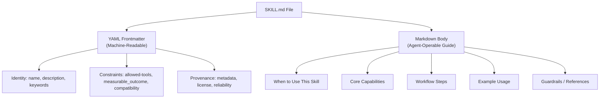
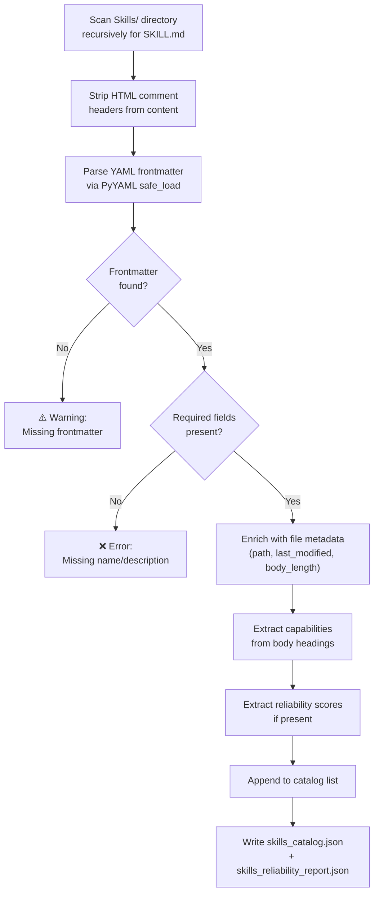

The **SKILL.md Standard** is the self-documenting contract that makes every AI capability in this repository discoverable, executable, and safe. Think of it as a résumé for each skill — a machine-readable file that tells the BioKernel engine *what the skill does, when to trigger it, how to run it, and what guardrails apply*. With **886 skills** already indexed across the repository, this standard is the single reason an autonomous agent can navigate the entire biomedical skills library without human guidance. This page explains the format from the ground up, walks through real examples, and shows you how the BioKernel validates your SKILL.md at scan time.

Sources: [skills_catalog.json](skills_catalog.json#L1-L10), [Skills/README.md](Skills/README.md#L84-L95)

## Why a Standard Matters

Without a standard, every skill is an island — a folder of scripts with no consistent entry point. An AI agent (or a developer) must open files, guess what they do, and hope the code matches the README. The SKILL.md Standard solves three core problems at once:

| Problem | What SKILL.md Provides |
|---|---|
| **Discoverability** — "Which skill handles X?" | The `name`, `description`, and `keywords` fields act as a semantic index. The BioKernel scanner reads every SKILL.md and builds a searchable catalog. |
| **Executability** — "How do I run it?" | The `allowed-tools`, `compatibility`, and `Workflow` sections tell the agent exactly which tools to invoke and in what order. |
| **Safety** — "What can go wrong?" | The `allowed-tools` whitelist sandboxes each skill, and the `measurable_outcome` field sets a verifiable success criterion. |

The result is a **Biomedical Operating System** where skills are not just files on disk — they are first-class, addressable capabilities that any LLM can discover, reason about, and invoke programmatically.

Sources: [Skills/README.md](Skills/README.md#L30-L38), [Skills/TUTORIAL_ADDING_NEW_SKILLS.md](Skills/TUTORIAL_ADDING_NEW_SKILLS.md#L14-L20)

## Anatomy of a SKILL.md File

Every SKILL.md is composed of two parts: a **YAML frontmatter block** enclosed in `---` delimiters, and a **Markdown body** that documents the skill in human-readable form. The frontmatter is the machine-parseable contract; the body is the operational guide for the agent. Here is a visual overview of how these parts relate:



Sources: [Skills/Genomics/CRISPR_Design_Agent/SKILL.md](Skills/Genomics/CRISPR_Design_Agent/SKILL.md#L14-L26), [Skills/TUTORIAL_ADDING_NEW_SKILLS.md](Skills/TUTORIAL_ADDING_NEW_SKILLS.md#L32-L56)

## Directory Structure Convention

Each skill lives in its own folder under a domain category. The SKILL.md file is the **required** entry point; implementation files and reference materials are optional.

```text
Skills/
└── Domain_Name/                # e.g., Clinical, Genomics, Drug_Discovery
    └── Skill_Name/             # e.g., CRISPR_Design_Agent, ChatEHR
        ├── SKILL.md            # ✅ Required — The skill definition
        ├── impl.py             # ⬜ Optional — Python implementation
        ├── agent.py            # ⬜ Optional — Agent entry point
        ├── references/         # ⬜ Optional — Supporting docs
        │   └── rules.md
        └── requirements.txt    # ⬜ Optional — Dependencies
```

The BioKernel scanner recursively searches for any file named `SKILL.md` under the `Skills/` root, so the exact nesting depth does not matter — only that the file exists and is well-formed.

Sources: [Skills/TUTORIAL_ADDING_NEW_SKILLS.md](Skills/TUTORIAL_ADDING_NEW_SKILLS.md#L27-L35), [biokernel/skills_catalog.py](biokernel/skills_catalog.py#L69-L72)

## YAML Frontmatter Reference

The frontmatter is parsed by the BioKernel's `skills_catalog.py` using **PyYAML** — not homebrew string parsing — so you can use standard YAML syntax including multi-line strings and nested objects. The scanner enforces two **required fields** and logs errors for any skill that omits them.

### Required Fields

| Field | Type | Purpose | Example |
|---|---|---|---|
| `name` | string | Unique skill identifier (kebab-case) | `crispr-guide-design` |
| `description` | string | One-sentence summary; acts as the "prompt" for skill selection | `Guide foundry for CRISPR sgRNA design` |

> [!TIP]
> The `description` field is the most important line you will write. It is what the BioKernel's Semantic Skill Router uses to match a user's intent to your skill. Write it as if you are explaining the skill to an AI that has never seen it before — be specific, include key nouns, and state the outcome.

### Recommended Fields

| Field | Type | Purpose | Example |
|---|---|---|---|
| `keywords` | list of strings | Core terms for indexing and search | `[CRISPR, sgRNA, off-target]` |
| `measurable_outcome` | string | SMART goal defining success | `Return ≥4 guides with scores within 10 min` |
| `allowed-tools` | list of strings | Security sandbox — tools the agent may use | `[run_shell_command, read_file]` |
| `tool_type` | string | Execution mode hint | `python`, `cli`, or `mixed` |
| `primary_tool` | string | Main library or binary the skill depends on | `cooltools`, `requests` |
| `license` | string | Open-source license | `MIT`, `Apache-2.0` |
| `compatibility` | list of objects | Runtime requirements | `[{system: Python 3.10+}]` |
| `metadata` | object | Author, version, and provenance | See below |

### Metadata Sub-Object

The `metadata` field carries provenance information:

```yaml
metadata:
  author: CRISPR-GPT Team
  version: "1.0.0"
```

### Reliability Sub-Object

Some skills include a `reliability` block that scores upstream data sources. The BioKernel extracts these into a separate reliability report during catalog generation:

```yaml
reliability:
  - source: https://github.com/scverse/scanpy
    score: 0.90
    rationale: >
      Scanpy repository maintained by the scverse core team with
      actively tested QC utilities.
```

Sources: [biokernel/skills_catalog.py](biokernel/skills_catalog.py#L44-L67), [Skills/Genomics/CRISPR_Design_Agent/SKILL.md](Skills/Genomics/CRISPR_Design_Agent/SKILL.md#L14-L26), [Skills/Genomics/Single_Cell_RNA_QC/SKILL.md](Skills/Genomics/Single_Cell_RNA_QC/SKILL.md#L11-L22)

## Markdown Body Structure

The body section is what an AI agent reads *after* it has selected your skill. It must answer three questions in order: **When should I use this?**, **What can it do?**, and **How do I run it?** The following table shows the recommended sections and their purpose:

| Section | Purpose | Required? |
|---|---|---|
| `# Skill Title` | Re-states the skill name with a one-paragraph overview | ✅ Yes |
| `## When to Use This Skill` | Trigger conditions — when should the agent select this skill? | ✅ Yes |
| `## Core Capabilities` | Numbered list of what the skill can accomplish | ✅ Yes |
| `## Workflow` | Ordered step-by-step procedure the agent should follow | ✅ Yes |
| `## Example Usage` | Concrete user prompt + agent action (CLI command or API call) | ✅ Yes |
| `## Guardrails` | Safety constraints, assumptions, and boundary conditions | ⬜ Recommended |
| `## References` | Links to related skills, papers, or internal docs | ⬜ Recommended |
| `## Related Skills` | Cross-references to other SKILL.md files | ⬜ Recommended |

Sources: [Skills/Genomics/CRISPR_Design_Agent/SKILL.md](Skills/Genomics/CRISPR_Design_Agent/SKILL.md#L28-L72), [Skills/Clinical/Oncology/Autonomous_Oncology_Agent/SKILL.md](Skills/Clinical/Oncology/Autonomous_Oncology_Agent/SKILL.md#L29-L77)

## Real-World Examples

The repository contains 886 skills spanning domains from 3D Genomics to Software Engineering. Here are three representative examples that illustrate the range of the standard.

### Example 1: Knowledge-Heavy Skill (ClinVar Lookup)

This skill wraps REST API and local VCF queries for clinical variant interpretation. Notice how the body includes **code snippets** inside the workflow — the agent can copy-paste these directly:

```yaml
---
name: bio-clinical-databases-clinvar-lookup
description: Query ClinVar for variant pathogenicity classifications,
  review status, and disease associations via REST API or local VCF.
tool_type: python
primary_tool: requests
measurable_outcome: Execute skill workflow successfully with valid
  output within 15 minutes.
allowed-tools:
  - read_file
  - run_shell_command
---
```

The body includes reference tables (clinical significance categories, review status stars), batch annotation commands, and cross-references to related skills like `variant-prioritization`.

Sources: [Skills/Clinical/Clinical_Databases/clinvar-lookup/SKILL.md](Skills/Clinical/Clinical_Databases/clinvar-lookup/SKILL.md#L12-L22)

### Example 2: Multimodal Agent (Autonomous Oncology)

This skill combines vision models and LLM reasoning — a more complex pattern where the `allowed-tools` whitelist is critical for safety:

```yaml
---
name: autonomous-oncology-agent
description: Precision Oncology
keywords:
  - oncology
  - multimodal
  - H&E
  - biomarkers
  - NCCN
measurable_outcome: Generate a prioritized treatment plan with evidence
  levels and predicted biomarker status within 5 minutes of data ingest.
allowed-tools:
  - run_shell_command
  - web_fetch
---
```

The `measurable_outcome` is specific and time-bound — the agent and its evaluators can verify success objectively.

Sources: [Skills/Clinical/Oncology/Autonomous_Oncology_Agent/SKILL.md](Skills/Clinical/Oncology/Autonomous_Oncology_Agent/SKILL.md#L14-L26)

### Example 3: QC Pipeline with Reliability Scores (scRNA-seq QC)

This skill demonstrates the `reliability` field, which the catalog scanner extracts into a separate report:

```yaml
---
name: scrna-qc
description: Execute the MAD-based single-cell RNA-seq QC workflow
  to filter low-quality cells and emit reports plus filtered AnnData files.
measurable_outcome: Produce filtered .h5ad files, before/after plots,
  and qc_summary.json within 20 minutes per dataset.
reliability:
  - source: https://github.com/scverse/scanpy
    score: 0.90
    rationale: >
      Scanpy repository maintained by the scverse core team with
      actively tested QC utilities.
---
```

Sources: [Skills/Genomics/Single_Cell_RNA_QC/SKILL.md](Skills/Genomics/Single_Cell_RNA_QC/SKILL.md#L11-L22)

## How the BioKernel Discovers and Validates Skills

The BioKernel's catalog scanner (`biokernel/skills_catalog.py`) is the runtime enforcement mechanism for the SKILL.md Standard. Understanding its pipeline helps you write SKILL.md files that pass validation on the first attempt.



The scanner performs these validation steps in order:

1. **Comment stripping**: Removes any HTML comment banners (`<!-- ... -->`) before the `---` delimiter so frontmatter is parseable. This is necessary because many skills include a copyright notice as an HTML comment at the top of the file.
2. **YAML parsing**: Uses `yaml.safe_load()` on the text between the `---` delimiters. If parsing fails, a warning is logged and the skill is skipped.
3. **Required field check**: Verifies that both `name` and `description` exist. Missing fields are recorded as errors in the catalog output.
4. **Reliability extraction**: If a `reliability` or `source_reliability` block exists, each entry must be a dictionary with `source` (string) and `score` (numeric) keys. Malformed entries produce errors.
5. **Output generation**: Writes `skills_catalog.json` (full catalog) and `skills_reliability_report.json` (reliability scores only).

> [!TIP]
> Always place any HTML copyright comments **before** the opening `---` delimiter, never inside the frontmatter block. The scanner strips leading comments automatically, but comments embedded between the two `---` markers will cause a YAML parse error and your skill will be silently skipped from the catalog.

Sources: [biokernel/skills_catalog.py](biokernel/skills_catalog.py#L43-L83), [biokernel/skills_catalog.py](biokernel/skills_catalog.py#L88-L155)

## SKILL.md and USDL: Two Layers of the Same Architecture

The SKILL.md Standard and the **Universal Skill Definition Language (USDL)** serve complementary roles in this repository. SKILL.md is the *authoring format* — a Markdown file that a human writes in a skill folder. USDL is the *interchange format* — a JSON schema that the BioKernel transpiles into provider-specific artifacts (OpenAI system prompts, Anthropic coworker templates, Gemini role cards).

| Aspect | SKILL.md | USDL (JSON) |
|---|---|---|
| **Audience** | Developers writing skills | BioKernel transpiler generating provider payloads |
| **Location** | Inside each skill folder | Generated or authored separately |
| **Scope** | Single skill definition | Cross-provider deployment spec with `platform_configs` |
| **Safety** | `allowed-tools` whitelist | `validation.test_cases` + `safety` policies |
| **Execution** | Agent reads workflow steps | Transpiler emits system prompts + function schemas |

The flow from authoring to deployment is: **Write SKILL.md → BioKernel scans into catalog → USDL spec authored or derived → USDLTranspiler compiles to provider artifacts → Skill runs on any LLM**.

Sources: [docs/standards/USDL_OVERVIEW.md](docs/standards/USDL_OVERVIEW.md#L6-L29), [biokernel/schema/usdl_schema_v1.json](biokernel/schema/usdl_schema_v1.json#L1-L30)

## Complete Template

Here is the full SKILL.md template incorporating all the patterns observed across the repository's 886 skills:

```markdown
---
name: my-skill-name
description: A one-sentence description of what this skill does.
keywords:
  - keyword1
  - keyword2
tool_type: python
primary_tool: library_name
measurable_outcome: Specific, time-bound success criterion.
license: MIT
metadata:
  author: Your Name
  version: "1.0.0"
compatibility:
  - system: Python 3.10+
allowed-tools:
  - read_file
  - run_shell_command
reliability:
  - source: https://github.com/example/upstream
    score: 0.85
    rationale: >
      Brief justification for the reliability score.
---

# My Skill Name

A more detailed description of the skill.

## When to Use This Skill

*   Trigger condition 1
*   Trigger condition 2

## Core Capabilities

1.  **Capability A**: Description.
2.  **Capability B**: Description.

## Workflow

1.  **Step 1**: What the agent should do first.
2.  **Step 2**: The command to run or file to read.
3.  **Step 3**: How to interpret and present the output.

## Example Usage

**User**: "Do X."

**Agent Action**:
```bash
python3 Skills/Domain/MySkill/impl.py --arg "value"
```

## Guardrails

-   State assumptions (e.g., genome build, Cas variant).
-   Define boundary conditions (e.g., "QC only — doublet handling is separate").
-   Flag anything requiring manual review.

## Related Skills

-   other-skill-name - Brief description of relationship
```

Sources: [Skills/TUTORIAL_ADDING_NEW_SKILLS.md](Skills/TUTORIAL_ADDING_NEW_SKILLS.md#L38-L76), [Skills/Genomics/CRISPR_Design_Agent/SKILL.md](Skills/Genomics/CRISPR_Design_Agent/SKILL.md#L14-L72)

## Best Practices

The following principles emerge from the patterns observed across the repository's skill library:

| Principle | What It Means | Anti-Pattern |
|---|---|---|
| **Atomic** | One skill does one thing well | A single skill that does both QC *and* batch correction |
| **Discoverable** | Clear `name`, specific `description`, relevant `keywords` | Vague descriptions like "Helps with genomics" |
| **Safe** | `allowed-tools` whitelist limits scope; guardrails section states boundaries | Granting `web_fetch` to a skill that only needs `read_file` |
| **Contextual** | `references/` folder for complex rules; `reliability` for upstream trust scores | Embedding 500 lines of policy text in the body |
| **Measurable** | `measurable_outcome` is specific and time-bound | "Works correctly" with no success criterion |
| **Consistent** | Follow the section ordering: When → Capabilities → Workflow → Example → Guardrails | Scattered workflow steps mixed with capabilities |

Sources: [Skills/TUTORIAL_ADDING_NEW_SKILLS.md](Skills/TUTORIAL_ADDING_NEW_SKILLS.md#L78-L83), [Skills/Genomics/Single_Cell_RNA_QC/SKILL.md](Skills/Genomics/Single_Cell_RNA_QC/SKILL.md#L31-L41)

## Where to Go Next

Now that you understand the SKILL.md Standard, the logical next steps are:

- **See it in action**: Read [Architecture Overview](4-architecture-overview) to understand how the BioKernel uses the catalog at runtime to route user requests to the right skill.
- **Start building**: Follow [Adding New Skills](17-adding-new-skills) for a step-by-step walkthrough of creating your first SKILL.md and registering it in the catalog.
- **Go deeper on transpilation**: Read [USDL Transpiler](8-usdl-transpiler) to learn how SKILL.md definitions are compiled into provider-specific artifacts for OpenAI, Anthropic, and Gemini.