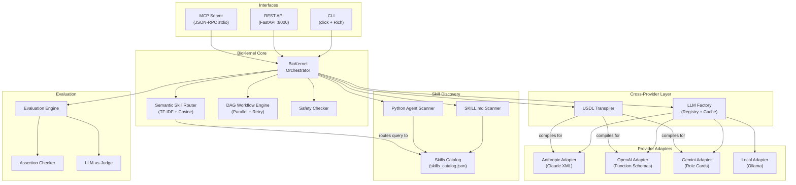
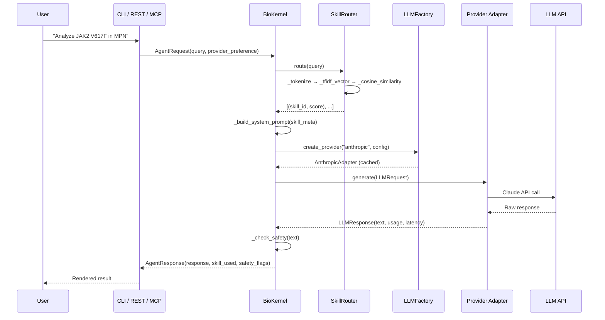

The Universal Biomedical Skills Platform operates as a **Biomedical Operating System (BioOS)** — a layered orchestration engine that transforms 59+ static biomedical skill domains into autonomous, agentic workflows. At its core lies **BioKernel**, a FastAPI runtime that discovers skills from the filesystem, routes natural-language queries to the best-matching skill via lightweight semantic similarity, and executes them through a provider-agnostic abstraction layer. The architectural design follows a single governing principle: **write a skill once in USDL (Universal Skill Description Language), deploy it optimally across Anthropic, OpenAI, Gemini, and local LLM backends**. This page maps the complete system topology — from user request to LLM response — establishing the structural foundation that subsequent deep-dive pages will expand upon.

Sources: [README.md](/README.md#L1-L200), [biokernel/README.md](/biokernel/README.md#L1-L200)

## System Architecture Diagram

The following diagram illustrates the end-to-end request flow through the BioKernel platform. Each colored region represents a distinct architectural concern: **routing** (how queries find their skill), **execution** (how skills become LLM prompts), **abstraction** (how one skill runs on any provider), and **interface** (how external systems connect).



Sources: [biokernel/biokernel/server.py](/biokernel/biokernel/server.py#L1-L200), [biokernel/biokernel/router.py](/biokernel/biokernel/router.py#L1-L187), [biokernel/biokernel/workflow_engine.py](/biokernel/biokernel/workflow_engine.py#L1-L200)

## Core Execution Pipeline

Every user query passes through a **four-stage pipeline** within the BioKernel orchestrator: **Route → Compile → Execute → Safeguard**. The `BioKernel` class in `server.py` is the central coordinator — it is independent of FastAPI and can be used programmatically in scripts, notebooks, or embedded applications. The FastAPI application wraps this core with REST endpoints, lifecycle management, and CORS middleware.

**Stage 1 — Routing**: The `SkillRouter` receives the natural-language query and computes TF-IDF cosine similarity against all registered skill metadata (name, description, tags, capabilities, category). Skills exceeding the configurable `similarity_threshold` (default 0.35) are ranked and the top match is selected. If the user specifies an explicit `skill_id`, the router short-circuits to an exact match with score 1.0. This lightweight approach avoids GPU-hosted embedding models while delivering substantially better routing than keyword matching alone.

**Stage 2 — Compilation**: The selected skill's `SkillMetadata` — including its `instructions_body` (the full markdown content from SKILL.md) and `safety_checks` — is woven into a context-aware system prompt. The `_build_system_prompt` method constructs a base biomedical persona with mandatory safety disclaimers, then appends skill-specific instructions. If the skill was defined via USDL, the `USDLTranspiler` further compiles it into provider-optimized payloads: XML-structured prompts with thinking blocks for Anthropic, system/user messages with function schemas for OpenAI, and role cards with structured context for Gemini.

**Stage 3 — Execution**: The `LLMFactory` resolves the requested provider (with a fallback chain: anthropic → openai → gemini → local) and dispatches the standardized `LLMRequest`. Each adapter implements the `LLMProvider` abstract interface, normalizing provider-specific APIs into unified `LLMResponse` objects containing text, tool calls, usage metrics, and latency. For multi-step workflows, the `WorkflowEngine` executes DAGs with automatic parallelization of independent steps, configurable retry with exponential backoff, and step-level timeout enforcement.

**Stage 4 — Safeguarding**: The `_check_safety` method scans generated output for dangerous content patterns (`synthesize`, `self-medicate`, `without prescription`) and validates that clinical content includes appropriate disclaimers. Safety flags are attached to the `AgentResponse` and surfaced to the caller.

Sources: [biokernel/biokernel/server.py](/biokernel/biokernel/server.py#L200-L399), [biokernel/biokernel/router.py](/biokernel/biokernel/router.py#L68-L130), [biokernel/optimizer/usdl_transpiler.py](/biokernel/optimizer/usdl_transpiler.py#L1-L200), [biokernel/interface/llm_provider.py](/biokernel/interface/llm_provider.py#L1-L121)

## Layer-by-Layer Component Map

The platform is organized into six architectural layers, each with a clear contract boundary. The table below maps every major component to its layer, responsibility, and primary source file.

| Layer | Component | Responsibility | Source |
|-------|-----------|----------------|--------|
| **Interface** | FastAPI Server | REST endpoints, lifecycle, CORS | [biokernel/biokernel/server.py](/biokernel/biokernel/server.py#L399-L547) |
| **Interface** | CLI (`biokernel` command) | Interactive + batch execution, Rich TUI | [biokernel/cli.py](/biokernel/cli.py#L1-L200) |
| **Interface** | MCP Server | JSON-RPC 2.0 over stdio for Claude Desktop/Code | [biokernel/biokernel/mcp_server.py](/biokernel/biokernel/mcp_server.py#L1-L200) |
| **Orchestration** | BioKernel Core | Pipeline coordination: route → compile → execute → safeguard | [biokernel/biokernel/server.py](/biokernel/biokernel/server.py#L55-L199) |
| **Orchestration** | SkillRouter | TF-IDF semantic matching with cosine similarity | [biokernel/biokernel/router.py](/biokernel/biokernel/router.py#L38-L187) |
| **Orchestration** | WorkflowEngine | DAG execution, parallel steps, retry + timeout | [biokernel/biokernel/workflow_engine.py](/biokernel/biokernel/workflow_engine.py#L1-L277) |
| **Abstraction** | USDL Transpiler | Canonical spec → provider-specific prompt + schema bundles | [biokernel/optimizer/usdl_transpiler.py](/biokernel/optimizer/usdl_transpiler.py#L1-L326) |
| **Abstraction** | LLMFactory | Dynamic provider registry, creation, and caching | [biokernel/adapters/factory.py](/biokernel/adapters/factory.py#L1-L119) |
| **Abstraction** | LLMProvider (ABC) | Unified interface: `generate`, `generate_with_tools`, `stream` | [biokernel/interface/llm_provider.py](/biokernel/interface/llm_provider.py#L1-L121) |
| **Provider** | AnthropicAdapter | Claude API with XML prompts + tool definitions | [biokernel/adapters/anthropic_adapter.py](/biokernel/adapters/anthropic_adapter.py) |
| **Provider** | OpenAIRuntimeAdapter | GPT API with function schemas | [biokernel/adapters/openai_runtime_adapter.py](/biokernel/adapters/openai_runtime_adapter.py) |
| **Provider** | GeminiAdapter | Gemini API with role cards | [biokernel/adapters/gemini_adapter.py](/biokernel/adapters/gemini_adapter.py) |
| **Provider** | LocalAdapter | Ollama / local model inference | [biokernel/adapters/local_adapter.py](/biokernel/adapters/local_adapter.py) |
| **Discovery** | SKILL.md Scanner | YAML frontmatter + markdown body parsing | [biokernel/biokernel/server.py](/biokernel/biokernel/server.py#L162-L230) |
| **Discovery** | Python Agent Scanner | `*_agent.py` file detection and registration | [biokernel/biokernel/server.py](/biokernel/biokernel/server.py#L143-L160) |
| **Discovery** | Skills Catalog Generator | Recursive scan, validation, JSON catalog output | [biokernel/skills_catalog.py](/biokernel/skills_catalog.py#L1-L226) |
| **Evaluation** | EvalEngine | Deterministic + LLM-as-judge assessment | [biokernel/evaluator/eval_engine.py](/biokernel/evaluator/eval_engine.py#L1-L200) |
| **Evaluation** | AssertionChecker | Biomedical entity, safety, citation, regex checks | [biokernel/evaluator/eval_engine.py](/biokernel/evaluator/eval_engine.py#L62-L186) |
| **Schema** | io_types (Pydantic) | All inter-component data contracts | [biokernel/schema/io_types.py](/biokernel/schema/io_types.py#L1-L272) |

Sources: [biokernel/biokernel/server.py](/biokernel/biokernel/server.py#L55-L199), [biokernel/adapters/factory.py](/biokernel/adapters/factory.py#L1-L119), [biokernel/evaluator/eval_engine.py](/biokernel/evaluator/eval_engine.py#L1-L200), [biokernel/schema/io_types.py](/biokernel/schema/io_types.py#L1-L272)

## Data Flow: Request Lifecycle

The diagram below traces a single `AgentRequest` through the complete execution path, showing the data transformations at each stage and the schema types that cross component boundaries.



Sources: [biokernel/biokernel/server.py](/biokernel/biokernel/server.py#L231-L330), [biokernel/biokernel/router.py](/biokernel/biokernel/router.py#L68-L130), [biokernel/adapters/factory.py](/biokernel/adapters/factory.py#L68-L100)

## Skill Discovery and Registration

The platform employs a **dual-path discovery mechanism** that indexes skills at startup. The `_discover_skills` method scans all directories listed in `config.yaml`'s `skill_paths` (default: `Skills/`, `Skills/User_Collections/Babu/`, `skill collections/Antigravity_Skills/`). Two scanners operate in parallel:

- **SKILL.md Scanner**: Recursively finds `SKILL.md` files, parses their YAML frontmatter (using PyYAML for robust parsing), extracts name, description, tags, and capabilities from body headings, and registers them as `SkillType.SKILL_MD`. The full markdown body is stored as `instructions_body` for prompt construction.
- **Python Agent Scanner**: Discovers `*_agent.py` files, derives a hyphen-case `skill_id` from the relative path, and registers them as `SkillType.PYTHON_AGENT`.

The standalone `skills_catalog.py` module provides a complementary batch scanner that generates `skills_catalog.json` (a machine-readable index) and `skills_reliability_report.json` (source reliability scores). Both scanners validate required fields (`name`, `description`) and log warnings for malformed entries.

Sources: [biokernel/biokernel/server.py](/biokernel/biokernel/server.py#L125-L230), [biokernel/skills_catalog.py](/biokernel/skills_catalog.py#L68-L175), [biokernel/config.yaml](/biokernel/config.yaml#L40-L44)

## Cross-Provider Abstraction: USDL and the Adapter Pattern

The platform's most architecturally significant contribution is the **USDL (Universal Skill Description Language)** transpilation layer. Rather than maintaining separate skill definitions per LLM provider, USDL defines a canonical `USDLSpec` — a dataclass containing name, description, inputs, outputs, safety checks, audit policy, and instructions body. The `USDLTranspiler` compiles this spec into three distinct output formats optimized for each provider's strengths:

| Provider | Prompt Format | Tool Schema | Special Features |
|----------|--------------|-------------|-----------------|
| **Anthropic** | XML-structured system prompt with `<instructions>`, `<safety>` blocks | Anthropic tool definitions (name + description + input_schema) | Thinking blocks, extended context |
| **OpenAI** | System message with markdown instructions | OpenAI function calling schemas (JSON Schema) | Structured JSON output, response format |
| **Gemini** | Role card with structured sections (Role, Objective, Instructions, Inputs) | Gemini-compatible function declarations | System instruction optimization |

The `LLMProvider` abstract base class enforces a uniform contract across all adapters: `initialize(config)`, `generate(request)`, `generate_with_tools(request, tool_executor)`, and `stream(request)`. The `LLMFactory` manages provider lifecycle with a class-level registry (supporting runtime plugin registration), instance caching, and a fallback chain that ensures graceful degradation when a preferred provider is unavailable.

> [!TIP]
> The USDL transpiler's `from_skill_md` classmethod automatically infers safety checks from body content — if the markdown body contains keywords like "safety", "risk", "contraindication", or "warning", it appends a safety review requirement without explicit configuration.

Sources: [biokernel/optimizer/usdl_transpiler.py](/biokernel/optimizer/usdl_transpiler.py#L1-L200), [biokernel/interface/llm_provider.py](/biokernel/interface/llm_provider.py#L1-L121), [biokernel/adapters/factory.py](/biokernel/adapters/factory.py#L1-L119)

## Configuration and Runtime Behavior

Runtime behavior is governed by `config.yaml`, which defines provider models and API key environment variables, routing strategy and similarity thresholds, workflow engine parameters (DAG depth, step timeout, retry policy), and evaluation thresholds. The `load_config` function searches a precedence chain: explicit path → `BIOKERNEL_CONFIG` env var → `platform/config.yaml` → `config.yaml` → empty defaults.

| Configuration Domain | Key Parameters | Default |
|---------------------|----------------|---------|
| **Provider** | `default_provider`, per-provider `model`/`api_key_env`/`temperature` | `anthropic`, `claude-sonnet-4-20250514`, 0.3 |
| **Routing** | `strategy`, `similarity_threshold`, `fallback_skill` | `semantic`, 0.35, `general-biomedical-assistant` |
| **Workflow** | `max_dag_depth`, `step_timeout_seconds`, `retry_count`, `retry_delay_seconds` | 20, 120, 2, 5 |
| **System** | `log_level`, `max_concurrent_agents`, `enable_safety_checks` | INFO, 10, true |
| **Evaluation** | `pass_threshold`, `safety_pass_threshold` | 0.80, 0.95 |

Three execution modes are supported: **Autonomous** (automatic routing + execution for production APIs), **Interactive** (user selects from ranked skill matches for exploratory research), and **Manual** (user specifies exact `skill_id` for debugging and benchmarking). The `ExecutionMode` enum in the schema layer encodes these as `AUTONOMOUS`, `INTERACTIVE`, and `MANUAL`.

Sources: [biokernel/config.yaml](/biokernel/config.yaml#L1-L76), [biokernel/biokernel/server.py](/biokernel/biokernel/server.py#L40-L53), [biokernel/schema/io_types.py](/biokernel/schema/io_types.py#L30-L47)

## Interface Layer: REST, CLI, and MCP

The platform exposes three complementary interfaces, each suited to a different consumption pattern:

**REST API (FastAPI)**: Serves six endpoints on port 8000 — `GET /` (health), `POST /v1/agent/run` (single query execution), `POST /v1/workflow/run` (DAG workflow), `GET /v1/skills` (skill listing), `GET /v1/providers` (provider availability), and `POST /v1/route` (routing preview without execution). The application uses an async lifespan manager to initialize the BioKernel singleton at startup and tear it down on shutdown. CORS is configured with permissive defaults for development.

**CLI (`biokernel`)**: A click-based command with Rich terminal rendering. Commands include `serve` (start API server), `run` (execute query), `skills` (list skills with table output), `eval` (run evaluation suite with optional HTML report), `interactive` (REPL chat session), and `mcp` (start MCP server). The CLI gracefully degrades when Rich is unavailable, falling back to plain text output.

**MCP Server**: Implements the Model Context Protocol (spec 2024-11-05) over JSON-RPC 2.0 via stdio. Exposes four tools: `run_bio_agent` (execute skill), `list_skills` (discover skills), `route_query` (preview routing), and `run_workflow` (execute DAG). This enables seamless integration with Claude Desktop, Claude Code, Cursor, and any MCP-compatible client. Logging is redirected to stderr to avoid corrupting the JSON-RPC stdout channel.

Sources: [biokernel/biokernel/server.py](/biokernel/biokernel/server.py#L399-L547), [biokernel/cli.py](/biokernel/cli.py#L1-L200), [biokernel/biokernel/mcp_server.py](/biokernel/biokernel/mcp_server.py#L1-L200)

## Project Directory Structure

The visual structure below maps the physical codebase layout to its architectural role, emphasizing the separation between the skill library (`Skills/`), the runtime platform (`biokernel/`), and the documentation hub (`docs/`).

```
├── Skills/                          # 59+ biomedical AI skill domains
│   ├── Genomics/                    #   Single Cell, Spatial, CRISPR, BioMaster
│   ├── Clinical/                    #   EHR, Radiology, Oncology, TrialGPT
│   ├── Drug_Discovery/              #   Antibody Design, CheMatAgent, MAGE
│   ├── MCP_Servers/                 #   BioMCP protocol server
│   ├── Research_Tools/              #   Biomni, KRAGEN, LEADS
│   └── ...                          #   54 additional domain directories
│
├── biokernel/                       # BioKernel Runtime Platform (v2026.4.0)
│   ├── biokernel/                   #   Core orchestration engine
│   │   ├── server.py               #     FastAPI + BioKernel class
│   │   ├── router.py               #     TF-IDF semantic skill router
│   │   ├── workflow_engine.py      #     DAG-based workflow execution
│   │   └── mcp_server.py           #     MCP protocol bridge
│   ├── adapters/                   #   LLM provider adapters
│   │   ├── factory.py              #     Provider registry + creation
│   │   ├── anthropic_adapter.py    #     Claude API integration
│   │   ├── openai_runtime_adapter.py #   GPT API integration
│   │   ├── gemini_adapter.py       #     Gemini API integration
│   │   └── local_adapter.py        #     Ollama / local models
│   ├── interface/                  #   Abstract contracts
│   │   └── llm_provider.py         #     LLMProvider ABC
│   ├── optimizer/                  #   USDL transpiler + meta-prompter
│   ├── evaluator/                  #   Biomedical evaluation engine
│   ├── schema/                     #   Pydantic data contracts
│   │   └── io_types.py             #     All I/O type definitions
│   ├── config.yaml                 #   Runtime configuration
│   ├── cli.py                      #   Command-line interface
│   └── skills_catalog.py           #   Skill discovery + catalog generation
│
├── docs/                           # Documentation hub
│   ├── architecture/               #   Repository maps + onboarding
│   ├── operations/                 #   Runbooks
│   ├── standards/                  #   USDL spec + governance
│   └── strategy/                   #   Curation playbooks
│
└── tests/                          # Test suites + benchmarks
```

Sources: [README.md](/README.md#L85-L130), [biokernel/README.md](/biokernel/README.md#L1-L200)

## Reading Progression

This Architecture Overview establishes the structural blueprint. The following pages dive deeper into each subsystem, following the natural dependency order from routing through execution to evaluation:

1. **[Semantic Skill Router](5-semantic-skill-router)** — How TF-IDF cosine similarity maps queries to skills, index rebuilding, and threshold tuning
2. **[DAG Workflow Engine](6-dag-workflow-engine)** — Topological execution, parallel step scheduling, retry with exponential backoff, and provenance tracking
3. **[MCP Protocol Server](7-mcp-protocol-server)** — JSON-RPC 2.0 implementation, tool exposure, and Claude Desktop integration
4. **[USDL Transpiler](8-usdl-transpiler)** — Canonical spec design, provider-specific compilation strategies, and `from_skill_md` inference
5. **[LLM Provider Adapters](9-llm-provider-adapters)** — Abstract interface contract, factory pattern, and per-adapter implementation details
6. **[Genomics and Single-Cell Agents](10-genomics-and-single-cell-agents)** — Domain-specific skill architecture for BioMaster, CellAgent, STAgent
7. **[Clinical Decision Support Agents](11-clinical-decision-support-agents)** — ChatEHR, TrialGPT, RadGPT, and autonomous oncology agent patterns
8. **[Drug Discovery and Chemistry Agents](12-drug-discovery-and-chemistry-agents)** — MAGE, CheMatAgent, Biomni, and molecular design workflows
9. **[Biomedical Evaluation Framework](13-biomedical-evaluation-framework)** — Assertion types, LLM-as-judge rubrics, cross-platform comparison, and HTML reporting
10. **[Assertion and Safety Checks](14-assertion-and-safety-checks)** — Biomedical entity detection, safety disclaimers, citation validation, and the `SafetyChecker` pipeline
