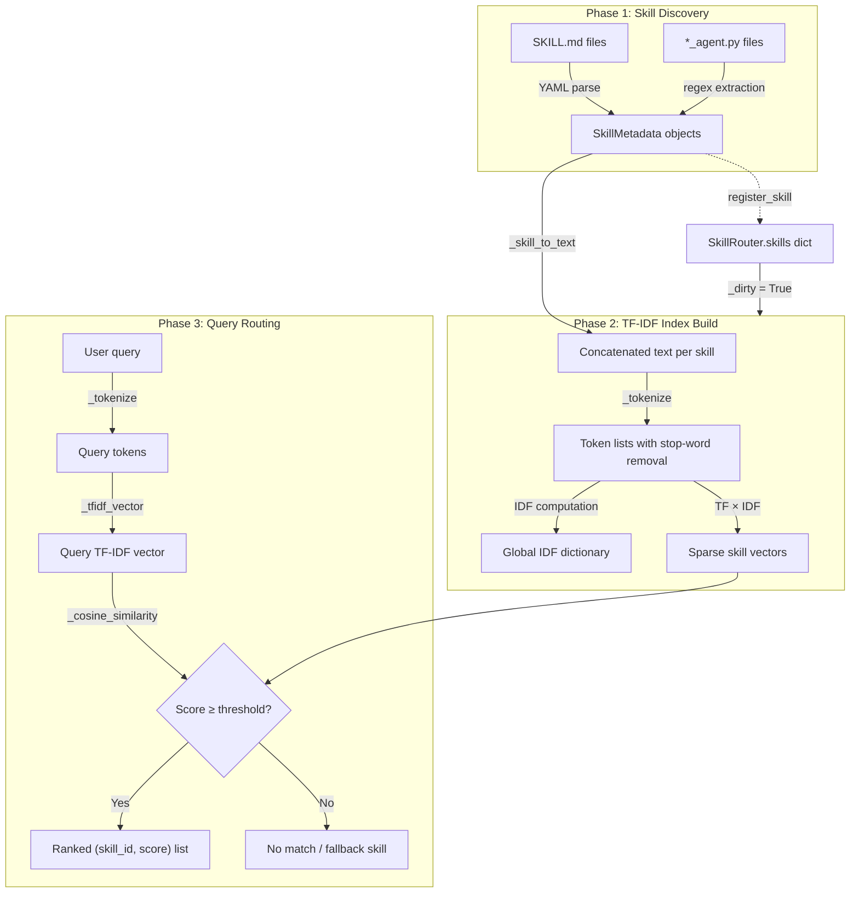

The **Semantic Skill Router** is the BrainKernel's query-to-skill matching engine — the component that determines *which* of the platform's 886+ registered biomedical skills should handle a given natural-language request. Rather than relying on brittle keyword matching or requiring heavyweight embedding model downloads, the router implements a **pure-Python TF-IDF cosine similarity** algorithm that delivers semantically meaningful routing with zero GPU dependency and sub-millisecond latency per query. It sits at the center of every request pipeline: when a user submits "analyze scRNA-seq data with UMAP clustering," the router converts that query into a sparse TF-IDF vector, computes cosine similarity against every indexed skill, and returns ranked matches above a configurable similarity threshold.

Sources: [router.py](biokernel/biokernel/router.py#L1-L15), [skills_catalog.json](skills_catalog.json#L1-L6)

## Architecture and Data Flow

The router operates within a three-phase pipeline: **Discovery → Indexing → Routing**. During startup, the BioKernel server scans configured `skill_paths` directories, parses each `SKILL.md` file's YAML frontmatter, and registers the resulting `SkillMetadata` objects with the router. The router lazily rebuilds its TF-IDF index on the next routing call whenever the skill registry has been mutated (the `_dirty` flag). At query time, the router tokenizes the user's input, computes a TF-IDF vector, and scores it against all pre-computed skill vectors using cosine similarity.



The BioKernel server orchestrates this pipeline. On initialization, it creates a `SkillRouter` with the configured `similarity_threshold`, then calls `_discover_skills()` which recursively scans `SKILL.md` and `*_agent.py` files, registering each as a `SkillMetadata` with the router. When a request arrives at the `/v1/agent/run` endpoint, the server calls `router.get_best_match()` to identify the target skill before constructing a context-aware system prompt and dispatching to the selected LLM provider.

Sources: [router.py](biokernel/biokernel/router.py#L30-L96), [server.py](biokernel/biokernel/server.py#L74-L115), [server.py](biokernel/biokernel/server.py#L254-L314)

## Routing Strategies and Configuration

The router supports three decision paths, evaluated in priority order:

| Priority | Strategy | Trigger | Behavior |
|----------|----------|---------|----------|
| 1 | **Exact Match** | `skill_id` parameter provided | Short-circuits to the named skill with score `1.0` |
| 2 | **Semantic (TF-IDF)** | Default path | Cosine similarity between query and skill vectors |
| 3 | **Fallback** | No matches above threshold | Routes to `general-biomedical-assistant` (configurable) |

The `config.yaml` routing section controls the router's behavior:

```yaml
routing:
  strategy: "semantic"           # semantic | keyword | hybrid
  similarity_threshold: 0.35     # Minimum cosine similarity for skill match
  fallback_skill: "general-biomedical-assistant"
```

The `similarity_threshold` is the critical tuning knob. At the default of `0.35`, the router balances recall (finding relevant skills) against precision (avoiding false matches). Setting it to `0.99` effectively disables semantic routing — only exact `skill_id` overrides succeed. Setting it too low (e.g., `0.1`) increases recall at the cost of returning marginally relevant skills. The test suite validates this behavior: at threshold `0.99`, a query about "proteins" returns zero matches against a skill about "quantum entanglement."

Sources: [config.yaml](biokernel/config.yaml#L58-L62), [router.py](biokernel/biokernel/router.py#L56-L96), [test_router.py](biokernel/tests/test_router.py#L138-L149)

## TF-IDF Index Construction

The router's index is built lazily when `_dirty` is `True` — meaning any call to `register_skill()` or `remove_skill()` invalidates the index and triggers a full rebuild on the next `route()` call. This design avoids redundant recomputation during bulk registration (e.g., at startup when hundreds of skills are loaded sequentially).

**Document construction.** Each skill is flattened into a single searchable text string by `_skill_to_text()`, which concatenates six metadata fields:

| Field | Source | Example |
|-------|--------|---------|
| `name` | SkillMetadata.name | "Single Cell Bioinformatics" |
| `description` | SkillMetadata.description | "Analyze scRNA-seq data with scanpy..." |
| `skill_id` (with dashes→spaces) | SkillMetadata.skill_id | "bioinformatics singlecell" |
| `tags` (space-joined) | SkillMetadata.tags | "single-cell scRNA-seq scanpy UMAP clustering" |
| `capabilities` (space-joined) | SkillMetadata.capabilities | "QC filtering Normalization Clustering..." |
| `category` | SkillMetadata.category | "genomics" |

**Tokenization.** The `_tokenize()` method applies four transformations: (1) lowercasing, (2) regex extraction of alphanumeric sequences (`[a-z0-9]+`), (3) removal of tokens shorter than 3 characters, and (4) filtering against a built-in set of 50+ English stop words. This handles biomedical nomenclature correctly — `JAK2-V617F` tokenizes to `["jak2", "v617f", "mutation"]`, preserving the critical variant identifier.

**IDF computation.** Inverse Document Frequency uses the smoothed formula: `IDF(t) = log((N + 1) / (df(t) + 1)) + 1`, where `N` is the total number of skill documents and `df(t)` is the number of documents containing token `t`. The `+1` additives prevent division-by-zero and ensure every term has a minimum IDF of 1.0.

**TF-IDF vectorization.** Each skill's token list is converted to a sparse vector where `vec[t] = (count(t) / total_tokens) × IDF(t)`. Query vectors use the same IDF dictionary, with unknown tokens defaulting to `IDF = 1.0`. This ensures that rare, domain-specific terms (like "CALR" or "UMAP") receive high weight, while common terms (like "analysis" or "data") are downweighted.

Sources: [router.py](biokernel/biokernel/router.py#L103-L186), [io_types.py](biokernel/schema/io_types.py#L137-L151)

## Cosine Similarity Scoring

The `_cosine_similarity()` method computes the dot product between two sparse vectors (represented as `Dict[str, float]`) over their shared keys, then normalizes by the product of their magnitudes. This is an efficient O(min(|a|, |b|)) operation for sparse vectors — since biomedical skill vectors typically contain 20–80 non-zero entries, scoring a query against all 886 skills completes in under a millisecond.

The scoring produces values in [0, 1], where 1.0 indicates identical term distributions and 0.0 indicates completely orthogonal vocabularies. The test suite confirms two invariants: identical vectors yield similarity `1.0` (within floating-point epsilon), and orthogonal vectors (no shared keys) yield `0.0`.

> [!TIP]
> The similarity threshold is your primary lever for tuning router behavior in production. Monitor the `/v1/route` endpoint's score distribution: if the median score for successful routes is above 0.5, you can safely raise the threshold to improve precision. If many legitimate queries return no matches, lower it to improve recall.

Sources: [router.py](biokernel/biokernel/router.py#L144-L153), [test_router.py](biokernel/tests/test_router.py#L167-L179)

## API Surface and Integration Points

The router is exposed through multiple interfaces, all converging on the same `SkillRouter` instance:

**Programmatic API.** The `SkillRouter` class provides two public routing methods:

| Method | Signature | Returns | Use Case |
|--------|-----------|---------|----------|
| `route()` | `route(query, *, skill_id=None, top_k=5)` | `List[Tuple[str, float]]` | Retrieve ranked candidate skills |
| `get_best_match()` | `get_best_match(query, skill_id=None)` | `Optional[str]` | Get single best skill_id |

**REST API.** The BioKernel FastAPI server exposes two routing-related endpoints:

| Endpoint | Method | Purpose |
|----------|--------|---------|
| `/v1/route` | POST | Route a query without executing (preview mode) |
| `/v1/agent/run` | POST | Route + execute (routing is implicit in step 1) |

The `/v1/route` preview endpoint returns ranked matches with scores, skill names, and descriptions — useful for debugging routing behavior or building skill-selection UIs:

```json
{
  "query": "analyze scRNA-seq data with UMAP clustering",
  "matches": [
    {
      "skill_id": "bioinformatics-singlecell",
      "score": 0.72,
      "name": "Single Cell Bioinformatics",
      "description": "Analyze scRNA-seq data with scanpy..."
    }
  ]
}
```

**MCP Protocol.** The `route_query` tool in the MCP server exposes the same preview functionality to MCP-compatible clients (Claude Desktop, Claude Code, Cursor), allowing AI assistants to introspect available skills before committing to execution.

> [!TIP]
> Use the `/v1/route` preview endpoint during development to validate that your SKILL.md frontmatter produces correct routing. A common mistake is writing descriptions that are too generic — the TF-IDF algorithm rewards distinctive, domain-specific vocabulary like "JAK2 V617F" over generic terms like "genomic analysis."

Sources: [server.py](biokernel/biokernel/server.py#L521-L537), [server.py](biokernel/biokernel/server.py#L476-L480), [mcp_server.py](biokernel/biokernel/mcp_server.py#L87-L102), [router.py](biokernel/biokernel/router.py#L56-L101)

## Skill Registration and Dynamic Updates

The router supports dynamic skill management at runtime through `register_skill()` and `remove_skill()`. Both methods set `_dirty = True`, which triggers a full index rebuild on the next routing call. This means you can add or remove skills without restarting the server, though there is an O(N) rebuild cost paid once before the next query.

The `SkillMetadata` schema defines the data contract between the discovery layer and the router:

```python
class SkillMetadata(BaseModel):
    skill_id: str                              # Unique identifier
    name: str                                  # Human-readable name
    description: str                           # Primary routing signal
    skill_type: SkillType                      # skill_md | python_agent | usdl | mcp_tool
    file_path: str                             # Source file location
    category: Optional[str] = None             # Domain category (e.g., "genomics")
    tags: List[str] = Field(default_factory=list)           # Searchable tags
    capabilities: List[str] = Field(default_factory=list)   # Extracted from body headings
    instructions_body: str = ""                # Full SKILL.md body (for prompt construction)
    embedding: Optional[List[float]] = None    # Reserved for future embedding-based routing
```

The `embedding` field is reserved for future semantic routing via dense vector embeddings, but the current implementation relies entirely on TF-IDF. This field's presence in the schema signals the architectural intent to support hybrid dense+sparse routing in future versions.

Sources: [io_types.py](biokernel/schema/io_types.py#L137-L151), [router.py](biokernel/biokernel/router.py#L45-L54), [server.py](biokernel/biokernel/server.py#L157-L250)

## Routing Behavior Validated by Tests

The test suite in `test_router.py` validates five domain-specific routing scenarios that demonstrate the router's semantic discrimination capability:

| Query | Expected Skill | Key Discriminating Terms |
|-------|---------------|------------------------|
| "analyze scRNA-seq data with UMAP clustering" | `bioinformatics-singlecell` | scrna-seq, umap, clustering |
| "find clinical trials for my patient with lung cancer" | `clinical-trial-matcher` | clinical, trials, patient |
| "design a small molecule inhibitor with SMILES optimization" | `molecule-designer` | molecule, smiles, inhibitor |
| "JAK2 V617F mutation in myeloproliferative neoplasms" | `mpn-research-assistant` | jak2, v617f, myeloproliferative |
| "classify BRCA1 variant using ACMG guidelines" | `variant-interpretation` | variant, acmg, classify |

These tests confirm that the TF-IDF approach correctly routes queries to semantically distinct skills even when the query vocabulary only partially overlaps with the skill's metadata — the term "BRCA1" doesn't appear in the variant-interpretation skill's metadata, but the shared terms "variant" and "ACMG" produce a sufficiently high cosine score. The threshold filtering test at `0.99` additionally validates that the router correctly returns empty results when no skill meets the similarity bar, rather than forcing a poor match.

Sources: [test_router.py](biokernel/tests/test_router.py#L75-L149)

## Performance Characteristics and Design Trade-offs

The router's design reflects three deliberate engineering trade-offs:

**Sparse vs. Dense vectors.** TF-IDF produces sparse vectors that are cheap to compute and compare (no GPU, no model download), but they cannot capture semantic relationships between synonyms (e.g., "cancer" vs. "oncology" vs. "neoplasm"). Dense embedding models (like `text-embedding-3-small`) would solve this at the cost of an external API dependency and ~50ms latency per embedding call. The `embedding` field in `SkillMetadata` is reserved for this upgrade path.

**Lazy vs. Eager indexing.** The `_dirty` flag pattern avoids redundant index rebuilds during bulk registration but introduces an O(N×M) rebuild cost (N skills × M average tokens) on the first query after any mutation. For 886 skills, this rebuild completes in well under a second on commodity hardware. For catalogs exceeding 10,000 skills, an incremental indexing strategy would be warranted.

**Global vs. Per-category thresholds.** The current implementation uses a single global `similarity_threshold`. In practice, some domains (e.g., oncology) have highly overlapping vocabularies across skills, while others (e.g., quantum biotech) are naturally distinct. A future enhancement could support per-category thresholds or a two-stage routing approach where the first stage identifies the domain and the second stage applies domain-specific matching.

| Dimension | Current Implementation | Future Direction |
|-----------|----------------------|-----------------|
| Vector type | TF-IDF (sparse) | Hybrid sparse + dense embeddings |
| Index strategy | Lazy full rebuild | Incremental delta updates |
| Threshold | Global scalar | Per-category adaptive thresholds |
| Tokenization | Regex + stop words | Biomedical NLP (BioBERT tokenizer) |
| Scoring | Cosine similarity only | Multi-signal (cosine + keyword boost + category affinity) |

Sources: [router.py](biokernel/biokernel/router.py#L30-L43), [io_types.py](biokernel/schema/io_types.py#L150-L151)

## What Comes Next

The Semantic Skill Router is the first stage in the BioKernel's execution pipeline. Once routing identifies the target skill, the [DAG Workflow Engine](6-dag-workflow-engine) orchestrates multi-step execution, and the [MCP Protocol Server](7-mcp-protocol-server) exposes the entire pipeline to external AI clients. For details on how skills are defined and parsed, see [SKILL.md Standard](3-skill-md-standard). For the configuration options that control routing behavior, refer to [Configuration Reference](15-configuration-reference).
