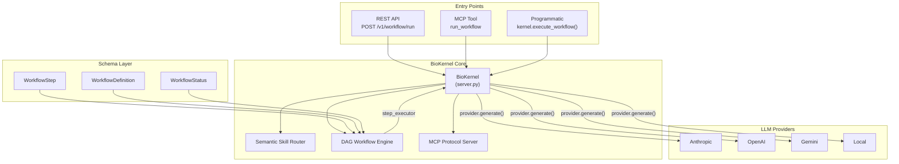
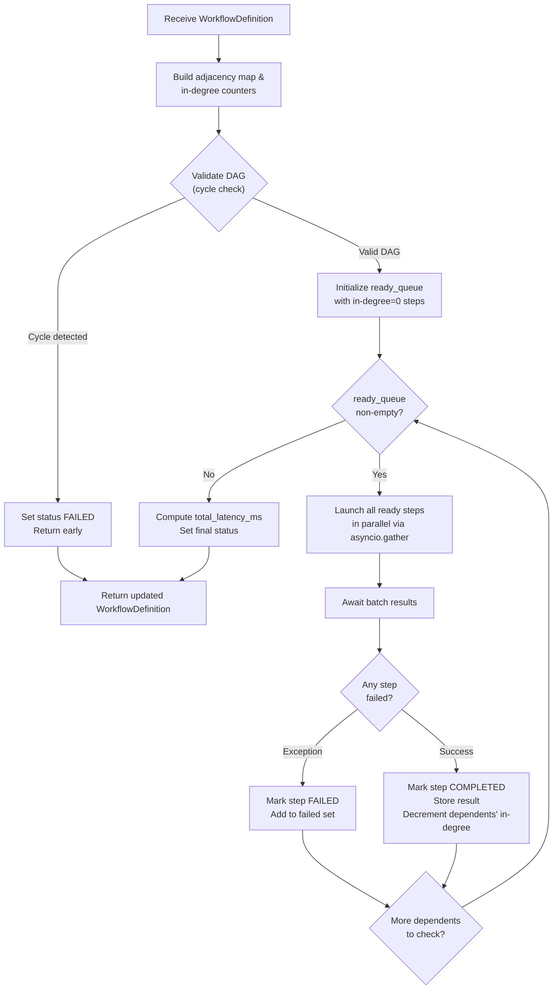
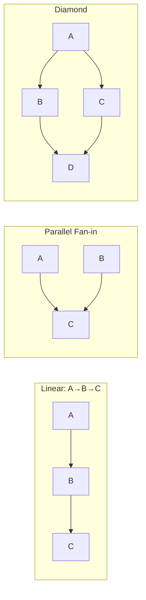

The **DAG Workflow Engine** is the multi-step orchestration core of the BioKernel platform, executing complex biomedical pipelines as directed acyclic graphs where each node represents a skill invocation and edges encode data dependencies. It provides automatic parallelization of independent steps, configurable retry with exponential backoff, step-level timeout enforcement, and full provenance tracking — transforming what would be brittle sequential scripts into resilient, concurrent workflows suitable for drug discovery pipelines, multi-omics analyses, and clinical decision support chains.

Sources: [workflow_engine.py](/biokernel/biokernel/workflow_engine.py#L1-L15), [server.py](/biokernel/biokernel/server.py#L316-L344)

## Architectural Context

Before examining the engine internals, it is essential to understand where the DAG Workflow Engine sits within the BioKernel architecture. The engine is one of three core submodules inside `biokernel/biokernel/` — alongside the [Semantic Skill Router](5-semantic-skill-router) and the [MCP Protocol Server](7-mcp-protocol-server). The `BioKernel` class in `server.py` instantiates the engine during initialization, wiring it to configuration from `config.yaml` and making it accessible through both the REST API (`POST /v1/workflow/run`) and the MCP tool `run_workflow`.



The key architectural insight is that the workflow engine is **executor-agnostic**: it accepts any `async Callable[[WorkflowStep, Dict[str, str]], Coroutine[Any, Any, str]]` as its step executor. The `BioKernel.execute_workflow()` method provides the default executor — which routes each step through the semantic skill router, builds a context-aware prompt incorporating upstream results, and dispatches to the configured LLM provider — but the engine itself knows nothing about LLMs, routing, or providers. This separation makes the engine independently testable and reusable.

Sources: [server.py](/biokernel/biokernel/server.py#L82-L102), [server.py](/biokernel/biokernel/server.py#L316-L344), [mcp_server.py](/biokernel/biokernel/mcp_server.py#L103-L137)

## Type System: The DAG's Data Contract

The engine operates on three Pydantic models defined in the schema layer. These models form the immutable data contract between the API layer, the MCP server, and the engine itself — ensuring type-safe workflow definitions and structured results regardless of entry point.

| Model | Purpose | Key Fields | Source |
|---|---|---|---|
| `WorkflowStep` | A single node in the DAG | `step_id`, `skill_id`, `depends_on`, `parameters`, `status`, `result`, `error`, `latency_ms` | [io_types.py](/biokernel/schema/io_types.py#L203-L212) |
| `WorkflowDefinition` | Complete DAG specification | `workflow_id` (auto UUID), `name`, `description`, `steps[]`, `status`, `created_at`, `completed_at`, `total_latency_ms` | [io_types.py](/biokernel/schema/io_types.py#L215-L224) |
| `WorkflowStatus` | State machine enum | `PENDING → RUNNING → COMPLETED \| FAILED \| CANCELLED` | [io_types.py](/biokernel/schema/io_types.py#L42-L48) |

The `WorkflowStep.depends_on` field is the edge list — a list of `step_id` strings that must complete before this step can begin. The `parameters` dict carries arbitrary step-level configuration (e.g., a natural language `query` for the LLM executor). The engine mutates `status`, `result`, `error`, and `latency_ms` in-place during execution, then returns the entire `WorkflowDefinition` with updated fields.

Sources: [io_types.py](/biokernel/schema/io_types.py#L42-L48), [io_types.py](/biokernel/schema/io_types.py#L203-L224)

## Execution Algorithm: Topological Parallel Scheduling

The engine implements a **Kahn's algorithm variant** that achieves maximum parallelism while strictly respecting dependency ordering. The execution proceeds in waves: all steps with zero in-degree (no unresolved dependencies) are launched concurrently via `asyncio.gather`, and as each step completes, the in-degree of its dependents is decremented, potentially queuing new steps for the next wave.



The concrete implementation builds two core data structures at initialization: a `step_map` (step_id → WorkflowStep) for O(1) lookup, and a `dependents` adjacency list (parent_id → [child_ids]) for efficient in-degree decrementing. The `ready_queue` is populated with all zero-in-degree steps, and each batch is launched as parallel `asyncio.Task` instances. Upon batch completion, successful steps propagate their results to the `results` accumulator, while failed steps are tracked in the `failed` set — note that dependent steps of a failed parent are **never queued** (the `child_id not in failed` guard at line 154 prevents cascading execution of steps whose upstream data is missing).

> [!TIP]
> The engine does **not** propagate failure transitively — it simply starves dependents of failed steps by never adding them to the ready queue. A step whose parent failed will remain in `PENDING` status indefinitely. If you need explicit failure propagation (marking orphaned steps as `FAILED`), you must post-process the returned workflow.

Sources: [workflow_engine.py](/biokernel/biokernel/workflow_engine.py#L65-L176), [workflow_engine.py](/biokernel/biokernel/workflow_engine.py#L223-L244)

## Cycle Detection: Kahn's Algorithm

Before execution begins, the engine validates that the graph is truly a DAG — a cycle would cause deadlock in the topological scheduler. The `_validate_dag` method implements Kahn's algorithm directly: it counts how many nodes can be visited by iteratively removing zero-in-degree nodes. If the visited count equals the total node count, the graph is acyclic; otherwise, the unvisited nodes form at least one cycle.

The implementation at lines 223–244 is notable for its simplicity: it uses the pre-computed `in_degree` map and the `step_map` to reconstruct the adjacency relationship on-the-fly (checking `if node in other_step.depends_on` for every step pair). This yields O(V²) worst-case complexity for dense graphs, which is acceptable given that biomedical workflows typically contain 3–20 steps. For larger DAGs, the `dependents` adjacency list built during execution could be reused here — but the validation runs before that structure is available.

Sources: [workflow_engine.py](/biokernel/biokernel/workflow_engine.py#L223-L244)

## Resilience: Retry with Exponential Backoff

Each step is executed through `_execute_step_with_retry`, which wraps the user-provided executor with two resilience patterns:

| Pattern | Configuration | Default | Behavior |
|---|---|---|---|
| **Retry** | `max_retries` | 2 | Up to `max_retries + 1` total attempts per step |
| **Exponential backoff** | `retry_delay` | 5.0s | Delay = `retry_delay × 2^attempt` between retries |
| **Timeout** | `step_timeout` | 120.0s | `asyncio.wait_for` kills execution after threshold |

Both `TimeoutError` and generic `Exception` are caught and retried. After exhausting all retries, the last exception is re-raised, which the outer `execute` method catches and records as `step.error`. The latency is tracked per-attempt via `time.perf_counter()`, and the final `step.latency_ms` reflects the last attempt's duration (successful or not).

> [!TIP]
> The `step_timeout` is enforced via `asyncio.wait_for`, which cancels the underlying coroutine on timeout. If your executor allocates resources (temporary files, database connections), ensure it handles `asyncio.CancelledError` for proper cleanup — Python's cancellation semantics do not guarantee `finally` blocks run synchronously after cancellation.

Sources: [workflow_engine.py](/biokernel/biokernel/workflow_engine.py#L178-L221)

## Configuration Reference

The workflow engine is configured both at instantiation and through the `config.yaml` file. The `BioKernel` class reads the `workflow` section and passes the values to the `WorkflowEngine` constructor.

| Parameter | YAML Key | Default | Description |
|---|---|---|---|
| `max_retries` | `workflow.retry_count` | 2 | Maximum retry attempts per failed step |
| `retry_delay` | `workflow.retry_delay_seconds` | 5.0 | Base delay in seconds between retries (doubles each attempt) |
| `step_timeout` | `workflow.step_timeout_seconds` | 120.0 | Maximum seconds a single step may run before timeout |
| — | `workflow.max_dag_depth` | 20 | Maximum DAG depth (config key exists but not enforced in current engine) |

The corresponding YAML configuration:

```yaml
# config.yaml — Workflow engine section
workflow:
  max_dag_depth: 20
  step_timeout_seconds: 120
  retry_count: 2
  retry_delay_seconds: 5
```

Sources: [config.yaml](/biokernel/config.yaml#L70-L76), [server.py](/biokernel/biokernel/server.py#L98-L102), [workflow_engine.py](/biokernel/biokernel/workflow_engine.py#L55-L63)

## Integration Surfaces

The DAG Workflow Engine is exposed through three distinct integration surfaces, each targeting a different consumer pattern.

### REST API

The FastAPI application exposes `POST /v1/workflow/run`, which accepts a `WorkflowDefinition` JSON body and returns a structured result with per-step status, truncated results (500 chars), and latency metrics. This is the primary integration for web applications and programmatic clients.

```json
// POST /v1/workflow/run request body
{
  "name": "Drug Discovery Pipeline",
  "steps": [
    {"step_id": "mine", "skill_id": "literature-miner"},
    {"step_id": "design", "skill_id": "molecule-designer", "depends_on": ["mine"]},
    {"step_id": "safety", "skill_id": "safety-officer", "depends_on": ["design"]}
  ]
}
```

### MCP Tool

The MCP server exposes `run_workflow` as a JSON-RPC tool, allowing MCP-compatible clients (Claude Desktop, Cursor, etc.) to invoke workflows conversationally. The tool handler in `_tool_run_workflow` constructs `WorkflowStep` objects from the JSON-RPC arguments and formats the result as a Markdown summary with ✓/✗ status icons.

### Programmatic API

The `BioKernel.execute_workflow()` method accepts a `WorkflowDefinition` directly, making it usable from Jupyter notebooks, Python scripts, or embedded applications. The default `step_executor` closure wires each step through the full pipeline: route → build prompt → LLM generate → return response text.

Sources: [server.py](/biokernel/biokernel/server.py#L483-L504), [mcp_server.py](/biokernel/biokernel/mcp_server.py#L301-L331), [server.py](/biokernel/biokernel/server.py#L316-L344)

## Convenience Factory: Linear Workflows

For the common case of sequential pipelines (A → B → C → ...), the engine provides a static factory method `create_linear_workflow` that constructs a `WorkflowDefinition` from an ordered list of skill IDs. Steps are named `step_0`, `step_1`, etc., and each step depends on its predecessor.

```python
# Create a linear drug discovery pipeline
workflow = WorkflowEngine.create_linear_workflow(
    name="Drug Discovery Pipeline",
    skill_ids=["literature-miner", "molecule-designer", "safety-officer"],
    description="Mine literature → design molecules → safety review",
)
# Result: step_0→step_1→step_2 with sequential dependencies
```

This factory is validated by the test suite, which confirms that `steps[0].depends_on == []`, `steps[1].depends_on == ["step_0"]`, and `steps[2].depends_on == ["step_1"]`.

Sources: [workflow_engine.py](/biokernel/biokernel/workflow_engine.py#L246-L277), [test_workflow_engine.py](/biokernel/tests/test_workflow_engine.py#L128-L137)

## Execution Patterns and DAG Topologies

The test suite validates four canonical DAG topologies that represent the fundamental execution patterns encountered in biomedical workflows. Understanding these patterns is essential for designing correct and efficient pipelines.

| Topology | Structure | Parallelism | Biomedical Example |
|---|---|---|---|
| **Linear** | A → B → C | None (sequential) | QC → Alignment → Variant Calling |
| **Parallel** | A, B → C (fan-in) | A & B concurrent | RNA-seq + ATAC-seq → Multi-omics integration |
| **Diamond** | A → (B, C) → D | B & C concurrent after A | Data ingestion → (QC + Stats) → Report generation |
| **Single step** | A | Trivial | Standalone skill invocation |

The **diamond topology** is particularly important in multi-omics workflows: a root step ingests raw data, then independent analysis branches (e.g., expression quantification and peak calling) run concurrently, finally merging into an integrated analysis step. The engine's batch-parallel execution ensures these branches run simultaneously rather than sequentially, reducing wall-clock time proportional to the number of independent branches.



Sources: [test_workflow_engine.py](/biokernel/tests/test_workflow_engine.py#L34-L95)

## Provenance and Observability

Every workflow execution produces a complete provenance record through the returned `WorkflowDefinition`. The engine records:

- **Step-level**: `status` (PENDING/RUNNING/COMPLETED/FAILED), `result` (string output), `error` (exception message), `latency_ms` (per-step timing)
- **Workflow-level**: `status` (COMPLETED if all steps succeed, FAILED if any step fails), `total_latency_ms` (end-to-end wall time), `completed_at` (UTC timestamp)

The engine integrates with the platform's structured logging system via `biokernel.observability.get_logger("workflow_engine")`. Key log events include step failures (with step_id, error message, workflow name), step timeouts (with attempt number), and workflow completion (with aggregate metrics). When `structlog` is available, logs emit as machine-readable JSON with ISO timestamps; otherwise, the `_KwargsLogger` fallback formats keyword arguments into human-readable console output.

Sources: [workflow_engine.py](/biokernel/biokernel/workflow_engine.py#L25-L32), [workflow_engine.py](/biokernel/biokernel/workflow_engine.py#L136-L174), [observability.py](/biokernel/observability.py#L1-L117)

## Data Flow: How Upstream Results Reach Downstream Steps

The critical mechanism for multi-step biomedical reasoning is the **upstream results injection**. When the engine launches a step, it constructs a dictionary mapping each dependency's `step_id` to its result string. The `BioKernel.execute_workflow()` step executor then formats this dictionary into a natural-language context block that prepends the current step's query:

```
Context from previous steps:
[mine]: Discovered 47 candidate targets from 312 PubMed articles...
[design]: Generated 23 novel molecules targeting EGFR L858R...

Task: Evaluate toxicity profiles for the top 5 candidates
```

This design means that downstream steps receive the distilled output of their predecessors as narrative context, enabling the LLM to reason across step boundaries. The `skill_id` field on each `WorkflowStep` ensures the router selects the correct domain-specific skill, while the upstream context provides the inter-step data flow.

Sources: [server.py](/biokernel/biokernel/server.py#L326-L344), [workflow_engine.py](/biokernel/biokernel/workflow_engine.py#L122-L123)

## Failure Semantics and Design Considerations

The engine's failure model follows a **fail-fast-at-step, continue-batch** philosophy. When a batch of parallel steps is executing, all steps in the batch run to completion (or timeout/retry exhaustion) — one step's failure does not cancel its batch siblings. However, any step that depends on a failed step will never be queued, effectively creating a **partial execution** where independent branches may complete while dependent branches are silently dropped.

This has important implications for workflow design:

- **Idempotency**: Because steps may be retried, executors should be idempotent — repeated calls with the same inputs should produce equivalent results without side-effect duplication.
- **Critical path awareness**: Place steps with high failure probability (external API calls, large model inference) on separate branches from critical-path steps to maximize partial progress.
- **Result size**: Upstream results are passed as strings in a dict, then formatted into the LLM prompt. For steps producing large outputs (e.g., full gene lists), consider summarization in the executor to avoid token limit overflow.

Sources: [workflow_engine.py](/biokernel/biokernel/workflow_engine.py#L130-L155), [test_workflow_engine.py](/biokernel/tests/test_workflow_engine.py#L97-L109)

## Next Steps

- **[MCP Protocol Server](7-mcp-protocol-server)** — Explore how the `run_workflow` MCP tool exposes the DAG engine to LLM clients like Claude Desktop.
- **[USDL Transpiler](8-usdl-transpiler)** — Understand how USDL skill definitions are transpiled into platform-specific configurations that the workflow engine invokes.
- **[Biomedical Evaluation Framework](13-biomedical-evaluation-framework)** — Learn how to validate workflow outputs against biomedical ground truth using the `EvalReport` system.
- **[Configuration Reference](15-configuration-reference)** — Full configuration options for tuning retry, timeout, and DAG depth parameters.