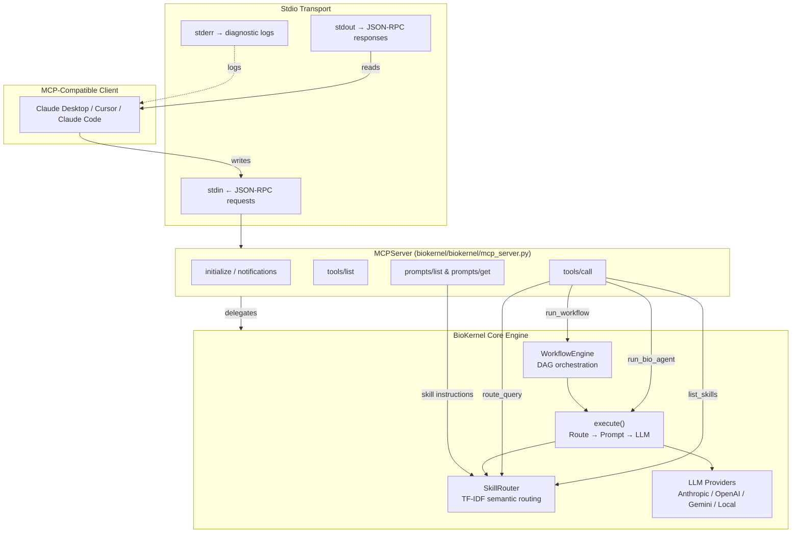

The BioKernel MCP (Model Context Protocol) Server is the stdio-based JSON-RPC 2.0 gateway that makes the entire biomedical skills catalog discoverable and executable from any MCP-compatible client — Claude Desktop, Claude Code, Cursor, and beyond. Rather than building a proprietary API surface, the platform speaks the open MCP specification (version `2024-11-05`), turning 59+ biomedical skill domains into first-class tools that LLM clients can list, route, invoke, and chain without custom integration code. This page explains the server's architecture, its four exposed tools, the request lifecycle from JSON-RPC message to skill execution, and how it connects to the broader BioKernel engine.

Sources: [mcp_server.py](biokernel/biokernel/mcp_server.py#L1-L18), [server.py](biokernel/biokernel/server.py#L1-L16)

## Protocol Foundation and Transport

The MCP server communicates over **stdio** (stdin/stdout) using newline-delimited JSON-RPC 2.0 messages. This transport choice is deliberate: stdio is the MCP specification's canonical local transport, requiring no network ports, no CORS configuration, and no firewall rules. The client launches the server as a subprocess, writes JSON-RPC requests to its stdin, and reads responses from its stdout. All diagnostic logging is redirected to stderr to avoid corrupting the protocol stream — a critical design constraint enforced at initialization time.

The protocol handshake follows the MCP lifecycle: the client sends an `initialize` request, the server responds with its protocol version and capabilities, the client sends a `notifications/initialized` notification, and the connection is ready for tool discovery and invocation. The server declares both `tools` and `prompts` capabilities, meaning clients can enumerate executable tools *and* retrieve pre-built prompt templates derived from registered SKILL.md files.

Sources: [mcp_server.py](biokernel/biokernel/mcp_server.py#L145-L200), [mcp_server.py](biokernel/biokernel/mcp_server.py#L30-L37)

## Architecture: MCP Server Within the BioKernel

The MCP server is not a standalone application — it is a thin protocol adapter that delegates all business logic to the `BioKernel` core engine. Understanding this layering is essential for working with the system effectively.



When the `MCPServer` class instantiates, it creates a `BioKernel` instance by loading configuration from `config.yaml` (or environment overrides). The BioKernel then initializes the `SkillRouter`, the `WorkflowEngine`, and all configured LLM providers, and discovers skills from the filesystem. The MCP server holds this kernel as `self.kernel` and routes every incoming `tools/call` request to the appropriate kernel method. This separation means the MCP server contains zero domain logic — it is purely a serialization and dispatch layer.

Sources: [mcp_server.py](biokernel/biokernel/mcp_server.py#L145-L156), [server.py](biokernel/biokernel/server.py#L74-L115), [config.yaml](biokernel/config.yaml#L1-L76)

## The Four Exposed Tools

The server registers exactly four tools in its `tools/list` response. Each tool maps to a distinct capability within the BioKernel, and together they cover the full lifecycle from discovery to execution to multi-step orchestration.

| Tool | Purpose | Required Params | Optional Params | Returns |
|------|---------|-----------------|-----------------|---------|
| **`run_bio_agent`** | Execute a biomedical skill via natural language query | `query` | `skill_id`, `provider` | Response text + metadata (skill used, provider, model, timing, safety flags) |
| **`list_skills`** | Discover all registered skills with descriptions | — | `category` | Markdown-formatted skill catalog |
| **`route_query`** | Preview skill routing without execution | `query` | — | Ranked skill matches with similarity scores |
| **`run_workflow`** | Execute a multi-step DAG workflow | `name`, `steps[]` | — | Workflow status with per-step results and total latency |

### `run_bio_agent` — The Primary Execution Tool

This is the workhorse tool. When an MCP client sends a natural-language biomedical query, `run_bio_agent` constructs an `AgentRequest`, optionally overrides the skill routing with an explicit `skill_id` or the LLM `provider` preference, and delegates to `BioKernel.execute()`. The kernel then routes the query to the best-matching skill via TF-IDF semantic similarity, builds a context-aware system prompt from the skill's metadata and instructions body, sends the prompt to the selected LLM provider, runs safety checks on the output, and returns a structured `AgentResponse`. The MCP tool wraps this response into the standard MCP content format, attaching execution metadata (skill used, provider, model, timing, safety flags) so the client can audit what happened.

Sources: [mcp_server.py](biokernel/biokernel/mcp_server.py#L44-L138), [mcp_server.py](biokernel/biokernel/mcp_server.py#L247-L267)

### `list_skills` — Skill Discovery

The `list_skills` tool provides a zero-side-effect way to browse the catalog. It calls `BioKernel.list_skills()`, which iterates over all skills registered in the `SkillRouter` and returns their `skill_id`, name, description, type, category, and tags. An optional `category` filter narrows results by matching against the skill's category field or tags. The output is formatted as Markdown, making it immediately readable in chat-based MCP clients.

Sources: [mcp_server.py](biokernel/biokernel/mcp_server.py#L269-L285), [server.py](biokernel/biokernel/server.py#L401-L413)

### `route_query` — Dry-Run Routing

Before committing to execution, a client can call `route_query` to see which skills would match a given query and how strongly. This invokes `SkillRouter.route()` with `top_k=5`, returning up to five matches with their cosine similarity scores. The threshold is configurable (default `0.35` in `config.yaml`). This tool is valuable for debugging routing behavior, exploring the skill catalog interactively, or building approval workflows where a human reviews the proposed skill before execution.

Sources: [mcp_server.py](biokernel/biokernel/mcp_server.py#L287-L299), [router.py](biokernel/biokernel/router.py#L56-L96)

### `run_workflow` — Multi-Step DAG Orchestration

The most complex tool, `run_workflow`, accepts a workflow name and an array of steps. Each step specifies a `step_id`, a `skill_id`, an optional `depends_on` list (referencing other step IDs), and an optional `query`. The tool converts these into a `WorkflowDefinition` and delegates to `BioKernel.execute_workflow()`, which uses the DAG-based `WorkflowEngine` to execute steps in topological order with automatic parallelization of independent steps. Upstream step results are injected as context into downstream steps. The response includes per-step status icons (✓/✗), truncated results, and total workflow latency.

Sources: [mcp_server.py](biokernel/biokernel/mcp_server.py#L301-L331), [server.py](biokernel/biokernel/server.py#L316-L344), [workflow_engine.py](biokernel/biokernel/workflow_engine.py#L65-L176)

## Request Lifecycle: From JSON-RPC to Skill Execution

The following flowchart traces a single `run_bio_agent` call from the moment the client writes a JSON-RPC message to the moment the response appears on stdout.


Each step in this pipeline is observable through the stderr log stream (prefixed `[MCP:BioKernel]`), and the response metadata provides a post-hoc audit trail of which skill was selected, which provider and model were used, and whether any safety flags were raised.

Sources: [mcp_server.py](biokernel/biokernel/mcp_server.py#L158-L188), [server.py](biokernel/biokernel/server.py#L254-L314)

## Message Dispatch and Error Handling

The `handle_message()` method implements a clean dispatch table pattern, mapping method strings to async handler functions. When a method is not found in the dispatch table, the server returns a standard JSON-RPC error with code `-32601`. When a handler raises an exception, the server catches it and returns a `-32000` error with the exception message. Notifications (messages without an `id` field) are handled but elicit no response, conforming to the JSON-RPC specification. This design ensures that no malformed request can crash the server loop — errors are always serialized back to the client.

| JSON-RPC Method | Handler | Response Required |
|-----------------|---------|-------------------|
| `initialize` | `_handle_initialize` | Yes — returns protocol version, capabilities, server info |
| `notifications/initialized` | `_handle_notification` | No — notification only |
| `tools/list` | `_handle_tools_list` | Yes — returns the four-tool catalog |
| `tools/call` | `_handle_tools_call` | Yes — dispatches to tool implementation |
| `prompts/list` | `_handle_prompts_list` | Yes — returns skill prompts from SKILL.md files |
| `prompts/get` | `_handle_prompts_get` | Yes — returns skill instructions as prompt messages |
| *(any other)* | `None` | Yes — returns error code `-32601` |

Sources: [mcp_server.py](biokernel/biokernel/mcp_server.py#L158-L188), [mcp_server.py](biokernel/biokernel/mcp_server.py#L335-L341)

## Prompts Capability: SKILL.md as Prompt Templates

Beyond tools, the MCP server exposes a **prompts** capability. When a client calls `prompts/list`, the server iterates over all registered skills of type `skill_md` and returns each as a named prompt with its description. When `prompts/get` is called with a specific skill name, the server retrieves that skill's `instructions_body` — the parsed Markdown content from the SKILL.md file below the YAML frontmatter — and wraps it as a user message in the MCP prompt format. This allows MCP clients to inject domain-specific biomedical instructions into their conversation context without executing a skill, enabling patterns like "load the oncology skill instructions as context, then answer my question."

Sources: [mcp_server.py](biokernel/biokernel/mcp_server.py#L220-L243), [server.py](biokernel/biokernel/server.py#L200-L250)

## The Stdio Event Loop

The server's `run()` method implements a robust async event loop over stdio. It connects `asyncio.StreamReader` to stdin and a write transport to stdout, then enters an infinite loop: read a line, parse it as JSON, dispatch to `handle_message()`, and if a response is produced, serialize it to JSON and write it to stdout with a trailing newline. The loop handles `JSONDecodeError` gracefully (logging to stderr and continuing) and exits cleanly on EOF or `KeyboardInterrupt`. This design is production-ready for long-running processes managed by MCP clients.

Sources: [mcp_server.py](biokernel/biokernel/mcp_server.py#L345-L391)

## Domain-Specific MCP Servers in the Skills Catalog

In addition to the core BioKernel MCP server, the platform includes specialized MCP servers registered as skills under `Skills/MCP_Servers/`. These are standalone servers that expose specific biomedical data sources as MCP tools, and they can run alongside or independently of the BioKernel server.

| Server | Location | Key Tools | Data Sources |
|--------|----------|-----------|--------------|
| **BioMCP** | `Skills/MCP_Servers/BioMCP/` | PubMed/PMC search, PubTator3 annotations, ClinicalTrials.gov, genomic variants | PubMed, PMC, PubTator3, ClinicalTrials.gov |
| **BioMCP Reference** | `Skills/MCP_Servers/BioMCP_Reference/` | `search_pubmed`, `get_gene_info` | Mock PubMed, gene database (TP53, BRCA1, EGFR) |
| **MCPmed** | `Skills/MCP_Servers/MCPmed/` | GEO integration, STRING DB, UCSC Cell Browser | GEO, STRING, UCSC Cell Browser |

The BioMCP Reference server is particularly instructive as a minimal working example — it implements the same JSON-RPC 2.0 over stdio protocol with `initialize`, `tools/list`, and `tools/call` handlers in under 170 lines of Python, demonstrating how straightforward it is to wrap any biomedical API as an MCP tool.

Sources: [Skills/MCP_Servers/README.md](Skills/MCP_Servers/README.md#L1-L36), [bio_mcp_server.py](Skills/MCP_Servers/BioMCP/bio_mcp_server.py#L1-L77), [server.py (Reference)](Skills/MCP_Servers/BioMCP_Reference/server.py#L1-L173), [MCPmed SKILL.md](Skills/MCP_Servers/MCPmed/SKILL.md#L1-L57)

## MCP Operations and Security Considerations

The `MCP_Operations_2026` skill codifies the platform's operational standards for running MCP safely in production. The key decisions documented there — and enforced in the BioKernel MCP server — are:

- **Transport**: stdio for local deployments (default), Streamable HTTP for remote deployments, SSE only for backward compatibility
- **Authorization**: Explicit approval required for sensitive actions by default; per-server allowlists for tools, domains, and scopes
- **Egress**: Restrict outbound access; block private-address abuse; do not trust redirect targets or OAuth discovery endpoints blindly
- **Audit**: Log every tool import and call; the BioKernel MCP server logs all handler errors and routing decisions to stderr
- **Registry hygiene**: Prefer official or registry-listed servers over community clones; document which data sources are enabled per deployment

The BioKernel's built-in safety checks in `server.py` complement these operational controls by scanning generated output for dangerous content (e.g., "synthesize," "self-medicate") and verifying that clinical responses include appropriate disclaimers. Safety flags are returned as part of every `run_bio_agent` response metadata.

> [!TIP]
> When deploying the MCP server in a clinical environment, ensure the `enable_safety_checks: true` flag is set in `config.yaml` (it defaults to true) and that the `system.log_json: true` option is enabled for structured audit logging. The safety check system flags responses containing clinical terms (diagnosis, treatment, prescribe, medication, dosage) that lack disclaimer language (consult, healthcare, physician), returning a `safety:missing_clinical_disclaimer` flag that MCP clients can surface to users.

Sources: [MCP_Operations_2026 SKILL.md](Skills/MCP_Servers/MCP_Operations_2026/SKILL.md#L1-L51), [server.py](biokernel/biokernel/server.py#L373-L397), [config.yaml](biokernel/config.yaml#L49-L56)

## Configuration Reference

The MCP server inherits all configuration from the BioKernel's `config.yaml`. The following parameters most directly affect MCP behavior:

| Parameter | Default | Description |
|-----------|---------|-------------|
| `default_provider` | `anthropic` | Fallback LLM provider when client doesn't specify |
| `routing.similarity_threshold` | `0.35` | Minimum cosine similarity for skill routing matches |
| `routing.fallback_skill` | `general-biomedical-assistant` | Skill used when no match exceeds threshold |
| `workflow.step_timeout_seconds` | `120` | Timeout per workflow step |
| `workflow.retry_count` | `2` | Retries on step failure with exponential backoff |
| `system.enable_safety_checks` | `true` | Enables clinical safety scanning on output |
| `system.log_json` | `false` | Structured JSON logging to stderr |

Sources: [config.yaml](biokernel/config.yaml#L1-L76), [mcp_server.py](biokernel/biokernel/mcp_server.py#L153-L156)

## Running the MCP Server

The server is launched as a standalone Python process. An MCP client (like Claude Desktop) configures it as a command in its MCP settings:

```bash
# Direct execution
python -m biokernel.biokernel.mcp_server

# Or via the entry point
python biokernel/biokernel/mcp_server.py
```

On startup, the server initializes the BioKernel (which discovers skills, builds the routing index, and connects LLM providers), logs the number of loaded skills to stderr, and begins reading JSON-RPC messages from stdin. The client then performs the MCP handshake and can begin calling tools.

Sources: [mcp_server.py](biokernel/biokernel/mcp_server.py#L385-L391)

## What Comes Next

The MCP Protocol Server is the external interface of a deeper orchestration stack. To understand how skill routing works under the hood, see [Semantic Skill Router](5-semantic-skill-router). To understand how multi-step workflows are parallelized and retried, see [DAG Workflow Engine](6-dag-workflow-engine). To understand how the same BioKernel capabilities are exposed via REST API (as opposed to MCP), see [Architecture Overview](4-architecture-overview). To explore how LLM providers are abstracted behind a unified interface, see [LLM Provider Adapters](9-llm-provider-adapters).